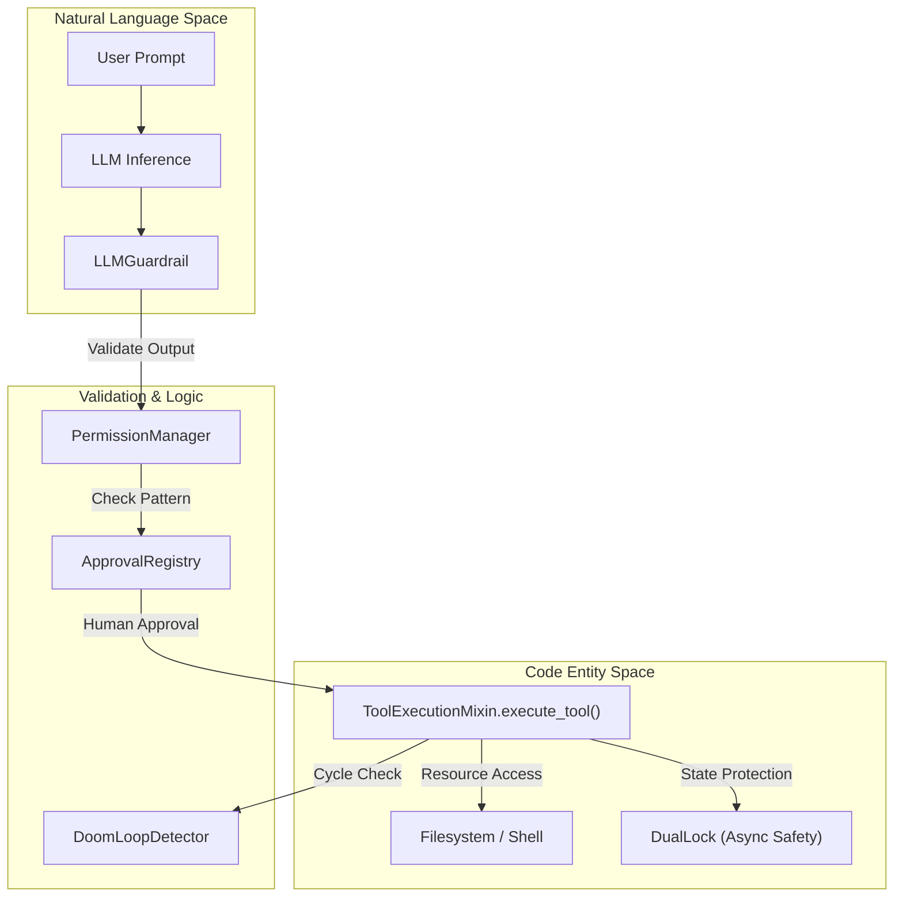
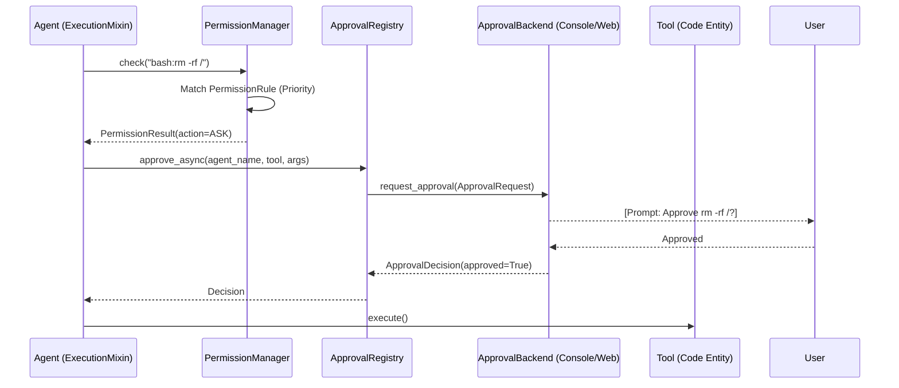

<!-- source: DeepWiki mcp.deepwiki.com · repo MervinPraison/PraisonAI · page 6 Safety and Validation · fetched 2026-10-26 -->

# Safety and Validation

Relevant source files

The following files were used as context for generating this wiki page:

- [src/praisonai-agents/praisonaiagents/agent/async_memory_mixin.py](src/praisonai-agents/praisonaiagents/agent/async_memory_mixin.py)
- [src/praisonai-agents/praisonaiagents/agent/async_safety.py](src/praisonai-agents/praisonaiagents/agent/async_safety.py)
- [src/praisonai-agents/praisonaiagents/agent/deep_research_agent.py](src/praisonai-agents/praisonaiagents/agent/deep_research_agent.py)
- [src/praisonai-agents/praisonaiagents/agent/realtime_agent.py](src/praisonai-agents/praisonaiagents/agent/realtime_agent.py)
- [src/praisonai-agents/praisonaiagents/agents/delegator.py](src/praisonai-agents/praisonaiagents/agents/delegator.py)
- [src/praisonai-agents/praisonaiagents/approval/__init__.py](src/praisonai-agents/praisonaiagents/approval/__init__.py)
- [src/praisonai-agents/praisonaiagents/approval/backends.py](src/praisonai-agents/praisonaiagents/approval/backends.py)
- [src/praisonai-agents/praisonaiagents/approval/protocols.py](src/praisonai-agents/praisonaiagents/approval/protocols.py)
- [src/praisonai-agents/praisonaiagents/approval/registry.py](src/praisonai-agents/praisonaiagents/approval/registry.py)
- [src/praisonai-agents/praisonaiagents/approval/utils.py](src/praisonai-agents/praisonaiagents/approval/utils.py)
- [src/praisonai-agents/praisonaiagents/context/aggregator.py](src/praisonai-agents/praisonaiagents/context/aggregator.py)
- [src/praisonai-agents/praisonaiagents/context/fast/parallel_executor.py](src/praisonai-agents/praisonaiagents/context/fast/parallel_executor.py)
- [src/praisonai-agents/praisonaiagents/guardrails/__init__.py](src/praisonai-agents/praisonaiagents/guardrails/__init__.py)
- [src/praisonai-agents/praisonaiagents/guardrails/chain.py](src/praisonai-agents/praisonaiagents/guardrails/chain.py)
- [src/praisonai-agents/praisonaiagents/guardrails/llm_guardrail.py](src/praisonai-agents/praisonaiagents/guardrails/llm_guardrail.py)
- [src/praisonai-agents/praisonaiagents/guardrails/protocols.py](src/praisonai-agents/praisonaiagents/guardrails/protocols.py)
- [src/praisonai-agents/praisonaiagents/knowledge/indexing.py](src/praisonai-agents/praisonaiagents/knowledge/indexing.py)
- [src/praisonai-agents/praisonaiagents/permissions/__init__.py](src/praisonai-agents/praisonaiagents/permissions/__init__.py)
- [src/praisonai-agents/praisonaiagents/permissions/arity.py](src/praisonai-agents/praisonaiagents/permissions/arity.py)
- [src/praisonai-agents/praisonaiagents/permissions/command_parser.py](src/praisonai-agents/praisonaiagents/permissions/command_parser.py)
- [src/praisonai-agents/praisonaiagents/permissions/doom_loop.py](src/praisonai-agents/praisonaiagents/permissions/doom_loop.py)
- [src/praisonai-agents/praisonaiagents/permissions/manager.py](src/praisonai-agents/praisonaiagents/permissions/manager.py)
- [src/praisonai-agents/praisonaiagents/permissions/rules.py](src/praisonai-agents/praisonaiagents/permissions/rules.py)
- [src/praisonai-agents/praisonaiagents/tools/exa_tools.py](src/praisonai-agents/praisonaiagents/tools/exa_tools.py)
- [src/praisonai-agents/praisonaiagents/tools/path_safety.py](src/praisonai-agents/praisonaiagents/tools/path_safety.py)
- [src/praisonai-agents/test_architectural_fixes.py](src/praisonai-agents/test_architectural_fixes.py)
- [src/praisonai-agents/tests/integration/test_memory_prefetch_real.py](src/praisonai-agents/tests/integration/test_memory_prefetch_real.py)
- [src/praisonai-agents/tests/unit/agent/test_agent_clone.py](src/praisonai-agents/tests/unit/agent/test_agent_clone.py)
- [src/praisonai-agents/tests/unit/approval/test_scoped_approval.py](src/praisonai-agents/tests/unit/approval/test_scoped_approval.py)
- [src/praisonai-agents/tests/unit/context/test_aggregator.py](src/praisonai-agents/tests/unit/context/test_aggregator.py)
- [src/praisonai-agents/tests/unit/memory/test_prefetch.py](src/praisonai-agents/tests/unit/memory/test_prefetch.py)
- [src/praisonai-agents/tests/unit/permissions/test_arity.py](src/praisonai-agents/tests/unit/permissions/test_arity.py)
- [src/praisonai-agents/tests/unit/permissions/test_command_aware.py](src/praisonai-agents/tests/unit/permissions/test_command_aware.py)
- [src/praisonai-agents/tests/unit/permissions/test_permissions.py](src/praisonai-agents/tests/unit/permissions/test_permissions.py)
- [src/praisonai-agents/tests/unit/permissions/test_secret_read_gate.py](src/praisonai-agents/tests/unit/permissions/test_secret_read_gate.py)
- [src/praisonai-agents/tests/unit/permissions/test_workspace_boundary.py](src/praisonai-agents/tests/unit/permissions/test_workspace_boundary.py)
- [src/praisonai-agents/tests/unit/test_approval_protocol.py](src/praisonai-agents/tests/unit/test_approval_protocol.py)
- [src/praisonai-agents/tests/unit/test_rate_limiter.py](src/praisonai-agents/tests/unit/test_rate_limiter.py)
- [src/praisonai/praisonai/cli/approval_backend.py](src/praisonai/praisonai/cli/approval_backend.py)
- [src/praisonai/praisonai/cli/features/approval.py](src/praisonai/praisonai/cli/features/approval.py)

This page documents PraisonAI's safety and validation mechanisms that ensure agent reliability, security, and compliance. The framework implements multiple layers of protection across the execution pipeline, including guardrails, human-in-the-loop approvals, and a robust permissions engine.

## Overview

PraisonAI provides five complementary safety systems:

| System | Purpose | Configuration Level | Page Reference |
|--------|---------|---------------------|----------------|
| **Guardrails** | Input/output validation using function-based or LLM-based rules | Agent, Task | [Guardrails](#6.1) |
| **Human Approval** | Require human confirmation for dangerous tool operations | Tool, Global | [Human Approval System](#6.2) |
| **Permissions** | Pattern-based allow/deny rules for tools and resources | Agent, Global | [Permissions and Policy Engine](#6.3) |
| **Policy Engine** | Declarative allow/deny rules for resources and actions | Global, Agent | [Permissions and Policy Engine](#6.3) |
| **Quality Assessment** | Score and filter outputs based on quality metrics | Task, Memory | Section below |

Additional validation systems include:
- **Model Capability Validation**: Ensure LLMs support required features (e.g., tool calling, structured outputs) before use.
- **Workspace Boundaries**: Enforcement of file and shell access limits relative to a project root.
- **Doom Loop Detection**: Prevention of runaway agent cycles through the `DoomLoopDetector`.

Sources: [src/praisonai-agents/praisonaiagents/permissions/manager.py:1-6](), [src/praisonai-agents/praisonaiagents/approval/registry.py:64-90](), [src/praisonai-agents/praisonaiagents/guardrails/llm_guardrail.py:1-6]()

## Safety Architecture

### Multi-Layer Protection System

PraisonAI implements safety at multiple layers, bridging Natural Language Space (LLM outputs) to Code Entity Space (Tool execution and Filesystem).

**Title: Safety Architecture Layers**

**Title: Execution Safety Sequence**

Sources: [src/praisonai-agents/praisonaiagents/permissions/manager.py:25-54](), [src/praisonai-agents/praisonaiagents/approval/registry.py:92-149](), [src/praisonai-agents/praisonaiagents/agent/async_safety.py:15-37]()

## Guardrails System

Guardrails validate task outputs to ensure they meet quality and safety requirements. The system supports function-based validation and LLM-powered reasoning via `LLMGuardrail` [src/praisonai-agents/praisonaiagents/guardrails/llm_guardrail.py:14-20]().

- **LLM-based**: Uses natural language descriptions to evaluate if an output meets specific criteria (e.g., "Ensure no PII is present").
- **Fail-Closed**: By default, if a guardrail cannot validate (e.g., LLM error), it blocks the output for safety [src/praisonai-agents/praisonaiagents/guardrails/llm_guardrail.py:91-97]().
- **Retry Mechanism**: Failed validations can trigger task retries with feedback.

For detailed guardrail implementation and protocols, see [Guardrails](#6.1).

Sources: [src/praisonai-agents/praisonaiagents/guardrails/llm_guardrail.py:99-112](), [src/praisonai-agents/praisonaiagents/guardrails/protocols.py:1-20]()

## Human Approval System

The human approval system provides human-in-the-loop control for dangerous operations. Tools are classified by risk level in the `ApprovalRegistry` [src/praisonai-agents/praisonaiagents/approval/registry.py:30-48]().

- **Risk Levels**: Tools like `execute_command` are marked as `critical`, while `write_file` is `high` [src/praisonai-agents/praisonaiagents/approval/registry.py:30-48]().
- **Backends**: Supports `ConsoleBackend`, `AutoApproveBackend`, and `CallbackBackend` for different environments [src/praisonai-agents/praisonaiagents/approval/__init__.py:47]().
- **Scoped Approvals**: Users can grant "Always" permissions for specific paths or commands during a session [src/praisonai-agents/praisonaiagents/approval/utils.py:67-96]().

For details on approval backends and the registry, see [Human Approval System](#6.2).

Sources: [src/praisonai-agents/praisonaiagents/approval/registry.py:152-162](), [src/praisonai-agents/praisonaiagents/approval/utils.py:17-32]()

## Permissions and Policy Engine

The `PermissionManager` handles fine-grained access control using glob or regex patterns [src/praisonai-agents/praisonaiagents/permissions/rules.py:93-116]().

- **Workspace Boundaries**: When a `workspace_root` is set, the system detects and gates any file or shell operations attempting to escape that directory [src/praisonai-agents/praisonaiagents/permissions/manager.py:70-82]().
- **Command Parsing**: The `ShellOp` parser decomposes compound shell commands (e.g., `&&`, `|`) to ensure hidden sub-commands are validated against rules [src/praisonai-agents/praisonaiagents/permissions/command_parser.py:106-116]().
- **Presets**: Built-in permission sets like `safe`, `read_only`, and `default` simplify security configuration [src/praisonai-agents/praisonaiagents/approval/registry.py:76-90]().

For details on rule priority, workspace enforcement, and the policy engine, see [Permissions and Policy Engine](#6.3).

Sources: [src/praisonai-agents/praisonaiagents/permissions/manager.py:252-270](), [src/praisonai-agents/praisonaiagents/permissions/command_parser.py:42-55](), [src/praisonai-agents/praisonaiagents/permissions/rules.py:16-21]()

## Concurrency and Async Safety

To ensure data integrity during parallel agent execution, PraisonAI uses specialized concurrency primitives:

- **DualLock**: A hybrid lock that automatically switches between `threading.RLock` and `asyncio.Lock` based on the execution context [src/praisonai-agents/praisonaiagents/agent/async_safety.py:15-37]().
- **AsyncSafeState**: Protects agent attributes (like `chat_history`) from race conditions during concurrent access or deepcopy operations [src/praisonai-agents/praisonaiagents/agent/async_safety.py:87-108]().
- **Deepcopy Isolation**: Cloned agents receive independent lock objects to prevent cross-agent deadlocks [src/praisonai-agents/tests/unit/agent/test_agent_clone.py:49-61]().

Sources: [src/praisonai-agents/praisonaiagents/agent/async_safety.py:117-139](), [src/praisonai-agents/tests/unit/agent/test_agent_clone.py:100-111]()

## Model Capability Validation

PraisonAI validates model capabilities before attempting operations to prevent runtime errors. The system uses LiteLLM's capability detection functions as the primary source.

### Capability Checks

The `model_capabilities` module provides capability detection functions:

| Function | Purpose | Example Use |
|----------|---------|-------------|
| `supports_structured_outputs()` | Check JSON schema support | Validate before `output_pydantic` |
| `supports_function_calling()` | Check tool calling support | Validate before passing tools |
| `supports_web_search()` | Check native web search | Enable search without external tools |

Sources: [src/praisonai-agents/praisonaiagents/llm/model_capabilities.py:1-312]()

## AutoAgents Configuration Validation

The `AutoAgents` class validates auto-generated agent configurations before execution to prevent malformed setups. It checks for required task fields and ensures generated tools match agent capabilities [src/praisonai-agents/praisonaiagents/agents/autoagents.py:245-272]().

Sources: [src/praisonai-agents/praisonaiagents/agents/autoagents.py:452-511]()

---

