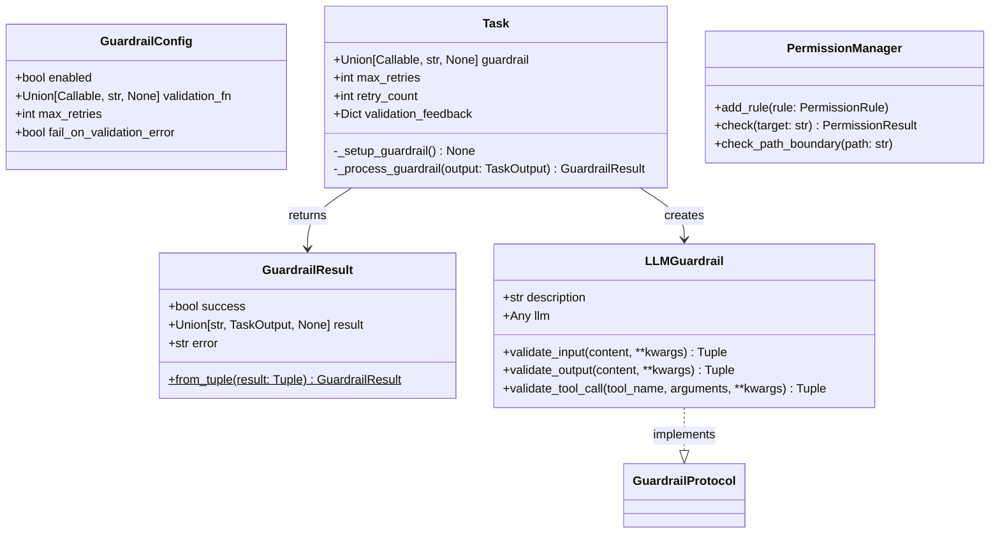
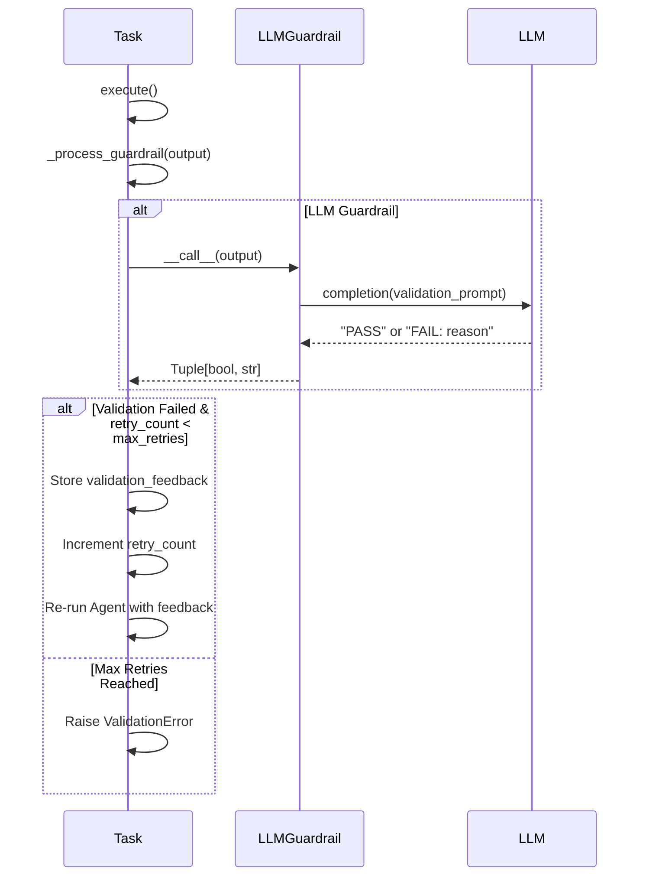

<!-- source: DeepWiki mcp.deepwiki.com · repo MervinPraison/PraisonAI · page 6.1 Guardrails · fetched 2026-10-26 -->

# Guardrails

<details>
<summary>Relevant source files</summary>

The following files were used as context for generating this wiki page:

- [examples/python/general/human_approval_example.py](examples/python/general/human_approval_example.py)
- [src/praisonai-agents/praisonaiagents/agent/async_memory_mixin.py](src/praisonai-agents/praisonaiagents/agent/async_memory_mixin.py)
- [src/praisonai-agents/praisonaiagents/agent/async_safety.py](src/praisonai-agents/praisonaiagents/agent/async_safety.py)
- [src/praisonai-agents/praisonaiagents/agents/delegator.py](src/praisonai-agents/praisonaiagents/agents/delegator.py)
- [src/praisonai-agents/praisonaiagents/guardrails/__init__.py](src/praisonai-agents/praisonaiagents/guardrails/__init__.py)
- [src/praisonai-agents/praisonaiagents/guardrails/chain.py](src/praisonai-agents/praisonaiagents/guardrails/chain.py)
- [src/praisonai-agents/praisonaiagents/guardrails/llm_guardrail.py](src/praisonai-agents/praisonaiagents/guardrails/llm_guardrail.py)
- [src/praisonai-agents/praisonaiagents/guardrails/protocols.py](src/praisonai-agents/praisonaiagents/guardrails/protocols.py)
- [src/praisonai-agents/praisonaiagents/knowledge/indexing.py](src/praisonai-agents/praisonaiagents/knowledge/indexing.py)
- [src/praisonai-agents/praisonaiagents/permissions/__init__.py](src/praisonai-agents/praisonaiagents/permissions/__init__.py)
- [src/praisonai-agents/praisonaiagents/permissions/arity.py](src/praisonai-agents/praisonaiagents/permissions/arity.py)
- [src/praisonai-agents/praisonaiagents/permissions/command_parser.py](src/praisonai-agents/praisonaiagents/permissions/command_parser.py)
- [src/praisonai-agents/praisonaiagents/permissions/manager.py](src/praisonai-agents/praisonaiagents/permissions/manager.py)
- [src/praisonai-agents/praisonaiagents/permissions/rules.py](src/praisonai-agents/praisonaiagents/permissions/rules.py)
- [src/praisonai-agents/praisonaiagents/tools/path_safety.py](src/praisonai-agents/praisonaiagents/tools/path_safety.py)
- [src/praisonai-agents/test_architectural_fixes.py](src/praisonai-agents/test_architectural_fixes.py)
- [src/praisonai-agents/tests/integration/test_memory_prefetch_real.py](src/praisonai-agents/tests/integration/test_memory_prefetch_real.py)
- [src/praisonai-agents/tests/unit/agent/test_agent_clone.py](src/praisonai-agents/tests/unit/agent/test_agent_clone.py)
- [src/praisonai-agents/tests/unit/memory/test_prefetch.py](src/praisonai-agents/tests/unit/memory/test_prefetch.py)
- [src/praisonai-agents/tests/unit/permissions/test_arity.py](src/praisonai-agents/tests/unit/permissions/test_arity.py)
- [src/praisonai-agents/tests/unit/permissions/test_command_aware.py](src/praisonai-agents/tests/unit/permissions/test_command_aware.py)
- [src/praisonai-agents/tests/unit/permissions/test_permissions.py](src/praisonai-agents/tests/unit/permissions/test_permissions.py)
- [src/praisonai-agents/tests/unit/permissions/test_secret_read_gate.py](src/praisonai-agents/tests/unit/permissions/test_secret_read_gate.py)
- [src/praisonai-agents/tests/unit/permissions/test_workspace_boundary.py](src/praisonai-agents/tests/unit/permissions/test_workspace_boundary.py)
- [src/praisonai-agents/tests/unit/test_rate_limiter.py](src/praisonai-agents/tests/unit/test_rate_limiter.py)
- [src/praisonai/tests/unit/test_agents_generator_sync_async_parity.py](src/praisonai/tests/unit/test_agents_generator_sync_async_parity.py)
- [src/praisonai/tests/unit/test_approval_agent_integration.py](src/praisonai/tests/unit/test_approval_agent_integration.py)
- [src/praisonai/tests/unit/test_approval_basic.py](src/praisonai/tests/unit/test_approval_basic.py)
- [src/praisonai/tests/unit/test_approval_interactive.py](src/praisonai/tests/unit/test_approval_interactive.py)
- [src/praisonai/tests/unit/test_decorator_enforcement.py](src/praisonai/tests/unit/test_decorator_enforcement.py)
- [src/praisonai/tests/unit/test_decorator_simple.py](src/praisonai/tests/unit/test_decorator_simple.py)
- [src/praisonai/tests/unit/test_graph_memory.py](src/praisonai/tests/unit/test_graph_memory.py)
- [src/praisonai/tests/unit/test_ollama_fix.py](src/praisonai/tests/unit/test_ollama_fix.py)
- [src/praisonai/tests/unit/test_security_fixes_core.py](src/praisonai/tests/unit/test_security_fixes_core.py)
- [src/praisonai/tests/unit/test_serve_unified.py](src/praisonai/tests/unit/test_serve_unified.py)

</details>


## Purpose and Scope

The guardrails system provides input/output validation and safety checks for agent and task executions in PraisonAI. Guardrails automatically validate LLM-generated outputs against custom criteria, with configurable retry logic when validation fails. The system supports function-based validation (Python callables), LLM-based validation (natural language criteria via `LLMGuardrail`), and preset validation rules.

Guardrails are part of PraisonAI's broader safety and control architecture, which includes:
- **Guardrails** (this page) - Input/output validation.
- **Human Approval System** (page 6.2) - Human-in-the-loop gates for tool execution [praisonaiagents/approval/backends.py:1-120]().
- **Permissions and Policy Engine** (page 6.3) - Pattern-based rules for shell and file access [praisonaiagents/permissions/manager.py:25-54]().
- **Loop Detection** (page 3.5) - Detection of repeated failures or actions [praisonaiagents/permissions/doom_loop.py:1-100]().

---

## Guardrail Types

PraisonAI supports three primary types of guardrails:

### Function-Based Guardrails
Custom Python functions that validate `TaskOutput` objects. Functions must accept exactly one parameter (the `TaskOutput`) and return either a `GuardrailResult` or `Tuple[bool, Any]`.

**Function Signature Requirements:**
- Single parameter of type `TaskOutput`.
- Return type: `GuardrailResult` or `Tuple[bool, Any]`.
- Return tuple format: `(success: bool, result_or_error: Any)`.

Sources: [praisonaiagents/task/task.py:162-215](), [praisonaiagents/guardrails/guardrail_result.py:13-43]()

### LLM-Based Guardrails
Natural language descriptions of validation criteria. The system creates an `LLMGuardrail` instance that uses an LLM to evaluate outputs against the description.

**Activation:** Provide a string description instead of a callable function to a `Task`:
```python
guardrails="Ensure the response is professional and between 100-500 characters"
```
The `LLMGuardrail` class constructs a validation prompt and interprets the LLM's response. It implements `GuardrailProtocol` for `validate_input`, `validate_output`, and `validate_tool_call` [praisonaiagents/guardrails/llm_guardrail.py:156-200]().

Sources: [praisonaiagents/guardrails/llm_guardrail.py:14-130](), [praisonaiagents/task/task.py:206-213]()

### Preset Guardrails
Built-in validation presets activated by string identifiers:
- `"permissive"` - Minimal validation.
- `"safety"` - Content safety checks.
- `"strict"` - Comprehensive validation.

Presets are resolved during agent initialization [praisonaiagents/agent/agent.py]().

---

## Architecture

### Guardrail Class Structure



**Key Code Entities:**
- `GuardrailResult`: Structured validation result with success status, result, and error message [praisonaiagents/guardrails/guardrail_result.py:13-43]().
- `LLMGuardrail`: LLM-powered guardrail that validates using natural language [praisonaiagents/guardrails/llm_guardrail.py:14-31]().
- `PermissionManager`: Manages rules for sensitive operations like shell commands [praisonaiagents/permissions/manager.py:25-54]().
- `GuardrailProtocol`: Interface defining `validate_input`, `validate_output`, and `validate_tool_call` [praisonaiagents/guardrails/protocols.py]().

Sources: [praisonaiagents/guardrails/llm_guardrail.py:14-130](), [praisonaiagents/permissions/manager.py:25-54](), [praisonaiagents/guardrails/guardrail_result.py:13-43]()

### Validation Flow with Retry Logic



**Key Methods:**
- `Task._process_guardrail(output)`: Executes the stored guardrail function and converts results to `GuardrailResult` [praisonaiagents/task/task.py:240-350]().
- `LLMGuardrail._llm_validate(content, description)`: Internal helper that formats the QA prompt for the LLM [praisonaiagents/guardrails/llm_guardrail.py:99-130]().

Sources: [praisonaiagents/task/task.py:240-350](), [praisonaiagents/guardrails/llm_guardrail.py:99-130]()

---

## Safety and Permissions Integration

Guardrails in PraisonAI often work alongside the `PermissionManager` to ensure system safety.

### Permission Modes
The system supports several `PermissionMode` presets (Claude Code parity) that control execution autonomy [praisonaiagents/permissions/rules.py:24-41]():
- `DEFAULT`: Standard checking (allow/deny/ask).
- `ACCEPT_EDITS`: Auto-accept file edits.
- `DONT_ASK`: Auto-deny prompts requiring user input.
- `BYPASS`: Skip all checks (dangerous).
- `PLAN`: Read-only exploration.

### Workspace Boundaries
The `PermissionManager` enforces a `workspace_root`. Any shell or file target resolving outside this root triggers an `external_dir` approval request [praisonaiagents/permissions/manager.py:70-82]().

```python
manager = PermissionManager(workspace_root="/path/to/project")
result = manager.check("bash:cat /etc/passwd") 
# result.needs_approval will be True because /etc/passwd is outside workspace_root
```

Sources: [praisonaiagents/permissions/manager.py:61-82](), [praisonaiagents/permissions/rules.py:24-41](), [praisonaiagents/tools/path_safety.py]()

### Doom Loop Detection
The `DoomLoopDetector` (integrated into `PermissionManager`) tracks repeated actions or failures to prevent infinite agent loops [praisonaiagents/permissions/manager.py:86](). It categorizes loops into:
- `REPEATED_ACTION`: Same tool/args called multiple times.
- `REPEATED_FAILURE`: Tool failing repeatedly with same error.
- `NO_PROGRESS`: LLM output showing no movement toward goal.

Sources: [praisonaiagents/permissions/doom_loop.py:1-50](), [praisonaiagents/permissions/manager.py:86]()

---

## Implementation Details

### LLM Guardrail Fail-Closed Behavior
The `LLMGuardrail` implementation follows a **fail-closed** contract. If no LLM is available or an unsupported LLM type is provided, the guardrail blocks the output rather than rubber-stamping it [praisonaiagents/guardrails/llm_guardrail.py:91-97](), [praisonaiagents/guardrails/llm_guardrail.py:125-132]().

### Shell Command Parsing
For shell-based safety, PraisonAI uses a `ShellOp` parser that decomposes compound commands (e.g., `&&`, `||`, `|`) into constituent parts to check each one against permission rules [praisonaiagents/permissions/command_parser.py:106-117](). It also detects `_UNSAFE_EXPANSION_RE` (like `${VAR}`) which could be used to evade static filters [praisonaiagents/permissions/command_parser.py:39-55]().

Sources: [praisonaiagents/guardrails/llm_guardrail.py:91-132](), [praisonaiagents/permissions/command_parser.py:24-55](), [praisonaiagents/permissions/command_parser.py:106-117]()

### Guardrail Result Models

| Model | Description |
| :--- | :--- |
| `GuardrailResult` | The standard container for validation outcomes [praisonaiagents/guardrails/guardrail_result.py:13](). |
| `PermissionResult` | Result of a permission check including the matching rule and target [praisonaiagents/permissions/rules.py:192-203](). |
| `PersistentApproval` | Stores user decisions for a specific target/scope [praisonaiagents/permissions/rules.py:236-250](). |

Sources: [praisonaiagents/guardrails/guardrail_result.py:13-43](), [praisonaiagents/permissions/rules.py:192-250]()

---

