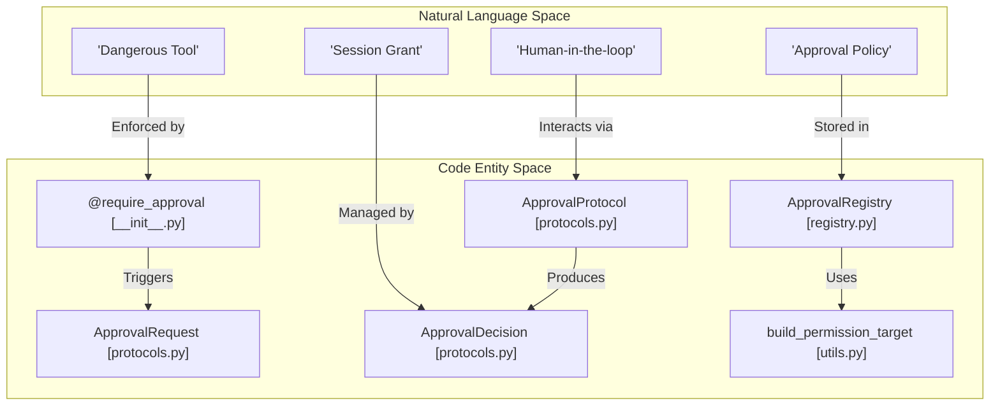
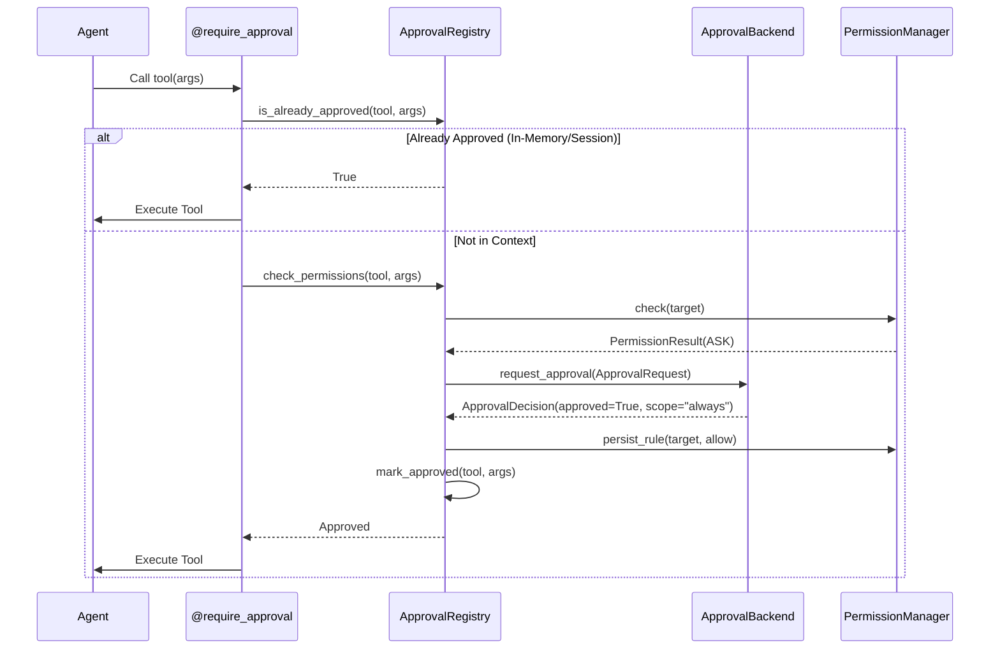

<!-- source: DeepWiki mcp.deepwiki.com · repo MervinPraison/PraisonAI · page 6.2 Human Approval System · fetched 2026-10-26 -->

# Human Approval System

<details>
<summary>Relevant source files</summary>

The following files were used as context for generating this wiki page:

- [examples/python/general/human_approval_example.py](examples/python/general/human_approval_example.py)
- [src/praisonai-agents/praisonaiagents/agent/deep_research_agent.py](src/praisonai-agents/praisonaiagents/agent/deep_research_agent.py)
- [src/praisonai-agents/praisonaiagents/agent/realtime_agent.py](src/praisonai-agents/praisonaiagents/agent/realtime_agent.py)
- [src/praisonai-agents/praisonaiagents/approval/__init__.py](src/praisonai-agents/praisonaiagents/approval/__init__.py)
- [src/praisonai-agents/praisonaiagents/approval/backends.py](src/praisonai-agents/praisonaiagents/approval/backends.py)
- [src/praisonai-agents/praisonaiagents/approval/protocols.py](src/praisonai-agents/praisonaiagents/approval/protocols.py)
- [src/praisonai-agents/praisonaiagents/approval/registry.py](src/praisonai-agents/praisonaiagents/approval/registry.py)
- [src/praisonai-agents/praisonaiagents/approval/utils.py](src/praisonai-agents/praisonaiagents/approval/utils.py)
- [src/praisonai-agents/praisonaiagents/context/aggregator.py](src/praisonai-agents/praisonaiagents/context/aggregator.py)
- [src/praisonai-agents/praisonaiagents/context/fast/parallel_executor.py](src/praisonai-agents/praisonaiagents/context/fast/parallel_executor.py)
- [src/praisonai-agents/praisonaiagents/permissions/doom_loop.py](src/praisonai-agents/praisonaiagents/permissions/doom_loop.py)
- [src/praisonai-agents/praisonaiagents/tools/exa_tools.py](src/praisonai-agents/praisonaiagents/tools/exa_tools.py)
- [src/praisonai-agents/tests/unit/approval/test_scoped_approval.py](src/praisonai-agents/tests/unit/approval/test_scoped_approval.py)
- [src/praisonai-agents/tests/unit/context/test_aggregator.py](src/praisonai-agents/tests/unit/context/test_aggregator.py)
- [src/praisonai-agents/tests/unit/test_approval_protocol.py](src/praisonai-agents/tests/unit/test_approval_protocol.py)
- [src/praisonai/praisonai/cli/approval_backend.py](src/praisonai/praisonai/cli/approval_backend.py)
- [src/praisonai/praisonai/cli/features/approval.py](src/praisonai/praisonai/cli/features/approval.py)
- [src/praisonai/tests/unit/test_agents_generator_sync_async_parity.py](src/praisonai/tests/unit/test_agents_generator_sync_async_parity.py)
- [src/praisonai/tests/unit/test_approval_agent_integration.py](src/praisonai/tests/unit/test_approval_agent_integration.py)
- [src/praisonai/tests/unit/test_approval_basic.py](src/praisonai/tests/unit/test_approval_basic.py)
- [src/praisonai/tests/unit/test_approval_interactive.py](src/praisonai/tests/unit/test_approval_interactive.py)
- [src/praisonai/tests/unit/test_decorator_enforcement.py](src/praisonai/tests/unit/test_decorator_enforcement.py)
- [src/praisonai/tests/unit/test_decorator_simple.py](src/praisonai/tests/unit/test_decorator_simple.py)
- [src/praisonai/tests/unit/test_graph_memory.py](src/praisonai/tests/unit/test_graph_memory.py)
- [src/praisonai/tests/unit/test_ollama_fix.py](src/praisonai/tests/unit/test_ollama_fix.py)
- [src/praisonai/tests/unit/test_security_fixes_core.py](src/praisonai/tests/unit/test_security_fixes_core.py)
- [src/praisonai/tests/unit/test_serve_unified.py](src/praisonai/tests/unit/test_serve_unified.py)

</details>


The Human Approval System provides a human-in-the-loop safety mechanism for controlling the execution of potentially dangerous tools in PraisonAI agents. It implements a protocol-driven architecture that classifies tools by risk, manages per-agent approval backends, and supports scoped decisions (once, session, or always).

For information about general safety features and output validation, see [Guardrails](#6.1). For declarative permissions, see [Permissions and Policy Engine](#6.3).

## System Architecture

The approval system is centered around the `ApprovalRegistry`, a singleton that manages backends, tool requirements, and active approval contexts.

### Approval Entity Mapping
This diagram maps high-level concepts to the specific code entities implementing them.


**Sources:** [src/praisonai-agents/praisonaiagents/approval/registry.py:92-150](), [src/praisonai-agents/praisonaiagents/approval/protocols.py:22-78](), [src/praisonai-agents/praisonaiagents/approval/utils.py:67-114]()

## Core Components

### ApprovalRegistry
The `ApprovalRegistry` centralizes approval state. It supports global backends and per-agent overrides, allowing a "bot-agent" to use a Slack backend while a CLI agent uses the console [src/praisonai-agents/praisonaiagents/approval/registry.py:4-15]().

- **Tool Requirements**: Maintains a set of tools that trigger approval (e.g., `execute_command`, `write_file`) [src/praisonai-agents/praisonaiagents/approval/registry.py:30-48]().
- **Risk Levels**: Maps tools to `critical`, `high`, `medium`, or `low` risk [src/praisonai-agents/praisonaiagents/approval/registry.py:109-110]().
- **Context Management**: Uses `contextvars` to track approved tools within a specific coroutine or thread to prevent redundant prompts [src/praisonai-agents/praisonaiagents/approval/registry.py:128-133]().

### Approval Protocols and Data Models
The system uses `dataclasses` to ensure type-safe communication between agents and backends.

| Class | Purpose | Key Attributes |
|-------|---------|----------------|
| `ApprovalRequest` | Immutable request for tool execution | `tool_name`, `arguments`, `risk_level`, `approval_id` |
| `ApprovalDecision` | Result of an approval request | `approved`, `modified_args`, `scope`, `scope_pattern` |
| `ApprovalConfig` | Per-agent configuration | `backend`, `all_tools`, `timeout`, `permissions` |

**Sources:** [src/praisonai-agents/praisonaiagents/approval/protocols.py:22-116]()

## Scoped Approvals and Persistence

Approvals can be granted with different scopes, managed by `ApprovalDecision.scope` [src/praisonai-agents/praisonaiagents/approval/protocols.py:56-63]():

1.  **once** (Default): Applies only to the current tool call.
2.  **session**: Auto-approves matching calls for the remainder of the process run.
3.  **always**: Persists an allow-rule to disk via `PermissionManager` so future runs do not re-ask.

### Permission Target Resolution
The `build_permission_target` utility maps tool calls to canonical strings for matching and scoping [src/praisonai-agents/praisonaiagents/approval/utils.py:67-78]().

| Tool Category | Example Tool | Resulting Target |
|---------------|--------------|------------------|
| Shell Tools   | `execute_command` | `bash:git status` |
| File Tools    | `edit_file` | `edit:src/app.py` |
| Other Tools   | `scrape_page` | `tool:scrape_page` |

**Sources:** [src/praisonai-agents/praisonaiagents/approval/utils.py:99-114](), [src/praisonai-agents/tests/unit/approval/test_scoped_approval.py:44-90]()

## Approval Backends

Backends implement the `ApprovalProtocol` to handle the actual human interaction [src/praisonai-agents/praisonaiagents/approval/protocols.py:119-147]().

- **ConsoleBackend**: Uses `rich` to provide interactive CLI prompts. It supports argument truncation and keyboard interrupts [src/praisonai-agents/praisonaiagents/approval/__init__.py:158-167]().
- **AutoApproveBackend**: Automatically approves all requests. Used for CI/CD and non-interactive environments [src/praisonai-agents/praisonaiagents/approval/backends.py]().
- **CallbackBackend**: Wraps legacy function-based callbacks into the new protocol [src/praisonai-agents/praisonaiagents/approval/__init__.py:82-94]().

## Dangerous Tool Gates

The system includes a `DEFAULT_DANGEROUS_TOOLS` registry that defines the baseline safety posture [src/praisonai-agents/praisonaiagents/approval/registry.py:30-48]().

### Runaway Safety (Doom Loop)
A specialized internal target `__doom_loop__` is registered at `critical` risk. If the `DoomLoopDetector` triggers, the system routes the safety gate through the approval pipeline rather than a hard block, allowing humans to authorize legitimate repeated actions (e.g., polling) [src/praisonai-agents/praisonaiagents/approval/registry.py:50-62]().

### Permission Presets
Users can configure safety postures via the `approval` parameter in `Agent` or the `PRAISONAI_TOOL_SAFETY` environment variable [src/praisonai-agents/praisonaiagents/approval/registry.py:64-90]().

| Preset | Behavior |
|--------|----------|
| `default` | Blocks `delete`, `move`, `copy`, and shell/code execution. |
| `safe` | Blocks all tools in `DEFAULT_DANGEROUS_TOOLS` (Read-only). |
| `full` / `off` | No restrictions; trusts the LLM completely. |

**Sources:** [src/praisonai-agents/praisonaiagents/approval/registry.py:76-90]()

## Data Flow: Tool Execution with Approval

This sequence shows how the `@require_approval` decorator interacts with the registry and backends.


**Sources:** [src/praisonai-agents/praisonaiagents/approval/__init__.py:184-216](), [src/praisonai-agents/praisonaiagents/approval/registry.py:284-330](), [src/praisonai-agents/tests/unit/approval/test_scoped_approval.py:126-177]()

## Implementation Details

### Argument Hashing
To prevent "sticky cache" bypasses where approving `rm file1` might unlock `rm file2`, the registry uses `hash_tool_args`. This produces a 16-character SHA-256 digest of the canonical JSON-encoded arguments [src/praisonai-agents/praisonaiagents/approval/utils.py:17-32]().

### Async/Sync Bridge
The `run_coroutine_safely` utility handles the complexity of executing async approval backends (like Webhooks) from synchronous tool calls, using a `ThreadPoolExecutor` when an event loop is already running to avoid `RuntimeError` [src/praisonai-agents/praisonaiagents/approval/utils.py:117-169]().

### Usage Example
```python
from praisonaiagents.approval import get_approval_registry, AutoApproveBackend

# Set a global backend
registry = get_approval_registry()
registry.set_backend(AutoApproveBackend())

# Set a specific backend for one agent
registry.set_backend(ConsoleBackend(), agent_name="researcher")
```
**Sources:** [src/praisonai-agents/praisonaiagents/approval/registry.py:9-15](), [src/praisonai-agents/praisonaiagents/approval/__init__.py:8-28]()

---

