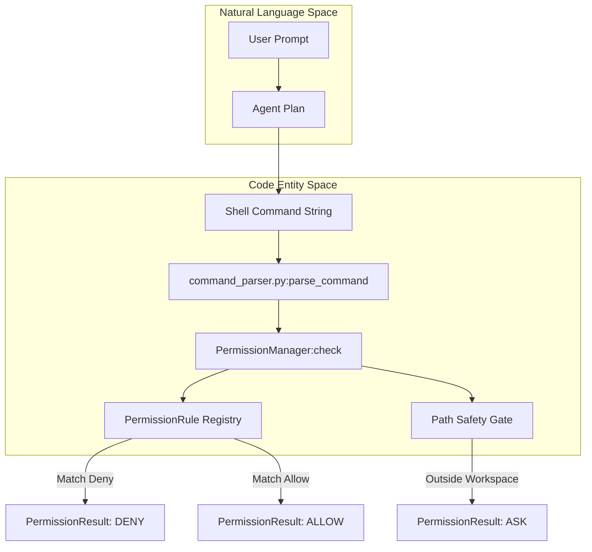
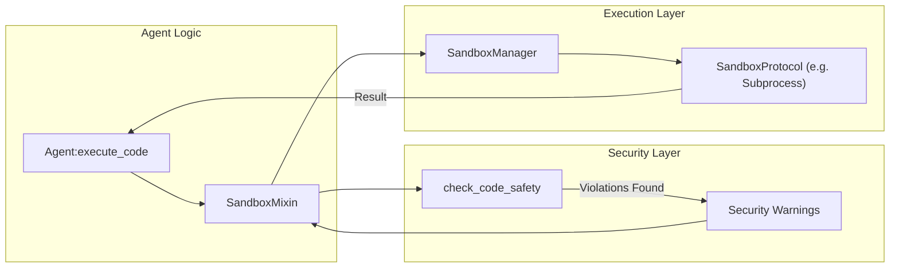

<!-- source: DeepWiki mcp.deepwiki.com · repo MervinPraison/PraisonAI · page 6.3 Permissions and Policy Engine · fetched 2026-10-26 -->

# Permissions and Policy Engine

Relevant source files

The following files were used as context for generating this wiki page:

- [examples/python/sandbox_remote.py](examples/python/sandbox_remote.py)
- [src/praisonai-agents/praisonaiagents/agent/async_memory_mixin.py](src/praisonai-agents/praisonaiagents/agent/async_memory_mixin.py)
- [src/praisonai-agents/praisonaiagents/agent/async_safety.py](src/praisonai-agents/praisonaiagents/agent/async_safety.py)
- [src/praisonai-agents/praisonaiagents/agent/sandbox_mixin.py](src/praisonai-agents/praisonaiagents/agent/sandbox_mixin.py)
- [src/praisonai-agents/praisonaiagents/agents/delegator.py](src/praisonai-agents/praisonaiagents/agents/delegator.py)
- [src/praisonai-agents/praisonaiagents/guardrails/__init__.py](src/praisonai-agents/praisonaiagents/guardrails/__init__.py)
- [src/praisonai-agents/praisonaiagents/guardrails/chain.py](src/praisonai-agents/praisonaiagents/guardrails/chain.py)
- [src/praisonai-agents/praisonaiagents/guardrails/llm_guardrail.py](src/praisonai-agents/praisonaiagents/guardrails/llm_guardrail.py)
- [src/praisonai-agents/praisonaiagents/guardrails/protocols.py](src/praisonai-agents/praisonaiagents/guardrails/protocols.py)
- [src/praisonai-agents/praisonaiagents/knowledge/indexing.py](src/praisonai-agents/praisonaiagents/knowledge/indexing.py)
- [src/praisonai-agents/praisonaiagents/permissions/__init__.py](src/praisonai-agents/praisonaiagents/permissions/__init__.py)
- [src/praisonai-agents/praisonaiagents/permissions/arity.py](src/praisonai-agents/praisonaiagents/permissions/arity.py)
- [src/praisonai-agents/praisonaiagents/permissions/command_parser.py](src/praisonai-agents/praisonaiagents/permissions/command_parser.py)
- [src/praisonai-agents/praisonaiagents/permissions/manager.py](src/praisonai-agents/praisonaiagents/permissions/manager.py)
- [src/praisonai-agents/praisonaiagents/permissions/rules.py](src/praisonai-agents/praisonaiagents/permissions/rules.py)
- [src/praisonai-agents/praisonaiagents/sandbox/__init__.py](src/praisonai-agents/praisonaiagents/sandbox/__init__.py)
- [src/praisonai-agents/praisonaiagents/sandbox/config.py](src/praisonai-agents/praisonaiagents/sandbox/config.py)
- [src/praisonai-agents/praisonaiagents/sandbox/manager.py](src/praisonai-agents/praisonaiagents/sandbox/manager.py)
- [src/praisonai-agents/praisonaiagents/sandbox/protocols.py](src/praisonai-agents/praisonaiagents/sandbox/protocols.py)
- [src/praisonai-agents/praisonaiagents/sandbox/security.py](src/praisonai-agents/praisonaiagents/sandbox/security.py)
- [src/praisonai-agents/praisonaiagents/tools/path_safety.py](src/praisonai-agents/praisonaiagents/tools/path_safety.py)
- [src/praisonai-agents/praisonaiagents/tools/resolver.py](src/praisonai-agents/praisonaiagents/tools/resolver.py)
- [src/praisonai-agents/test_architectural_fixes.py](src/praisonai-agents/test_architectural_fixes.py)
- [src/praisonai-agents/tests/integration/test_memory_prefetch_real.py](src/praisonai-agents/tests/integration/test_memory_prefetch_real.py)
- [src/praisonai-agents/tests/unit/agent/test_agent_clone.py](src/praisonai-agents/tests/unit/agent/test_agent_clone.py)
- [src/praisonai-agents/tests/unit/memory/test_prefetch.py](src/praisonai-agents/tests/unit/memory/test_prefetch.py)
- [src/praisonai-agents/tests/unit/permissions/test_arity.py](src/praisonai-agents/tests/unit/permissions/test_arity.py)
- [src/praisonai-agents/tests/unit/permissions/test_command_aware.py](src/praisonai-agents/tests/unit/permissions/test_command_aware.py)
- [src/praisonai-agents/tests/unit/permissions/test_permissions.py](src/praisonai-agents/tests/unit/permissions/test_permissions.py)
- [src/praisonai-agents/tests/unit/permissions/test_secret_read_gate.py](src/praisonai-agents/tests/unit/permissions/test_secret_read_gate.py)
- [src/praisonai-agents/tests/unit/permissions/test_workspace_boundary.py](src/praisonai-agents/tests/unit/permissions/test_workspace_boundary.py)
- [src/praisonai-agents/tests/unit/plugins/test_plugins_enable.py](src/praisonai-agents/tests/unit/plugins/test_plugins_enable.py)
- [src/praisonai-agents/tests/unit/sandbox/__init__.py](src/praisonai-agents/tests/unit/sandbox/__init__.py)
- [src/praisonai-agents/tests/unit/sandbox/test_sandbox_manager.py](src/praisonai-agents/tests/unit/sandbox/test_sandbox_manager.py)
- [src/praisonai-agents/tests/unit/sandbox/test_sandbox_mixin.py](src/praisonai-agents/tests/unit/sandbox/test_sandbox_mixin.py)
- [src/praisonai-agents/tests/unit/sandbox/test_sandbox_wiring.py](src/praisonai-agents/tests/unit/sandbox/test_sandbox_wiring.py)
- [src/praisonai-agents/tests/unit/sandbox/test_security.py](src/praisonai-agents/tests/unit/sandbox/test_security.py)
- [src/praisonai-agents/tests/unit/test_rate_limiter.py](src/praisonai-agents/tests/unit/test_rate_limiter.py)
- [src/praisonai-agents/tests/unit/tools/test_tool_resolver.py](src/praisonai-agents/tests/unit/tools/test_tool_resolver.py)
- [src/praisonai-sandbox/praisonai_sandbox/_plugin_registry.py](src/praisonai-sandbox/praisonai_sandbox/_plugin_registry.py)
- [src/praisonai-sandbox/praisonai_sandbox/e2b.py](src/praisonai-sandbox/praisonai_sandbox/e2b.py)
- [src/praisonai-sandbox/praisonai_sandbox/sandlock.py](src/praisonai-sandbox/praisonai_sandbox/sandlock.py)
- [src/praisonai-sandbox/praisonai_sandbox/subprocess.py](src/praisonai-sandbox/praisonai_sandbox/subprocess.py)
- [src/praisonai-sandbox/tests/test_daytona.py](src/praisonai-sandbox/tests/test_daytona.py)
- [src/praisonai-sandbox/tests/test_e2b_sandbox.py](src/praisonai-sandbox/tests/test_e2b_sandbox.py)
- [src/praisonai/praisonai/sandbox/__init__.py](src/praisonai/praisonai/sandbox/__init__.py)

The Permissions and Policy Engine in PraisonAI provides a robust security layer for autonomous agents. It enforces workspace boundaries, validates shell commands, protects sensitive secrets, and manages persistent user approvals. The engine is designed to handle the risks associated with tool execution and code generation by providing a pattern-based rule system and a secure execution sandbox.

## PermissionsManager

The `PermissionManager` is the central authority for managing permission rules and persistent approvals [src/praisonai-agents/praisonaiagents/permissions/manager.py:25-27](). It integrates with doom loop detection and provides pattern-based checking for agent actions.

### Key Responsibilities
- **Rule Management**: Stores and evaluates `PermissionRule` objects based on priority [src/praisonai-agents/praisonaiagents/permissions/manager.py:166-171]().
- **Approval Persistence**: Manages `PersistentApproval` records, allowing users to grant permissions for a session or permanently [src/praisonai-agents/praisonaiagents/permissions/manager.py:142-155]().
- **Workspace Enforcement**: Gathers filesystem and shell targets to ensure they remain within the defined `workspace_root` [src/praisonai-agents/praisonaiagents/permissions/manager.py:70-75]().

### Data Flow: Permission Check
The following diagram illustrates how a request (e.g., a shell command) is processed by the engine.

**Permission Evaluation Pipeline**

Sources: [src/praisonai-agents/praisonaiagents/permissions/manager.py:25-54](), [src/praisonai-agents/praisonaiagents/permissions/command_parser.py:180-195]()

## Policy Engine Components

The engine relies on three core entities defined in `rules.py`:

| Class | Purpose | Key Attributes |
| :--- | :--- | :--- |
| `PermissionRule` | Defines a static security policy. | `pattern`, `action` (ALLOW/DENY/ASK), `priority`, `is_regex`. |
| `PermissionAction` | Enum for rule outcomes. | `ALLOW`, `DENY`, `ASK`. |
| `PermissionMode` | Execution presets (Claude Code parity). | `DEFAULT`, `ACCEPT_EDITS`, `DONT_ASK`, `BYPASS`, `PLAN`. |
| `PermissionResult` | The outcome of a specific check. | `action`, `rule`, `target`, `reason`, `needs_approval`. |

Sources: [src/praisonai-agents/praisonaiagents/permissions/rules.py:16-41](), [src/praisonai-agents/praisonaiagents/permissions/rules.py:93-116]()

## Command Parser and Path Safety

To prevent evasion via complex shell syntax, the `command_parser.py` decomposes shell strings into constituent operations [src/praisonai-agents/praisonaiagents/permissions/command_parser.py:4-9]().

### Shell Decomposition
The parser handles:
- **Compound Operators**: `&&`, `||`, `;`, `|` [src/praisonai-agents/praisonaiagents/permissions/command_parser.py:25]().
- **Redirections**: Detects `>` or `>>` to identify file-writing targets [src/praisonai-agents/praisonaiagents/permissions/command_parser.py:59]().
- **Substitutions**: Extracts inner commands from `$(...)` or backticks to prevent nested execution attacks [src/praisonai-agents/praisonaiagents/permissions/command_parser.py:158-164]().
- **Unsafe Expansions**: Flags commands using `${VAR}` or `$VAR` as `ASK` because they cannot be statically verified [src/praisonai-agents/praisonaiagents/permissions/command_parser.py:42-52]().

### Workspace Boundary Enforcement
When a `workspace_root` is configured, the engine resolves all paths (including those in shell arguments) to their real paths. If a path resolves outside the root, it triggers a distinct `external_dir:<path>` sub-target check [src/praisonai-agents/praisonaiagents/permissions/manager.py:70-75]().

Sources: [src/praisonai-agents/praisonaiagents/permissions/command_parser.py:106-124](), [src/praisonai-agents/tests/unit/permissions/test_workspace_boundary.py:71-80]()

## Secret Read Gate

The engine includes a specialized gate for sensitive information. Any attempt to read files known to contain secrets (e.g., `.env`, `.ssh/id_rsa`, `~/.aws/credentials`) is automatically intercepted and requires explicit user approval, regardless of other broad "allow" rules [src/praisonai-agents/praisonaiagents/permissions/manager.py:210-215]().

## Sandbox Security

For agents requiring code execution (Python/Bash), PraisonAI provides a sandbox system integrated via `SandboxMixin` [src/praisonai-agents/praisonaiagents/agent/sandbox_mixin.py:16-20]().

### Sandbox Integration
- **Isolation**: Agents configured with `sandbox=True` use a `SandboxManager` to run code in isolated environments (Subprocess, Docker, E2B, etc.) [src/praisonai-agents/praisonaiagents/agent/sandbox_mixin.py:27-29]().
- **Security Pre-checks**: Before execution, code is passed through `check_code_safety` to identify dangerous imports or operations [src/praisonai-agents/praisonaiagents/agent/sandbox_mixin.py:83-87]().
- **Non-Capability Injection**: Setting `sandbox=True` is a restriction, not a capability. It does not automatically grant the agent new tools; it only secures the `execute_code` and `run_shell_command` methods [src/praisonai-agents/tests/unit/sandbox/test_sandbox_wiring.py:28-32]().

**Sandbox Execution Flow**

Sources: [src/praisonai-agents/praisonaiagents/agent/sandbox_mixin.py:55-75](), [src/praisonai-agents/praisonaiagents/agent/sandbox_mixin.py:128-133]()

## Async Safety

State management within the permission and agent system uses `AsyncSafeState` and `DualLock` to ensure consistency across synchronous and asynchronous execution contexts [src/praisonai-agents/praisonaiagents/agent/async_safety.py:15-18]().

- **DualLock**: Automatically selects between `threading.RLock` and `asyncio.Lock` based on the current running loop [src/praisonai-agents/praisonaiagents/agent/async_safety.py:39-42]().
- **DeepCopy Protection**: Prevents cloning an agent while an asynchronous state access is in progress to avoid corruption [src/praisonai-agents/praisonaiagents/agent/async_safety.py:117-128]().

Sources: [src/praisonai-agents/praisonaiagents/agent/async_safety.py:87-91](), [src/praisonai-agents/tests/unit/agent/test_agent_clone.py:127-151]()

---

