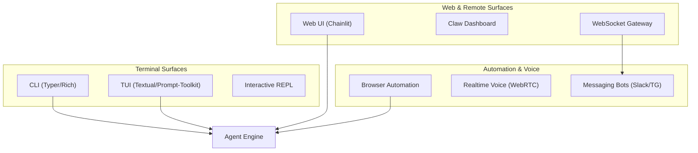

<!-- source: DeepWiki mcp.deepwiki.com · repo MervinPraison/PraisonAI · page 7 User Interfaces · fetched 2026-10-26 -->

# User Interfaces

Relevant source files

The following files were used as context for generating this wiki page:

- [examples/terminal_bench/praisonai_code_agent.py](examples/terminal_bench/praisonai_code_agent.py)
- [scripts/check_c7_imports.sh](scripts/check_c7_imports.sh)
- [src/praisonai-code/praisonai_code/cli/commands/chat.py](src/praisonai-code/praisonai_code/cli/commands/chat.py)
- [src/praisonai-code/praisonai_code/cli/commands/code.py](src/praisonai-code/praisonai_code/cli/commands/code.py)
- [src/praisonai-code/praisonai_code/cli/commands/command.py](src/praisonai-code/praisonai_code/cli/commands/command.py)
- [src/praisonai-code/praisonai_code/cli/commands/init.py](src/praisonai-code/praisonai_code/cli/commands/init.py)
- [src/praisonai-code/praisonai_code/cli/commands/init_team.py](src/praisonai-code/praisonai_code/cli/commands/init_team.py)
- [src/praisonai-code/praisonai_code/cli/commands/run.py](src/praisonai-code/praisonai_code/cli/commands/run.py)
- [src/praisonai-code/praisonai_code/cli/features/cli_profiler.py](src/praisonai-code/praisonai_code/cli/features/cli_profiler.py)
- [src/praisonai-code/praisonai_code/cli/features/custom_definitions.py](src/praisonai-code/praisonai_code/cli/features/custom_definitions.py)
- [src/praisonai-code/praisonai_code/cli/interactive/async_tui.py](src/praisonai-code/praisonai_code/cli/interactive/async_tui.py)
- [src/praisonai-code/praisonai_code/cli/interactive/command_registry.py](src/praisonai-code/praisonai_code/cli/interactive/command_registry.py)
- [src/praisonai-code/praisonai_code/cli/interactive/core.py](src/praisonai-code/praisonai_code/cli/interactive/core.py)
- [src/praisonai-code/praisonai_code/cli/interactive/repl.py](src/praisonai-code/praisonai_code/cli/interactive/repl.py)
- [src/praisonai-code/praisonai_code/cli/interactive/split_tui.py](src/praisonai-code/praisonai_code/cli/interactive/split_tui.py)
- [src/praisonai-code/praisonai_code/cli/interactive/tui_app.py](src/praisonai-code/praisonai_code/cli/interactive/tui_app.py)
- [src/praisonai-code/praisonai_code/cli/session/unified.py](src/praisonai-code/praisonai_code/cli/session/unified.py)
- [src/praisonai-code/tests/unit/test_btw_side_question.py](src/praisonai-code/tests/unit/test_btw_side_question.py)
- [src/praisonai-code/tests/unit/test_chat_auth_exit_code.py](src/praisonai-code/tests/unit/test_chat_auth_exit_code.py)
- [src/praisonai-code/tests/unit/test_code_print_json.py](src/praisonai-code/tests/unit/test_code_print_json.py)
- [src/praisonai-code/tests/unit/test_command_frontmatter_positional.py](src/praisonai-code/tests/unit/test_command_frontmatter_positional.py)
- [src/praisonai-code/tests/unit/test_command_registry.py](src/praisonai-code/tests/unit/test_command_registry.py)
- [src/praisonai-code/tests/unit/test_init_generate_agents_md.py](src/praisonai-code/tests/unit/test_init_generate_agents_md.py)
- [src/praisonai-code/tests/unit/test_init_team.py](src/praisonai-code/tests/unit/test_init_team.py)
- [src/praisonai-code/tests/unit/test_plan_mode_flag.py](src/praisonai-code/tests/unit/test_plan_mode_flag.py)
- [src/praisonai-code/tests/unit/test_project_tool_discovery.py](src/praisonai-code/tests/unit/test_project_tool_discovery.py)
- [src/praisonai-code/tests/unit/test_pure_plugin_isolation.py](src/praisonai-code/tests/unit/test_pure_plugin_isolation.py)
- [src/praisonai-code/tests/unit/test_session_fork.py](src/praisonai-code/tests/unit/test_session_fork.py)
- [src/praisonai-code/tests/unit/test_shell_escape.py](src/praisonai-code/tests/unit/test_shell_escape.py)
- [src/praisonai-code/tests/unit/test_subagent_delegation.py](src/praisonai-code/tests/unit/test_subagent_delegation.py)
- [src/praisonai/praisonai/cli/interactive/async_tui.py](src/praisonai/praisonai/cli/interactive/async_tui.py)
- [src/praisonai/praisonai/cli/legacy/interactive_legacy.py](src/praisonai/praisonai/cli/legacy/interactive_legacy.py)
- [src/praisonai/tests/unit/cli/test_async_tui.py](src/praisonai/tests/unit/cli/test_async_tui.py)
- [src/praisonai/tests/unit/cli/test_interactive_auto_compact.py](src/praisonai/tests/unit/cli/test_interactive_auto_compact.py)
- [src/praisonai/tests/unit/cli/test_interactive_branch.py](src/praisonai/tests/unit/cli/test_interactive_branch.py)
- [src/praisonai/tests/unit/cli/test_unified_session.py](src/praisonai/tests/unit/cli/test_unified_session.py)
- [src/praisonai/tests/unit/code/test_default_path_undo.py](src/praisonai/tests/unit/code/test_default_path_undo.py)

This document provides a high-level overview of the diverse interfaces available in PraisonAI, ranging from terminal-native tools and full-screen TUIs to web dashboards and browser automation bridges. PraisonAI follows a "CLI-first, UI-rich" philosophy, ensuring that all agent capabilities are accessible via both human-centric graphical interfaces and machine-friendly scripting modes.

## Interface Ecosystem

The PraisonAI interface layer is divided into several specialized surfaces, each optimized for different interaction contexts.

**Sources:** [src/praisonai-code/praisonai_code/cli/commands/run.py:1-40](), [src/praisonai-code/praisonai_code/cli/interactive/async_tui.py:194-203](), [src/praisonai/praisonai/cli/legacy/interactive_legacy.py:18-31]()

## CLI Interface

The Command Line Interface is the primary entry point for both `praisonai` (wrapper) and `praisonai-code` (standalone). It supports two main modes: human-readable interactive output and headless, machine-readable JSON output.

- **`praisonai run`**: Executes agents based on YAML definitions or natural language prompts [src/praisonai-code/praisonai_code/cli/commands/run.py:17-18]().
- **`praisonai code`**: A terminal-native assistant with file awareness, diff display, and LSP integration [src/praisonai-code/praisonai_code/cli/commands/code.py:47-64]().
- **Headless Mode**: Using the `-p` or `--print` flag with `--output json` allows scripts and CI pipelines to consume agent results as structured data [src/praisonai-code/praisonai_code/cli/commands/code.py:100-114]().

For details, see [CLI Interface](#7.1).

**Sources:** [src/praisonai-code/praisonai_code/cli/commands/code.py:1-118](), [src/praisonai-code/tests/unit/test_code_print_json.py:1-14]()

## Terminal User Interface (TUI)

PraisonAI provides a sophisticated TUI for users who prefer a full-screen terminal experience without leaving their development environment.

- **Async TUI**: Built with `prompt-toolkit` and `Textual` concepts, it features a split-pane layout where the UI remains responsive while the LLM processes in the background [src/praisonai-code/praisonai_code/cli/interactive/async_tui.py:1-14]().
- **Interactive REPL**: A synchronous terminal loop supporting slash commands (e.g., `/undo`, `/compact`, `/model`) and `@file` mentions for context [src/praisonai-code/praisonai_code/cli/interactive/repl.py:126-156]().
- **Legacy TUI**: A Rich-based interface providing streaming text and tool status indicators [src/praisonai/praisonai/cli/legacy/interactive_legacy.py:18-31]().

For details, see [TUI (Terminal User Interface)](#7.6).

**Sources:** [src/praisonai-code/praisonai_code/cli/interactive/async_tui.py:194-203](), [src/praisonai-code/praisonai_code/cli/interactive/repl.py:34-49]()

## Web UI (Chainlit)

The Web UI provides a browser-based dashboard for managing agents, knowledge bases, and memory.

- **Chainlit Integration**: Uses Chainlit for real-time chat, step-by-step tool execution visibility, and multi-modal support.
- **Claw Dashboard**: A specialized interface for managing "Claw" agents, knowledge retrieval, and channel-based communication.
- **Configuration**: Managed via `praisonai ui` commands which launch local servers for chat or code-specific tasks.

For details, see [Web UI (Chainlit)](#7.3).

**Sources:** [src/praisonai-code/praisonai_code/cli/commands/code.py:53-53](), [src/praisonai-code/praisonai_code/cli/commands/chat.py:153-154]()

## Browser Automation

The `praisonai-browser` package allows agents to interact with the web directly through browser automation.

- **CDP & Playwright**: Supports both Chrome DevTools Protocol (CDP) and Playwright for high-level browser control.
- **Extension Bridge**: Allows agents to operate within existing browser sessions via a bridge.
- **Visual Grounding**: Enables agents to "see" and interact with DOM elements.

For details, see [Browser Automation](#7.4).

## Realtime Voice & Bots

PraisonAI extends beyond the screen into voice and messaging platforms.

- **Realtime Voice**: Uses `RealtimeAgent` to handle low-latency audio streams via WebRTC/WebSockets for natural conversation [src/praisonai-code/praisonai_code/cli/interactive/async_tui.py:92-98]().
- **Messaging Gateway**: A WebSocket-based system that bridges agents to Telegram, Slack, Discord, and WhatsApp.
- **Bot System**: The `praisonai-bot` package handles multi-channel delivery and session persistence across messaging platforms.

For details, see [Realtime Voice Interface](#7.5) and [Bot and Gateway System](#14).

## Display and Output System

All interfaces share a unified display system that handles Rich console output, progress bars, and event streaming.

- **Output Controller**: A centralized `get_output_controller()` ensures consistent formatting across CLI and TUI [src/praisonai-code/praisonai_code/cli/commands/run.py:12-12]().
- **Event Callbacks**: A callback-driven system notifies UIs of tool starts, LLM completions, and state changes.

For details, see [Display System](#7.2).

**Sources:** [src/praisonai-code/praisonai_code/cli/commands/run.py:42-64](), [src/praisonai-code/praisonai_code/cli/interactive/async_tui.py:182-189]()

---

