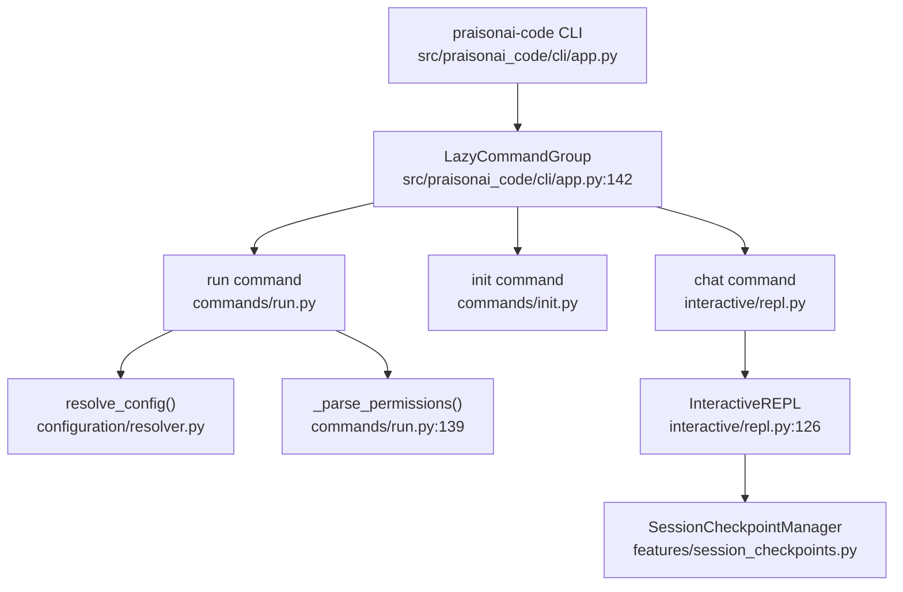
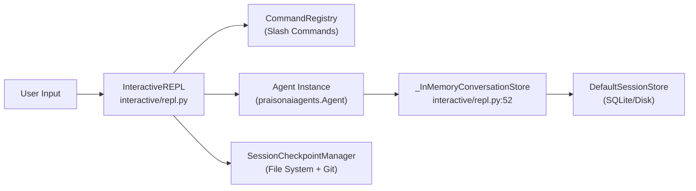

<!-- source: DeepWiki mcp.deepwiki.com · repo MervinPraison/PraisonAI · page 7.1 CLI Interface · fetched 2026-10-26 -->

# CLI Interface

Relevant source files

The following files were used as context for generating this wiki page:

- [examples/yaml/cli_backend.yaml](examples/yaml/cli_backend.yaml)
- [install.sh](install.sh)
- [src/praisonai-code/praisonai_code/cli/app.py](src/praisonai-code/praisonai_code/cli/app.py)
- [src/praisonai-code/praisonai_code/cli/commands/command.py](src/praisonai-code/praisonai_code/cli/commands/command.py)
- [src/praisonai-code/praisonai_code/cli/commands/init.py](src/praisonai-code/praisonai_code/cli/commands/init.py)
- [src/praisonai-code/praisonai_code/cli/commands/init_team.py](src/praisonai-code/praisonai_code/cli/commands/init_team.py)
- [src/praisonai-code/praisonai_code/cli/commands/run.py](src/praisonai-code/praisonai_code/cli/commands/run.py)
- [src/praisonai-code/praisonai_code/cli/commands/uninstall.py](src/praisonai-code/praisonai_code/cli/commands/uninstall.py)
- [src/praisonai-code/praisonai_code/cli/commands/upgrade.py](src/praisonai-code/praisonai_code/cli/commands/upgrade.py)
- [src/praisonai-code/praisonai_code/cli/features/custom_definitions.py](src/praisonai-code/praisonai_code/cli/features/custom_definitions.py)
- [src/praisonai-code/praisonai_code/cli/features/self_manage.py](src/praisonai-code/praisonai_code/cli/features/self_manage.py)
- [src/praisonai-code/praisonai_code/cli/help_categories.py](src/praisonai-code/praisonai_code/cli/help_categories.py)
- [src/praisonai-code/praisonai_code/cli/interactive/command_registry.py](src/praisonai-code/praisonai_code/cli/interactive/command_registry.py)
- [src/praisonai-code/praisonai_code/cli/interactive/repl.py](src/praisonai-code/praisonai_code/cli/interactive/repl.py)
- [src/praisonai-code/praisonai_code/cli/interactive/split_tui.py](src/praisonai-code/praisonai_code/cli/interactive/split_tui.py)
- [src/praisonai-code/praisonai_code/cli/interactive/tui_app.py](src/praisonai-code/praisonai_code/cli/interactive/tui_app.py)
- [src/praisonai-code/tests/unit/test_btw_side_question.py](src/praisonai-code/tests/unit/test_btw_side_question.py)
- [src/praisonai-code/tests/unit/test_command_frontmatter_positional.py](src/praisonai-code/tests/unit/test_command_frontmatter_positional.py)
- [src/praisonai-code/tests/unit/test_command_registry.py](src/praisonai-code/tests/unit/test_command_registry.py)
- [src/praisonai-code/tests/unit/test_init_generate_agents_md.py](src/praisonai-code/tests/unit/test_init_generate_agents_md.py)
- [src/praisonai-code/tests/unit/test_init_team.py](src/praisonai-code/tests/unit/test_init_team.py)
- [src/praisonai-code/tests/unit/test_project_tool_discovery.py](src/praisonai-code/tests/unit/test_project_tool_discovery.py)
- [src/praisonai-code/tests/unit/test_shell_escape.py](src/praisonai-code/tests/unit/test_shell_escape.py)
- [src/praisonai-code/tests/unit/test_subagent_delegation.py](src/praisonai-code/tests/unit/test_subagent_delegation.py)
- [src/praisonai/praisonai/agent.py](src/praisonai/praisonai/agent.py)
- [src/praisonai/praisonai/cli/app.py](src/praisonai/praisonai/cli/app.py)
- [src/praisonai/praisonai/cli/commands/attach.py](src/praisonai/praisonai/cli/commands/attach.py)
- [src/praisonai/praisonai/cli/commands/daemon.py](src/praisonai/praisonai/cli/commands/daemon.py)
- [src/praisonai/praisonai/cli/commands/run.py](src/praisonai/praisonai/cli/commands/run.py)
- [src/praisonai/praisonai/cli/commands/session.py](src/praisonai/praisonai/cli/commands/session.py)
- [src/praisonai/praisonai/cli/features/gateway.py](src/praisonai/praisonai/cli/features/gateway.py)
- [src/praisonai/praisonai/cli/session/__init__.py](src/praisonai/praisonai/cli/session/__init__.py)
- [src/praisonai/praisonai/cli_backends/__init__.py](src/praisonai/praisonai/cli_backends/__init__.py)
- [src/praisonai/praisonai/runtime/__init__.py](src/praisonai/praisonai/runtime/__init__.py)
- [src/praisonai/praisonai/runtime/__main__.py](src/praisonai/praisonai/runtime/__main__.py)
- [src/praisonai/tests/unit/code/test_default_path_undo.py](src/praisonai/tests/unit/code/test_default_path_undo.py)
- [src/praisonai/tests/unit/test_cli_backend_flag.py](src/praisonai/tests/unit/test_cli_backend_flag.py)
- [src/praisonai/tests/unit/test_external_agents_backcompat.py](src/praisonai/tests/unit/test_external_agents_backcompat.py)
- [src/praisonai/tests/unit/test_session_resume.py](src/praisonai/tests/unit/test_session_resume.py)
- [src/praisonai/tests/unit/test_warm_runtime.py](src/praisonai/tests/unit/test_warm_runtime.py)
- [src/praisonai/tests/unit/test_yaml_cli_backend.py](src/praisonai/tests/unit/test_yaml_cli_backend.py)

The CLI Interface provides command-line access to PraisonAI's multi-agent system capabilities. It serves as the primary entry point for users to create, configure, and execute AI agent workflows through terminal commands, supporting both interactive and automated deployment scenarios.

The CLI is split into two primary layers: the `praisonai-code` (C7) core commands and the `praisonai` (C14) wrapper commands.

## Command Architecture

The system utilizes a hybrid dispatch model. The modern `praisonai-code` CLI uses **Typer** with a `LazyCommandGroup` to defer heavy imports, while the `praisonai` wrapper provides a backward-compatibility shim and high-level orchestration features like scheduling and bots.

### Core Command Dispatch (praisonai-code)
The main Typer application registers command groups lazily to ensure sub-millisecond startup times for help commands.

| Command Group | Implementation Path | Purpose |
|:---|:---|:---|
| `run` | `praisonai_code.cli.commands.run` | Execute agents, prompts, or YAML files |
| `init` | `praisonai_code.cli.commands.init` | Scaffold `.praisonai/` project structure |
| `chat` | `praisonai_code.cli.interactive.repl` | Interactive terminal chat (REPL) |
| `session` | `praisonai_code.cli.commands.session` | Manage conversation history and checkpoints |
| `setup` | `praisonai_code.cli.commands.setup` | Interactive onboarding and API key config |
| `mcp` | `praisonai_code.cli.commands.mcp` | Model Context Protocol server management |

**CLI Dispatch Logic**

Sources: [src/praisonai-code/praisonai_code/cli/app.py:141-166](), [src/praisonai-code/praisonai_code/cli/commands/run.py:10-17]()

## Agent Execution (Run Command)

The `run` command is the workhorse of the CLI. It handles structured output modes, permission enforcement, and framework routing.

### Execution Pathways
1.  **YAML Mode**: Executes a team of agents defined in a `.yaml` or `.yml` file [src/praisonai-code/praisonai_code/cli/commands/run.py:67-80]().
2.  **Direct Prompt**: Executes a single-turn prompt. If the `praisonai` wrapper is available, it delegates to `handle_direct_prompt` for human-readable text modes [src/praisonai-code/praisonai_code/cli/commands/run.py:108-136]().
3.  **Structured Mode**: Modes like `actions`, `json`, or `stream` run in-process using the core `Agent` class [src/praisonai-code/praisonai_code/cli/commands/run.py:82-84]().

### Permission and Safety Gates
The CLI implements a multi-tier permission system that can be configured via flags or agent "modes" (e.g., `plan`, `review`, `build`).

| Mode | Read Patterns | Mutate Patterns | Bash/Execute |
|:---|:---|:---|:---|
| `read-only` | `allow` | `deny` | `deny` |
| `review` | `allow` | `deny` | `ask` |
| `build` | `allow` | `allow` | `allow` |

Sources: [src/praisonai-code/praisonai_code/cli/features/custom_definitions.py:49-77](), [src/praisonai-code/praisonai_code/cli/commands/run.py:139-185]()

## Project Scaffolding (Init)

The `init` command establishes the `.praisonai/` convention in a directory.

- **Static Scaffolding**: Creates `config.yaml`, `agents/assistant.md`, and `tools/example.py` [src/praisonai-code/praisonai_code/cli/commands/init.py:38-100]().
- **AI-Generated Scaffolding**: With `--generate`, it runs an analysis agent to inspect the repository (README, manifests, file tree) and produces a tailored `AGENTS.md` [src/praisonai-code/praisonai_code/cli/commands/init.py:176-198]().

Sources: [src/praisonai-code/praisonai_code/cli/commands/init.py:1-26](), [src/praisonai-code/praisonai_code/cli/commands/init.py:130-173]()

## Interactive REPL

The `chat` command launches the `InteractiveREPL`, providing a stateful conversation environment.

- **Session Persistence**: Automatically manages `session_id` and persists history to the `DefaultSessionStore` [src/praisonai/tests/unit/test_session_resume.py:11-14]().
- **Coherent Undo/Revert**: Integrates the `SessionCheckpointManager` to roll back both file changes (via shadow git) and conversation history in lockstep [src/praisonai-code/praisonai_code/cli/interactive/repl.py:157-189]().
- **Warm Runtime**: Supports an opt-in "warm" runtime that keeps agents in memory between CLI calls to avoid initialization overhead [src/praisonai/tests/unit/test_warm_runtime.py:89-116]().

**REPL Data Flow**

Sources: [src/praisonai-code/praisonai_code/cli/interactive/repl.py:126-156](), [src/praisonai-code/praisonai_code/cli/interactive/repl.py:52-69]()

## Tool Discovery

The CLI automatically discovers tools in the `.praisonai/tools/` directory.

- **Opt-in Security**: Loading local tools requires `PRAISONAI_ALLOW_LOCAL_TOOLS=true` or the `--allow-local-tools` flag [src/praisonai-code/tests/unit/test_project_tool_discovery.py:71-86]().
- **Namespacing**: Discovered tools are namespaced by their filename (e.g., `tools/greet.py` defines `greet.greet`) [src/praisonai-code/tests/unit/test_project_tool_discovery.py:79-82]().

Sources: [src/praisonai-code/praisonai_code/cli/features/custom_definitions.py:1-13](), [src/praisonai-code/tests/unit/test_project_tool_discovery.py:152-181]()

## Observability Integration

The CLI integrates with tracing backends to monitor agent execution.

- **Langfuse**: Captures agent lifecycles and tool calls [src/praisonai-code/praisonai_code/cli/app.py:25-58]().
- **Langextract**: Generates local HTML trace files (`praisonai-trace.html`) for offline debugging [src/praisonai-code/praisonai_code/cli/app.py:60-118]().

Sources: [src/praisonai-code/praisonai_code/cli/app.py:25-58](), [src/praisonai-code/praisonai_code/cli/app.py:60-118]()

---

