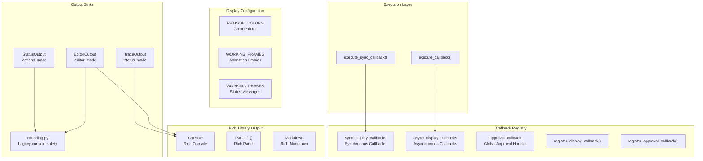

<!-- source: DeepWiki mcp.deepwiki.com · repo MervinPraison/PraisonAI · page 7.2 Display System · fetched 2026-10-26 -->

# Display System

Relevant source files

The following files were used as context for generating this wiki page:

- [src/praisonai-agents/praisonaiagents/main.py](src/praisonai-agents/praisonaiagents/main.py)
- [src/praisonai-agents/praisonaiagents/output/editor.py](src/praisonai-agents/praisonaiagents/output/editor.py)
- [src/praisonai-agents/praisonaiagents/output/encoding.py](src/praisonai-agents/praisonaiagents/output/encoding.py)
- [src/praisonai-agents/praisonaiagents/output/models.py](src/praisonai-agents/praisonaiagents/output/models.py)
- [src/praisonai-agents/praisonaiagents/output/status.py](src/praisonai-agents/praisonaiagents/output/status.py)
- [src/praisonai-agents/praisonaiagents/output/trace.py](src/praisonai-agents/praisonaiagents/output/trace.py)
- [src/praisonai-agents/praisonaiagents/planning/todo.py](src/praisonai-agents/praisonaiagents/planning/todo.py)
- [src/praisonai-agents/praisonaiagents/streaming/__init__.py](src/praisonai-agents/praisonaiagents/streaming/__init__.py)
- [src/praisonai-agents/praisonaiagents/streaming/events.py](src/praisonai-agents/praisonaiagents/streaming/events.py)
- [src/praisonai-agents/praisonaiagents/streaming/progress.py](src/praisonai-agents/praisonaiagents/streaming/progress.py)
- [src/praisonai-agents/praisonaiagents/tools/shell_tools.py](src/praisonai-agents/praisonaiagents/tools/shell_tools.py)
- [src/praisonai-agents/praisonaiagents/tools/todo_tools.py](src/praisonai-agents/praisonaiagents/tools/todo_tools.py)
- [src/praisonai-agents/tests/unit/streaming/test_progress_compositor.py](src/praisonai-agents/tests/unit/streaming/test_progress_compositor.py)
- [src/praisonai-agents/tests/unit/streaming/test_tool_progress.py](src/praisonai-agents/tests/unit/streaming/test_tool_progress.py)
- [src/praisonai-agents/tests/unit/task/test_task_non_fatal_errors.py](src/praisonai-agents/tests/unit/task/test_task_non_fatal_errors.py)
- [src/praisonai-agents/tests/unit/test_output_encoding.py](src/praisonai-agents/tests/unit/test_output_encoding.py)
- [src/praisonai-bot/praisonai_bot/bots/_streaming.py](src/praisonai-bot/praisonai_bot/bots/_streaming.py)
- [src/praisonai-bot/tests/unit/bots/test_streaming_flood_control.py](src/praisonai-bot/tests/unit/bots/test_streaming_flood_control.py)
- [src/praisonai/praisonai/inc/models.py](src/praisonai/praisonai/inc/models.py)
- [src/praisonai/tests/unit/llm/test_registered_provider_hot_paths.py](src/praisonai/tests/unit/llm/test_registered_provider_hot_paths.py)

## Purpose and Scope

The Display System provides a unified interface for rendering agent execution information to the console using the Rich library. It implements a callback-based architecture that allows external systems to intercept and process display events without coupling to the console output implementation. This system handles formatted output for task interactions, tool calls, errors, reasoning steps, and status indicators with a consistent color palette and visual design language. It also includes specialized output modes like "actions" and "editor" for different user experience requirements.

---

## Architecture Overview

The Display System consists of the color and design system, a global callback registry, and specialized output sinks for different display modes.

### System Component Architecture

**Sources:** [src/praisonai-agents/praisonaiagents/main.py:34-113](), [src/praisonai-agents/praisonaiagents/output/status.py:65-95](), [src/praisonai-agents/praisonaiagents/output/editor.py:81-108]()

---

## Color Palette and Design System

The system uses `PRAISON_COLORS`, a semantic palette for visual narrative flow: Agent → Task → Working → Response.

### Color Palette Structure

| Semantic Role | Hex Color | Usage |
|--------------|-----------|--------|
| `agent` | `#86A789` | Agent identity, stable elements |
| `task` | `#FF9B9B` | Task/question input |
| `working` | `#FFB347` | Processing/action states |
| `response` | `#4A90D9` | Output/completion |
| `tool` | `#9B7EDE` | Tool execution |
| `reasoning` | `#78909C` | Thought process |
| `error` | `#E57373` | Errors/warnings |
| `metrics` | `#B4B4B3` | Meta information |

**Sources:** [src/praisonai-agents/praisonaiagents/main.py:46-78]()

---

## Callback System

The callback system enables external consumers to intercept display events. It supports standard events (`tool_call`, `interaction`, `error`) and PraisonAI-unique autonomy events (`autonomy_doom_loop`, `autonomy_stage_change`). [src/praisonai-agents/praisonaiagents/main.py:115-127]()

### Callback Execution Flow

The system provides `execute_sync_callback()` for immediate execution and `execute_callback()` for async-compatible handling.

1. **Parameter filtering**: Callbacks are inspected via `inspect.signature`. If they don't accept `**kwargs`, only supported parameters are passed to maintain backward compatibility. [src/praisonai-agents/praisonaiagents/main.py:170-181]()
2. **Global Approval**: `approval_callback` handles high-risk tool operations (e.g., shell command execution). [src/praisonai-agents/praisonaiagents/main.py:143-151](), [src/praisonai-agents/praisonaiagents/tools/shell_tools.py:47]()

**Sources:** [src/praisonai-agents/praisonaiagents/main.py:129-197]()

---

## Output Modes

PraisonAI provides several specialized output sinks beyond the standard Rich display.

### StatusOutput ("actions" mode)
A filtered output mode showing only lifecycle events, tool calls, and final output. It supports both human-readable text and JSONL formats. [src/praisonai-agents/praisonaiagents/output/status.py:65-86]()

- **Thread-safe**: Uses `_output_lock` for multi-agent concurrent execution. [src/praisonai-agents/praisonaiagents/output/status.py:37]()
- **Redaction**: Automatically redacts sensitive data from tool arguments using `redact_dict`. [src/praisonai-agents/praisonaiagents/output/status.py:106-114]()

### EditorOutput ("editor" mode)
Provides a user-friendly, step-by-step display format with emoji icons and human-readable tool labels. [src/praisonai-agents/praisonaiagents/output/editor.py:4-17]()

- **Tool Labels**: Maps technical tool names (e.g., `internet_search`) to user-friendly icons (🔍) and labels ("Searching the web"). [src/praisonai-agents/praisonaiagents/output/editor.py:55-78]()
- **LLM Indicator**: Displays a subtle "▸ Thinking..." status between steps. [src/praisonai-agents/praisonaiagents/output/editor.py:138-151]()

### TraceOutput ("status" mode)
A minimal, timestamped status line mode without boxes or panels, ideal for logging or external app parsing. [src/praisonai-agents/praisonaiagents/output/trace.py:4-26]()

---

## Output Models

The system uses Pydantic models to structure data across the codebase while avoiding module-level Rich imports.

### TaskOutput
The primary model for task results. [src/praisonai-agents/praisonaiagents/output/models.py:21-34]()
- **Formats**: Supports `RAW`, `JSON`, and `Pydantic` output formats.
- **Metrics**: Integrates with `TokenMetrics` for cost and token tracking. [src/praisonai-agents/praisonaiagents/output/models.py:31]()
- **Errors**: Tracks `non_fatal_errors` and `callback_error`. [src/praisonai-agents/praisonaiagents/output/models.py:32-33]()

**Sources:** [src/praisonai-agents/praisonaiagents/output/models.py:1-64]()

---

## Streaming and Progress

### Stream Events
The `StreamEvent` protocol maps native chunks from OpenAI or LiteLLM into a unified format. [src/praisonai-agents/praisonaiagents/streaming/events.py:4-12]()

- **Types**: Includes `FIRST_TOKEN` (TTFT marker), `DELTA_TEXT`, `TOOL_CALL_START`, and `TODO_UPDATED`. [src/praisonai-agents/praisonaiagents/streaming/events.py:23-42]()
- **Metrics**: `StreamMetrics` tracks TTFT, stream duration, and tokens per second. [src/praisonai-agents/praisonaiagents/streaming/events.py:101-147]()

### Progress Compositor
Allows tools (like `ShellTools`) to emit incremental progress or output while running. [src/praisonai-agents/tests/unit/streaming/test_tool_progress.py:9-11]()
- **Channel**: `tool_progress_channel` context manager activates a sink for `TOOL_PROGRESS` events. [src/praisonai-agents/tests/unit/streaming/test_tool_progress.py:31-43]()
- **Shell Integration**: `ShellTools._communicate_streaming` uses this to surface live stdout/stderr during command execution. [src/praisonai-agents/praisonaiagents/tools/shell_tools.py:132]()

**Sources:** [src/praisonai-agents/praisonaiagents/streaming/events.py:1-177](), [src/praisonai-agents/praisonaiagents/tools/shell_tools.py:128-155]()

---

## Encoding and Legacy Support

The system includes `encoding.py` to ensure safety on legacy consoles (e.g., Windows `cp1252`).

- **Safe Text**: `safe_text()` replaces Unicode glyphs (like `▸`) with ASCII fallbacks (like `>`) if the target stream cannot encode them. [src/praisonai-agents/tests/unit/test_output_encoding.py:31-48]()
- **Markup Protection**: `_safe_markup()` in `EditorOutput` escapes Rich markup characters in dynamic content to prevent `MarkupError`. [src/praisonai-agents/praisonaiagents/output/editor.py:196-202]()

**Sources:** [src/praisonai-agents/praisonaiagents/output/encoding.py:1-50](), [src/praisonai-agents/tests/unit/test_output_encoding.py:1-135]()

---

