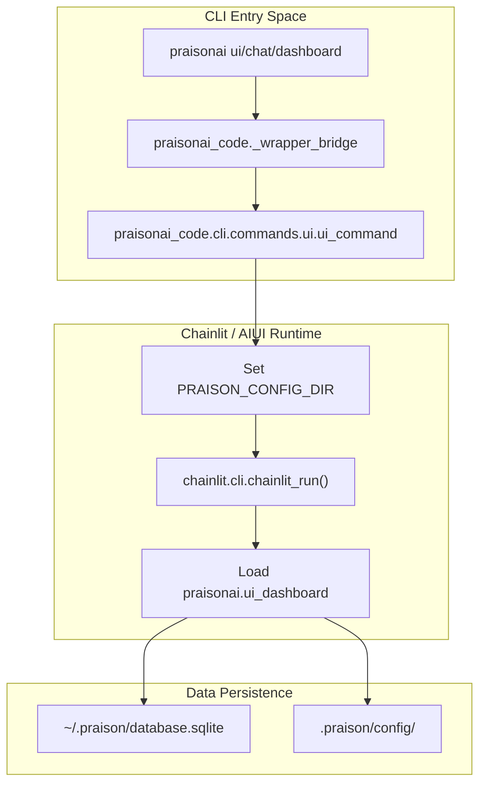
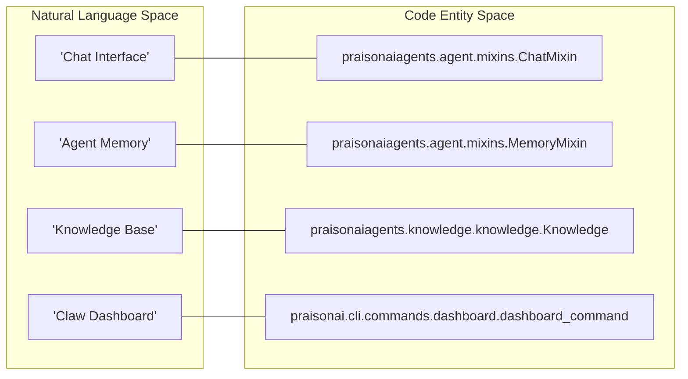

<!-- source: DeepWiki mcp.deepwiki.com · repo MervinPraison/PraisonAI · page 7.3 Web UI (Chainlit) · fetched 2026-10-26 -->

# Web UI (Chainlit)

<details>
<summary>Relevant source files</summary>

The following files were used as context for generating this wiki page:

- [docker/Dockerfile](docker/Dockerfile)
- [docker/Dockerfile.chat](docker/Dockerfile.chat)
- [docker/Dockerfile.dev](docker/Dockerfile.dev)
- [docker/Dockerfile.ui](docker/Dockerfile.ui)
- [docker/README.md](docker/README.md)
- [src/praisonai-agents/pyproject.toml](src/praisonai-agents/pyproject.toml)
- [src/praisonai-agents/uv.lock](src/praisonai-agents/uv.lock)
- [src/praisonai-code/praisonai_code/_wrapper_bridge.py](src/praisonai-code/praisonai_code/_wrapper_bridge.py)
- [src/praisonai-code/praisonai_code/cli/commands/port.py](src/praisonai-code/praisonai_code/cli/commands/port.py)
- [src/praisonai-code/praisonai_code/cli/commands/ui.py](src/praisonai-code/praisonai_code/cli/commands/ui.py)
- [src/praisonai-code/tests/unit/test_help_categories.py](src/praisonai-code/tests/unit/test_help_categories.py)
- [src/praisonai-code/tests/unit/test_help_encoding.py](src/praisonai-code/tests/unit/test_help_encoding.py)
- [src/praisonai-code/tests/unit/test_standalone_stub_commands.py](src/praisonai-code/tests/unit/test_standalone_stub_commands.py)
- [src/praisonai-code/tests/unit/test_ui_command.py](src/praisonai-code/tests/unit/test_ui_command.py)
- [src/praisonai/praisonai.rb](src/praisonai/praisonai.rb)
- [src/praisonai/praisonai/cli/commands/dashboard.py](src/praisonai/praisonai/cli/commands/dashboard.py)
- [src/praisonai/praisonai/cli/main.py](src/praisonai/praisonai/cli/main.py)
- [src/praisonai/praisonai/ui_dashboard/__init__.py](src/praisonai/praisonai/ui_dashboard/__init__.py)
- [src/praisonai/praisonai/version.py](src/praisonai/praisonai/version.py)
- [src/praisonai/pyproject.toml](src/praisonai/pyproject.toml)
- [src/praisonai/tests/unit/cli/interactive/test_config.py](src/praisonai/tests/unit/cli/interactive/test_config.py)
- [src/praisonai/tests/unit/cli/test_dashboard_command.py](src/praisonai/tests/unit/cli/test_dashboard_command.py)
- [src/praisonai/uv.lock](src/praisonai/uv.lock)

</details>


## Introduction

The Web UI provides a browser-based interface for interacting with PraisonAI agents using the Chainlit framework. It offers specialized interfaces accessible via Docker containers or direct CLI commands, supporting real-time streaming, tool integration, session management, and a centralized dashboard for resource management.

- **UI Service** (Port 8082): General agent interface launched via `praisonai ui`. [docker/README.md:8-8]()
- **Chat Service** (Port 8083): Dedicated chat interface launched via `praisonai chat`. [docker/README.md:9-9]()
- **Claw Dashboard**: A comprehensive management interface for agents, memory, and knowledge. [src/praisonai/praisonai/cli/commands/dashboard.py:1-20]()

Sources:
- [docker/Dockerfile.ui:1-33]()
- [docker/Dockerfile.chat:1-33]()
- [docker/README.md:1-20]()
- [src/praisonai/praisonai/cli/commands/dashboard.py:1-20]()

## Installation

The Web UI is an optional component requiring specific dependency groups.

### Package Installation

```bash
# Install with general UI support
pip install "praisonai[ui]"

# Install for chat interface (includes search/crawl tools)
pip install "praisonai[chat]"

# Install for realtime voice/web features
pip install "praisonai[realtime]"
```

**Key Dependencies:**

| Package | Purpose | Source |
|---------|---------|--------|
| `aiui` | Core PraisonAI UI (Dashboard + Chat) | [src/praisonai/pyproject.toml:198-198]() |
| `chainlit` | Web UI framework (transitive via aiui) | [docker/README.md:8-8]() |
| `tavily-python` | Web search for Chat mode | [src/praisonai/pyproject.toml:69-69]() |
| `crawl4ai` | Web crawling for Chat mode | [src/praisonai/pyproject.toml:70-70]() |
| `playwright` | Browser automation for crawling | [src/praisonai/pyproject.toml:72-72]() |

Sources:
- [src/praisonai/pyproject.toml:45-47]()
- [src/praisonai/pyproject.toml:67-74]()
- [src/praisonai/pyproject.toml:101-110]()

## Architecture and Data Flow

The Web UI integrates with the core agent system through a bridge mechanism, ensuring that the heavy UI dependencies are only loaded when required.

### UI Command Execution Flow



Sources:
- [src/praisonai/praisonai/cli/main.py:1-18]()
- [src/praisonai-code/praisonai_code/cli/commands/ui.py:1-20]()
- [docker/README.md:59-67]()

### Natural Language to Code Entity Mapping

The following diagram maps UI concepts to their underlying code implementations.



Sources:
- [src/praisonai-agents/pyproject.toml:138-139]()
- [src/praisonai/praisonai/cli/commands/dashboard.py:1-15]()
- [src/praisonai-agents/pyproject.toml:31-41]()

## Claw Dashboard

The **Claw Dashboard** is the central management hub for the PraisonAI ecosystem. It is launched via the `praisonai dashboard` command. [src/praisonai/praisonai/cli/commands/dashboard.py:1-10]()

### Key Components

1.  **Chat Management**: Interface for managing active agent sessions and multi-agent conversations.
2.  **Memory Management**: Visualizes agent memories (short-term, long-term, and entity memory) stored in backends like SQLite or ChromaDB. [src/praisonai-agents/pyproject.toml:31-34]()
3.  **Knowledge Management**: Tools for ingesting documents, managing vector stores, and configuring RAG (Retrieval-Augmented Generation). [src/praisonai-agents/pyproject.toml:36-41]()
4.  **Channel Management**: Configuration for messaging bots (Telegram, Slack, Discord) via the `praisonai-bot` package. [src/praisonai/pyproject.toml:190-196]()

Sources:
- [src/praisonai/praisonai/cli/commands/dashboard.py:1-20]()
- [src/praisonai/praisonai/ui_dashboard/__init__.py:1]()

## Docker Configuration

PraisonAI provides specialized Dockerfiles for different UI use cases to keep image sizes optimized.

### Service Inventory

| Service | Dockerfile | Default Port | Description |
|---------|------------|--------------|-------------|
| **UI** | `Dockerfile.ui` | 8082 | General purpose UI with CrewAI support. [docker/Dockerfile.ui:1-33]() |
| **Chat** | `Dockerfile.chat` | 8083 | Optimized for web search and crawling. [docker/Dockerfile.chat:1-31]() |
| **Dev** | `Dockerfile.dev` | N/A | Full suite including Jupyter and testing tools. [docker/Dockerfile.dev:1-47]() |

### Directory Consolidation
To prevent root directory clutter, all runtime files are mapped to `~/.praison/` inside containers:
- `PRAISON_CONFIG_DIR`: `/root/.praison` [docker/Dockerfile.ui:27-27]()
- `CHAINLIT_CONFIG_DIR`: `/root/.praison` [docker/Dockerfile.ui:28-28]()
- `CHAINLIT_DB_DIR`: `/root/.praison` [docker/Dockerfile.ui:29-29]()

Sources:
- [docker/README.md:7-19]()
- [docker/README.md:53-74]()
- [docker/Dockerfile.ui:26-30]()

## Realtime and Voice Modes

The Web UI supports real-time interaction through the `praisonai[realtime]` extra. This enables:
- **WebSocket Gateway**: High-speed, low-latency communication for real-time agents. [src/praisonai/pyproject.toml:106-106]()
- **Voice Interaction**: Integration with STT (Speech-to-Text) and TTS (Text-to-Speech) for vocal agent interaction.
- **Dynamic Visualization**: Support for `plotly` and `yfinance` tools directly within the chat interface. [src/praisonai/pyproject.toml:107-108]()

Sources:
- [src/praisonai/pyproject.toml:101-110]()
- [src/praisonai-agents/pyproject.toml:24-29]()

---

