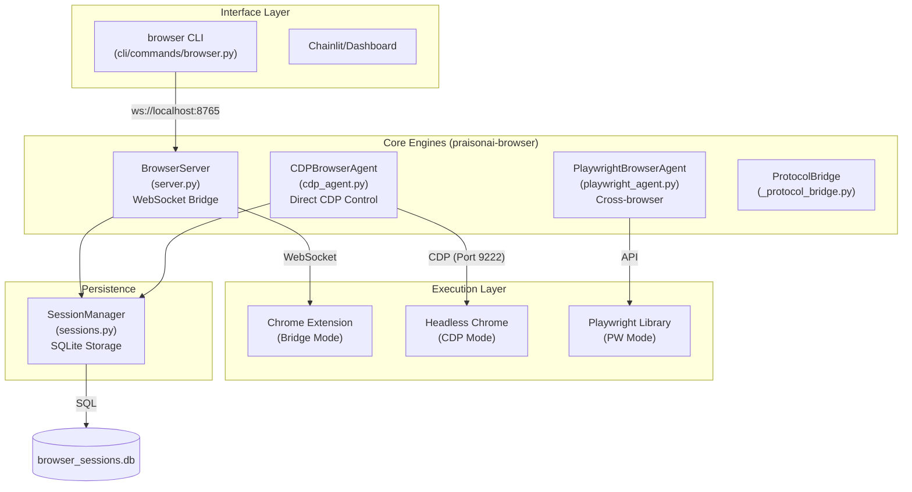
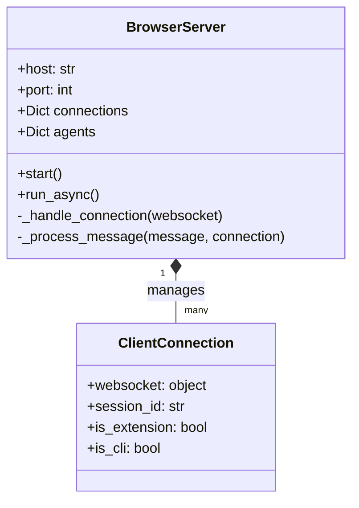

<!-- source: DeepWiki mcp.deepwiki.com · repo MervinPraison/PraisonAI · page 7.4 Browser Automation · fetched 2026-10-26 -->

# Browser Automation

Relevant source files

The following files were used as context for generating this wiki page:

- [scripts/check_c11_browser_imports.sh](scripts/check_c11_browser_imports.sh)
- [src/praisonai-agents/praisonaiagents/tools/protocols/browser.py](src/praisonai-agents/praisonaiagents/tools/protocols/browser.py)
- [src/praisonai-browser/README.md](src/praisonai-browser/README.md)
- [src/praisonai-browser/praisonai_browser/__init__.py](src/praisonai-browser/praisonai_browser/__init__.py)
- [src/praisonai-browser/praisonai_browser/__main__.py](src/praisonai-browser/praisonai_browser/__main__.py)
- [src/praisonai-browser/praisonai_browser/_protocol_bridge.py](src/praisonai-browser/praisonai_browser/_protocol_bridge.py)
- [src/praisonai-browser/praisonai_browser/_version.py](src/praisonai-browser/praisonai_browser/_version.py)
- [src/praisonai-browser/praisonai_browser/agent.py](src/praisonai-browser/praisonai_browser/agent.py)
- [src/praisonai-browser/praisonai_browser/cdp_agent.py](src/praisonai-browser/praisonai_browser/cdp_agent.py)
- [src/praisonai-browser/praisonai_browser/cli/commands/browser.py](src/praisonai-browser/praisonai_browser/cli/commands/browser.py)
- [src/praisonai-browser/praisonai_browser/playwright_agent.py](src/praisonai-browser/praisonai_browser/playwright_agent.py)
- [src/praisonai-browser/praisonai_browser/server.py](src/praisonai-browser/praisonai_browser/server.py)
- [src/praisonai-browser/praisonai_browser/sessions.py](src/praisonai-browser/praisonai_browser/sessions.py)
- [src/praisonai-browser/pyproject.toml](src/praisonai-browser/pyproject.toml)
- [src/praisonai-browser/tests/browser/test_cli.py](src/praisonai-browser/tests/browser/test_cli.py)
- [src/praisonai-browser/tests/browser/test_extension_integration.py](src/praisonai-browser/tests/browser/test_extension_integration.py)
- [src/praisonai-browser/tests/browser/test_protocol_compliance.py](src/praisonai-browser/tests/browser/test_protocol_compliance.py)
- [src/praisonai-browser/tests/browser/test_server.py](src/praisonai-browser/tests/browser/test_server.py)
- [src/praisonai-browser/uv.lock](src/praisonai-browser/uv.lock)
- [src/praisonai/praisonai/browser/__init__.py](src/praisonai/praisonai/browser/__init__.py)
- [src/praisonai/tests/unit/test_c11_browser_backward_compat.py](src/praisonai/tests/unit/test_c11_browser_backward_compat.py)

The `praisonai-browser` package provides a multi-engine browser automation framework that enables AI agents to control web browsers via the **Chrome DevTools Protocol (CDP)**, **Playwright**, or a specialized **Chrome Extension Bridge**. It includes features for session persistence, automatic retry logic, and real-time vision-based element detection.

## Architecture Overview

The browser automation system is structured as a bridge between high-level Agent reasoning and low-level browser control protocols.

### System Components

Sources: [src/praisonai-browser/praisonai_browser/server.py:1-63](), [src/praisonai-browser/praisonai_browser/cdp_agent.py:92-120](), [src/praisonai-browser/praisonai_browser/playwright_agent.py:31-54](), [src/praisonai-browser/praisonai_browser/sessions.py:19-43]()

### Automation Engine Comparison

| Engine | Implementation | Use Case | Requirements |
| :--- | :--- | :--- | :--- |
| **Extension** | `BrowserServer` + Extension | Interactive, visual feedback | Chrome Extension installed |
| **CDP** | `CDPBrowserAgent` | Headless, CI/CD, no-extension | Chrome with `--remote-debugging-port` |
| **Playwright**| `PlaywrightBrowserAgent` | Cross-browser (Firefox/WebKit) | `pip install playwright` |
| **Hybrid** | `ProtocolBridge` | Auto-fallback logic | Varies |

Sources: [src/praisonai-browser/pyproject.toml:18-30](), [src/praisonai-browser/praisonai_browser/cdp_agent.py:1-11]()

## BrowserServer: The Extension Bridge

The `BrowserServer` class acts as a central hub, bridging CLI commands and the Chrome Extension via WebSockets. It manages multiple `ClientConnection` objects and maps them to active automation sessions.

### Connection Management

Sources: [src/praisonai-browser/praisonai_browser/server.py:42-103]()

### Protocol Flow (WebSocket)

1.  **Handshake**: Clients connect to `/ws`. The server identifies if the connection is from the extension (via `Origin` header) or the CLI [src/praisonai-browser/praisonai_browser/server.py:180-200]().
2.  **Session Start**: CLI sends `start_session`. Server creates a `BrowserAgent` and broadcasts the request to connected extensions [src/praisonai-browser/praisonai_browser/server.py:204-225]().
3.  **Observation Loop**:
    *   Extension sends `observation` (URL, elements, screenshot) [src/praisonai-browser/praisonai_browser/server.py:173-175]().
    *   Server passes observation to the internal agent [src/praisonai-browser/praisonai_browser/server.py:390-410]().
    *   Agent returns a `BrowserAction` (click, type, etc.).
    *   Server broadcasts `action` back to the extension for execution [src/praisonai-browser/praisonai_browser/server.py:412-421]().

## CDP Engine: Direct Control

The `CDPBrowserAgent` allows for headless automation by communicating directly with Chrome's debugging port (default `9222`) without requiring an extension bridge.

### Element Extraction Strategy
The engine uses a multi-layered approach to identify interactive elements, generating robust selectors:
1.  **ID/Name**: Primary unique identifiers [src/praisonai-browser/praisonai_browser/cdp_agent.py:100-105]().
2.  **ARIA/TestID**: Fallbacks for accessibility and testing attributes [src/praisonai-browser/praisonai_browser/cdp_agent.py:58-70]().
3.  **JS Path**: Complex CSS paths generated via `Runtime.evaluate` [src/praisonai-browser/praisonai_browser/cdp_agent.py:160-171]().

### Recovery and Verification
*   **Action Verification**: If `verify_actions` is enabled, the agent captures screenshots before and after an action to confirm the state change [src/praisonai-browser/praisonai_browser/cdp_agent.py:119-120]().
*   **Stuck Detection**: Tracks `_action_history` to identify if the agent is repeating the same failing action or URL [src/praisonai-browser/praisonai_browser/cdp_agent.py:155-157]().
*   **Consent Handling**: Includes hardcoded selectors for common cookie consent dialogs (`GOOGLE_CONSENT_SELECTORS`, `GENERIC_CONSENT_SELECTORS`) to prevent automation blockage [src/praisonai-browser/praisonai_browser/cdp_agent.py:47-80]().

## Playwright Engine

The `PlaywrightBrowserAgent` provides cross-browser support (Chromium, Firefox, WebKit) by wrapping the Playwright library.

### Key Methods
*   `_launch()`: Initializes the `async_playwright` context and launches the specified browser type [src/praisonai-browser/praisonai_browser/playwright_agent.py:56-79]().
*   `_get_page_state()`: Evaluates a script in the page context to extract interactive elements (links, buttons, inputs) [src/praisonai-browser/praisonai_browser/playwright_agent.py:80-109]().
*   `_execute_action()`: Maps agent actions (`navigate`, `type`, `click`, `scroll`) to Playwright API calls like `page.goto`, `page.fill`, and `page.click` [src/praisonai-browser/praisonai_browser/playwright_agent.py:111-157]().

Sources: [src/praisonai-browser/praisonai_browser/playwright_agent.py:31-167]()

## Session Persistence

The `SessionManager` provides a SQLite-based persistence layer for recording automation runs.

### Database Schema
*   **`sessions` table**: Stores `session_id`, `goal`, `status` (running/completed/failed), `engine` used, and timing data [src/praisonai-browser/praisonai_browser/sessions.py:67-79]().
*   **`steps` table**: Stores individual automation steps including `observation`, `action`, `thought`, and `screenshot_path` [src/praisonai-browser/praisonai_browser/sessions.py:81-95]().

### Thread Safety
The manager uses `threading.local()` to maintain unique database connections per thread, ensuring safety in multi-agent environments [src/praisonai-browser/praisonai_browser/sessions.py:42-50]().

Sources: [src/praisonai-browser/praisonai_browser/sessions.py:19-163]()

## CLI Commands

The `praisonai-browser` CLI provides tools for server management and session auditing.

| Command | Function | Implementation |
| :--- | :--- | :--- |
| `start` | Launches the `BrowserServer` WebSocket bridge | `start_server` [src/praisonai-browser/praisonai_browser/cli/commands/browser.py:56-111]() |
| `sessions` | Lists active and historical sessions from SQLite | `list_sessions` [src/praisonai-browser/praisonai_browser/cli/commands/browser.py:113-172]() |
| `history` | Displays step-by-step actions for a specific session | `show_history` [src/praisonai-browser/praisonai_browser/cli/commands/browser.py:174-212]() |
| `doctor` | Runs diagnostic checks on bridge and CDP connectivity | `doctor_flow` [src/praisonai-browser/tests/browser/test_cli.py:80-93]() |

Sources: [src/praisonai-browser/praisonai_browser/cli/commands/browser.py:1-212](), [src/praisonai-browser/praisonai_browser/__main__.py:19-26]()

---

