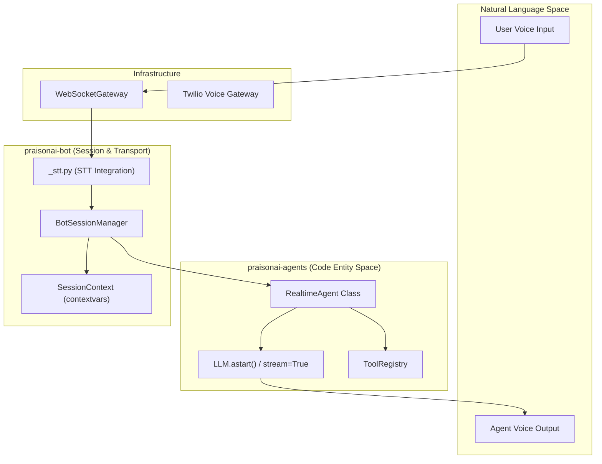
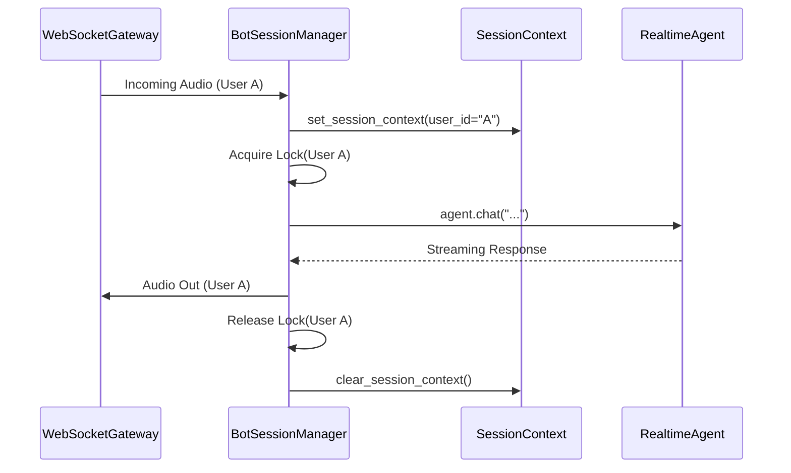

<!-- source: DeepWiki mcp.deepwiki.com · repo MervinPraison/PraisonAI · page 7.5 Realtime Voice Interface · fetched 2026-10-26 -->

# Realtime Voice Interface

Relevant source files

The following files were used as context for generating this wiki page:

- [src/praisonai-agents/praisonaiagents/agent/deep_research_agent.py](src/praisonai-agents/praisonaiagents/agent/deep_research_agent.py)
- [src/praisonai-agents/praisonaiagents/agent/prompt_cache.py](src/praisonai-agents/praisonaiagents/agent/prompt_cache.py)
- [src/praisonai-agents/praisonaiagents/agent/realtime_agent.py](src/praisonai-agents/praisonaiagents/agent/realtime_agent.py)
- [src/praisonai-agents/praisonaiagents/approval/__init__.py](src/praisonai-agents/praisonaiagents/approval/__init__.py)
- [src/praisonai-agents/praisonaiagents/approval/backends.py](src/praisonai-agents/praisonaiagents/approval/backends.py)
- [src/praisonai-agents/praisonaiagents/approval/protocols.py](src/praisonai-agents/praisonaiagents/approval/protocols.py)
- [src/praisonai-agents/praisonaiagents/approval/registry.py](src/praisonai-agents/praisonaiagents/approval/registry.py)
- [src/praisonai-agents/praisonaiagents/approval/utils.py](src/praisonai-agents/praisonaiagents/approval/utils.py)
- [src/praisonai-agents/praisonaiagents/context/aggregator.py](src/praisonai-agents/praisonaiagents/context/aggregator.py)
- [src/praisonai-agents/praisonaiagents/context/fast/parallel_executor.py](src/praisonai-agents/praisonaiagents/context/fast/parallel_executor.py)
- [src/praisonai-agents/praisonaiagents/permissions/doom_loop.py](src/praisonai-agents/praisonaiagents/permissions/doom_loop.py)
- [src/praisonai-agents/praisonaiagents/session/context.py](src/praisonai-agents/praisonaiagents/session/context.py)
- [src/praisonai-agents/praisonaiagents/tools/exa_tools.py](src/praisonai-agents/praisonaiagents/tools/exa_tools.py)
- [src/praisonai-agents/tests/unit/approval/test_scoped_approval.py](src/praisonai-agents/tests/unit/approval/test_scoped_approval.py)
- [src/praisonai-agents/tests/unit/context/test_aggregator.py](src/praisonai-agents/tests/unit/context/test_aggregator.py)
- [src/praisonai-agents/tests/unit/session/test_session_context.py](src/praisonai-agents/tests/unit/session/test_session_context.py)
- [src/praisonai-agents/tests/unit/test_approval_protocol.py](src/praisonai-agents/tests/unit/test_approval_protocol.py)
- [src/praisonai-bot/praisonai_bot/bots/_metrics.py](src/praisonai-bot/praisonai_bot/bots/_metrics.py)
- [src/praisonai-bot/praisonai_bot/bots/_session.py](src/praisonai-bot/praisonai_bot/bots/_session.py)
- [src/praisonai-bot/praisonai_bot/bots/_stt.py](src/praisonai-bot/praisonai_bot/bots/_stt.py)
- [src/praisonai-bot/tests/unit/bots/test_group_session_scope.py](src/praisonai-bot/tests/unit/bots/test_group_session_scope.py)
- [src/praisonai-bot/tests/unit/bots/test_temporal_grounding.py](src/praisonai-bot/tests/unit/bots/test_temporal_grounding.py)
- [src/praisonai-bot/tests/unit/gateway/test_telegram_security_pipeline.py](src/praisonai-bot/tests/unit/gateway/test_telegram_security_pipeline.py)
- [src/praisonai/praisonai/cli/approval_backend.py](src/praisonai/praisonai/cli/approval_backend.py)
- [src/praisonai/praisonai/cli/features/approval.py](src/praisonai/praisonai/cli/features/approval.py)

The Realtime Voice Interface provides low-latency, full-duplex voice communication capabilities for PraisonAI agents. It enables natural interaction through the `RealtimeAgent` class, integrating Speech-to-Text (STT), Large Language Models (LLMs) with streaming support, and per-user session management for bot deployments.

## Architecture Overview

The realtime interface bridges raw audio streams with the PraisonAI agent ecosystem. It utilizes WebSockets for bidirectional streaming and a specialized `BotSessionManager` to maintain conversation state across voice turns.

### System Components

Sources: [src/praisonai-agents/praisonaiagents/agent/realtime_agent.py](), [src/praisonai-bot/praisonai_bot/bots/_session.py:72-101](), [src/praisonai-bot/praisonai_bot/bots/_stt.py]()

## RealtimeAgent Capabilities

The `RealtimeAgent` is a specialized agent type designed for immediate response. Unlike standard agents that wait for full completion, the `RealtimeAgent` leverages `litellm` streaming to provide partial results as they are generated.

### Execution Flow
1.  **Audio Ingress**: Raw audio is received via WebSocket and processed by the STT module.
2.  **Context Resolution**: `BotSessionManager` swaps the `chat_history` based on the user's identity [src/praisonai-bot/praisonai_bot/bots/_session.py:89-94]().
3.  **Streaming Inference**: The agent calls the LLM with `stream=True` [src/praisonai-agents/realtime-streaming.py:8]().
4.  **Tool Interruption**: If a tool is triggered, the agent can pause the audio stream, execute the tool, and resume with the tool's output.

Sources: [src/praisonai-agents/praisonaiagents/agent/realtime_agent.py](), [src/praisonai-bot/praisonai_bot/bots/_session.py:89-94]()

## Session and State Management

Voice interactions require strict session isolation to prevent cross-talk between different users or phone calls. The `BotSessionManager` handles this using `asyncio.Lock` and `contextvars`.

### BotSessionManager Implementation

The `BotSessionManager` serializes concurrent calls from the same user while allowing different users to run in parallel [src/praisonai-bot/praisonai_bot/bots/_session.py:12-14]().

| Feature | Code Entity | Role |
| :--- | :--- | :--- |
| **User Isolation** | `self._locks = LockMap()` | Serializes turns per user ID [src/praisonai-bot/praisonai_bot/bots/_session.py:135](). |
| **History Persistence** | `SessionStoreProtocol` | Saves/Loads `chat_history` from SQLite/Redis [src/praisonai-bot/praisonai_bot/bots/_session.py:8-10](). |
| **Identity Resolution** | `identity_resolver` | Maps multiple platform IDs (e.g., phone, telegram) to one human [src/praisonai-bot/praisonai_bot/bots/_session.py:146-149](). |
| **Task Context** | `SessionContext` | Stores `platform`, `chat_id`, and `user_id` in task-local storage [src/praisonai-agents/praisonaiagents/session/context.py:106-119](). |

Sources: [src/praisonai-bot/praisonai_bot/bots/_session.py:12-14](), [src/praisonai-bot/praisonai_bot/bots/_session.py:135](), [src/praisonai-agents/praisonaiagents/session/context.py:106-119]()

### Concurrent Voice Session Handling

Sources: [src/praisonai-bot/praisonai_bot/bots/_session.py:87-94](), [src/praisonai-agents/praisonaiagents/session/context.py:168-191]()

## Safety and Approval in Voice

Voice agents often have access to dangerous tools (e.g., `execute_command`). PraisonAI implements a real-time approval pipeline that can pause voice execution to wait for human or agent-based permission.

### Approval Pipeline for Voice

1.  **Detection**: `ApprovalRegistry` identifies a "high" or "critical" risk tool call [src/praisonai-agents/praisonaiagents/approval/registry.py:30-48]().
2.  **Interruption**: The voice stream is paused.
3.  **Backend Dispatch**: The request is sent to an `ApprovalProtocol` backend (e.g., `ConsoleBackend` or `AgentApproval`) [src/praisonai-agents/praisonaiagents/approval/protocols.py:119-130]().
4.  **Resumption**: Upon `ApprovalDecision(approved=True)`, the agent continues the voice turn [src/praisonai-agents/praisonaiagents/approval/protocols.py:47-68]().

Sources: [src/praisonai-agents/praisonaiagents/approval/registry.py:30-48](), [src/praisonai-agents/praisonaiagents/approval/protocols.py:119-130](), [src/praisonai-agents/praisonaiagents/approval/protocols.py:47-68]()

## Voice-Enabled Bot Sessions

When deployed via the `praisonai-bot` package, voice agents support group-specific scopes and sender attribution.

*   **Shared Group Scope**: By setting `session_scope="per_chat"`, multiple users in a voice channel share one multi-party transcript [src/praisonai-bot/praisonai_bot/bots/_session.py:118]().
*   **Sender Attribution**: The manager prefixes turns with `[{sender}]` so the agent knows who is speaking in a group [src/praisonai-bot/praisonai_bot/bots/_session.py:119]().
*   **Injection Protection**: Untrusted sender names are passed through `neutralize_untrusted_text` to prevent prompt injection via newlines in usernames [src/praisonai-agents/praisonaiagents/session/context.py:48-69]().

Sources: [src/praisonai-bot/praisonai_bot/bots/_session.py:118-119](), [src/praisonai-agents/praisonaiagents/session/context.py:48-69]()

---

