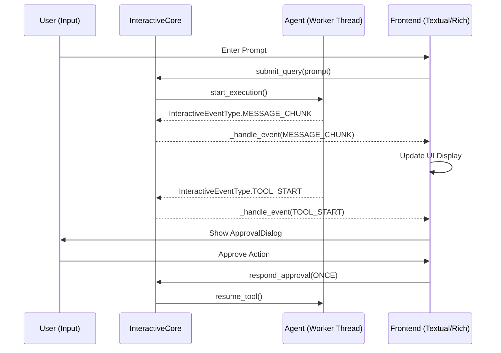

<!-- source: DeepWiki mcp.deepwiki.com · repo MervinPraison/PraisonAI · page 7.6 TUI (Terminal User Interface) · fetched 2026-10-26 -->

# TUI (Terminal User Interface)

<details>
<summary>Relevant source files</summary>

The following files were used as context for generating this wiki page:

- [ARCHITECTURE.md](ARCHITECTURE.md)
- [examples/terminal_bench/praisonai_code_agent.py](examples/terminal_bench/praisonai_code_agent.py)
- [scripts/audit_hybrid_modules.py](scripts/audit_hybrid_modules.py)
- [scripts/c7_wrapper_import_allowlist.txt](scripts/c7_wrapper_import_allowlist.txt)
- [scripts/check_c7_imports.sh](scripts/check_c7_imports.sh)
- [src/praisonai-agents/tests/unit/approval/test_default_tool_safety.py](src/praisonai-agents/tests/unit/approval/test_default_tool_safety.py)
- [src/praisonai-code/praisonai_code/cli/commands/chat.py](src/praisonai-code/praisonai_code/cli/commands/chat.py)
- [src/praisonai-code/praisonai_code/cli/commands/code.py](src/praisonai-code/praisonai_code/cli/commands/code.py)
- [src/praisonai-code/praisonai_code/cli/features/cli_profiler.py](src/praisonai-code/praisonai_code/cli/features/cli_profiler.py)
- [src/praisonai-code/praisonai_code/cli/features/recipe_creator.py](src/praisonai-code/praisonai_code/cli/features/recipe_creator.py)
- [src/praisonai-code/praisonai_code/cli/features/session_checkpoints.py](src/praisonai-code/praisonai_code/cli/features/session_checkpoints.py)
- [src/praisonai-code/praisonai_code/cli/features/tui/widgets/tool_panel.py](src/praisonai-code/praisonai_code/cli/features/tui/widgets/tool_panel.py)
- [src/praisonai-code/praisonai_code/cli/interactive/async_tui.py](src/praisonai-code/praisonai_code/cli/interactive/async_tui.py)
- [src/praisonai-code/praisonai_code/cli/interactive/core.py](src/praisonai-code/praisonai_code/cli/interactive/core.py)
- [src/praisonai-code/praisonai_code/cli/interactive/events.py](src/praisonai-code/praisonai_code/cli/interactive/events.py)
- [src/praisonai-code/praisonai_code/cli/interactive/frontends/rich_frontend.py](src/praisonai-code/praisonai_code/cli/interactive/frontends/rich_frontend.py)
- [src/praisonai-code/praisonai_code/cli/interactive/frontends/textual_frontend.py](src/praisonai-code/praisonai_code/cli/interactive/frontends/textual_frontend.py)
- [src/praisonai-code/praisonai_code/cli/session/unified.py](src/praisonai-code/praisonai_code/cli/session/unified.py)
- [src/praisonai-code/tests/unit/test_chat_auth_exit_code.py](src/praisonai-code/tests/unit/test_chat_auth_exit_code.py)
- [src/praisonai-code/tests/unit/test_code_print_json.py](src/praisonai-code/tests/unit/test_code_print_json.py)
- [src/praisonai-code/tests/unit/test_interactive_approval_pattern.py](src/praisonai-code/tests/unit/test_interactive_approval_pattern.py)
- [src/praisonai-code/tests/unit/test_plan_mode_flag.py](src/praisonai-code/tests/unit/test_plan_mode_flag.py)
- [src/praisonai-code/tests/unit/test_pure_plugin_isolation.py](src/praisonai-code/tests/unit/test_pure_plugin_isolation.py)
- [src/praisonai-code/tests/unit/test_session_fork.py](src/praisonai-code/tests/unit/test_session_fork.py)
- [src/praisonai/praisonai/cli/commands/checkpoint.py](src/praisonai/praisonai/cli/commands/checkpoint.py)
- [src/praisonai/praisonai/cli/commands/code.py](src/praisonai/praisonai/cli/commands/code.py)
- [src/praisonai/praisonai/cli/execution/__init__.py](src/praisonai/praisonai/cli/execution/__init__.py)
- [src/praisonai/praisonai/cli/features/tui/app.py](src/praisonai/praisonai/cli/features/tui/app.py)
- [src/praisonai/praisonai/cli/interactive/async_tui.py](src/praisonai/praisonai/cli/interactive/async_tui.py)
- [src/praisonai/praisonai/cli/legacy/interactive_legacy.py](src/praisonai/praisonai/cli/legacy/interactive_legacy.py)
- [src/praisonai/tests/C7.1_BOUNDARIES.md](src/praisonai/tests/C7.1_BOUNDARIES.md)
- [src/praisonai/tests/C8_BACKLOG.md](src/praisonai/tests/C8_BACKLOG.md)
- [src/praisonai/tests/unit/cli/test_async_tui.py](src/praisonai/tests/unit/cli/test_async_tui.py)
- [src/praisonai/tests/unit/cli/test_interactive_auto_compact.py](src/praisonai/tests/unit/cli/test_interactive_auto_compact.py)
- [src/praisonai/tests/unit/cli/test_interactive_branch.py](src/praisonai/tests/unit/cli/test_interactive_branch.py)
- [src/praisonai/tests/unit/cli/test_unified_session.py](src/praisonai/tests/unit/cli/test_unified_session.py)
- [src/praisonai/tests/unit/code/test_session_checkpoints.py](src/praisonai/tests/unit/code/test_session_checkpoints.py)
- [src/praisonai/tests/unit/code/test_tui_diff_undo.py](src/praisonai/tests/unit/code/test_tui_diff_undo.py)
- [src/praisonai/tests/unit/test_c7_1_boundaries.py](src/praisonai/tests/unit/test_c7_1_boundaries.py)
- [src/praisonai/tests/unit/test_unified_profiler.py](src/praisonai/tests/unit/test_unified_profiler.py)

</details>


The PraisonAI TUI provides a terminal-native, interactive interface for AI agent orchestration. It supports two primary modes: a high-fidelity **Textual** frontend with a multi-pane layout and an **Async TUI** (Rich-based REPL) designed for non-blocking streaming interactions. The TUI layer integrates directly with workspace checkpoints, diff/undo systems, and real-time tool execution monitoring.

## Architecture and Frontends

The TUI system is built on an event-driven core that decouples the agent execution logic from the rendering layer. This allows the same `InteractiveCore` to drive different terminal experiences.

### Component Mapping: Natural Language to Code Entities

The following diagram maps high-level TUI concepts to their implementation classes and files.

**TUI Entity Association**
```mermaid
graph TD
    subgraph "Natural Language Space"
        "Terminal Dashboard"
        "Interactive REPL"
        "Event Stream"
        "Approval Gate"
    end

    subgraph "Code Entity Space"
        "TUIApp"["TUIApp (praisonai_code/cli/features/tui/app.py)"]
        "AsyncTUI"["AsyncTUI (praisonai_code/cli/interactive/async_tui.py)"]
        "InteractiveCore"["InteractiveCore (praisonai_code/cli/interactive/core.py)"]
        "ApprovalDialog"["ApprovalDialog (praisonai_code/cli/interactive/frontends/textual_frontend.py)"]
    end

    "Terminal Dashboard" --- "TUIApp"
    "Interactive REPL" --- "AsyncTUI"
    "Event Stream" --- "InteractiveCore"
    "Approval Gate" --- "ApprovalDialog"
```
**Sources:** [src/praisonai-code/praisonai_code/cli/features/tui/app.py:40-50](), [src/praisonai-code/praisonai_code/cli/interactive/async_tui.py:194-203](), [src/praisonai-code/praisonai_code/cli/interactive/frontends/textual_frontend.py:24-32]()

### 1. Textual TUI (`TUIApp`)
The flagship TUI is built using the `textual` framework. It provides a multi-pane interface including a chat area, a tool execution panel, a background task queue, and a status bar [src/praisonai/praisonai/cli/features/tui/app.py:40-50]().

*   **Async Execution:** Uses `textual.work` and threading to ensure the UI remains responsive while the LLM or tools are executing [src/praisonai-code/praisonai_code/cli/interactive/async_tui.py:11-14]().
*   **Slash Commands:** Supports commands like `/help`, `/clear`, `/model`, `/undo`, and `/diff` to manage the session state [src/praisonai/praisonai/cli/features/tui/app.py:169-191]().
*   **Tool Panel:** A specialized widget that displays real-time tool calls and requires user approval for high-risk operations [src/praisonai-code/praisonai_code/cli/interactive/frontends/textual_frontend.py:85-95]().

### 2. Async TUI / Rich REPL
A lighter-weight, non-blocking REPL used by the `praisonai chat` and `praisonai code` commands when the full Textual dashboard is not invoked.

*   **Non-blocking I/O:** Implements a worker thread to handle LLM calls, allowing the user to continue typing or cancel tasks [src/praisonai-code/praisonai_code/cli/interactive/async_tui.py:194-203]().
*   **Streaming:** Supports real-time text streaming without the overhead of complex widget layouts [src/praisonai/praisonai/cli/legacy/interactive_legacy.py:20-31]().

**Sources:** [src/praisonai/praisonai/cli/features/tui/app.py:40-191](), [src/praisonai-code/praisonai_code/cli/interactive/async_tui.py:1-203](), [src/praisonai/praisonai/cli/legacy/interactive_legacy.py:18-31]()

---

## Data Flow and Interactive Events

The TUI operates by subscribing to an `InteractiveEvent` stream emitted by the `InteractiveCore`.

**TUI Event Propagation**

**Sources:** [src/praisonai-code/praisonai_code/cli/interactive/events.py:15-41](), [src/praisonai-code/praisonai_code/cli/interactive/frontends/textual_frontend.py:47-52]()

### Key Event Types
Events are defined in `praisonai_code.cli.interactive.events.InteractiveEventType`:
*   `MESSAGE_START/CHUNK/END`: Lifecycle of LLM text generation [src/praisonai-code/praisonai_code/cli/interactive/events.py:18-21]().
*   `TOOL_START/END`: Execution of external tools (e.g., shell, file edits) [src/praisonai-code/praisonai_code/cli/interactive/events.py:23-25]().
*   `APPROVAL_ASKED/ANSWERED`: User-in-the-loop permission flow [src/praisonai-code/praisonai_code/cli/interactive/events.py:30-32]().

**Sources:** [src/praisonai-code/praisonai_code/cli/interactive/events.py:1-70]()

---

## Session Checkpoints and Undo Support

The TUI provides integrated support for workspace safety through the checkpoint system.

*   **Auto-Checkpoints:** When enabled via `--checkpoints`, the TUI triggers a workspace snapshot before any file-mutating tool is executed [src/praisonai-code/praisonai_code/cli/commands/code.py:32-32]().
*   **Diff Preview:** The `ApprovalDialog` renders a unified diff of proposed changes so the user can inspect the exact mutation before approving [src/praisonai-code/praisonai_code/cli/interactive/events.py:71-81]().
*   **Undo/Revert:** The `/undo` command allows users to roll back the last set of file changes by restoring the previous checkpoint [src/praisonai/praisonai/cli/legacy/interactive_legacy.py:20-31]().

**Sources:** [src/praisonai-code/praisonai_code/cli/commands/code.py:32-33](), [src/praisonai-code/praisonai_code/cli/interactive/events.py:71-119](), [src/praisonai/praisonai/cli/legacy/interactive_legacy.py:136-136]()

---

## Tool Panel and Approval Logic

The `ApprovalDialog` in the Textual frontend provides granular control over tool permissions during a session.

| Option | Effect |
| :--- | :--- |
| **Allow Once** | Permits the current specific tool call only [src/praisonai-code/praisonai_code/cli/interactive/frontends/textual_frontend.py:175-179](). |
| **Always Allow This Command** | Creates a persistent glob pattern for the specific command/path [src/praisonai-code/praisonai_code/cli/interactive/frontends/textual_frontend.py:180-185](). |
| **Session Only** | Grants permission for the pattern, but only for the duration of the current TUI session [src/praisonai-code/praisonai_code/cli/interactive/frontends/textual_frontend.py:186-191](). |
| **Always Allow All** | Grants a blanket permission for the entire tool (e.g., `shell_command:*`) [src/praisonai-code/praisonai_code/cli/interactive/frontends/textual_frontend.py:144-144](). |
| **Reject** | Denies the execution and sends the failure back to the agent [src/praisonai-code/praisonai_code/cli/interactive/frontends/textual_frontend.py:192-195](). |

**Sources:** [src/praisonai-code/praisonai_code/cli/interactive/frontends/textual_frontend.py:85-195]()

---

## Configuration and Launch

The TUI behavior is governed by `AsyncTUIConfig` and `InteractiveConfig`.

*   **Launch via CLI:**
    *   `praisonai code`: Launches the terminal-native code assistant [src/praisonai-code/praisonai_code/cli/commands/code.py:48-51]().
    *   `praisonai chat`: Launches the interactive REPL [src/praisonai-code/praisonai_code/cli/commands/chat.py:148-152]().
*   **Workspace Binding:** When resuming a session with `--continue`, the TUI automatically binds the tool execution root to the directory where the session originated [src/praisonai/praisonai/cli/legacy/interactive_legacy.py:72-73]().
*   **Plan Mode:** Using `--plan` or `/plan` puts the TUI into a read-only state where mutating tools (write, edit, shell) are automatically denied [src/praisonai-code/praisonai_code/cli/commands/code.py:30-30](), [src/praisonai-code/tests/unit/test_plan_mode_flag.py:135-158]().

**Sources:** [src/praisonai-code/praisonai_code/cli/commands/code.py:19-64](), [src/praisonai-code/praisonai_code/cli/commands/chat.py:54-152](), [src/praisonai-code/praisonai_code/cli/interactive/async_tui.py:81-98](), [src/praisonai-code/tests/unit/test_plan_mode_flag.py:1-50]()

---

