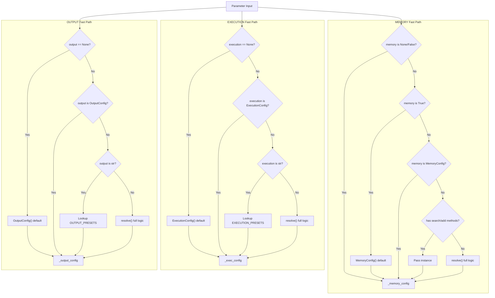
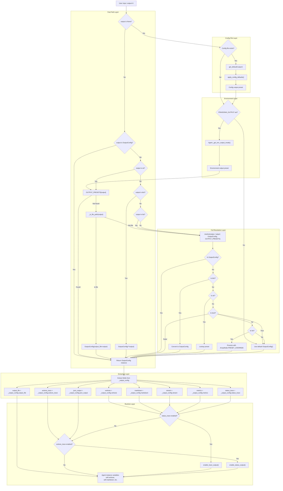

<!-- source: DeepWiki mcp.deepwiki.com · repo MervinPraison/PraisonAI · page 8 Configuration System · fetched 2026-10-26 -->

# Configuration System

<details>
<summary>Relevant source files</summary>

The following files were used as context for generating this wiki page:

- [src/praisonai-agents/praisonaiagents/agent/agent.py](src/praisonai-agents/praisonaiagents/agent/agent.py)
- [src/praisonai-agents/praisonaiagents/agent/chat_mixin.py](src/praisonai-agents/praisonaiagents/agent/chat_mixin.py)
- [src/praisonai-agents/praisonaiagents/agent/durable.py](src/praisonai-agents/praisonaiagents/agent/durable.py)
- [src/praisonai-agents/praisonaiagents/agent/execution_mixin.py](src/praisonai-agents/praisonaiagents/agent/execution_mixin.py)
- [src/praisonai-agents/praisonaiagents/agent/interrupt.py](src/praisonai-agents/praisonaiagents/agent/interrupt.py)
- [src/praisonai-agents/praisonaiagents/agent/loop_detection.py](src/praisonai-agents/praisonaiagents/agent/loop_detection.py)
- [src/praisonai-agents/praisonaiagents/agent/tool_execution.py](src/praisonai-agents/praisonaiagents/agent/tool_execution.py)
- [src/praisonai-agents/praisonaiagents/agents/agents.py](src/praisonai-agents/praisonaiagents/agents/agents.py)
- [src/praisonai-agents/praisonaiagents/config/feature_configs.py](src/praisonai-agents/praisonaiagents/config/feature_configs.py)
- [src/praisonai-agents/praisonaiagents/escalation/doom_loop.py](src/praisonai-agents/praisonaiagents/escalation/doom_loop.py)
- [src/praisonai-agents/praisonaiagents/llm/llm.py](src/praisonai-agents/praisonaiagents/llm/llm.py)
- [src/praisonai-agents/praisonaiagents/llm/openai_client.py](src/praisonai-agents/praisonaiagents/llm/openai_client.py)
- [src/praisonai-agents/praisonaiagents/llm/sanitize.py](src/praisonai-agents/praisonaiagents/llm/sanitize.py)
- [src/praisonai-agents/praisonaiagents/plugins/loop_detection_plugin.py](src/praisonai-agents/praisonaiagents/plugins/loop_detection_plugin.py)
- [src/praisonai-agents/praisonaiagents/tools/call_executor.py](src/praisonai-agents/praisonaiagents/tools/call_executor.py)
- [src/praisonai-agents/praisonaiagents/tools/path_overlap.py](src/praisonai-agents/praisonaiagents/tools/path_overlap.py)
- [src/praisonai-agents/tests/integration/test_responses_api.py](src/praisonai-agents/tests/integration/test_responses_api.py)
- [src/praisonai-agents/tests/test_deferred_progress_tools.py](src/praisonai-agents/tests/test_deferred_progress_tools.py)
- [src/praisonai-agents/tests/test_native_deferred_parity.py](src/praisonai-agents/tests/test_native_deferred_parity.py)
- [src/praisonai-agents/tests/test_parallel_tools.py](src/praisonai-agents/tests/test_parallel_tools.py)
- [src/praisonai-agents/tests/test_tool_timeout.py](src/praisonai-agents/tests/test_tool_timeout.py)
- [src/praisonai-agents/tests/unit/agent/test_durable_run.py](src/praisonai-agents/tests/unit/agent/test_durable_run.py)
- [src/praisonai-agents/tests/unit/agent/test_loop_detector_wiring.py](src/praisonai-agents/tests/unit/agent/test_loop_detector_wiring.py)
- [src/praisonai-agents/tests/unit/llm/test_durable_tool_dispatch.py](src/praisonai-agents/tests/unit/llm/test_durable_tool_dispatch.py)
- [src/praisonai-agents/tests/unit/test_compaction_wiring.py](src/praisonai-agents/tests/unit/test_compaction_wiring.py)
- [src/praisonai-agents/tests/unit/test_doom_loop_no_progress_boundary.py](src/praisonai-agents/tests/unit/test_doom_loop_no_progress_boundary.py)
- [src/praisonai-agents/tests/unit/test_loop_detection.py](src/praisonai-agents/tests/unit/test_loop_detection.py)
- [src/praisonai-code/praisonai_code/cli/commands/config.py](src/praisonai-code/praisonai_code/cli/commands/config.py)
- [src/praisonai-code/praisonai_code/cli/configuration/config.schema.json](src/praisonai-code/praisonai_code/cli/configuration/config.schema.json)
- [src/praisonai-code/praisonai_code/cli/configuration/resolver.py](src/praisonai-code/praisonai_code/cli/configuration/resolver.py)
- [src/praisonai-code/praisonai_code/cli/utils/env_utils.py](src/praisonai-code/praisonai_code/cli/utils/env_utils.py)
- [src/praisonai-code/tests/unit/test_config_env_blob.py](src/praisonai-code/tests/unit/test_config_env_blob.py)
- [src/praisonai-code/tests/unit/test_config_interpolation_provenance.py](src/praisonai-code/tests/unit/test_config_interpolation_provenance.py)
- [src/praisonai-code/tests/unit/test_managed_config_layer.py](src/praisonai-code/tests/unit/test_managed_config_layer.py)

</details>


The Configuration System provides a unified, type-safe approach to configuring agents and their features. It handles parameter resolution, preset management, environment variable integration, and config file loading. The system enables flexible configuration through multiple input formats (bool, string, dict, config objects) while maintaining backward compatibility and performance.

For information about specific feature configurations (memory, knowledge, planning, etc.), see [Consolidated Parameters](#8.1). For preset definitions and defaults, see [Presets and Defaults](#8.2). For environment variable control, see [Environment Variables](#8.3).

---

## Architecture Overview

The configuration system consists of four main layers: presets (named configurations), config classes (typed configuration objects), resolution logic (parameter normalization), and defaults (file-based and environment-based).

**Configuration System Architecture**

```mermaid
graph TB
    subgraph "Input Layer"
        BOOL["bool Input<br/>True/False"]
        STR["str Input<br/>preset names"]
        DICT["dict Input<br/>key-value config"]
        CONFIG["Config Object<br/>XxxConfig instance"]
        INSTANCE["Instance<br/>pre-configured object"]
    end
    
    subgraph "Resolution Layer"
        RESOLVE["resolve()<br/>param_resolver.py"]
        ARRAY_MODE["ArrayMode<br/>resolution strategy"]
        FAST_PATH["Fast Path<br/>common case optimization"]
    end
    
    subgraph "Preset Layer"
        OUTPUT_PRESETS["OUTPUT_PRESETS<br/>silent/verbose/actions/debug"]
        EXECUTION_PRESETS["EXECUTION_PRESETS<br/>fast/balanced/thorough"]
        MEMORY_PRESETS["MEMORY_PRESETS<br/>file/sqlite/mem0"]
        PLANNING_PRESETS["PLANNING_PRESETS<br/>basic/advanced"]
        REFLECTION_PRESETS["REFLECTION_PRESETS<br/>quick/thorough"]
        WEB_PRESETS["WEB_PRESETS<br/>search/fetch/both"]
        CACHING_PRESETS["CACHING_PRESETS<br/>disabled/enabled"]
        CONTEXT_PRESETS["CONTEXT_PRESETS<br/>auto/off/manual"]
    end
    
    subgraph "Config Class Layer"
        OUTPUT_CONFIG["OutputConfig<br/>verbose, markdown, stream"]
        EXECUTION_CONFIG["ExecutionConfig<br/>max_iter, max_rpm, timeout"]
        MEMORY_CONFIG["MemoryConfig<br/>backend, user_id, db"]
        KNOWLEDGE_CONFIG["KnowledgeConfig<br/>sources, retrieval_k"]
        PLANNING_CONFIG["PlanningConfig<br/>tools, reasoning, read_only"]
        REFLECTION_CONFIG["ReflectionConfig<br/>min/max iterations, llm"]
        GUARDRAIL_CONFIG["GuardrailConfig<br/>validator, max_retries"]
        WEB_CONFIG["WebConfig<br/>search, fetch"]
        TEMPLATE_CONFIG["TemplateConfig<br/>system, prompt, response"]
        CACHING_CONFIG["CachingConfig<br/>enabled, prompt_caching"]
        HOOKS_CONFIG["HooksConfig<br/>on_step, middleware"]
        SKILLS_CONFIG["SkillsConfig<br/>sources, dirs"]
    end
    
    subgraph "Defaults Layer"
        ENV_VARS["Environment Variables<br/>PRAISONAI_OUTPUT<br/>OPENAI_MODEL_NAME"]
        CONFIG_FILE["Config File<br/>~/.praison/config.yaml<br/>praisonai.yaml"]
        APPLY_DEFAULTS["apply_config_defaults()<br/>config/loader.py"]
    end
    
    subgraph "Agent Layer"
        AGENT["Agent.__init__()<br/>parameter extraction"]
        AGENT_PARAMS["_output_config<br/>_exec_config<br/>_memory_config<br/>etc."]
    end
    
    BOOL --> RESOLVE
    STR --> RESOLVE
    DICT --> RESOLVE
    CONFIG --> RESOLVE
    INSTANCE --> RESOLVE
    
    RESOLVE --> ARRAY_MODE
    RESOLVE --> FAST_PATH
    
    FAST_PATH --> OUTPUT_PRESETS
    FAST_PATH --> EXECUTION_PRESETS
    FAST_PATH --> MEMORY_PRESETS
    
    RESOLVE --> OUTPUT_PRESETS
    RESOLVE --> EXECUTION_PRESETS
    RESOLVE --> MEMORY_PRESETS
    RESOLVE --> PLANNING_PRESETS
    RESOLVE --> REFLECTION_PRESETS
    RESOLVE --> WEB_PRESETS
    RESOLVE --> CACHING_PRESETS
    RESOLVE --> CONTEXT_PRESETS
    
    OUTPUT_PRESETS --> OUTPUT_CONFIG
    EXECUTION_PRESETS --> EXECUTION_CONFIG
    MEMORY_PRESETS --> MEMORY_CONFIG
    PLANNING_PRESETS --> PLANNING_CONFIG
    REFLECTION_PRESETS --> REFLECTION_CONFIG
    WEB_PRESETS --> WEB_CONFIG
    CACHING_PRESETS --> CACHING_CONFIG
    
    STR --> KNOWLEDGE_CONFIG
    DICT --> GUARDRAIL_CONFIG
    DICT --> TEMPLATE_CONFIG
    STR --> HOOKS_CONFIG
    STR --> SKILLS_CONFIG
    
    ENV_VARS --> RESOLVE
    CONFIG_FILE --> APPLY_DEFAULTS
    APPLY_DEFAULTS --> AGENT
    
    OUTPUT_CONFIG --> AGENT_PARAMS
    EXECUTION_CONFIG --> AGENT_PARAMS
    MEMORY_CONFIG --> AGENT_PARAMS
    KNOWLEDGE_CONFIG --> AGENT_PARAMS
    PLANNING_CONFIG --> AGENT_PARAMS
    REFLECTION_CONFIG --> AGENT_PARAMS
    GUARDRAIL_CONFIG --> AGENT_PARAMS
    WEB_CONFIG --> AGENT_PARAMS
    TEMPLATE_CONFIG --> AGENT_PARAMS
    CACHING_CONFIG --> AGENT_PARAMS
    HOOKS_CONFIG --> AGENT_PARAMS
    SKILLS_CONFIG --> AGENT_PARAMS
    
    AGENT --> AGENT_PARAMS
```



**Sources:** [src/praisonai-agents/praisonaiagents/agent/agent.py:125-136](), [src/praisonai-agents/praisonaiagents/config/param_resolver.py](), [src/praisonai-agents/praisonaiagents/config/presets.py](), [src/praisonai-agents/praisonaiagents/config/feature_configs.py]()

---

## Configuration Resolution System

The `resolve()` function provides unified parameter resolution, converting diverse input types into standardized config objects. It handles bool, string (preset names), dict, config objects, and pre-configured instances.

### Resolution Priority

The resolver follows this precedence chain:

1. **Instance passthrough** - Pre-configured objects (e.g., `Memory` instance, `Knowledge` instance)
2. **Config object** - Typed config classes (e.g., `OutputConfig`, `MemoryConfig`)
3. **Dict** - Configuration dictionaries converted to config objects
4. **String** - Preset names or special strings (URLs, paths, model names)
5. **Bool** - `True` uses defaults, `False` disables feature
6. **Array** - Lists processed based on `ArrayMode` strategy
7. **Default** - Fallback when value is `None`

**Sources:** [src/praisonai-agents/praisonaiagents/config/param_resolver.py]()

### The resolve() Function

Located in [src/praisonai-agents/praisonaiagents/config/param_resolver.py](), the `resolve()` function signature:

```python
def resolve(
    value: Any,
    param_name: str,
    config_class: Type,
    presets: Optional[Dict] = None,
    url_schemes: Optional[Set[str]] = None,
    instance_check: Optional[Callable] = None,
    array_mode: ArrayMode = ArrayMode.PRESET_OVERRIDE,
    string_mode: Optional[str] = None,
    default: Any = None,
) -> Any
```

Key parameters:
- `value` - Input to resolve (any type)
- `config_class` - Target config class (e.g., `OutputConfig`)
- `presets` - Preset dictionary for string lookups
- `url_schemes` - URL schemes for database URLs (e.g., `{"sqlite://", "postgresql://"}`)
- `instance_check` - Function to detect pre-configured instances
- `array_mode` - Strategy for handling list inputs
- `string_mode` - Special string interpretation (e.g., `"llm_model"`, `"path_as_source"`)
- `default` - Fallback value when input is `None`

**Sources:** [src/praisonai-agents/praisonaiagents/config/param_resolver.py]()

### ArrayMode Strategies

The `ArrayMode` enum defines how lists are processed:

| Mode | Behavior | Use Case |
|------|----------|----------|
| `PRESET_OVERRIDE` | Array overrides preset values | General configs (output, execution) |
| `SOURCES` | Array becomes `sources` field | Knowledge sources, skills |
| `SOURCES_WITH_CONFIG` | Array + dict → sources + config | Knowledge with retrieval settings |
| `SINGLE_OR_LIST` | Single item or list preserved | Memory instances |
| `PASSTHROUGH` | Array returned unchanged | Hooks, middleware |

Example resolution with `ArrayMode.SOURCES`:
```python
# Input: ["file1.txt", "file2.pdf"]
# Output: KnowledgeConfig(sources=["file1.txt", "file2.pdf"])
```

**Sources:** [src/praisonai-agents/praisonaiagents/config/param_resolver.py]()

### Fast Path Optimization

The Agent class implements fast path optimization for common configuration patterns to minimize overhead. This avoids calling `resolve()` for typical cases.

**Fast Path Decision Tree**



Fast path implementation examples from [src/praisonai-agents/praisonaiagents/agent/agent.py:619-900]():

**OUTPUT Fast Path:**
```python
# Fast path: None -> silent defaults (use cached env var)
if output is None:
    env_output = Agent._get_env_output_mode()
    if env_output and env_output in OUTPUT_PRESETS:
        output = env_output
    else:
        output = DEFAULT_OUTPUT_MODE
# Fast path: string preset lookup (most common case)
elif isinstance(output, str):
    output_lower = output.lower()
    preset_value = OUTPUT_PRESETS.get(output_lower)
    if preset_value is not None:
        _output_config = OutputConfig(**preset_value)
```

**EXECUTION Fast Path:**
```python
# Fast path: None -> default config (skip resolve() call)
if execution is None:
    _exec_config = ExecutionConfig()
elif isinstance(execution, ExecutionConfig):
    _exec_config = execution
elif isinstance(execution, str):
    preset_value = EXECUTION_PRESETS.get(execution.lower())
    if preset_value is not None:
        _exec_config = ExecutionConfig(**preset_value)
```

**MEMORY Fast Path:**
```python
# Fast path: None/False -> no memory (skip resolve() call)
if memory is None or memory is False:
    _memory_config = None
elif memory is True:
    _memory_config = MemoryConfig()
elif isinstance(memory, MemoryConfig):
    _memory_config = memory
elif hasattr(memory, 'search') and hasattr(memory, 'add'):
    _memory_config = memory  # Memory instance passthrough
```

This optimization reduces parameter resolution overhead from ~10-20ms to <1ms for common patterns (silent mode, default execution, no memory).

**Sources:** [src/praisonai-agents/praisonaiagents/agent/agent.py:619-900]()

---

## Preset System

Presets provide named configurations for common use cases. Each preset is a dictionary that maps to config class fields.

### Preset Dictionaries

Located in [src/praisonai-agents/praisonaiagents/config/presets.py]():

#### OUTPUT_PRESETS

Controls agent output verbosity and format:

| Preset | Fields | Description |
|--------|--------|-------------|
| `"silent"` | `verbose=False, markdown=False, stream=False` | No output (default, fastest) |
| `"actions"` | `verbose=False, actions_trace=True` | Tool calls and results only |
| `"status"` | `verbose=False, status_trace=True, simple_output=True` | Clean inline status |
| `"verbose"` | `verbose=True, markdown=True, stream=False` | Full output with formatting |
| `"stream"` | `verbose=True, stream=True` | Streaming tokens |
| `"json"` | `verbose=False, json_output=True, actions_trace=True` | JSON format |
| `"debug"` | `verbose=True, metrics=True, actions_trace=True` | Debug with metrics |

Default: `"silent"` (can be overridden via `PRAISONAI_OUTPUT` env var)

**Sources:** [src/praisonai-agents/praisonaiagents/config/presets.py]()

#### EXECUTION_PRESETS

Controls execution limits and timing:

| Preset | Fields | Description |
|--------|--------|-------------|
| `"fast"` | `max_iter=10, max_execution_time=30, max_retry_limit=1` | Quick execution |
| `"balanced"` | `max_iter=20, max_execution_time=None, max_retry_limit=2` | Default balanced |
| `"thorough"` | `max_iter=50, max_execution_time=600, max_retry_limit=3` | Extended execution |

**Sources:** [src/praisonai-agents/praisonaiagents/config/presets.py]()

#### MEMORY_PRESETS

Controls memory backend and features:

| Preset | Fields | Description |
|--------|--------|-------------|
| `"file"` | `backend="file", auto_memory=False` | Conversation history only |
| `"history"` | `backend="file", history=True, history_limit=10` | Recent conversation context |
| `"sqlite"` | `backend="sqlite", auto_memory=False` | SQLite storage |
| `"mem0"` | `backend="mem0", learn=True, auto_memory=True` | Full memory with learning |

URL schemes supported: `{"sqlite://", "postgresql://", "mysql://", "mem0://", "supabase://"}`

**Sources:** [src/praisonai-agents/praisonaiagents/config/presets.py]()

#### PLANNING_PRESETS

Controls planning behavior:

| Preset | Fields | Description |
|--------|--------|-------------|
| `"basic"` | `read_only=False, reasoning=False` | Simple planning |
| `"advanced"` | `read_only=False, reasoning=True, tools=True` | Full planning with tools |

**Sources:** [src/praisonai-agents/praisonaiagents/config/presets.py]()

#### REFLECTION_PRESETS

Controls self-reflection iterations:

| Preset | Fields | Description |
|--------|--------|-------------|
| `"quick"` | `min_iterations=1, max_iterations=2` | Fast reflection |
| `"thorough"` | `min_iterations=2, max_iterations=5` | Deep reflection |

**Sources:** [src/praisonai-agents/praisonaiagents/config/presets.py]()

#### WEB_PRESETS

Controls web search and fetch:

| Preset | Fields | Description |
|--------|--------|-------------|
| `"search"` | `search=True, fetch=False` | Search only |
| `"fetch"` | `search=False, fetch=True` | Fetch only |
| `"both"` | `search=True, fetch=True` | Full web access |

**Sources:** [src/praisonai-agents/praisonaiagents/config/presets.py]()

#### CACHING_PRESETS

Controls prompt caching:

| Preset | Fields | Description |
|--------|--------|-------------|
| `"disabled"` | `enabled=False, prompt_caching=None` | No caching |
| `"enabled"` | `enabled=True, prompt_caching=True` | Full caching |

**Sources:** [src/praisonai-agents/praisonaiagents/config/presets.py]()

#### CONTEXT_PRESETS

Controls context management:

| Preset | Fields | Description |
|--------|--------|-------------|
| `"auto"` | `enabled=True, strategy="auto"` | Automatic optimization |
| `"off"` | `enabled=False` | No management |
| `"manual"` | `enabled=True, strategy="manual", max_tokens=4000` | Manual control |

**Sources:** [src/praisonai-agents/praisonaiagents/config/presets.py]()

### Preset Usage

Presets work with all input methods:

```python
# Direct preset string
agent = Agent(name="Test", output="verbose", execution="fast")

# Array with preset override
agent = Agent(name="Test", output=["verbose", {"metrics": True}])

# Preset as starting point for customization
agent = Agent(name="Test", memory="mem0", user_id="alice")
```

**Sources:** [src/praisonai-agents/praisonaiagents/agent/agent.py:619-900](), [src/praisonai-agents/praisonaiagents/config/presets.py]()

---

## Feature Config Classes

Feature config classes provide type-safe configuration with validation. All classes are dataclasses located in [src/praisonai-agents/praisonaiagents/config/feature_configs.py]().

### Core Config Classes

| Class | Key Fields | Purpose |
|-------|-----------|---------|
| `OutputConfig` | `verbose`, `markdown`, `stream`, `metrics`, `actions_trace`, `json_output` | Output control |
| `ExecutionConfig` | `max_iter`, `max_rpm`, `max_execution_time`, `max_retry_limit`, `durable` | Execution limits and durability |
| `MemoryConfig` | `backend`, `user_id`, `session_id`, `db`, `learn`, `auto_memory`, `history` | Memory settings |
| `KnowledgeConfig` | `sources`, `retrieval_k`, `retrieval_threshold`, `rerank`, `rerank_model` | Knowledge/RAG |
| `PlanningConfig` | `tools`, `reasoning`, `read_only`, `approval_callback` | Planning mode |
| `ReflectionConfig` | `min_iterations`, `max_iterations`, `llm`, `prompt` | Self-reflection |
| `GuardrailConfig` | `validator`, `llm_validator`, `max_retries`, `action` | Output validation |
| `WebConfig` | `search`, `fetch`, `provider` | Web access |
| `TemplateConfig` | `system`, `prompt`, `response`, `use_system_prompt` | Prompt templates |
| `CachingConfig` | `enabled`, `prompt_caching` | Caching control |
| `HooksConfig` | `on_step`, `middleware`, `registry` | Event hooks |
| `SkillsConfig` | `sources`, `dirs`, `paths` | Skill loading |
| `LearnConfig` | `persona`, `insights`, `mode`, `backend`, `nudge_interval` | Continuous learning |

**Sources:** [src/praisonai-agents/praisonaiagents/config/feature_configs.py]()

### Config Class Usage

Config classes support multiple input patterns:

```python
from praisonaiagents import Agent, OutputConfig, MemoryConfig

# Direct instantiation
output = OutputConfig(verbose=True, markdown=True, stream=True)
agent = Agent(name="Test", output=output)

# Dict conversion
output = OutputConfig(**{"verbose": True, "markdown": True})
agent = Agent(name="Test", output=output)

# Preset base + overrides
memory = MemoryConfig(backend="mem0", user_id="alice", learn=True)
agent = Agent(name="Test", memory=memory)

# Mixed: preset string + dict override
agent = Agent(name="Test", output=["verbose", {"metrics": True}])
```

**Sources:** [src/praisonai-agents/praisonaiagents/config/feature_configs.py](), [src/praisonai-agents/praisonaiagents/agent/agent.py:399-523]()

### Durable Execution Configuration

The `ExecutionConfig` includes fields for durable execution using the `RunJournal` system. This allows runs to be resumed after interruption.

| Field | Type | Purpose |
|-------|------|---------|
| `durable` | bool | Opt-in to journal-backed execution |
| `journal_path` | str | Path to the SQLite journal database |
| `resume_run_id` | str | Identifier of the run to resume |

**Sources:** [src/praisonai-agents/tests/unit/agent/test_durable_run.py:29-42]()

---

## Environment Variables

Environment variables provide global defaults and runtime control. They're cached at the class level for performance.

### Core Environment Variables

| Variable | Type | Default | Purpose | Code Reference |
|----------|------|---------|---------|----------------|
| `PRAISONAI_OUTPUT` | str | `"silent"` | Default output mode | [agent.py:188-193]() |
| `OPENAI_MODEL_NAME` | str | `"gpt-4o-mini"` | Default LLM model | [agent.py:196-201]() |
| `OPENAI_API_KEY` | str | - | OpenAI API key | [llm.py:355]() |
| `OPENAI_BASE_URL` | str | - | Custom LLM endpoint | [llm.py:356]() |
| `LOGLEVEL` | str | `"INFO"` | Logging level | [agent.py:210-216]() |
| `PRAISONAI_CONFIG_DIR` | str | `~/.praison/` | Config directory | [config/loader.py]() |
| `PRAISONAI_CONFIG_CONTENT` | str | - | Inline JSON/YAML config blob | [resolver.py:62]() |
| `PRAISONAI_CONFIG` | str | - | Path to explicit config file | [resolver.py:67]() |

**Sources:** [src/praisonai-agents/praisonaiagents/agent/agent.py:188-201,210-216](), [src/praisonai-agents/praisonaiagents/llm/llm.py:355-356](), [src/praisonai-code/praisonai_code/cli/configuration/resolver.py:56-67]()

### Environment Variable Resolution

Environment variables are resolved with caching for performance:

```python
# Class-level cache for env vars (avoid repeated os.environ.get)
_env_output_mode = None
_env_output_checked = False
_default_model = None
_default_model_checked = False

@classmethod
def _get_env_output_mode(cls):
    """Get cached PRAISONAI_OUTPUT env var value."""
    if not cls._env_output_checked:
        cls._env_output_mode = os.environ.get('PRAISONAI_OUTPUT', '').lower()
        cls._env_output_checked = True
    return cls._env_output_mode

@classmethod
def _get_default_model(cls):
    """Get cached default model name from OPENAI_MODEL_NAME env var."""
    if not cls._default_model_checked:
        cls._default_model = os.getenv('OPENAI_MODEL_NAME', 'gpt-4o-mini')
        cls._default_model_checked = True
    return cls._default_model
```

This caching reduces repeated environment lookups from O(n) per agent to O(1) amortized.

**Sources:** [src/praisonai-agents/praisonaiagents/agent/agent.py:158-201]()

---

## Config File Loading

Config files provide project-level and user-level defaults. The system searches for config files in multiple locations and supports deep-merge semantics.

### Unified Configuration Resolver

The `praisonai-code` package implements a unified configuration resolver that follows a strict precedence hierarchy:

1. **Managed Policy** - Organization-enforced settings (e.g., `model_allowlist`).
2. **Explicit CLI Flags** - Command-line overrides.
3. **Environment Variables** - Per-key environment variables.
4. **Project Config** - Discovered by walking up from the current working directory.
5. **Global User Config** - Located at `~/.praisonai/config.yaml`.
6. **Managed Defaults** - Suggested organization settings.
7. **Built-in Defaults** - System-wide fallbacks.

**Sources:** [src/praisonai-code/praisonai_code/cli/configuration/resolver.py:1-31]()

### Zero-Disk Config Injection

The user-config layer can be supplied entirely from the environment for read-only or stateless runs:

- `PRAISONAI_CONFIG_CONTENT`: An inline JSON/YAML blob parsed in memory.
- `PRAISONAI_CONFIG`: An explicit path to a configuration file.

**Sources:** [src/praisonai-code/praisonai_code/cli/configuration/resolver.py:56-67]()

### Config-Driven Defaults in Agent

Config file defaults are applied before parameter resolution in [src/praisonai-agents/praisonaiagents/agent/agent.py:544-586]():

```python
from ..config.loader import apply_config_defaults, get_default

# Apply config defaults for LLM if not explicitly set
if llm is None and model is None:
    config_model = get_default("model")
    if config_model:
        llm = config_model

# Apply config defaults for feature params
if memory is None:
    memory = apply_config_defaults("memory", memory, MemoryConfig)
if knowledge is None:
    knowledge = apply_config_defaults("knowledge", knowledge, KnowledgeConfig)
```

**Sources:** [src/praisonai-agents/praisonaiagents/agent/agent.py:544-586]()

---

## Parameter Resolution Flow

The complete parameter resolution flow shows how inputs are transformed into runtime values.

**Parameter Resolution Flow (output= example)**



**Sources:** [src/praisonai-agents/praisonaiagents/agent/agent.py:544-704](), [src/praisonai-agents/praisonaiagents/config/param_resolver.py]()

---

## Performance Considerations

### Caching Strategies

The configuration system uses multiple caching layers:

1. **Class-level env var cache** - [agent.py:158-201]() - Environment variables cached at class level.
2. **Module-level preset cache** - [presets.py]() - Preset dictionaries are module constants.
3. **Lazy Tool Signatures** - [call_executor.py:44-68]() - Tool signature introspection (e.g., `on_progress` support) is memoized using a `WeakKeyDictionary` to avoid memory leaks.

### Lazy Loading

Configuration system components use lazy loading to reduce startup time from ~420ms to ~20ms:

- **Rich console** - Only imported when `output=verbose` [agent.py:43]().
- **LLM module** - Only imported when using LiteLLM or OpenAI clients [agent.py:57-68]().
- **Hooks module** - Only imported when event hooks are active [agent.py:70-82]().

**Sources:** [src/praisonai-agents/praisonaiagents/agent/agent.py:37-92]()

---

