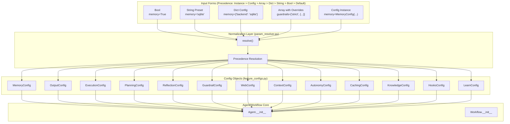
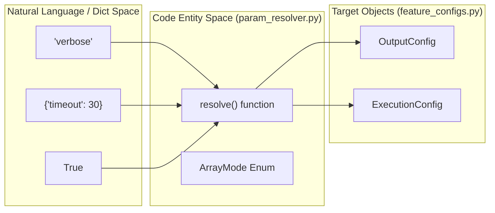
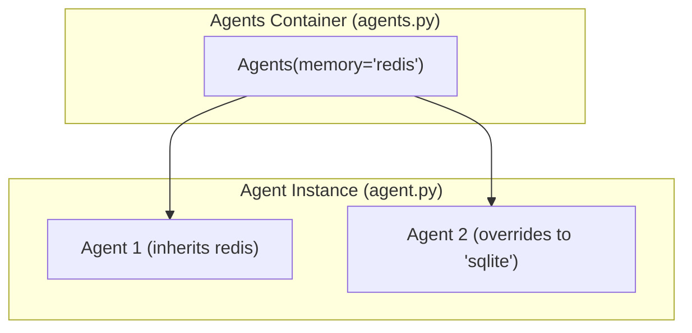

<!-- source: DeepWiki mcp.deepwiki.com · repo MervinPraison/PraisonAI · page 8.1 Consolidated Parameters · fetched 2026-10-26 -->

# Consolidated Parameters

<details>
<summary>Relevant source files</summary>

The following files were used as context for generating this wiki page:

- [api.md](api.md)
- [src/praisonai-agents/praisonaiagents/agent/agent.py](src/praisonai-agents/praisonaiagents/agent/agent.py)
- [src/praisonai-agents/praisonaiagents/agent/chat_mixin.py](src/praisonai-agents/praisonaiagents/agent/chat_mixin.py)
- [src/praisonai-agents/praisonaiagents/agent/durable.py](src/praisonai-agents/praisonaiagents/agent/durable.py)
- [src/praisonai-agents/praisonaiagents/agent/execution_mixin.py](src/praisonai-agents/praisonaiagents/agent/execution_mixin.py)
- [src/praisonai-agents/praisonaiagents/agent/interrupt.py](src/praisonai-agents/praisonaiagents/agent/interrupt.py)
- [src/praisonai-agents/praisonaiagents/agent/loop_detection.py](src/praisonai-agents/praisonaiagents/agent/loop_detection.py)
- [src/praisonai-agents/praisonaiagents/agent/tool_execution.py](src/praisonai-agents/praisonaiagents/agent/tool_execution.py)
- [src/praisonai-agents/praisonaiagents/agents/agents.py](src/praisonai-agents/praisonaiagents/agents/agents.py)
- [src/praisonai-agents/praisonaiagents/config/feature_configs.py](src/praisonai-agents/praisonaiagents/config/feature_configs.py)
- [src/praisonai-agents/praisonaiagents/escalation/doom_loop.py](src/praisonai-agents/praisonaiagents/escalation/doom_loop.py)
- [src/praisonai-agents/praisonaiagents/llm/llm.py](src/praisonai-agents/praisonaiagents/llm/llm.py)
- [src/praisonai-agents/praisonaiagents/llm/openai_client.py](src/praisonai-agents/praisonaiagents/llm/openai_client.py)
- [src/praisonai-agents/praisonaiagents/llm/sanitize.py](src/praisonai-agents/praisonaiagents/llm/sanitize.py)
- [src/praisonai-agents/praisonaiagents/plugins/loop_detection_plugin.py](src/praisonai-agents/praisonaiagents/plugins/loop_detection_plugin.py)
- [src/praisonai-agents/praisonaiagents/tools/call_executor.py](src/praisonai-agents/praisonaiagents/tools/call_executor.py)
- [src/praisonai-agents/praisonaiagents/tools/path_overlap.py](src/praisonai-agents/praisonaiagents/tools/path_overlap.py)
- [src/praisonai-agents/tests/integration/test_responses_api.py](src/praisonai-agents/tests/integration/test_responses_api.py)
- [src/praisonai-agents/tests/test_deferred_progress_tools.py](src/praisonai-agents/tests/test_deferred_progress_tools.py)
- [src/praisonai-agents/tests/test_native_deferred_parity.py](src/praisonai-agents/tests/test_native_deferred_parity.py)
- [src/praisonai-agents/tests/test_parallel_tools.py](src/praisonai-agents/tests/test_parallel_tools.py)
- [src/praisonai-agents/tests/test_tool_timeout.py](src/praisonai-agents/tests/test_tool_timeout.py)
- [src/praisonai-agents/tests/unit/agent/test_durable_run.py](src/praisonai-agents/tests/unit/agent/test_durable_run.py)
- [src/praisonai-agents/tests/unit/agent/test_loop_detector_wiring.py](src/praisonai-agents/tests/unit/agent/test_loop_detector_wiring.py)
- [src/praisonai-agents/tests/unit/llm/test_durable_tool_dispatch.py](src/praisonai-agents/tests/unit/llm/test_durable_tool_dispatch.py)
- [src/praisonai-agents/tests/unit/test_compaction_wiring.py](src/praisonai-agents/tests/unit/test_compaction_wiring.py)
- [src/praisonai-agents/tests/unit/test_doom_loop_no_progress_boundary.py](src/praisonai-agents/tests/unit/test_doom_loop_no_progress_boundary.py)
- [src/praisonai-agents/tests/unit/test_loop_detection.py](src/praisonai-agents/tests/unit/test_loop_detection.py)

</details>


This document describes PraisonAI's **consolidated parameters system**, which provides a unified configuration interface for Agent and Workflow configuration. The system standardizes how core features (memory, output, execution, planning, reflection, guardrails, web, context, autonomy, caching, knowledge, hooks) are configured across the framework through a flexible multi-form input pattern and precedence hierarchy.

For implementation details of individual subsystems, see: [Memory Management](#4.1), [Knowledge Management](#4.2), [Planning System](#3.3), [Reflection System](#3.4), [Guardrails](#6.1). For preset configurations, see [Presets and Defaults](#8.2). For environment-level configuration, see [Environment Variables](#8.3).

## System Overview

The consolidated parameters system implements a **multi-form input pattern** where each parameter accepts multiple input types (bool, string, dict, array, config instance) that are internally normalized to a common configuration object via the `param_resolver`. This provides both simple string-based presets for common use cases and detailed dict/instance configuration for advanced scenarios.



**Sources:** [src/praisonai-agents/praisonaiagents/agent/agent.py:123-134](), [src/praisonai-agents/praisonaiagents/config/feature_configs.py:1-32]()

## Precedence Hierarchy

Configuration values follow a strict precedence ladder when multiple sources provide the same parameter:

```
Instance > Config > Array > Dict > String > Bool > Default
```

| Priority | Form | Example | Description |
|----------|------|---------|-------------|
| 1 (Highest) | Config Instance | `MemoryConfig(backend="sqlite")` | Fully instantiated config object |
| 2 | Array with Overrides | `["strict", {"max_retries": 10}]` | Preset name with dict overrides |
| 3 | Dict Config | `{"backend": "sqlite", "user_id": "user123"}` | Full dict specification |
| 4 | String Preset | `"sqlite"` | Named preset from `MEMORY_PRESETS` |
| 5 | Bool Enable | `True` | Enable with default config |
| 6 (Lowest) | Default | `None` | Framework defaults |

The `Agent` class uses `resolve` from `praisonaiagents.config.param_resolver` to process these inputs during initialization [src/praisonai-agents/praisonaiagents/agent/agent.py:123]().

**Sources:** [src/praisonai-agents/praisonaiagents/agent/agent.py:123-134](), [src/praisonai-agents/praisonaiagents/config/feature_configs.py:34-100]()

## The Consolidated Parameters

### 1. memory and learn
`MemoryConfig` controls agent memory persistence for short-term context, long-term facts, and entities. `LearnConfig` enables continuous learning (persona, insights, patterns) within the memory system [src/praisonai-agents/praisonaiagents/config/feature_configs.py:104-182]().

**Available Memory Backends:** `file`, `sqlite`, `redis`, `valkey`, `postgres`, `mem0`, `mongodb` [src/praisonai-agents/praisonaiagents/config/feature_configs.py:54-63]().

### 2. output
`OutputConfig` controls verbosity and formatting. It includes a `tool_output_limit` (default 16,000 chars) to prevent context window bloat [src/praisonai-agents/praisonaiagents/config/feature_configs.py:45-46]().

### 3. execution
`ExecutionConfig` manages timeouts, retries, and durable execution features. Durable execution allows an agent to resume from a `RunJournal` after an interruption [src/praisonai-agents/tests/unit/agent/test_durable_run.py:32-42]().

**Key Fields:**
- `timeout`: Hard timeout for agent runs.
- `max_retries`: Number of attempts for tool failures.
- `durable`: Boolean to enable `RunJournal` persistence [src/praisonai-agents/tests/unit/agent/test_durable_run.py:30]().

### 4. planning and reflection
`PlanningConfig` enables task decomposition via `PlanningAgent`. `ReflectionConfig` enables self-correction loops where an agent evaluates its own output before finalizing [src/praisonai-agents/praisonaiagents/config/feature_configs.py:7-8]().

### 5. guardrails
`GuardrailConfig` provides safety validation. It can return a `GuardrailResult` which includes a boolean `success` and an optional `score` or `reason` [api.md:15]().

### 6. knowledge
`KnowledgeConfig` manages RAG (Retrieval Augmented Generation). It defines `sources` (files, directories), `chunking_strategy`, and `vector_store` settings [src/praisonai-agents/praisonaiagents/config/feature_configs.py:29-30]().

## Implementation: The Param Resolver

The `param_resolver` is the core engine that converts raw user inputs into structured config objects.



**Sources:** [src/praisonai-agents/praisonaiagents/agent/agent.py:123-134](), [src/praisonai-agents/praisonaiagents/config/feature_configs.py:1-50]()

## Durable Execution Parameters

The `ExecutionConfig` supports a "Durable" mode which uses a `RunJournal` to persist execution state. This allows agents to recover from failures or manual interrupts.

| Parameter | Type | Role |
|-----------|------|------|
| `durable` | bool | Enables/disables journaling [src/praisonai-agents/tests/unit/agent/test_durable_run.py:30]() |
| `journal_path` | str | File path for the SQLite journal database [src/praisonai-agents/tests/unit/agent/test_durable_run.py:34]() |
| `resume_run_id` | str | The ID of a previous run to resume [src/praisonai-agents/tests/unit/agent/test_durable_run.py:35]() |

**Sources:** [src/praisonai-agents/tests/unit/agent/test_durable_run.py:29-42](), [src/praisonai-agents/praisonaiagents/agent/chat_mixin.py:77-88]()

## Multi-Agent Inheritance

When using `AgentTeam` or the `Agents` container, parameters defined at the team level are propagated to individual agents unless overridden.



**Sources:** [src/praisonai-agents/praisonaiagents/agents/agents.py:9-14](), [src/praisonai-agents/praisonaiagents/agent/execution_mixin.py:95-141]()

## Parameter Reference Table

| Parameter | Config Class | Default | Purpose |
|-----------|--------------|---------|---------|
| `memory` | `MemoryConfig` | `None` | Short/Long term state [src/praisonai-agents/praisonaiagents/config/feature_configs.py:186]() |
| `learn` | `LearnConfig` | `None` | Persona/Insight extraction [src/praisonai-agents/praisonaiagents/config/feature_configs.py:104]() |
| `knowledge` | `KnowledgeConfig` | `None` | RAG and document retrieval [src/praisonai-agents/praisonaiagents/config/feature_configs.py:29]() |
| `execution` | `ExecutionConfig` | `balanced` | Timeouts, retries, durability [src/praisonai-agents/praisonaiagents/agent/agent.py:129]() |
| `output` | `OutputConfig` | `normal` | Verbosity and logging [src/praisonai-agents/praisonaiagents/agent/agent.py:129]() |
| `guardrails` | `GuardrailConfig` | `None` | Input/Output validation [src/praisonai-agents/praisonaiagents/agent/agent.py:131]() |
| `autonomy` | `AutonomyConfig` | `None` | Self-direction and loop detection [src/praisonai-agents/praisonaiagents/config/feature_configs.py:40]() |

**Sources:** [src/praisonai-agents/praisonaiagents/agent/agent.py:123-141](), [src/praisonai-agents/praisonaiagents/config/feature_configs.py:1-200]()

---

