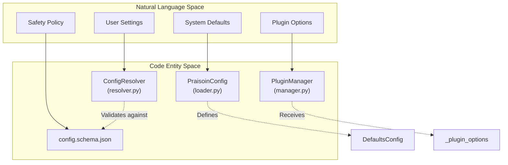
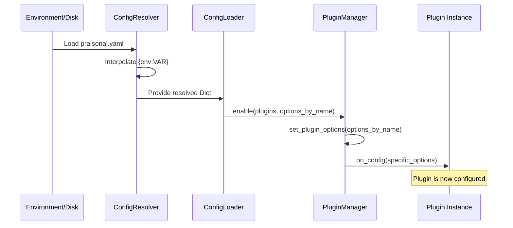

<!-- source: DeepWiki mcp.deepwiki.com · repo MervinPraison/PraisonAI · page 8.2 Presets and Defaults · fetched 2026-10-26 -->

# 8.2 Presets and Defaults

<details>
<summary>Relevant source files</summary>

The following files were used as context for generating this wiki page:

- [src/praisonai-agents/praisonaiagents/config/loader.py](src/praisonai-agents/praisonaiagents/config/loader.py)
- [src/praisonai-agents/praisonaiagents/plugins/__init__.py](src/praisonai-agents/praisonaiagents/plugins/__init__.py)
- [src/praisonai-agents/praisonaiagents/plugins/discovery.py](src/praisonai-agents/praisonaiagents/plugins/discovery.py)
- [src/praisonai-agents/praisonaiagents/plugins/manager.py](src/praisonai-agents/praisonaiagents/plugins/manager.py)
- [src/praisonai-agents/praisonaiagents/plugins/plugin.py](src/praisonai-agents/praisonaiagents/plugins/plugin.py)
- [src/praisonai-agents/praisonaiagents/session/title.py](src/praisonai-agents/praisonaiagents/session/title.py)
- [src/praisonai-agents/tests/test_plugin_registry_and_gate.py](src/praisonai-agents/tests/test_plugin_registry_and_gate.py)
- [src/praisonai-agents/tests/unit/plugins/test_hook_bridge.py](src/praisonai-agents/tests/unit/plugins/test_hook_bridge.py)
- [src/praisonai-agents/tests/unit/plugins/test_plugin_options.py](src/praisonai-agents/tests/unit/plugins/test_plugin_options.py)
- [src/praisonai-agents/tests/unit/plugins/test_plugins.py](src/praisonai-agents/tests/unit/plugins/test_plugins.py)
- [src/praisonai-agents/tests/unit/session/test_title_gen.py](src/praisonai-agents/tests/unit/session/test_title_gen.py)
- [src/praisonai-code/praisonai_code/cli/commands/config.py](src/praisonai-code/praisonai_code/cli/commands/config.py)
- [src/praisonai-code/praisonai_code/cli/commands/plugins.py](src/praisonai-code/praisonai_code/cli/commands/plugins.py)
- [src/praisonai-code/praisonai_code/cli/commands/tools.py](src/praisonai-code/praisonai_code/cli/commands/tools.py)
- [src/praisonai-code/praisonai_code/cli/configuration/config.schema.json](src/praisonai-code/praisonai_code/cli/configuration/config.schema.json)
- [src/praisonai-code/praisonai_code/cli/configuration/resolver.py](src/praisonai-code/praisonai_code/cli/configuration/resolver.py)
- [src/praisonai-code/praisonai_code/cli/utils/env_utils.py](src/praisonai-code/praisonai_code/cli/utils/env_utils.py)
- [src/praisonai-code/tests/unit/test_config_env_blob.py](src/praisonai-code/tests/unit/test_config_env_blob.py)
- [src/praisonai-code/tests/unit/test_config_interpolation_provenance.py](src/praisonai-code/tests/unit/test_config_interpolation_provenance.py)
- [src/praisonai-code/tests/unit/test_managed_config_layer.py](src/praisonai-code/tests/unit/test_managed_config_layer.py)
- [src/praisonai-code/tests/unit/test_tools_list_mcp.py](src/praisonai-code/tests/unit/test_tools_list_mcp.py)
- [src/praisonai/praisonai/cli/configuration/config.schema.json](src/praisonai/praisonai/cli/configuration/config.schema.json)

</details>


## Purpose and Scope

This document describes the preset configuration system in PraisonAI, which provides pre-defined configuration bundles for common use cases. Presets simplify agent configuration by offering named configurations that encapsulate best practices for specific scenarios such as debugging, production deployment, or research workflows.

This page covers the implementation of `PluginManager` options, the `ConfigResolver` hierarchy, and the JSON schema used for project-level validation. For information about how presets are resolved and merged with explicit parameters, see [8.1 Consolidated Parameters](). For environment variable configuration, see [8.3 Environment Variables]().

---

## Configuration Hierarchy and Resolution

The PraisonAI configuration system implements a single, project-aware hierarchy with a strict precedence model. This ensures that organizational policies can be enforced while allowing local developer flexibility.

### Resolution Precedence

The `ConfigResolver` in `praisonai-code` resolves configuration in the following order (highest priority first):

1.  **Managed Policy**: Org-level enforcement (e.g., `permissions`, `model_allowlist`) [src/praisonai-code/praisonai_code/cli/configuration/resolver.py:54-54]().
2.  **Explicit CLI Flags**: Arguments passed directly to the command line [src/praisonai-code/praisonai_code/cli/configuration/resolver.py:10-10]().
3.  **Environment Variables**: Individual keys like `PRAISONAI_MODEL` [src/praisonai-code/praisonai_code/cli/configuration/resolver.py:9-9]().
4.  **Project Config**: Discovered by walking up from the current working directory to the git root [src/praisonai-code/praisonai_code/cli/configuration/resolver.py:8-8]().
5.  **Global User Config**: Located at `~/.praisonai/config.yaml` [src/praisonai-code/praisonai_code/cli/configuration/resolver.py:7-7]().
6.  **Managed Defaults**: Suggested non-policy defaults from a remote source [src/praisonai-code/praisonai_code/cli/configuration/resolver.py:6-6]().
7.  **Built-in Defaults**: Hardcoded system fallbacks [src/praisonai-code/praisonai_code/cli/configuration/resolver.py:5-5]().

### Zero-Disk Config Injection

For stateless environments (CI/CD, Containers), the `user-config` layer (Global + Project) can be injected via environment variables, bypassing file discovery:
*   `PRAISONAI_CONFIG_CONTENT`: An inline JSON/YAML blob [src/praisonai-code/praisonai_code/cli/configuration/resolver.py:62-62]().
*   `PRAISONAI_CONFIG`: An explicit file path [src/praisonai-code/praisonai_code/cli/configuration/resolver.py:67-67]().

**Sources:** [src/praisonai-code/praisonai_code/cli/configuration/resolver.py:4-31](), [src/praisonai-code/tests/unit/test_config_env_blob.py:1-13]()

---

## Config Entity Space Mapping

The following diagram bridges the natural language concepts of "Configuration" to the specific classes and files that implement them.

### Configuration Entity Diagram



**Sources:** [src/praisonai-code/praisonai_code/cli/configuration/resolver.py:32-50](), [src/praisonai-agents/praisonaiagents/config/loader.py:142-187](), [src/praisonai-agents/praisonaiagents/plugins/manager.py:62-69]()

---

## Plugin Presets and Options

The `PluginManager` supports a unified configuration surface where per-plugin options are sourced from the project config and delivered via hooks.

### Plugin Configuration Delivery

Plugins receive their configuration through the `on_config` hook. The `PluginManager` maintains a mapping of `{plugin_name: options_dict}` [src/praisonai-agents/praisonaiagents/plugins/manager.py:68-68]().

1.  **Storage**: `set_plugin_options(options_by_name)` stores the mapping from the unified config [src/praisonai-agents/praisonaiagents/plugins/manager.py:95-125]().
2.  **Delivery**: `apply_plugin_options()` iterates through enabled plugins and calls `plugin.on_config(options)` [src/praisonai-agents/praisonaiagents/plugins/manager.py:130-157]().

### Plugin Lifecycle Decisions

Plugins can influence runtime behavior using `PluginDecision` or by raising `GuardrailBlocked` [src/praisonai-agents/praisonaiagents/plugins/plugin.py:23-40]().

| Action | Entity | Effect |
| :--- | :--- | :--- |
| `PluginDecision.allow()` | `PluginDecision` | Continues execution [src/praisonai-agents/praisonaiagents/plugins/plugin.py:60-61](). |
| `PluginDecision.deny(reason)` | `PluginDecision` | Blocks action with reason [src/praisonai-agents/praisonaiagents/plugins/plugin.py:64-65](). |
| `raise GuardrailBlocked(reason)` | `Exception` | Immediate abort of tool/LLM call [src/praisonai-agents/praisonaiagents/plugins/plugin.py:37-39](). |

**Sources:** [src/praisonai-agents/praisonaiagents/plugins/manager.py:62-157](), [src/praisonai-agents/praisonaiagents/plugins/plugin.py:23-73]()

---

## Config Schema and Validation

PraisonAI uses a JSON Schema to validate `.praisonai/config.yaml` files, providing editor support and preventing runtime errors.

### Schema Structure

The schema defines several top-level sections:
*   `agent`: LLM defaults like `model`, `temperature`, and `memory` [src/praisonai/praisonai/cli/configuration/config.schema.json:10-28]().
*   `rag`: Knowledge base settings including `vector_store` and `top_k` [src/praisonai/praisonai/cli/configuration/config.schema.json:29-44]().
*   `plugins`: Enablement flags and per-plugin option maps [src/praisonai/praisonai/cli/configuration/config.schema.json:56-65]().

### Plugin Configuration Schema

```json
"plugins": {
  "type": "object",
  "properties": {
    "enabled": { "type": ["boolean", "array"] },
    "auto_discover": { "type": "boolean" },
    "directories": { "type": "array", "items": { "type": "string" } }
  },
  "additionalProperties": true
}
```
*Note: `additionalProperties: true` allows the config to contain custom keys for specific plugins (e.g., `pii_redactor: { mode: "strict" }`) [src/praisonai/praisonai/cli/configuration/config.schema.json:59-59]().*

**Sources:** [src/praisonai/praisonai/cli/configuration/config.schema.json:1-68]()

---

## Default Configuration Classes

The `praisonaiagents` core defines defaults using dataclasses to ensure type safety during resolution.

### PraisonConfig Structure

The root configuration is split into `PluginsConfig` and `DefaultsConfig` [src/praisonai-agents/praisonaiagents/config/loader.py:190-200]().

| Class | Key Attributes | Default Value |
| :--- | :--- | :--- |
| `PluginsConfig` | `enabled`, `auto_discover`, `allow_project_plugins` | `enabled=False`, `auto_discover=True` [src/praisonai-agents/praisonaiagents/config/loader.py:110-121](). |
| `DefaultsConfig` | `model`, `allow_delegation`, `code_execution_mode` | `allow_delegation=False`, `code_execution_mode="safe"` [src/praisonai-agents/praisonaiagents/config/loader.py:142-167](). |

### Discovery Logic

The system lazily searches for configuration files in the following order:
1.  `.praisonai/config.toml` / `.yaml`
2.  `praisonai.toml` / `.yaml`
3.  Global user config [src/praisonai-agents/praisonaiagents/config/loader.py:202-212]().

**Sources:** [src/praisonai-agents/praisonaiagents/config/loader.py:109-200]()

---

## Data Flow: Config to Plugin Manager

This diagram illustrates how configuration data flows from the environment and disk into the runtime `PluginManager`.



**Sources:** [src/praisonai-agents/praisonaiagents/plugins/__init__.py:124-205](), [src/praisonai-code/praisonai_code/cli/configuration/resolver.py:1-31](), [src/praisonai-agents/praisonaiagents/plugins/manager.py:95-157]()

---

