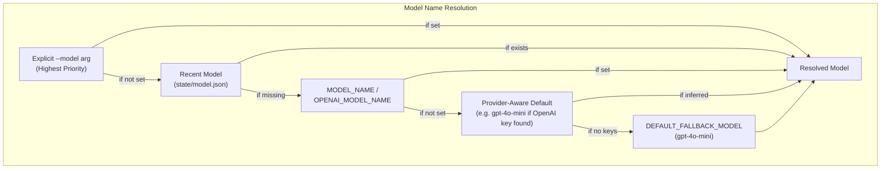
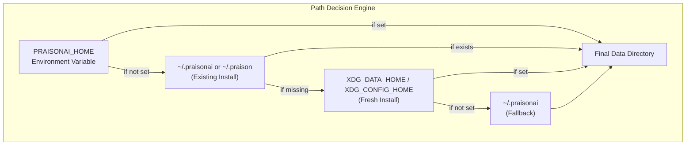

<!-- source: DeepWiki mcp.deepwiki.com · repo MervinPraison/PraisonAI · page 8.3 Environment Variables · fetched 2026-10-26 -->

# Environment Variables

Relevant source files

The following files were used as context for generating this wiki page:

- [.gitignore](.gitignore)
- [src/praisonai-agents/praisonaiagents/paths.py](src/praisonai-agents/praisonaiagents/paths.py)
- [src/praisonai-agents/tests/unit/test_paths.py](src/praisonai-agents/tests/unit/test_paths.py)
- [src/praisonai-code/praisonai_code/cli/commands/auth.py](src/praisonai-code/praisonai_code/cli/commands/auth.py)
- [src/praisonai-code/praisonai_code/cli/commands/setup.py](src/praisonai-code/praisonai_code/cli/commands/setup.py)
- [src/praisonai-code/praisonai_code/cli/configuration/credentials.py](src/praisonai-code/praisonai_code/cli/configuration/credentials.py)
- [src/praisonai-code/praisonai_code/cli/configuration/loader.py](src/praisonai-code/praisonai_code/cli/configuration/loader.py)
- [src/praisonai-code/praisonai_code/cli/configuration/model_resolver.py](src/praisonai-code/praisonai_code/cli/configuration/model_resolver.py)
- [src/praisonai-code/praisonai_code/cli/configuration/oauth.py](src/praisonai-code/praisonai_code/cli/configuration/oauth.py)
- [src/praisonai-code/praisonai_code/cli/configuration/paths.py](src/praisonai-code/praisonai_code/cli/configuration/paths.py)
- [src/praisonai-code/praisonai_code/cli/features/diag.py](src/praisonai-code/praisonai_code/cli/features/diag.py)
- [src/praisonai-code/praisonai_code/cli/features/setup/handler.py](src/praisonai-code/praisonai_code/cli/features/setup/handler.py)
- [src/praisonai-code/praisonai_code/llm/__init__.py](src/praisonai-code/praisonai_code/llm/__init__.py)
- [src/praisonai-code/praisonai_code/llm/catalogue.py](src/praisonai-code/praisonai_code/llm/catalogue.py)
- [src/praisonai-code/praisonai_code/llm/credentials.py](src/praisonai-code/praisonai_code/llm/credentials.py)
- [src/praisonai-code/praisonai_code/llm/env.py](src/praisonai-code/praisonai_code/llm/env.py)
- [src/praisonai-code/tests/unit/test_credential_env_blob.py](src/praisonai-code/tests/unit/test_credential_env_blob.py)
- [src/praisonai-code/tests/unit/test_credential_onboarding.py](src/praisonai-code/tests/unit/test_credential_onboarding.py)
- [src/praisonai-code/tests/unit/test_first_run_coherence.py](src/praisonai-code/tests/unit/test_first_run_coherence.py)
- [src/praisonai-code/tests/unit/test_oauth_provider_registry.py](src/praisonai-code/tests/unit/test_oauth_provider_registry.py)
- [src/praisonai-code/tests/unit/test_setup_onboarding.py](src/praisonai-code/tests/unit/test_setup_onboarding.py)
- [src/praisonai/praisonai/cli/commands/agent.py](src/praisonai/praisonai/cli/commands/agent.py)
- [src/praisonai/praisonai/cli/commands/auth.py](src/praisonai/praisonai/cli/commands/auth.py)
- [src/praisonai/praisonai/cli/commands/command.py](src/praisonai/praisonai/cli/commands/command.py)
- [src/praisonai/praisonai/cli/commands/init.py](src/praisonai/praisonai/cli/commands/init.py)
- [src/praisonai/praisonai/llm/credentials.py](src/praisonai/praisonai/llm/credentials.py)
- [src/praisonai/praisonai/llm/env.py](src/praisonai/praisonai/llm/env.py)
- [src/praisonai/tests/unit/cli/test_auth_functionality.py](src/praisonai/tests/unit/cli/test_auth_functionality.py)
- [src/praisonai/tests/unit/cli/test_auth_oauth.py](src/praisonai/tests/unit/cli/test_auth_oauth.py)
- [src/praisonai/tests/unit/cli/test_config_validation.py](src/praisonai/tests/unit/cli/test_config_validation.py)
- [src/praisonai/tests/unit/cli/test_init_provider_guard.py](src/praisonai/tests/unit/cli/test_init_provider_guard.py)
- [src/praisonai/tests/unit/cli/test_setup_command.py](src/praisonai/tests/unit/cli/test_setup_command.py)
- [src/praisonai/tests/unit/llm/test_credentials_is_configured.py](src/praisonai/tests/unit/llm/test_credentials_is_configured.py)
- [src/praisonai/tests/unit/llm/test_env_resolver.py](src/praisonai/tests/unit/llm/test_env_resolver.py)
- [src/praisonai/tests/unit/test_logging_regression.py](src/praisonai/tests/unit/test_logging_regression.py)

This document describes all environment variables used by PraisonAI for configuration. Environment variables provide the primary mechanism for configuring API keys, model selection, directory paths, service ports, and feature flags across both development and production deployments.

For information about consolidated configuration parameters (memory, output, execution, etc.), see [Consolidated Parameters](#8.1). For preset configurations, see [Presets and Defaults](#8.2).

## Overview

PraisonAI uses environment variables for three primary purposes:

1. **LLM Provider Configuration** - API keys, base URLs, model selection, and endpoint resolution.
2. **Directory and Path Management** - Config directories, database locations, application roots, and XDG-compliant storage.
3. **Service and Runtime Configuration** - Port numbers, hosts, logging levels, telemetry flags, and tool execution safety.

Environment variables can be set via:
- `.env` files (loaded via `python-dotenv`).
- Shell exports (`export VAR_NAME=value`).
- Docker environment declarations (`ENV` in Dockerfiles, `environment:` in docker-compose).
- The `praisonai setup` wizard, which writes to `.env` and `credentials.json` [src/praisonai-code/praisonai_code/cli/features/setup/handler.py:127-143]().

## LLM Provider Configuration

### Model Selection and Resolution

PraisonAI supports multiple environment variables for model configuration with a specific precedence order managed by the `model_resolver` [src/praisonai-code/praisonai_code/cli/configuration/model_resolver.py:112-183]().

**Sources:** [src/praisonai-code/praisonai_code/cli/configuration/model_resolver.py:112-183](), [src/praisonai-code/praisonai_code/llm/env.py:35-45]()

| Variable | Priority | Purpose | Default |
|----------|----------|---------|---------|
| `MODEL_NAME` | 1 | Primary model name selector [src/praisonai-code/praisonai_code/llm/env.py:36]() | - |
| `OPENAI_MODEL_NAME` | 2 | Fallback model name (legacy) [src/praisonai-code/praisonai_code/llm/env.py:36]() | `gpt-4o-mini` |
| `OPENAI_BASE_URL` | 1 | Standard OpenAI SDK base URL [src/praisonai-code/praisonai_code/llm/env.py:37]() | - |
| `OPENAI_API_BASE` | 2 | PraisonAI legacy base URL [src/praisonai-code/praisonai_code/llm/env.py:37]() | - |
| `OLLAMA_API_BASE` | 3 | Ollama-specific base URL [src/praisonai-code/praisonai_code/llm/env.py:37]() | `http://localhost:11434/v1` |

### Provider-Specific Credentials

PraisonAI maps well-known model prefixes to specific environment variables for API keys. The `LLMEndpoint` resolver uses these to build configuration objects [src/praisonai-code/praisonai_code/llm/env.py:17-33]().

| Prefix | API Key Variable | Default Base URL |
|--------|------------------|------------------|
| `anthropic/` | `ANTHROPIC_API_KEY` | `https://api.anthropic.com/v1` |
| `google/` | `GOOGLE_API_KEY` | `https://generativelanguage.googleapis.com/v1beta` |
| `gemini/` | `GEMINI_API_KEY` | `https://generativelanguage.googleapis.com/v1beta` |
| `groq/` | `GROQ_API_KEY` | `https://api.groq.com/openai/v1` |
| `cohere/` | `COHERE_API_KEY` | `https://api.cohere.ai/v1` |
| `openrouter/` | `OPENROUTER_API_KEY` | `https://openrouter.ai/api/v1` |
| `ollama/` | `OLLAMA_API_KEY` | `http://localhost:11434/v1` |

**Sources:** [src/praisonai-code/praisonai_code/llm/env.py:25-33](), [src/praisonai-code/praisonai_code/llm/credentials.py:61-70]()

## Directory and Path Configuration

PraisonAI uses a centralized path utility to manage persistent data. While `PRAISONAI_HOME` is the primary override, the system also respects XDG Base Directory specifications for fresh installs [src/praisonai-agents/praisonaiagents/paths.py:1-37]().

### Path Resolution Logic

**Sources:** [src/praisonai-agents/praisonaiagents/paths.py:73-109](), [src/praisonai-agents/praisonaiagents/paths.py:126-191]()

### Directory Variables

| Variable | Purpose | Default (Local) |
|----------|---------|-----------------|
| `PRAISONAI_HOME` | Single-root override for all data [src/praisonai-agents/praisonaiagents/paths.py:45]() | `~/.praisonai` |
| `XDG_CONFIG_HOME` | Editable config, credentials, rules [src/praisonai-agents/praisonaiagents/paths.py:200]() | `~/.config/praisonai` |
| `XDG_DATA_HOME` | SQLite databases, knowledge bases [src/praisonai-agents/praisonaiagents/paths.py:183]() | `~/.local/share/praisonai` |
| `XDG_STATE_HOME` | Recency state, session logs [src/praisonai-agents/praisonaiagents/paths.py:221]() | `~/.local/state/praisonai` |
| `XDG_CACHE_HOME` | Temporary downloads, embeddings cache [src/praisonai-agents/praisonaiagents/paths.py:241]() | `~/.cache/praisonai` |

## Service and Runtime Configuration

### Tool Safety and Execution
A critical environment variable for security is `PRAISONAI_ALLOW_LOCAL_TOOLS`. When set to `true`, it permits the agent to execute tools that interact with the local filesystem or shell.

### Logging and Debugging
| Variable | Purpose | Values | Default |
|----------|---------|--------|---------|
| `LOGLEVEL` | Global logging verbosity | `DEBUG`, `INFO`, `WARNING`, `ERROR` | `WARNING` |

The CLI entry points route logging configuration through the `LOGLEVEL` environment variable to suppress verbose output from core libraries unless explicitly requested [src/praisonai/praisonai/cli/main.py:18]().

### Telemetry Controls
PraisonAI provides three variables to opt-out of telemetry:
1. `PRAISONAI_TELEMETRY_DISABLED`
2. `PRAISONAI_DISABLE_TELEMETRY`
3. `DO_NOT_TRACK`

Setting any of these to `true` or `1` disables the `TelemetryCollector` [src/praisonai-code/praisonai_code/cli/configuration/loader.py:131-135]().

## Development and Testing

### Test Suite Variables
The CI/CD pipelines and local test runners use specific variables to control test behavior and prevent accidental cloud costs.

| Variable | Purpose | Test Usage |
|----------|---------|------------|
| `OPENAI_API_KEY` | API authentication | Required for `real` marked tests. |
| `PYTHONPATH` | Module resolution | Used to include `praisonai-agents` in the import path. |

**Sources:** [.github/workflows/unittest.yml:34-40](), [.github/workflows/test-core.yml:41-47]()

### Mock vs Real Test Distinction
PraisonAI uses `pytest` markers to distinguish between tests:
- **Mock Tests** (`-m 'not real'`): Run with fake API keys, safe for CI.
- **Real Tests** (`-m real`): Make actual API calls, require valid keys.

**Sources:** [src/praisonai/tests/unit/cli/test_setup_command.py:81-88]()

## Complete Reference Table

| Category | Variable | Purpose | Default |
|----------|----------|---------|---------|
| **LLM Provider** | `MODEL_NAME` | Model selection (primary) | - |
| | `OPENAI_MODEL_NAME` | Model selection (fallback) | `gpt-4o-mini` |
| | `OPENAI_BASE_URL` | API base URL (standard) | - |
| | `OPENAI_API_KEY` | OpenAI API key | - |
| | `ANTHROPIC_API_KEY` | Anthropic API key | - |
| | `GEMINI_API_KEY` | Gemini API key | - |
| **Directories** | `PRAISONAI_HOME` | Main root directory | `~/.praisonai` |
| | `PRAISON_CONFIG_DIR` | Legacy config directory | `~/.praison` |
| **Security** | `PRAISONAI_ALLOW_LOCAL_TOOLS` | Enable shell/file tools | `false` |
| **Logging** | `LOGLEVEL` | Global log level | `WARNING` |
| **Telemetry** | `PRAISONAI_TELEMETRY_DISABLED` | Disable telemetry | - |
| | `DO_NOT_TRACK` | Universal opt-out | - |

**Sources:** [src/praisonai-code/praisonai_code/llm/env.py:35-45](), [src/praisonai-agents/praisonaiagents/paths.py:45-55](), [src/praisonai-code/praisonai_code/cli/commands/auth.py:27-40]()

---

