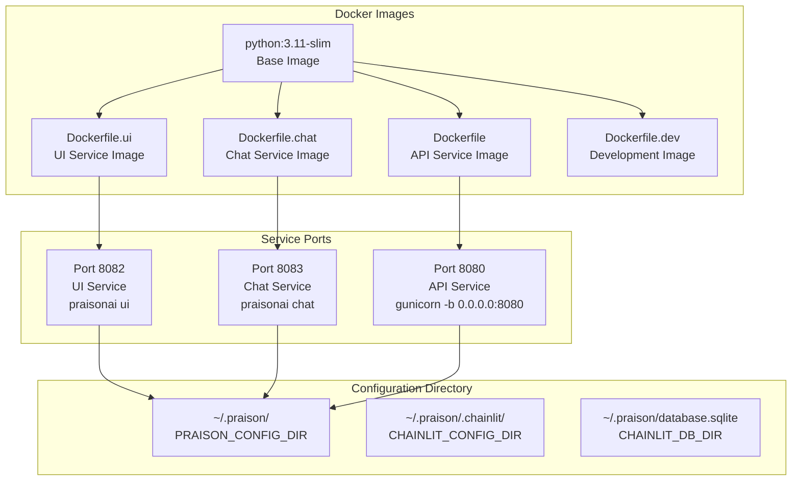
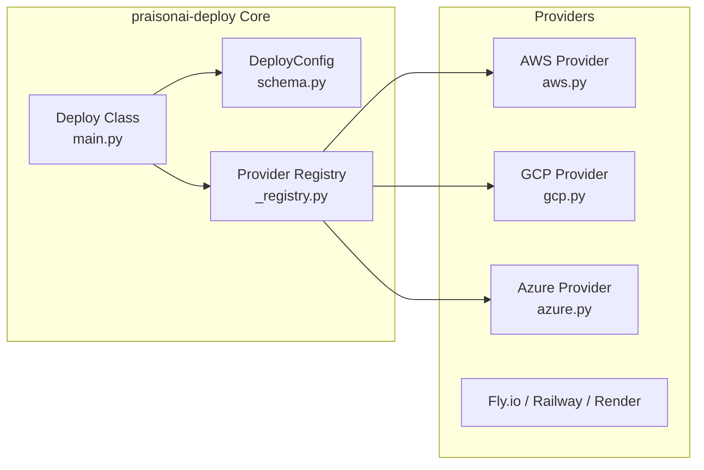
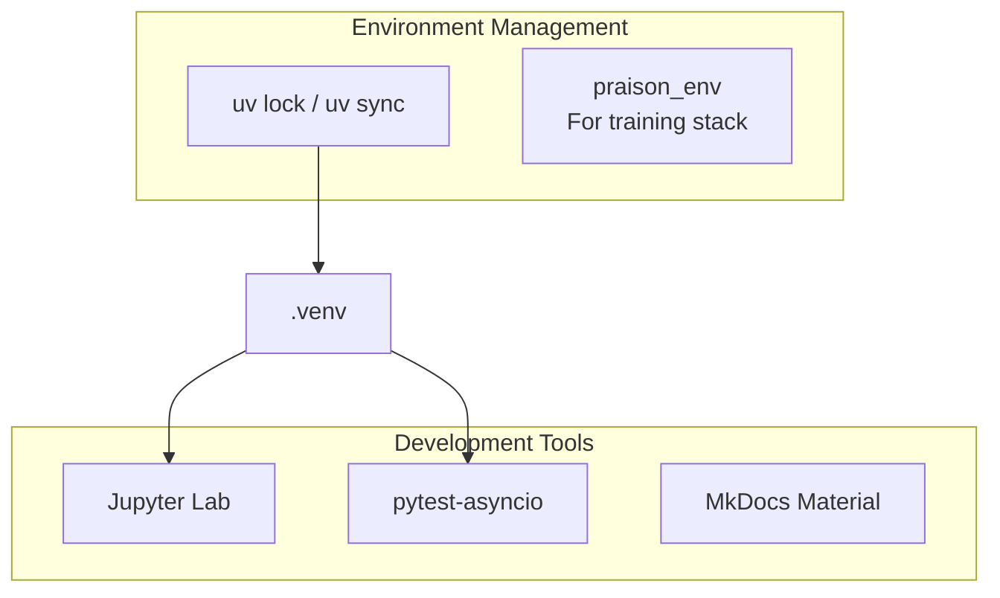
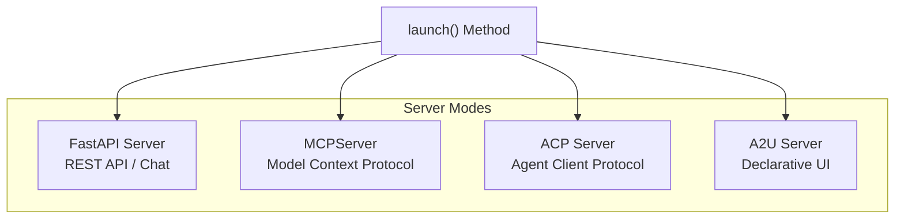

<!-- source: DeepWiki mcp.deepwiki.com · repo MervinPraison/PraisonAI · page 9 Deployment and Infrastructure · fetched 2026-10-26 -->

# Deployment and Infrastructure

Relevant source files

The following files were used as context for generating this wiki page:

- [docker/Dockerfile](docker/Dockerfile)
- [docker/Dockerfile.chat](docker/Dockerfile.chat)
- [docker/Dockerfile.dev](docker/Dockerfile.dev)
- [docker/Dockerfile.ui](docker/Dockerfile.ui)
- [docker/README.md](docker/README.md)
- [src/praisonai-agents/pyproject.toml](src/praisonai-agents/pyproject.toml)
- [src/praisonai-agents/uv.lock](src/praisonai-agents/uv.lock)
- [src/praisonai-deploy/examples/deploy/agents-docker.yaml](src/praisonai-deploy/examples/deploy/agents-docker.yaml)
- [src/praisonai-deploy/praisonai_deploy/_wrapper_bridge.py](src/praisonai-deploy/praisonai_deploy/_wrapper_bridge.py)
- [src/praisonai-deploy/praisonai_deploy/api.py](src/praisonai-deploy/praisonai_deploy/api.py)
- [src/praisonai-deploy/praisonai_deploy/cli/commands/deploy.py](src/praisonai-deploy/praisonai_deploy/cli/commands/deploy.py)
- [src/praisonai-deploy/praisonai_deploy/docker.py](src/praisonai-deploy/praisonai_deploy/docker.py)
- [src/praisonai-deploy/praisonai_deploy/main.py](src/praisonai-deploy/praisonai_deploy/main.py)
- [src/praisonai-deploy/praisonai_deploy/models.py](src/praisonai-deploy/praisonai_deploy/models.py)
- [src/praisonai-deploy/praisonai_deploy/providers/_registry.py](src/praisonai-deploy/praisonai_deploy/providers/_registry.py)
- [src/praisonai-deploy/praisonai_deploy/providers/aws.py](src/praisonai-deploy/praisonai_deploy/providers/aws.py)
- [src/praisonai-deploy/praisonai_deploy/providers/azure.py](src/praisonai-deploy/praisonai_deploy/providers/azure.py)
- [src/praisonai-deploy/praisonai_deploy/providers/gcp.py](src/praisonai-deploy/praisonai_deploy/providers/gcp.py)
- [src/praisonai-deploy/praisonai_deploy/scheduler/deployment.py](src/praisonai-deploy/praisonai_deploy/scheduler/deployment.py)
- [src/praisonai-deploy/praisonai_deploy/schema.py](src/praisonai-deploy/praisonai_deploy/schema.py)
- [src/praisonai-deploy/tests/test_api.py](src/praisonai-deploy/tests/test_api.py)
- [src/praisonai-deploy/tests/test_destroy_api.py](src/praisonai-deploy/tests/test_destroy_api.py)
- [src/praisonai-deploy/tests/test_docker.py](src/praisonai-deploy/tests/test_docker.py)
- [src/praisonai-deploy/tests/test_schema.py](src/praisonai-deploy/tests/test_schema.py)
- [src/praisonai/praisonai.rb](src/praisonai/praisonai.rb)
- [src/praisonai/praisonai/cli/main.py](src/praisonai/praisonai/cli/main.py)
- [src/praisonai/praisonai/version.py](src/praisonai/praisonai/version.py)
- [src/praisonai/pyproject.toml](src/praisonai/pyproject.toml)
- [src/praisonai/tests/PRAISONAI_DEPLOY_MANIFEST.md](src/praisonai/tests/PRAISONAI_DEPLOY_MANIFEST.md)
- [src/praisonai/uv.lock](src/praisonai/uv.lock)

This document covers the deployment options, infrastructure setup, and environment configuration for PraisonAI. It includes Docker containerization, cloud deployment across multiple providers, development environment setup, and the unified API server launch system.

For information about CI/CD pipelines and automated testing, see [Testing and Quality Assurance](#11). For package structure and dependency management details, see [Package System](#10).

---

## Overview

PraisonAI provides a tiered deployment strategy ranging from local development to multi-cloud production environments:

- **Docker Containers**: Specialized services for UI, Chat, API, and development environments [docker/README.md:7-19]().
- **Cloud Deployment**: The `praisonai-deploy` package provides the `Deploy` class and `DeployConfig` for automated deployment to AWS, Azure, GCP, Fly, Railway, and Render [src/praisonai/pyproject.toml:22]().
- **Local Development**: Virtual environment setup optimized with the `uv` package manager for fast dependency resolution [src/praisonai/uv.lock:1-12]().
- **API Server Launch**: A unified `launch()` method for starting FastAPI, MCP, and ACP servers [src/praisonaiagents/pyproject.toml:56-66]().

---

## Docker Service Architecture

**Title**: Docker Service Architecture and Configuration Flow

The Docker setup provides four specialized images, each with specific purposes. All services use a unified configuration directory `~/.praison/` to avoid cluttering the root filesystem, managed via `PRAISON_CONFIG_DIR`, `CHAINLIT_CONFIG_DIR`, and `CHAINLIT_DB_DIR` environment variables [docker/Dockerfile.ui:27-30]().

For details, see [Docker Deployment](#9.1).

**Sources**: [docker/Dockerfile.ui:1-33](), [docker/Dockerfile.chat:1-33](), [docker/Dockerfile:1-46](), [docker/Dockerfile.dev:1-47](), [docker/README.md:59-74]()

---

## Cloud Deployment (praisonai-deploy)

The `praisonai-deploy` package modernizes cloud deployment by providing a provider-agnostic interface for containerized agent applications. It handles Docker containerization, API server generation, and cloud-specific orchestration (e.g., Helm charts for Kubernetes, Cloud Run for GCP).

**Title**: praisonai-deploy Architecture

Key features include:
- **Multi-Cloud Support**: Native providers for AWS, Azure, and GCP [src/praisonai/pyproject.toml:22]().
- **Deployment Manifests**: Tracks deployment state and boundaries [src/praisonai/tests/PRAISONAI_DEPLOY_MANIFEST.md:1-10]().
- **CLI Integration**: Commands for deploying agents directly from YAML configurations [src/praisonai-deploy/praisonai_deploy/cli/commands/deploy.py:1-20]().

For details, see [Cloud Deployment](#9.2).

**Sources**: [src/praisonai/pyproject.toml:22](), [src/praisonai-deploy/praisonai_deploy/main.py:1-50](), [src/praisonai-deploy/praisonai_deploy/schema.py:1-30]()

---

## Development Environment

PraisonAI utilizes a monorepo structure managed with the `uv` package manager for near-instant dependency resolution and virtual environment management.

**Title**: Development Stack

The development environment includes:
- **Fast Resolution**: `uv.lock` files ensure deterministic builds [src/praisonai/uv.lock:1-20]().
- **Boundary Verification**: Scripts to verify C7–C14 package boundaries and import direction gates.
- **Optional Dependencies**: Heavy ML stacks for training or UI features are separated into optional groups like `[train]`, `[ui]`, and `[knowledge]` [src/praisonai/pyproject.toml:45-123]().

For details, see [Development Environment](#9.3).

**Sources**: [src/praisonai/pyproject.toml:167-206](), [src/praisonai-agents/pyproject.toml:1-21](), [docker/Dockerfile.dev:21-35]()

---

## API Server Launch

The `launch()` method serves as the entry point for various server modes, including FastAPI for REST interactions and MCP (Model Context Protocol) for tool/context sharing.

**Title**: Server Launch Entry Points

Deployment highlights:
- **Jobs System**: Includes a server, store, executor, and router for managing long-running agent tasks.
- **Protocol Support**: Native support for `agent-client-protocol` (ACP) and `a2ui-agent-sdk` [src/praisonai/pyproject.toml:110-113, 157-159]().
- **Production Servers**: Uses `uvicorn` or `gunicorn` depending on the service type [docker/Dockerfile:46]().

For details, see [API Server Launch](#9.4).

**Sources**: [src/praisonai/pyproject.toml:49-60](), [src/praisonaiagents/pyproject.toml:56-66](), [docker/Dockerfile:46]()

---

## Configuration Resolution

PraisonAI uses a hierarchical resolution system for configuration:

1.  **CLI Arguments**: Highest priority (e.g., `--model`).
2.  **Environment Variables**: `MODEL_NAME` or `OPENAI_MODEL_NAME` [src/praisonai/praisonai/deploy.py:92-96]().
3.  **Project `.env`**: Loaded via `python-dotenv`.
4.  **Global Config**: Located in `~/.praison/config/`.
5.  **Defaults**: Hardcoded fallbacks (e.g., `gpt-4o-mini`).

**Sources**: [src/praisonai/praisonai/deploy.py:92-96](), [docker/README.md:70-74]()

---

