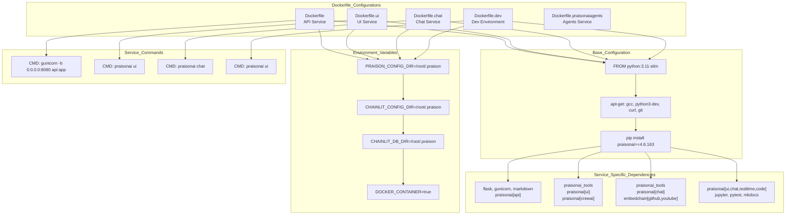
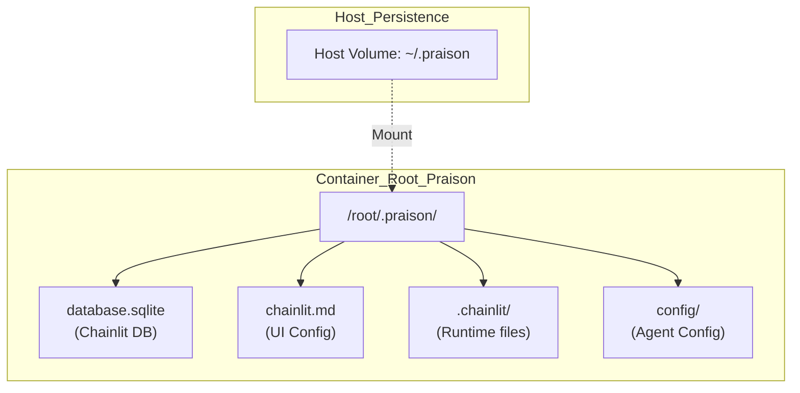
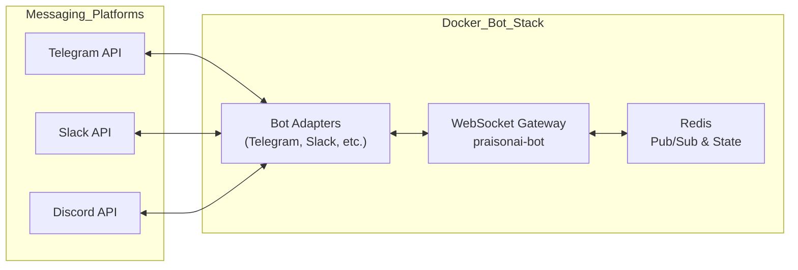

<!-- source: DeepWiki mcp.deepwiki.com · repo MervinPraison/PraisonAI · page 9.1 Docker Deployment · fetched 2026-10-26 -->

# Docker Deployment

<details>
<summary>Relevant source files</summary>

The following files were used as context for generating this wiki page:

- [docker/.env.template](docker/.env.template)
- [docker/Dockerfile](docker/Dockerfile)
- [docker/Dockerfile.chat](docker/Dockerfile.chat)
- [docker/Dockerfile.claw](docker/Dockerfile.claw)
- [docker/Dockerfile.dev](docker/Dockerfile.dev)
- [docker/Dockerfile.praisonaiagents](docker/Dockerfile.praisonaiagents)
- [docker/Dockerfile.ui](docker/Dockerfile.ui)
- [docker/README.md](docker/README.md)
- [docker/bots/.env.template](docker/bots/.env.template)
- [docker/bots/Dockerfile](docker/bots/Dockerfile)
- [docker/bots/README.md](docker/bots/README.md)
- [docker/bots/docker-compose.yml](docker/bots/docker-compose.yml)
- [docker/docker-compose.dev.yml](docker/docker-compose.dev.yml)
- [docker/docker-compose.yml](docker/docker-compose.yml)
- [docker/quick-start.sh](docker/quick-start.sh)
- [src/praisonai-agents/pyproject.toml](src/praisonai-agents/pyproject.toml)
- [src/praisonai-agents/uv.lock](src/praisonai-agents/uv.lock)
- [src/praisonai/praisonai.rb](src/praisonai/praisonai.rb)
- [src/praisonai/praisonai/claw/__init__.py](src/praisonai/praisonai/claw/__init__.py)
- [src/praisonai/praisonai/cli/main.py](src/praisonai/praisonai/cli/main.py)
- [src/praisonai/praisonai/version.py](src/praisonai/praisonai/version.py)
- [src/praisonai/pyproject.toml](src/praisonai/pyproject.toml)
- [src/praisonai/tests/README.md](src/praisonai/tests/README.md)
- [src/praisonai/uv.lock](src/praisonai/uv.lock)

</details>


This document covers Docker-based deployment options for PraisonAI, including containerized services, multi-service orchestration, and cloud deployment capabilities. The system provides multiple Docker configurations for different use cases including API services, web interfaces, and development environments.

## Docker Architecture Overview

PraisonAI provides five distinct Docker service configurations, each built on a `python:3.11-slim` base image [docker/Dockerfile:1]() and using standardized directory management via `/root/.praison`. The deployment architecture separates concerns between API, UI, Chat, Claw, and Development services while maintaining consistent configuration patterns.

### Docker Service Architecture



Sources: [docker/Dockerfile:1-46](), [docker/Dockerfile.ui:1-33](), [docker/Dockerfile.chat:1-33](), [docker/Dockerfile.dev:1-47](), [docker/README.md:1-20]()

## Available Docker Services

The system provides multiple Docker configurations, each optimized for specific deployment scenarios as described in [docker/README.md:5-20]().

| Service | Dockerfile | Port | PraisonAI Version | Key Dependencies | Default CMD |
|---------|------------|------|-------------------|-----------------|-------------|
| **API** | `Dockerfile` | 8080 | latest | flask, praisonai[api], gunicorn | `gunicorn -b 0.0.0.0:8080 api:app` |
| **UI** | `Dockerfile.ui` | 8082 | >=4.6.163 | praisonai[ui], praisonai[crewai] | `praisonai ui` |
| **Chat** | `Dockerfile.chat` | 8083 | >=4.6.163 | praisonai[chat], embedchain | `praisonai chat` |
| **Dev** | `Dockerfile.dev` | 8082 | >=4.6.163 | praisonai[all], jupyter, pytest | `praisonai ui` |
| **Agents** | `Dockerfile.praisonaiagents` | - | latest | praisonaiagents | - |

### API Service Configuration

The API service creates a minimal Flask application if `api.py` doesn't exist, providing a health check endpoint [docker/Dockerfile:33-43](). It uses Gunicorn for production-grade serving [docker/Dockerfile:46]().

### UI and Chat Service Configuration

Both UI and Chat services use the Chainlit-based web interface. The UI service includes `praisonai[crewai]` for multi-framework support [docker/Dockerfile.ui:21](), while the Chat service includes `embedchain` for knowledge-based interactions [docker/Dockerfile.chat:21]().

### Development Service Configuration

The development image [docker/Dockerfile.dev:1-47]() includes additional system dependencies for audio support (`portaudio19-dev`) and development tools like `vim` and `nano` [docker/Dockerfile.dev:9-14](). It installs a comprehensive suite of PraisonAI components, including `realtime` and `code` extras [docker/Dockerfile.dev:24-27](), along with `jupyterlab` and `pytest` [docker/Dockerfile.dev:29-33]().

Sources: [docker/Dockerfile:1-46](), [docker/Dockerfile.ui:1-33](), [docker/Dockerfile.chat:1-33](), [docker/Dockerfile.dev:1-47](), [docker/README.md:78-100]()

## Directory Management Solution

To prevent root directory clutter, PraisonAI implements a standardized directory management solution using the `/root/.praison` path within containers [docker/README.md:55-67]().

### Environment Variable Mapping

The following environment variables are set in all Dockerfile variants to enforce this structure:
- `PRAISON_CONFIG_DIR=/root/.praison` [docker/Dockerfile:29]()
- `CHAINLIT_CONFIG_DIR=/root/.praison` [docker/Dockerfile.ui:28]()
- `CHAINLIT_DB_DIR=/root/.praison` [docker/Dockerfile.ui:29]()
- `DOCKER_CONTAINER=true` [docker/Dockerfile:30]()

### Internal Directory Structure



Sources: [docker/README.md:58-74](), [docker/Dockerfile.dev:41-44]()

## Multi-Service Orchestration

The `docker-compose.yml` configuration enables simultaneous deployment of multiple PraisonAI services with coordinated networking and shared environment variables [docker/README.md:35-51]().

### Service Endpoints

| Service | Host Port | Internal Port | Endpoint |
|---------|-----------|---------------|----------|
| UI | 8082 | 8082 | `http://localhost:8082` |
| Chat | 8083 | 8083 | `http://localhost:8083` |
| API | 8080 | 8080 | `http://localhost:8080` |

### Health Checks

All services include health checks to ensure reliability within the orchestration layer [docker/README.md:112-119]():
```yaml
healthcheck:
  test: ["CMD", "curl", "-f", "http://localhost:PORT"]
  interval: 10s
  timeout: 5s
  retries: 3
```

Sources: [docker/README.md:103-119](), [docker/docker-compose.yml]()

## Quick-Start Script

The `docker/quick-start.sh` script automates the deployment process. It performs the following steps:
1. Validates the environment.
2. Creates the necessary `.env` file from `.env.template`.
3. Pulls or builds the required Docker images.
4. Launches the multi-service stack using `docker-compose`.

Sources: [docker/quick-start.sh](), [docker/README.md:21-33]()

## Bot and Gateway Deployment

The `docker/bots/` directory contains specialized configurations for deploying messaging bots (Telegram, Slack, Discord, WhatsApp) via the PraisonAI Gateway [docker/bots/README.md]().

### Bot Deployment Architecture



The bot stack utilizes `praisonai-bot[bot]` [src/praisonai/pyproject.toml:213-216]() and requires specific environment variables for each messaging platform, managed via `docker/bots/.env.template`.

Sources: [src/praisonai/pyproject.toml:213-216](), [docker/bots/docker-compose.yml](), [docker/bots/README.md]()

---

