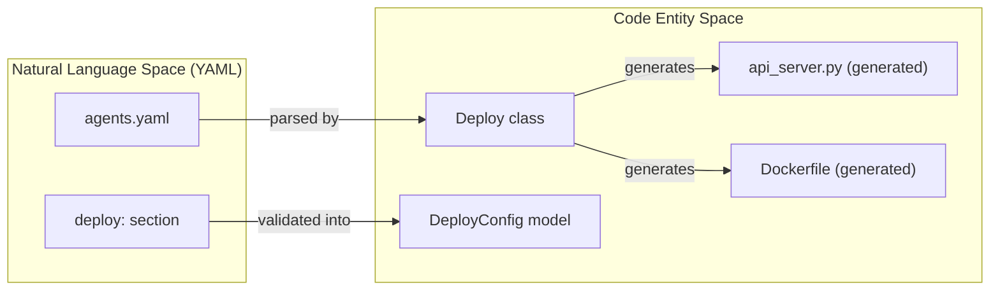
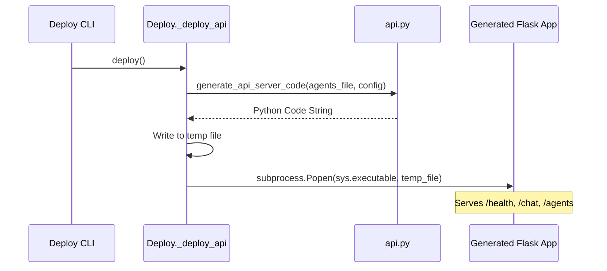

<!-- source: DeepWiki mcp.deepwiki.com · repo MervinPraison/PraisonAI · page 9.2 Cloud Deployment · fetched 2026-10-26 -->

# Cloud Deployment

<details>
<summary>Relevant source files</summary>

The following files were used as context for generating this wiki page:

- [src/praisonai-deploy/examples/deploy/agents-docker.yaml](src/praisonai-deploy/examples/deploy/agents-docker.yaml)
- [src/praisonai-deploy/praisonai_deploy/_wrapper_bridge.py](src/praisonai-deploy/praisonai_deploy/_wrapper_bridge.py)
- [src/praisonai-deploy/praisonai_deploy/api.py](src/praisonai-deploy/praisonai_deploy/api.py)
- [src/praisonai-deploy/praisonai_deploy/cli/commands/deploy.py](src/praisonai-deploy/praisonai_deploy/cli/commands/deploy.py)
- [src/praisonai-deploy/praisonai_deploy/docker.py](src/praisonai-deploy/praisonai_deploy/docker.py)
- [src/praisonai-deploy/praisonai_deploy/main.py](src/praisonai-deploy/praisonai_deploy/main.py)
- [src/praisonai-deploy/praisonai_deploy/models.py](src/praisonai-deploy/praisonai_deploy/models.py)
- [src/praisonai-deploy/praisonai_deploy/providers/_registry.py](src/praisonai-deploy/praisonai_deploy/providers/_registry.py)
- [src/praisonai-deploy/praisonai_deploy/providers/aws.py](src/praisonai-deploy/praisonai_deploy/providers/aws.py)
- [src/praisonai-deploy/praisonai_deploy/providers/azure.py](src/praisonai-deploy/praisonai_deploy/providers/azure.py)
- [src/praisonai-deploy/praisonai_deploy/providers/gcp.py](src/praisonai-deploy/praisonai_deploy/providers/gcp.py)
- [src/praisonai-deploy/praisonai_deploy/scheduler/deployment.py](src/praisonai-deploy/praisonai_deploy/scheduler/deployment.py)
- [src/praisonai-deploy/praisonai_deploy/schema.py](src/praisonai-deploy/praisonai_deploy/schema.py)
- [src/praisonai-deploy/tests/test_api.py](src/praisonai-deploy/tests/test_api.py)
- [src/praisonai-deploy/tests/test_destroy_api.py](src/praisonai-deploy/tests/test_destroy_api.py)
- [src/praisonai-deploy/tests/test_docker.py](src/praisonai-deploy/tests/test_docker.py)
- [src/praisonai-deploy/tests/test_schema.py](src/praisonai-deploy/tests/test_schema.py)
- [src/praisonai/tests/PRAISONAI_DEPLOY_MANIFEST.md](src/praisonai/tests/PRAISONAI_DEPLOY_MANIFEST.md)

</details>


This document covers PraisonAI's cloud deployment capabilities provided by the `praisonai-deploy` package. It details the unified deployment interface, Docker containerization, API server generation, and multi-cloud provider support (AWS, Azure, GCP, Fly, Railway, Render).

## Overview

The `praisonai-deploy` package provides a standardized way to move PraisonAI agents from local development to production environments. It uses a configuration-driven approach, typically defined in an `agents.yaml` file, to manage different deployment targets including local API servers, Docker containers, and managed cloud services [src/praisonai-deploy/praisonai_deploy/main.py:16-36]().

## Deployment Core Entities

The system is built around the `Deploy` class, which orchestrates the transition from "Natural Language Space" (agent definitions in YAML) to "Code Entity Space" (running servers and containers).

### Entity Mapping


Sources: [src/praisonai-deploy/praisonai_deploy/main.py:16-36](), [src/praisonai-deploy/praisonai_deploy/schema.py:10-82]()

### The Deploy Class
The `Deploy` class is the primary entry point for all deployment operations. It supports three main deployment types: `API`, `DOCKER`, and `CLOUD` [src/praisonai-deploy/praisonai_deploy/main.py:80-85]().

| Method | Description | Source |
| :--- | :--- | :--- |
| `from_yaml(agents_file)` | Factory method to create a Deploy instance from a YAML configuration. | [main.py:49-68]() |
| `deploy(background)` | Executes the deployment based on the configured type. | [main.py:70-91]() |
| `plan()` | Generates a dictionary representing the deployment steps without executing them. | [main.py:143-170]() |
| `doctor()` | Runs health checks specific to the deployment type (e.g., checking if Docker is installed). | [main.py:172-195]() |

## API Server Generation

PraisonAI can automatically generate and run a Flask-based API server to expose agents via REST endpoints.

### Data Flow: API Deployment

Sources: [src/praisonai-deploy/praisonai_deploy/api.py:121-195](), [src/praisonai-deploy/praisonai_deploy/main.py:93-99]()

The generated server includes:
- **Authentication**: Bearer token validation using `secrets.compare_digest` [src/praisonai-deploy/praisonai_deploy/api.py:60-67]().
- **Endpoints**: `/health` for monitoring, `/chat` for agent interaction, and `/agents` to list available agents [src/praisonai-deploy/praisonai_deploy/api.py:69-108]().
- **Runtime Logic**: It dynamically imports `praisonai` and uses `run()` to execute agent tasks based on the incoming chat message [src/praisonai-deploy/praisonai_deploy/api.py:84-87]().

## Docker Containerization

The Docker deployment flow builds an image containing the agent configuration, the generated API server, and the necessary PraisonAI dependencies.

### Implementation Details
1. **Dockerfile Generation**: The `generate_dockerfile` function creates a multi-stage build using `python:3.11-slim` by default [src/praisonai-deploy/praisonai_deploy/docker.py:53-95]().
2. **Gunicorn Integration**: To prevent timeouts during LLM cold starts, the container uses Gunicorn with a default timeout of 120 seconds [src/praisonai-deploy/praisonai_deploy/docker.py:12-15](), [src/praisonai-deploy/praisonai_deploy/docker.py:92]().
3. **Environment Collection**: Host environment variables like `OPENAI_API_KEY` are automatically collected and passed to the container [src/praisonai-deploy/praisonai_deploy/docker.py:45-50]().

Sources: [src/praisonai-deploy/praisonai_deploy/docker.py:53-95](), [src/praisonai-deploy/praisonai_deploy/main.py:101-136]()

## Multi-Cloud Providers

PraisonAI uses a provider-based architecture to support various cloud platforms. Each provider implements a common interface via `BaseProvider`.

### Supported Providers
| Provider | Target Service | Implementation Class | Source |
| :--- | :--- | :--- | :--- |
| **AWS** | ECS Fargate | `AWSProvider` | [aws.py:12-177]() |
| **Azure** | Container Apps | `AzureProvider` | [azure.py:12-185]() |
| **GCP** | Cloud Run | `GCPProvider` | [gcp.py:12-176]() |

### Cloud Provider Logic
Providers typically follow a four-step process:
1. **Doctor**: Check for CLI installation (e.g., `gcloud`, `az`, `aws`) and authentication [src/praisonai-deploy/praisonai_deploy/providers/gcp.py:15-56]().
2. **Plan**: Define the resource requirements (CPU, Memory, Instances) [src/praisonai-deploy/praisonai_deploy/providers/azure.py:54-75]().
3. **Deploy**: Execute CLI commands to create/update the cloud service [src/praisonai-deploy/praisonai_deploy/providers/aws.py:75-170]().
4. **Status**: Query the provider for the running service URL and state [src/praisonai-deploy/praisonai_deploy/providers/gcp.py:178-185]().

## Configuration Schema

Deployment is configured via a `deploy` block in `agents.yaml`. The `validate_agents_yaml` function parses this into `DeployConfig`, `APIConfig`, `DockerConfig`, and `CloudConfig` models [src/praisonai-deploy/praisonai_deploy/schema.py:10-82]().

### Example: Cloud Configuration (AWS)
```yaml
deploy:
  type: cloud
  cloud:
    provider: aws
    region: us-east-1
    service_name: my-agent-service
    cpu: "256"
    memory: "512"
    min_instances: 1
    max_instances: 10
```
Sources: [src/praisonai-deploy/praisonai_deploy/schema.py:137-150]()

### Example: Docker with API Auth
```yaml
deploy:
  type: docker
  docker:
    image_name: my-agent
    expose: [8016]
  api:
    port: 8016
    auth_enabled: false
```
Sources: [src/praisonai-deploy/tests/test_schema.py:73-93]()

## Deployment Lifecycle Management

### Destroy Operations
The system supports cleaning up local deployments by identifying and killing processes associated with specific ports.
- **Unix**: Uses `lsof -t -i:{port}` to find PIDs [src/praisonai-deploy/tests/test_destroy_api.py:15-28]().
- **Windows**: Uses `netstat -ano` and filters for the `LISTENING` state, then uses `taskkill /F /PID` [src/praisonai-deploy/tests/test_destroy_api.py:31-49](), [src/praisonai-deploy/tests/test_destroy_api.py:72-82]().

### Health Checks
The `doctor` system verifies the local and remote environment:
- **Local Checks**: Port availability and YAML validity [src/praisonai-deploy/praisonai_deploy/main.py:181-185]().
- **Docker Checks**: Verifies if the Docker daemon is running [src/praisonai-deploy/praisonai_deploy/main.py:187-190]().
- **Cloud Checks**: Verifies provider-specific APIs (e.g., Cloud Run API enabled in GCP) [src/praisonai-deploy/praisonai_deploy/providers/gcp.py:19-47]().

Sources: [src/praisonai-deploy/praisonai_deploy/main.py:172-195](), [src/praisonai-deploy/praisonai_deploy/providers/azure.py:15-52]()

---

