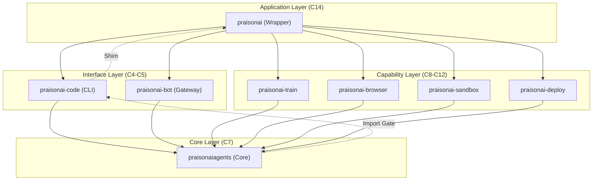
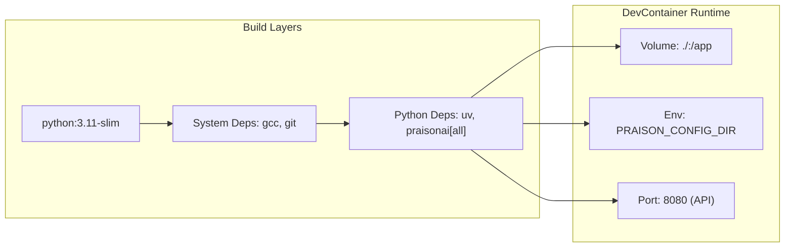

<!-- source: DeepWiki mcp.deepwiki.com · repo MervinPraison/PraisonAI · page 9.3 Development Environment · fetched 2026-10-26 -->

# Development Environment

<details>
<summary>Relevant source files</summary>

The following files were used as context for generating this wiki page:

- [.github/scripts/release-gate-selftest.js](.github/scripts/release-gate-selftest.js)
- [.github/scripts/release-gate.js](.github/scripts/release-gate.js)
- [.github/workflows/nightly-release-gate.yml](.github/workflows/nightly-release-gate.yml)
- [.github/workflows/pypi-release.yml](.github/workflows/pypi-release.yml)
- [AGENTS.md](AGENTS.md)
- [docker/Dockerfile](docker/Dockerfile)
- [docker/Dockerfile.chat](docker/Dockerfile.chat)
- [docker/Dockerfile.dev](docker/Dockerfile.dev)
- [docker/Dockerfile.ui](docker/Dockerfile.ui)
- [docker/README.md](docker/README.md)
- [src/praisonai-agents/pyproject.toml](src/praisonai-agents/pyproject.toml)
- [src/praisonai-agents/uv.lock](src/praisonai-agents/uv.lock)
- [src/praisonai-bot/tests/unit/test_gateway_tools.py](src/praisonai-bot/tests/unit/test_gateway_tools.py)
- [src/praisonai-code/README.md](src/praisonai-code/README.md)
- [src/praisonai-code/praisonai_code/__init__.py](src/praisonai-code/praisonai_code/__init__.py)
- [src/praisonai-code/praisonai_code/_framework_availability.py](src/praisonai-code/praisonai_code/_framework_availability.py)
- [src/praisonai-code/praisonai_code/_safe_loader.py](src/praisonai-code/praisonai_code/_safe_loader.py)
- [src/praisonai-code/praisonai_code/cli/features/_approval_bridge.py](src/praisonai-code/praisonai_code/cli/features/_approval_bridge.py)
- [src/praisonai-code/praisonai_code/cli/main.py](src/praisonai-code/praisonai_code/cli/main.py)
- [src/praisonai-code/praisonai_code/tool_registry.py](src/praisonai-code/praisonai_code/tool_registry.py)
- [src/praisonai-code/praisonai_code/tool_resolver.py](src/praisonai-code/praisonai_code/tool_resolver.py)
- [src/praisonai-code/pyproject.toml](src/praisonai-code/pyproject.toml)
- [src/praisonai-code/tests/unit/test_run_standalone_wrapper_gate.py](src/praisonai-code/tests/unit/test_run_standalone_wrapper_gate.py)
- [src/praisonai-code/uv.lock](src/praisonai-code/uv.lock)
- [src/praisonai/praisonai.rb](src/praisonai/praisonai.rb)
- [src/praisonai/praisonai/cli/main.py](src/praisonai/praisonai/cli/main.py)
- [src/praisonai/praisonai/version.py](src/praisonai/praisonai/version.py)
- [src/praisonai/pyproject.toml](src/praisonai/pyproject.toml)
- [src/praisonai/scripts/bump_and_release.py](src/praisonai/scripts/bump_and_release.py)
- [src/praisonai/scripts/bump_version.py](src/praisonai/scripts/bump_version.py)
- [src/praisonai/tests/C7_VERIFICATION.md](src/praisonai/tests/C7_VERIFICATION.md)
- [src/praisonai/uv.lock](src/praisonai/uv.lock)

</details>


This document provides a comprehensive guide for setting up a local development environment for PraisonAI, including installation from source, using the **UV package manager**, development containers, monorepo structure, and boundary verification scripts. This page focuses on the developer experience for contributors and maintainers across the tiered package architecture.

For Docker deployment options, see [Docker Deployment](9.1). For cloud deployment, see [Cloud Deployment](9.2). For package architecture details, see [Package System](10).

---

## Monorepo Architecture

PraisonAI is structured as a tiered monorepo consisting of nine primary Python packages. Development requires understanding the dependency direction, particularly the boundary between the core agent system (C7) and the application layer (C14).

### Package Tier Table

| Package | Directory | Tier | Purpose |
|---------|-----------|------|---------|
| `praisonaiagents` | [src/praisonai-agents/]() | C7 | Core agent framework (Logic, Tools, Memory) |
| `praisonai-code` | [src/praisonai-code/]() | C5 | Terminal-native agent CLI |
| `praisonai-bot` | [src/praisonai-bot/]() | C4 | Messaging bot gateway (Telegram, Slack, etc.) |
| `praisonai-train` | [src/praisonai-train/]() | C10 | LLM fine-tuning and agent training |
| `praisonai-browser` | [src/praisonai-browser/]() | C8 | Browser automation and CDP bridge |
| `praisonai-mcp` | [src/praisonai-mcp/]() | C9 | Model Context Protocol implementation |
| `praisonai-sandbox` | [src/praisonai-sandbox/]() | C11 | Secure execution environments |
| `praisonai-deploy` | [src/praisonai-deploy/]() | C12 | Cloud deployment orchestration |
| `PraisonAI` | [src/praisonai/]() | C14 | Wrapper package & legacy framework adapter |

The `praisonai` wrapper package acts as the top-level entry point, aggregating all other packages as dependencies [src/praisonai/pyproject.toml:15-22]().

### Dependency Graph and Import Gates


Sources: [src/praisonai/pyproject.toml:15-22](), [src/praisonai-code/pyproject.toml:12](), [src/praisonai/praisonai/cli/main.py:1-18]()

---

## Local Setup with UV

The project utilizes `uv` for high-performance dependency resolution and virtual environment management.

### Installation from Source

**1. Install UV**
Follow the official instructions at `https://github.com/astral-sh/uv`.

**2. Clone and Sync Monorepo**
```bash
git clone https://github.com/MervinPraison/PraisonAI.git
cd PraisonAI
```

**3. Development Installation (Editable)**
To set up the entire monorepo for development, use `uv` to install the wrapper with all development extras. This will link local packages via the `tool.uv.sources` configuration [src/praisonai-code/pyproject.toml:32-33]().

```bash
# Install the full suite in editable mode
uv pip install -e "src/praisonai[all,ui,chat,code,train]"
```

### Virtual Environments
Each sub-package contains its own `uv.lock` file to ensure deterministic builds across different Python versions (3.10 to 3.14) [src/praisonai-agents/uv.lock:1-11](), [src/praisonai/uv.lock:1-11]().

---

## C7–C14 Boundary Verification

A critical part of the development environment is maintaining the architectural boundary between the `praisonaiagents` core (C7) and the `praisonai` wrapper (C14). 

### Import Direction Gates
The codebase uses shims to maintain backward compatibility while moving implementation to specific packages. For example, `praisonai.cli.main` is now a shim that bootstraps `praisonai_code.cli.main` [src/praisonai/praisonai/cli/main.py:1-15]().

### Verification Scripts
Developers should run boundary verification tests to ensure no "illegal" upward dependencies (where core packages depend on application-layer packages).
- **C7 Verification**: Ensures `praisonaiagents` remains independent.
- **Import Gates**: Managed via `_bootstrap.py` and `_framework_availability.py` in the `praisonai-code` package.

Sources: [src/praisonai/tests/C7_VERIFICATION.md](), [src/praisonai-code/praisonai_code/_framework_availability.py]()

---

## Development Containers

PraisonAI provides specialized Dockerfiles for different development scenarios.

### Dockerfile Variants

| Dockerfile | Purpose | Key Components |
|------------|---------|----------------|
| `Dockerfile.dev` | Full Dev Environment | gcc, portaudio, jupyter, pytest, mkdocs [docker/Dockerfile.dev:1-35]() |
| `Dockerfile.chat` | UI/Chat Dev | `praisonai[chat]`, embedchain, tavily [docker/Dockerfile.chat:1-21]() |
| `Dockerfile.ui` | Dashboard Dev | `praisonai[ui]`, `praisonai[crewai]` [docker/Dockerfile.ui:1-21]() |

### DevContainer Configuration
The `Dockerfile.dev` sets specific environment variables to ensure configuration persistence within the container:
- `PRAISON_CONFIG_DIR`: `/root/.praison` [docker/Dockerfile.dev:41]()
- `DOCKER_CONTAINER`: `true` [docker/Dockerfile.dev:44]()


Sources: [docker/Dockerfile.dev:1-47](), [docker/Dockerfile:1-46]()

---

## Build System and Versioning

### Setuptools Configuration
The project uses `setuptools.build_meta` as the build backend [src/praisonai-agents/pyproject.toml:3](). Entry points are defined to map CLI commands to specific package functions:
- `praisonai` -> `praisonai.__main__:main` [src/praisonai/pyproject.toml:35]()
- `praisonai-code` -> `praisonai_code.__main__:main` [src/praisonai-code/pyproject.toml:30]()

### Version Management
Versions are synchronized across the monorepo. The wrapper version is tracked in `src/praisonai/praisonai/version.py` [src/praisonai/praisonai/version.py:1]().

### Homebrew Formula
For macOS development, a Homebrew formula is maintained in `src/praisonai/praisonai.rb`, which uses `Language::Python::Virtualenv` to isolate the installation [src/praisonai/praisonai.rb:1-19]().

Sources: [src/praisonai-agents/pyproject.toml:1-139](), [src/praisonai/pyproject.toml:1-206](), [src/praisonai/praisonai.rb:1-20]()

---

