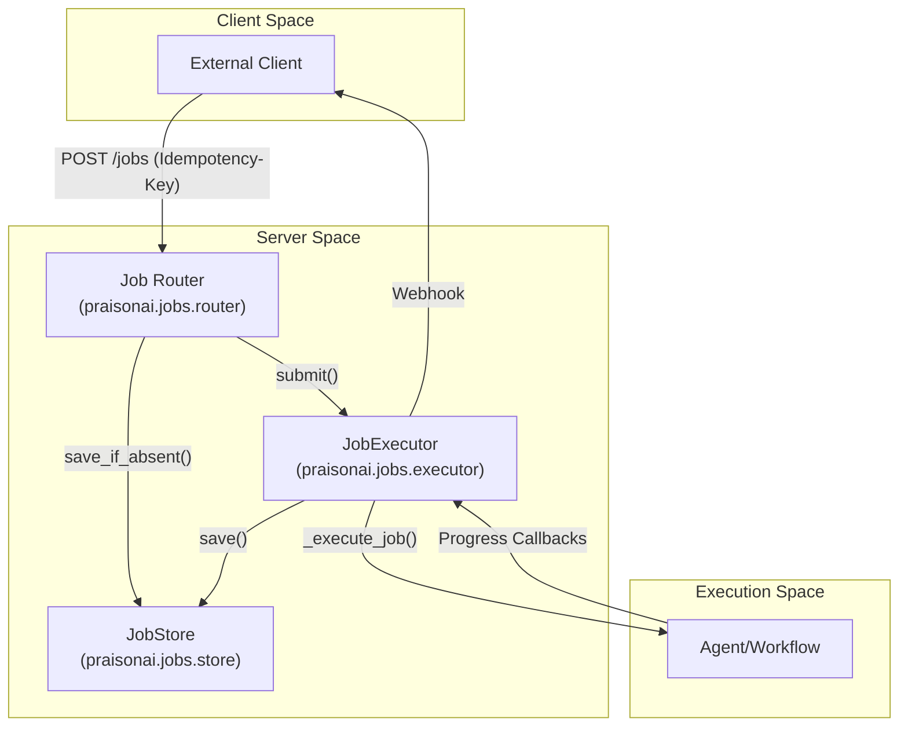
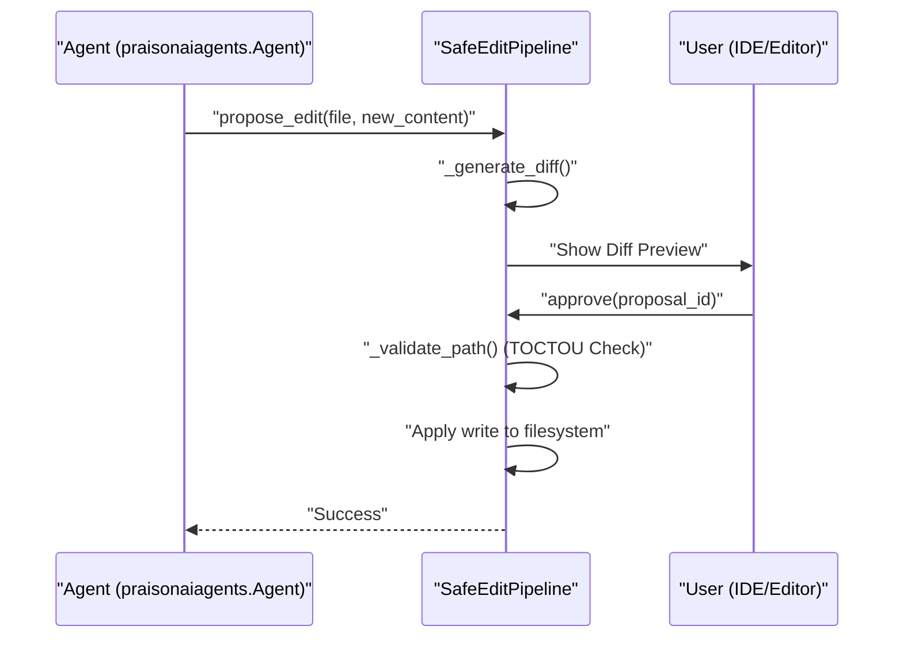

<!-- source: DeepWiki mcp.deepwiki.com · repo MervinPraison/PraisonAI · page 9.4 API Server Launch · fetched 2026-10-26 -->

# API Server Launch

Relevant source files

The following files were used as context for generating this wiki page:

- [examples/python/bot_example.py](examples/python/bot_example.py)
- [examples/python/gateway_example.py](examples/python/gateway_example.py)
- [src/praisonai-agents/praisonaiagents/frameworks/base.py](src/praisonai-agents/praisonaiagents/frameworks/base.py)
- [src/praisonai-agents/tests/unit/test_handoff_unified.py](src/praisonai-agents/tests/unit/test_handoff_unified.py)
- [src/praisonai-agents/tests/unit/test_paths_wiring.py](src/praisonai-agents/tests/unit/test_paths_wiring.py)
- [src/praisonai-code/tests/unit/test_daemon_background.py](src/praisonai-code/tests/unit/test_daemon_background.py)
- [src/praisonai/praisonai/_api_auth.py](src/praisonai/praisonai/_api_auth.py)
- [src/praisonai/praisonai/acp/safe_edit.py](src/praisonai/praisonai/acp/safe_edit.py)
- [src/praisonai/praisonai/acp/server.py](src/praisonai/praisonai/acp/server.py)
- [src/praisonai/praisonai/cli/commands/serve.py](src/praisonai/praisonai/cli/commands/serve.py)
- [src/praisonai/praisonai/cli/commands/standardise.py](src/praisonai/praisonai/cli/commands/standardise.py)
- [src/praisonai/praisonai/cli/features/acp.py](src/praisonai/praisonai/cli/features/acp.py)
- [src/praisonai/praisonai/cli/features/serve.py](src/praisonai/praisonai/cli/features/serve.py)
- [src/praisonai/praisonai/endpoints/a2u_server.py](src/praisonai/praisonai/endpoints/a2u_server.py)
- [src/praisonai/praisonai/endpoints/providers/__init__.py](src/praisonai/praisonai/endpoints/providers/__init__.py)
- [src/praisonai/praisonai/endpoints/providers/openai_compat.py](src/praisonai/praisonai/endpoints/providers/openai_compat.py)
- [src/praisonai/praisonai/endpoints/server.py](src/praisonai/praisonai/endpoints/server.py)
- [src/praisonai/praisonai/jobs/__init__.py](src/praisonai/praisonai/jobs/__init__.py)
- [src/praisonai/praisonai/jobs/executor.py](src/praisonai/praisonai/jobs/executor.py)
- [src/praisonai/praisonai/jobs/router.py](src/praisonai/praisonai/jobs/router.py)
- [src/praisonai/praisonai/jobs/server.py](src/praisonai/praisonai/jobs/server.py)
- [src/praisonai/praisonai/jobs/store.py](src/praisonai/praisonai/jobs/store.py)
- [src/praisonai/praisonai/standardise/undo_redo.py](src/praisonai/praisonai/standardise/undo_redo.py)
- [src/praisonai/praisonai/tools/glob_tool.py](src/praisonai/praisonai/tools/glob_tool.py)
- [src/praisonai/praisonai/tools/grep_tool.py](src/praisonai/praisonai/tools/grep_tool.py)
- [src/praisonai/praisonai/tools/multiedit.py](src/praisonai/praisonai/tools/multiedit.py)
- [src/praisonai/praisonai/tools/skill_manage.py](src/praisonai/praisonai/tools/skill_manage.py)
- [src/praisonai/tests/C9_BACKLOG.md](src/praisonai/tests/C9_BACKLOG.md)
- [src/praisonai/tests/integration/acp/test_acp_real_llm.py](src/praisonai/tests/integration/acp/test_acp_real_llm.py)
- [src/praisonai/tests/integration/knowledge/test_knowledge_integration.py](src/praisonai/tests/integration/knowledge/test_knowledge_integration.py)
- [src/praisonai/tests/integration/test_aiui_host_agentic.py](src/praisonai/tests/integration/test_aiui_host_agentic.py)
- [src/praisonai/tests/integration/test_bot_protocol.py](src/praisonai/tests/integration/test_bot_protocol.py)
- [src/praisonai/tests/integration/test_doctor_cli.py](src/praisonai/tests/integration/test_doctor_cli.py)
- [src/praisonai/tests/integration/test_judge_modes.py](src/praisonai/tests/integration/test_judge_modes.py)
- [src/praisonai/tests/integration/test_kanban_host_injection.py](src/praisonai/tests/integration/test_kanban_host_injection.py)
- [src/praisonai/tests/integration/test_self_improving_loop.py](src/praisonai/tests/integration/test_self_improving_loop.py)
- [src/praisonai/tests/integration/test_websocket_integration.py](src/praisonai/tests/integration/test_websocket_integration.py)
- [src/praisonai/tests/integration/test_whatsapp_web_real.py](src/praisonai/tests/integration/test_whatsapp_web_real.py)
- [src/praisonai/tests/test_runner.py](src/praisonai/tests/test_runner.py)
- [src/praisonai/tests/unit/acp/test_server.py](src/praisonai/tests/unit/acp/test_server.py)
- [src/praisonai/tests/unit/conftest.py](src/praisonai/tests/unit/conftest.py)
- [src/praisonai/tests/unit/jobs/test_store.py](src/praisonai/tests/unit/jobs/test_store.py)
- [src/praisonai/tests/unit/scheduler/test_agent_scheduler.py](src/praisonai/tests/unit/scheduler/test_agent_scheduler.py)
- [src/praisonai/tests/unit/standardise/test_cli_surface.py](src/praisonai/tests/unit/standardise/test_cli_surface.py)
- [src/praisonai/tests/unit/test_cli_features.py](src/praisonai/tests/unit/test_cli_features.py)
- [src/praisonai/tests/unit/test_skills_cli.py](src/praisonai/tests/unit/test_skills_cli.py)

## Purpose and Scope

This document covers the `launch()` method and related infrastructure for exposing PraisonAI agents as network-accessible API servers. It details the `serve` command suite, FastAPI REST endpoints, MCP (Model Context Protocol) servers, A2U (Agent-to-User) event streams, and the ACP (Agent Client Protocol) server for IDE integration.

For information about:
- Cloud deployment using `CloudDeployer`, see [Cloud Deployment](#9.2)
- Docker container orchestration, see [Docker Deployment](#9.1)
- Local development setup, see [Development Environment](#9.3)

## Overview

The API server launch system provides multiple modes for exposing agents as network services:

1.  **FastAPI Mode** - REST API with HTTP endpoints for agent execution [src/praisonai/praisonai/cli/features/serve.py:210-220]().
2.  **MCP Mode** - Model Context Protocol server supporting stdio, SSE, or HTTP transports [src/praisonai/praisonai/cli/features/serve.py:288-295]().
3.  **A2U Mode** - Server-Sent Events (SSE) stream for real-time agent-to-user updates [src/praisonai/praisonai/endpoints/a2u_server.py:2-5]().
4.  **ACP Mode** - JSON-RPC over stdio for IDE/editor communication [src/praisonai/praisonai/acp/server.py:4-6]().
5.  **Jobs API** - Asynchronous task execution with persistent storage and status tracking [src/praisonai/praisonai/jobs/server.py:1-5]().

## Serve Command Suite

The `praisonai serve` command is the primary entry point for launching various server types. It is managed by the `ServeHandler` class [src/praisonai/praisonai/cli/features/serve.py:41-53]().

### Serve Command Variants

| Command | Handler Method | Purpose |
| :--- | :--- | :--- |
| `agents` | `cmd_agents` | Launch agents as HTTP API via FastAPI [src/praisonai/praisonai/cli/features/serve.py:210-220]() |
| `mcp` | `cmd_mcp` | Launch a standalone MCP server [src/praisonai/praisonai/cli/features/serve.py:288-295]() |
| `a2u` | `cmd_a2u` | Launch A2U event stream server [src/praisonai/praisonai/cli/features/serve.py:345-350]() |
| `unified` | `cmd_unified` | Launch a server combining multiple providers [src/praisonai/praisonai/cli/features/serve.py:365-370]() |
| `recipe` | `cmd_recipe` | Launch a recipe runner server [src/praisonai/praisonai/cli/features/serve.py:265-270]() |

**Sources:** [src/praisonai/praisonai/cli/features/serve.py:83-90]()

## Jobs System Architecture

The Jobs system provides a robust framework for long-running agent tasks, supporting idempotency and persistence.

**Diagram: Jobs API Data Flow**

**Sources:** [src/praisonai/praisonai/jobs/server.py:23-26](), [src/praisonai/praisonai/jobs/executor.py:94-103](), [src/praisonai/praisonai/jobs/store.py:67-74]()

### Job Storage Backends

The system supports two primary storage backends for job metadata and status [src/praisonai/praisonai/jobs/store.py:19-25]():

1.  **InMemoryJobStore**: Suitable for local development; jobs are lost on restart [src/praisonai/praisonai/jobs/store.py:83-89]().
2.  **SqliteJobStore**: Persistent storage for production. Refuses to start with in-memory store if `ENVIRONMENT=production` is set [src/praisonai/praisonai/jobs/server.py:41-47]().

### Job Executor

The `JobExecutor` manages the lifecycle of background tasks [src/praisonai/praisonai/jobs/executor.py:18-28]():
*   **Concurrency Control**: Uses an `asyncio.Semaphore` to limit concurrent jobs (default: 10) [src/praisonai/praisonai/jobs/executor.py:50-52]().
*   **Timeouts**: Enforces execution limits (default: 3600s) [src/praisonai/praisonai/jobs/executor.py:183-188]().
*   **Webhooks**: Notifies external systems upon job completion or failure [src/praisonai/praisonai/jobs/executor.py:179-182]().

**Sources:** [src/praisonai/praisonai/jobs/executor.py:30-46]()

## ACP (Agent Client Protocol) Server

The ACP server enables IDEs (like Cursor or VS Code) to interact with PraisonAI agents using JSON-RPC over standard I/O [src/praisonai/praisonai/acp/server.py:4-6]().

### Safe Edit Pipeline

To prevent unauthorized file modifications, the ACP server implements a `SafeEditPipeline` [src/praisonai/praisonai/acp/safe_edit.py:100-111]().

**Diagram: Safe Edit Workflow**

**Sources:** [src/praisonai/praisonai/acp/safe_edit.py:104-111](), [src/praisonai/praisonai/acp/safe_edit.py:136-155]()

### ACP Capability Gating

The `ACPServer` filters tools based on configuration flags to ensure security [src/praisonai/praisonai/acp/server.py:120-144]():
*   **Read-only**: Limits tools to `read_file`, `grep`, `list_files`, etc.
*   **Write**: Enables `edit_file`, `write_file`.
*   **Shell**: Enables `execute_command`.
*   **Network**: Enables `internet_search`.

**Sources:** [src/praisonai/praisonai/acp/server.py:134-144]()

## A2U (Agent-to-User) Server

The A2U server provides real-time event streaming using Server-Sent Events (SSE) [src/praisonai/praisonai/endpoints/a2u_server.py:2-5]().

### Event Bus Architecture

The `A2UEventBus` manages subscriptions and broadcasts [src/praisonai/praisonai/endpoints/a2u_server.py:88-93]():
*   **Subscriptions**: Clients subscribe to specific `stream_name` channels [src/praisonai/praisonai/endpoints/a2u_server.py:104-108]().
*   **Filtering**: Subscriptions can include filters for specific `event_type` strings [src/praisonai/praisonai/endpoints/a2u_server.py:81-86]().
*   **Memory Bounds**: Limits maximum subscriptions (`PRAISONAI_A2U_MAX_SUBS`, default 1024) and queue sizes (`PRAISONAI_A2U_QUEUE_MAX`, default 1000) to prevent OOM [src/praisonai/praisonai/endpoints/a2u_server.py:47-49]().

**Sources:** [src/praisonai/praisonai/endpoints/a2u_server.py:51-86]()

## Security and Authentication

All servers support unified authentication via API keys:

*   **Middleware**: The `_install_api_key_middleware` function wraps FastAPI apps to enforce `--api-key` [src/praisonai/praisonai/cli/features/serve.py:25-39]().
*   **Public Paths**: Certain paths like `/health` and `/.well-known/agent.json` are typically excluded from auth [src/praisonai/praisonai/cli/features/serve.py:36-38]().
*   **Jobs Auth**: For the Jobs API, auth is required if the server is bound to a non-localhost interface [src/praisonai/praisonai/jobs/server.py:153-158]().

**Sources:** [src/praisonai/praisonai/_api_auth.py:1-20]()

## Global State Management

The server launch system maintains global dictionaries to coordinate instances and prevent port conflicts:

| Global Variable | Type | Purpose |
| :--- | :--- | :--- |
| `_agents_server_started` | `Dict[int, bool]` | Tracks which ports have active servers [src/praisonai-agents/praisonaiagents/agents/agents.py:33-36]() |
| `_agents_registered_endpoints` | `Dict[int, Dict[str, str]]` | Maps ports to registered endpoint paths and IDs [src/praisonai-agents/praisonaiagents/agents/agents.py:33-36]() |
| `_agents_shared_apps` | `Dict[int, FastAPI]` | Stores FastAPI app instances by port [src/praisonai-agents/praisonaiagents/agents/agents.py:33-36]() |

**Sources:** [src/praisonai-agents/praisonaiagents/agents/agents.py:33-36]()

---

