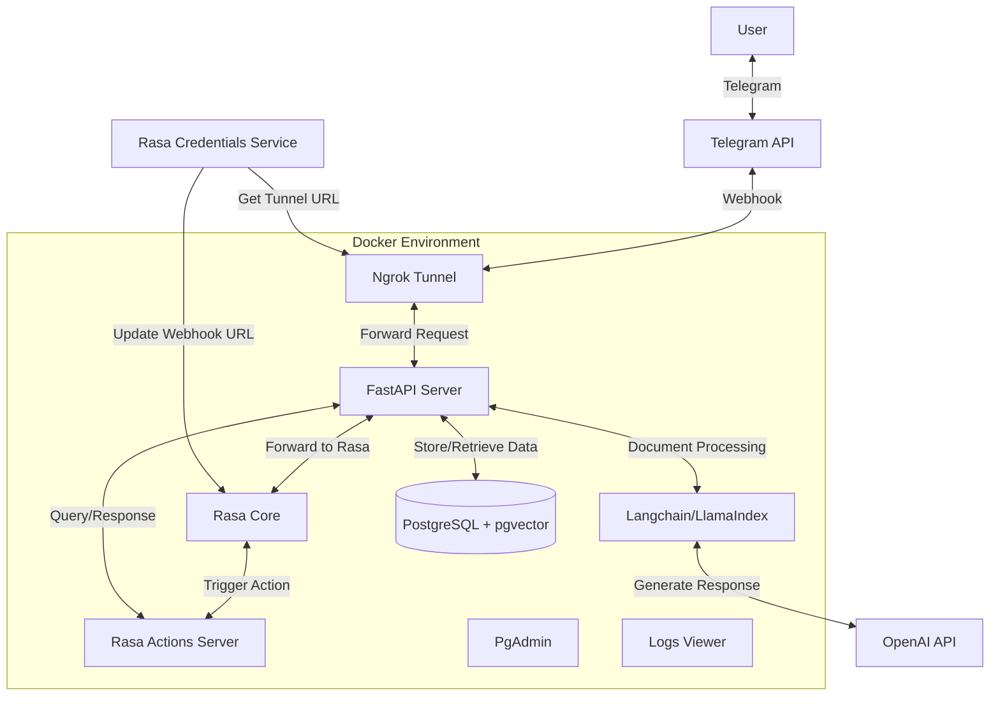
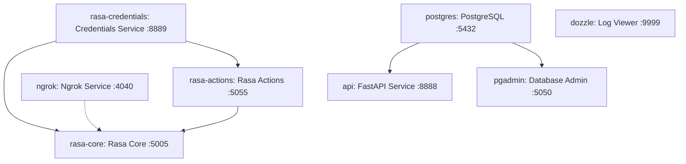
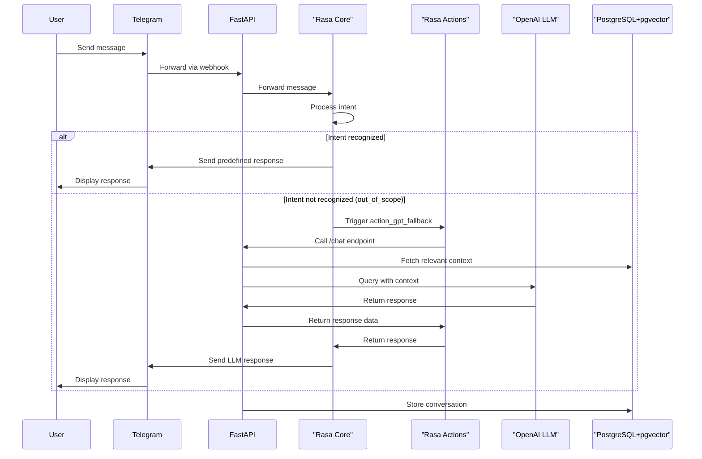
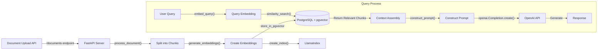
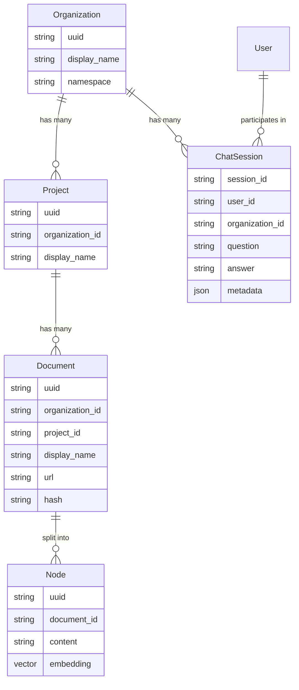

<!-- source: DeepWiki mcp.deepwiki.com · repo paulpierre/RasaGPT · page 1 Overview · fetched 2026-10-26 -->

# Overview

Relevant source files

The following files were used as context for generating this wiki page:

- [README.md](README.md)
- [github/rasagpt-banner.png](github/rasagpt-banner.png)
- [github/rasagpt-video-title-screen.png](github/rasagpt-video-title-screen.png)

This document provides an introduction to RasaGPT, a headless LLM chatbot platform built on top of Rasa and Langchain. It explains the system's purpose, high-level architecture, and core functionality. For detailed installation instructions, see [Installation and Setup](#2).

RasaGPT is a boilerplate and reference implementation that combines the Rasa conversational AI framework with large language model (LLM) capabilities through Langchain and LlamaIndex. It provides an API-first approach to building intelligent chatbots with document retrieval capabilities and multi-tenant support.

Sources: [README.md:6-8]()

## System Purpose and Scope

RasaGPT addresses several key implementation challenges in building LLM-powered chatbots:

1. Creating a proprietary bot endpoint with document upload and training pipeline
2. Integrating Langchain/LlamaIndex with Rasa
3. Resolving library conflicts with LLM libraries
4. Running Rasa in Docker with cross-platform support
5. Implementing reverse proxy capabilities for chatbots
6. Creating a custom pgvector implementation instead of using Langchain's default
7. Adding multi-tenancy support, session management, and metadata handling

The system is designed as a reference implementation with practical usage scenarios including help desk, customer support, quiz systems, e-learning, and more.

Sources: [README.md:39-51]()

## System Architecture

### High-Level Architecture Overview

The diagram below shows the main components of RasaGPT and how they interact with each other.

Users interact with the bot through Telegram, which forwards messages to the FastAPI server via an Ngrok tunnel. The FastAPI server processes these messages and sends them to Rasa Core for intent recognition. When Rasa cannot handle a query, it triggers custom actions that leverage the LLM capabilities through the FastAPI server, which uses Langchain/LlamaIndex for document retrieval and response generation.

Sources: [README.md:560-616]()

### Docker Service Architecture

The following diagram shows the Docker services that make up the RasaGPT system and their port mappings.

The system consists of eight Docker services, each with a specific role. The PostgreSQL database serves as the foundation, storing data for the API server. The FastAPI server, Rasa Core, and Rasa Actions work together to handle chat interactions, while supporting services like Ngrok, PgAdmin, and Dozzle provide infrastructure capabilities.

Sources: [README.md:159-171](), [README.md:182-196]()

## Conversation Flow

The following diagram illustrates how a user conversation flows through the RasaGPT system:

When a user sends a message through Telegram, it's forwarded to the FastAPI server and then to Rasa Core. If Rasa can recognize the intent, it responds directly. If not, it triggers the `action_gpt_fallback` action which leverages the LLM capabilities through the FastAPI server. The server retrieves relevant context from the database, queries the LLM, and returns a response to the user.

Sources: [README.md:616-629](), [README.md:575-582]()

## Document Processing and Indexing

RasaGPT includes a document processing pipeline that enables the chatbot to answer questions based on uploaded documents:

Documents are uploaded through the API, processed into chunks, and embedded using vector representations. These embeddings are stored in the PostgreSQL database using the pgvector extension. When a user queries the system, their question is also embedded, and a similarity search identifies the most relevant document chunks. These chunks are then used to provide context to the LLM when generating a response.

Sources: [README.md:607-615](), [README.md:95-104]()

## Multi-tenant Data Model

RasaGPT supports multi-tenancy through a hierarchical data model:

The data model shows the relationships between different entities in the system. Organizations have projects, which have documents. Documents are split into nodes, each with vector embeddings for similarity search. Chat sessions track conversations between users and bots, associated with specific organizations.

Sources: [README.md:267-543]()

## Key Features

RasaGPT includes the following key features:

| Feature Category | Capabilities |
|------------------|--------------|
| **Application & API** | - Document upload and "training" via FastAPI - Document versioning and automatic retraining - Custom async endpoints with FastAPI and SQLModel - Human handoff determination - Automatic tag generation - API documentation via Swagger and Redoc - PGAdmin for database management - Automatic Ngrok endpoint generation |
| **Rasa Integration** | - Built on top of Rasa, the open-source chatbot framework - Support for MacOS M1/M2 via Docker - Telegram integration with easy extension to other platforms - Complex dialog pipelines with fallback to OpenAI GPT |
| **Flexibility** | - Extensible with Langchain capabilities - Multi-tenant schema design - Customizable agent personalities - Chat history storage with embeddings - Automatic knowledge base embedding generation |

Sources: [README.md:89-120]()

## Technical Implementation

### Rasa Integration

The Rasa integration is configured through several key files:

1. **config.yml** - Contains the NLU pipeline and policy configuration, with `FallbackClassifier` threshold settings
2. **credentials.yml** - Contains webhook paths and Telegram credentials, updated by the `rasa-credentials` service
3. **domain.yml** - Defines chat entrypoint logic, intents, and actions including `action_gpt_fallback`
4. **endpoints.yml** - Configures custom action endpoints
5. **nlu.yml** - Defines intents, including the `out_of_scope` intent
6. **rules.yml** - Sets up rules for handling intents, triggering appropriate actions
7. **actions.py** - Implements custom actions like `ActionGPTFallback`

When a message cannot be handled by Rasa's standard intent recognition, it triggers the `action_gpt_fallback` which interacts with the FastAPI server to get a response from the LLM.

Sources: [README.md:569-585]()

### Database & Vector Store

The system uses PostgreSQL with the pgvector extension for storing and querying vector embeddings:

1. The database is initialized during setup with the pgvector extension enabled
2. The database schema is created using SQLModel through the `models.py` file
3. The `enable_vector` method in `models.py` activates the pgvector extension
4. Document chunks (nodes) are stored with their vector embeddings for similarity search

Sources: [README.md:600-607]()

### LLM Integration

The LLM integration is handled through Langchain and LlamaIndex:

1. Training data is loaded into the database
2. If the index doesn't exist, it's created and stored in `index.json`
3. LlamaIndex uses `GPTSimpleVectorIndex` to find relevant data and inject it into prompts
4. Prompt guardrails ensure the conversation stays focused
5. LLM responses include JSON formatting, categorical tagging, and human escalation recommendations

Sources: [README.md:607-629]()

## Common Use Cases

RasaGPT is designed to support a variety of use cases:

1. **Customer Support** - Answering product or service-related questions
2. **Help Desk** - Providing IT or technical support
3. **E-Learning** - Creating interactive educational experiences
4. **Knowledge Base** - Making organizational knowledge accessible
5. **Quiz Systems** - Building interactive quiz or testing experiences

The architecture allows for customization and extension to support specific business needs while maintaining a consistent user experience.

Sources: [README.md:104-105]()

---

