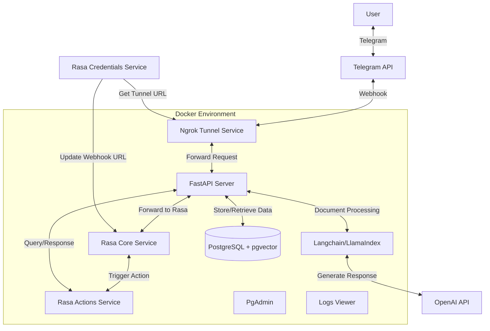
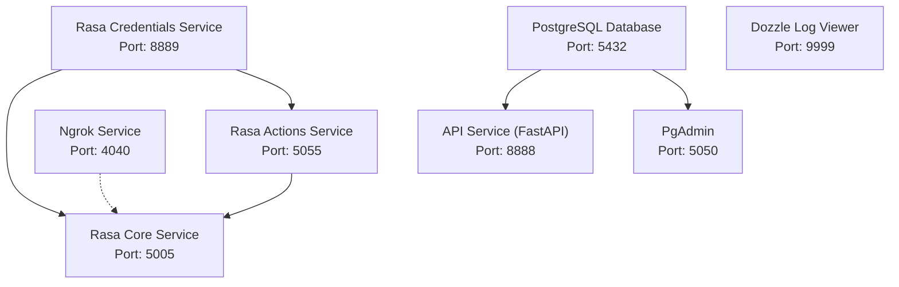
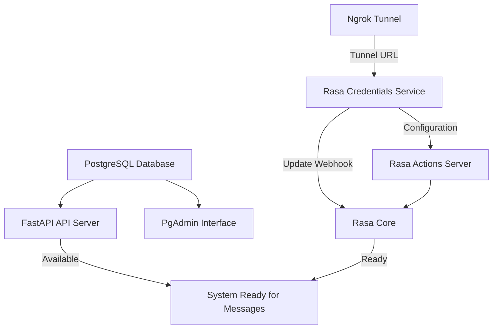
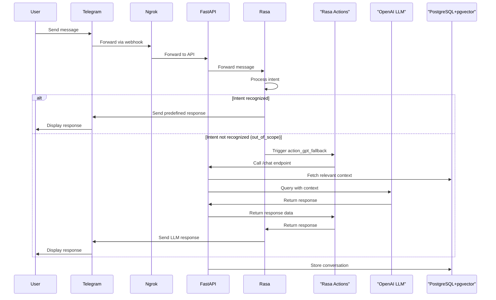
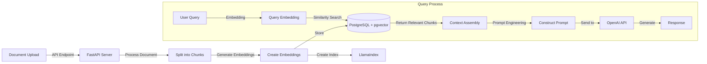
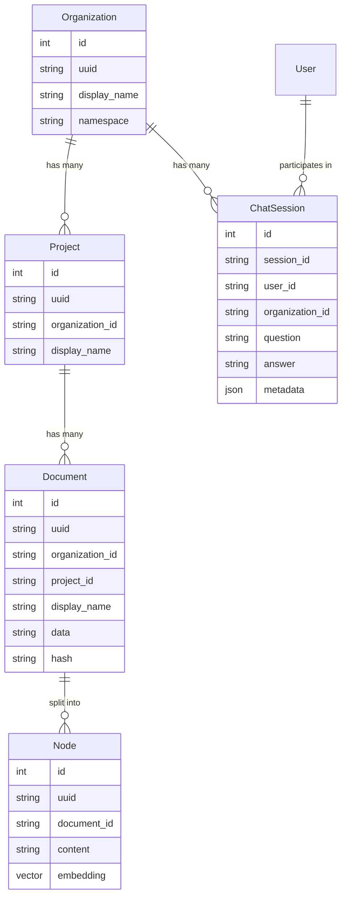

<!-- source: DeepWiki mcp.deepwiki.com · repo paulpierre/RasaGPT · page 1.1 System Architecture · fetched 2026-10-26 -->

# System Architecture

Relevant source files

The following files were used as context for generating this wiki page:

- [README.md](README.md)
- [app/scripts/wait-for-it.sh](app/scripts/wait-for-it.sh)
- [docker-compose.yml](docker-compose.yml)
- [github/rasagpt-video-title-screen.png](github/rasagpt-video-title-screen.png)

This document outlines the high-level architecture of RasaGPT, detailing the core components and their interactions within the system. It covers the Docker-based deployment architecture, API services, integration with Rasa, database design, and the conversational flow throughout the system. For information about specific features and capabilities, see [Features and Capabilities](#1.2).

## Overview

RasaGPT is a headless LLM chatbot platform that combines traditional conversational AI (Rasa) with modern large language model capabilities through an API-first design. The system enables multi-tenancy, document indexing, semantic search, and conversational AI in a modular, containerized architecture.

Sources: [docker-compose.yml:1-184](), [README.md:6-53]()

## Docker-based Deployment Architecture

RasaGPT uses Docker and Docker Compose to orchestrate multiple services that work together. This containerized approach ensures consistency across environments and simplifies deployment.

The system consists of the following Docker services:

| Service | Container Name | Description | Port |
|---------|---------------|-------------|------|
| API | chat_api | FastAPI server that provides LLM capabilities and document processing | 8888 |
| Ngrok | chat_ngrok | Creates secure tunnels for webhook communication | 4040 |
| Rasa Core | chat_rasa_core | Main Rasa service for NLU and conversation handling | 5005 |
| Rasa Actions | chat_rasa_actions | Custom actions server for Rasa | 5055 |
| Rasa Credentials | chat_rasa_credentials | Helper service for webhook configuration | 8889 |
| Database | chat_db | PostgreSQL with pgvector extension | 5432 |
| PgAdmin | chat_pgadmin | Database management interface | 5050 |
| Dozzle | chat_dozzle | Log viewer for all containers | 9999 |

Each service runs in its own container and communicates with others through a dedicated Docker network called `chat-network`.

Sources: [docker-compose.yml:10-184]()

## Service Dependencies and Startup Process

RasaGPT services have specific dependencies and must start in a particular order to function correctly. The system uses a waiting mechanism to ensure services are available before dependent services start.

The startup process:

1. Database initializes first with pgvector extension
2. FastAPI server starts and connects to the database
3. Ngrok service starts and creates a tunnel
4. Rasa Credentials service gets the Ngrok URL and configures Rasa
5. Rasa Actions server starts
6. Rasa Core starts and connects to Rasa Actions
7. The system is ready to process messages

The waiting mechanism is implemented using `wait-for-it.sh` script which checks service availability before allowing dependent services to start.

Sources: [docker-compose.yml:65-74](), [app/scripts/wait-for-it.sh:1-205]()

## Conversation Flow

This diagram shows how a user message flows through the RasaGPT system:

Key points about conversation flow:

1. Users interact through Telegram, which sends messages to RasaGPT via webhook
2. Rasa attempts to classify the user message into a predefined intent
3. If an intent is recognized, Rasa sends a predefined response
4. If no intent is recognized ("out_of_scope"), the `action_gpt_fallback` is triggered
5. The fallback action calls the FastAPI server to generate a response using the LLM
6. The LLM response is processed and sent back to the user
7. All conversations are stored in the database for future reference

Sources: [README.md:576-629]()

## Document Processing and Vector Search

RasaGPT processes documents to create vector embeddings for semantic search capabilities. This enables the system to find relevant content when responding to user queries.

The document processing pipeline:

1. Documents are uploaded via the FastAPI server
2. Documents are split into smaller chunks for better semantic indexing
3. Embeddings are generated for each chunk using OpenAI's embedding models
4. Embeddings are stored in PostgreSQL using the pgvector extension
5. When a user query comes in:
   - The query is converted to an embedding
   - A similarity search finds the most relevant document chunks
   - Relevant chunks are assembled as context
   - A prompt is constructed with this context
   - The prompt is sent to OpenAI for response generation

Sources: [README.md:611-615]()

## Multi-tenant Data Model

RasaGPT implements a multi-tenant architecture with organizations, projects, and documents. This structure enables the system to serve multiple clients with isolated data.

Key entities in the data model:

1. **Organization**: Represents a client in a multi-tenant environment
2. **Project**: Belongs to an Organization and groups related documents
3. **Document**: Contains text data that is processed and indexed
4. **Node**: A chunk of a document with associated vector embeddings
5. **User**: Represents an end-user of the chatbot
6. **ChatSession**: Records interactions between users and the chatbot

This model allows:
- Isolating data between different clients
- Organizing and managing documents in a hierarchical structure
- Storing chat history with metadata for future analysis
- Maintaining embeddings for semantic search

Sources: [README.md:267-496]()

## Key Components and Integrations

### FastAPI Server

The FastAPI server serves as the central hub of the system, providing:

- REST API for document management and chatbot interactions
- Document processing and indexing using Langchain/LlamaIndex
- Storage and retrieval of vector embeddings
- Integration with OpenAI API for LLM capabilities
- Multi-tenant organization management

### Rasa Integration

Rasa provides the conversational framework with:

- Intent recognition using an NLU pipeline
- Webhook configuration for Telegram integration
- Custom actions that connect to the FastAPI server
- Fallback mechanisms when intents aren't recognized

### Telegram Integration via Ngrok

RasaGPT integrates with Telegram through:

- Automatic webhook configuration using Ngrok tunnels
- The Rasa Credentials service updates Telegram webhooks
- Ngrok provides secure, publicly accessible URLs for local development

### Database with Vector Search

PostgreSQL with pgvector extension provides:

- Storage for documents, organizations, projects, and chat history
- Vector embeddings for semantic similarity search
- Efficient retrieval of relevant document chunks during conversations

Sources: [README.md:566-585]()

## Conclusion

The RasaGPT architecture combines traditional conversational AI with modern LLM capabilities, providing a flexible, multi-tenant chatbot platform. The modular Docker-based design allows for easy deployment and scalability, while the integration with existing communication channels like Telegram enables immediate practical applications.

By leveraging vector embeddings and semantic search, RasaGPT enhances the capabilities of Rasa with the power of large language models, creating a hybrid system that can handle complex conversational scenarios and knowledge retrieval tasks.

---

