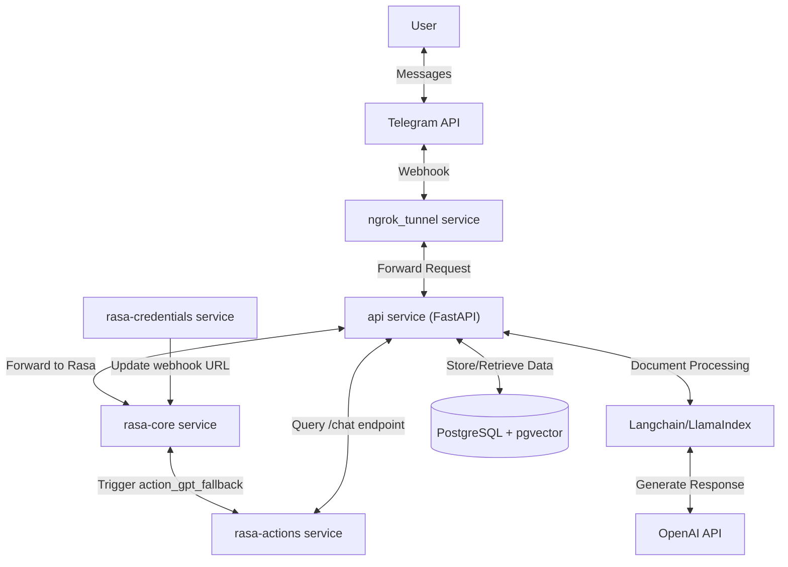
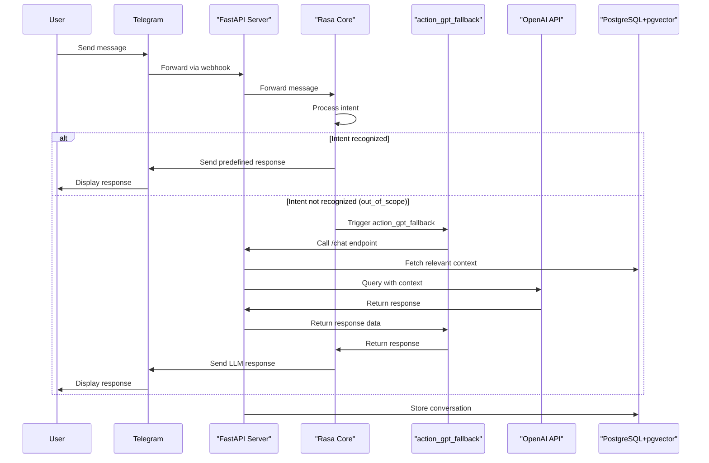
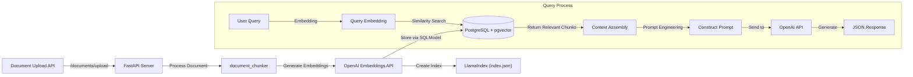
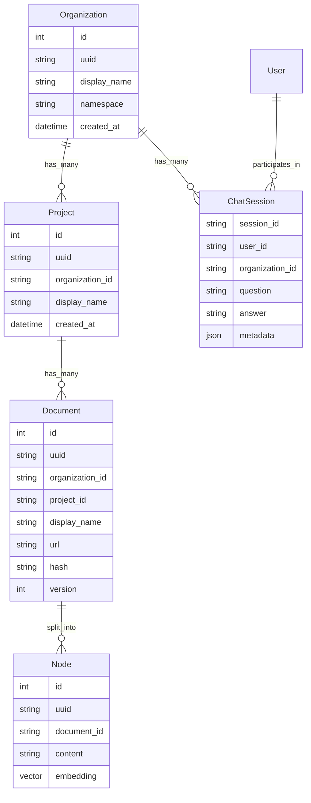

<!-- source: DeepWiki mcp.deepwiki.com · repo paulpierre/RasaGPT · page 1.2 Features and Capabilities · fetched 2026-10-26 -->

# Features and Capabilities

Relevant source files

The following files were used as context for generating this wiki page:

- [README.md](README.md)
- [RESULTS.md](RESULTS.md)
- [github/rasagpt-video-title-screen.png](github/rasagpt-video-title-screen.png)

This document outlines the key features and capabilities of RasaGPT, a headless LLM chatbot platform built on top of Rasa and Langchain. For information about installing and setting up the system, see [Installation and Setup](#2).

## Core Platform Features

RasaGPT provides a comprehensive set of features that enable sophisticated chatbot functionality with large language model integration:

### Full Application and API

| Feature | Description |
|---------|-------------|
| LLM Knowledge Base | System "learns" on arbitrary corpus of data using Langchain |
| Document Management | Upload documents and "train" via FastAPI with versioning and automatic re-training |
| Customizable Backend | Extend with async endpoints and database models via FastAPI and SQLModel |
| Smart Conversation Handling | Bot determines when human handoff is necessary and generates tags automatically |
| API Documentation | Full documentation via Swagger and Redoc |
| Database Management | PGAdmin included for database browsing |
| Webhook Management | Ngrok endpoints automatically generated for Telegram access |
| Vector Search | Embedding similarity search built into Postgres via pgvector |
| Test Data | Dummy data included for experimentation |

Sources: [README.md:91-105]()

### Rasa Integration

RasaGPT leverages Rasa's powerful framework with enhancements:

- Built on top of Rasa, the open source gold-standard for chat platforms
- MacOS M1/M2 support via Docker (canonical Rasa image lacks this support)
- Telegram integration with easy extension to other platforms
- Complex dialog pipelines using NLU models from Huggingface with OpenAI GPT as fallback

Sources: [README.md:106-112]()

### Flexibility Features

The system is designed for maximum flexibility:

- Extensible with Langchain's agentic and memory capabilities
- Multi-tenant schema supporting organizations, sessions, and data storage
- Customizable agent personalities
- Chat history storage with embedding creation for future retrieval optimization
- Automatic embedding generation from knowledge base corpus and client feedback

Sources: [README.md:113-120]()

## System Architecture

### Component Interaction

**High-Level System Architecture**

Sources: [README.md:570-585](), [docker-compose.yml]()

### Conversation Flow

**Conversation Flow Through System Components**

Sources: [README.md:590-629](), [app/rasa/actions/actions.py](), [app/rasa/data/rules.yml]()

## Document Processing and Indexing

### Document Pipeline

**Document Processing and Indexing Pipeline**

Sources: [README.md:610-616](), [app/api/main.py:49-66]()

## Multi-tenant Data Model

RasaGPT uses a sophisticated data model to support multi-tenancy and document management:

**Multi-tenant Data Model**

Sources: [app/api/models.py](), [README.md:267-321](), [README.md:325-498]()

## API and Integration

### Core API Endpoints

| Endpoint | Method | Description |
|----------|--------|-------------|
| `/organizations` | GET | List all organizations |
| `/organizations/{org_id}` | GET | Get organization details |
| `/organizations/{org_id}/projects` | GET | List projects for an organization |
| `/projects/{project_id}` | GET | Get project details |
| `/projects/{project_id}/documents` | GET | List documents in a project |
| `/documents/{document_id}` | GET | Get document details |
| `/documents/upload` | POST | Upload a new document |
| `/chat` | POST | Send a message to the chatbot |

Sources: [app/api/main.py](), [README.md:261-262]()

### LLM Response Features

The LLM integration provides enhanced response capabilities:

- Context-aware responses based on document corpus
- Automatic tagging of user questions (categorization)
- Human handoff detection when the bot can't confidently answer
- JSON-formatted responses with structured metadata
- Document similarity search via vector embeddings

Sources: [README.md:623-629](), [RESULTS.md:7-50]()

## Performance and Response Quality

RasaGPT's retrieval and response quality varies based on the indexing strategy currently used:

- Uses 1000 character length chunking for document indexing
- Employs Euclidean distance for similarity search
- Quality is described as "hit or miss" but can be improved with optimization
- Retrieval accuracy could be increased by more than 70% with improvements to indexing

The system captures successful responses like:
- Company information retrieval
- Product details and usage instructions
- Financial information
- Historical data

Sources: [RESULTS.md:12-113](), [README.md:248-253]()

## Future Enhancements

Future planned enhancements to the system include:

- Improved LlamaIndex optimizations
- Chat history implementation
- Query routing abstractions
- Exploration of diverse indexing methods (Tree, Keyword)
- Implementation of dual agent pattern for answer verification
- Hypothetical Document Embeddings (HyDE) pattern for improved retrieval

Sources: [README.md:633-646](), [RESULTS.md:152-166]()

## Technical Implementation Details

The RasaGPT implementation includes:

- Docker-containerized microservices architecture
- Automatic webhook configuration between Ngrok and Telegram
- Vector database implemented with PostgreSQL and pgvector
- Training and inference pipeline for document embeddings
- Makefile-managed initialization and operations
- Headless API-first design

Sources: [README.md:42-50](), [README.md:206-215](), [README.md:602-607]()

---

