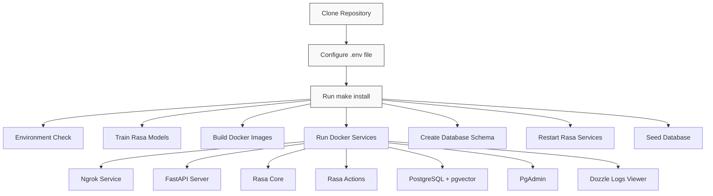
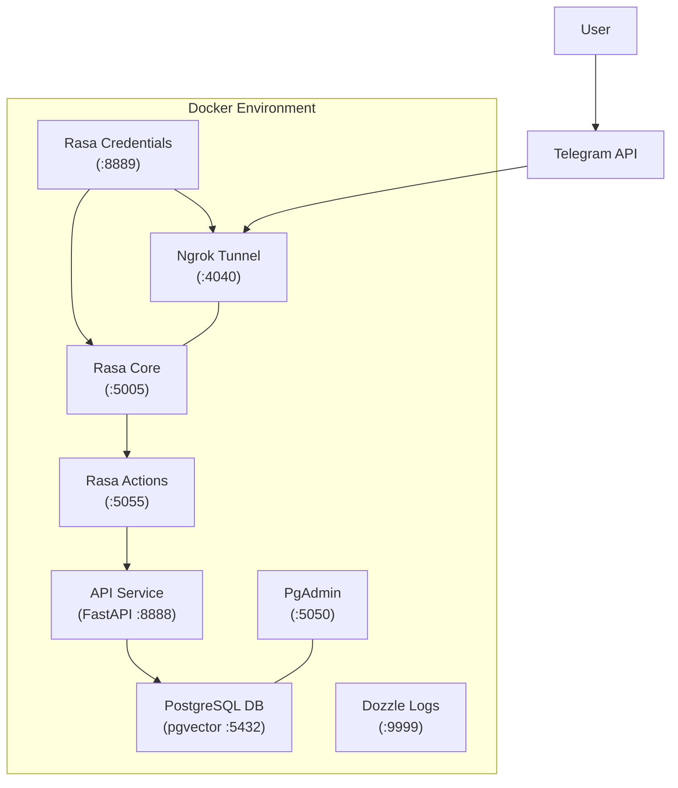
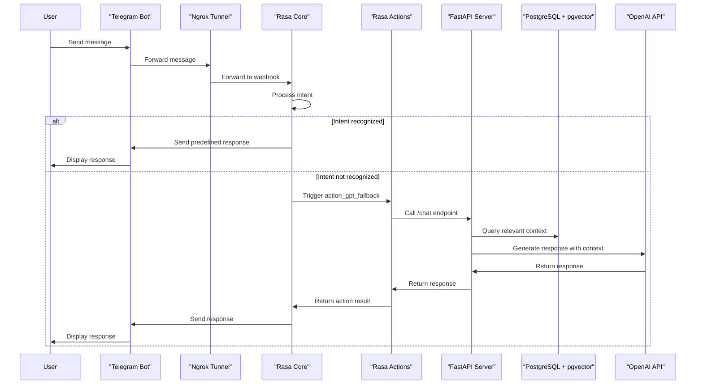
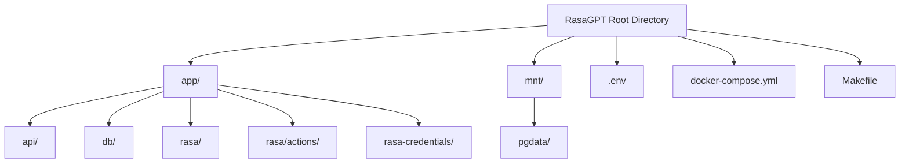

<!-- source: DeepWiki mcp.deepwiki.com · repo paulpierre/RasaGPT · page 2 Installation and Setup · fetched 2026-10-26 -->

# Installation and Setup

<details>
<summary>Relevant source files</summary>

The following files were used as context for generating this wiki page:

- [.env-example](.env-example)
- [Makefile](Makefile)
- [README.md](README.md)
- [github/rasagpt-video-title-screen.png](github/rasagpt-video-title-screen.png)

</details>


This page provides comprehensive instructions for installing and setting up RasaGPT on your system. It covers all prerequisites, configuration steps, and verification procedures to ensure a successful deployment. For information about specific configuration options and environment variables, see [Configuration Options](#2.1).

## Overview of Installation Process

The installation process for RasaGPT involves setting up several interconnected components through Docker containers. The system uses a Makefile to automate most of the installation steps, making the process straightforward.

**Installation Flow Diagram**



Sources: [Makefile:53-64](), [README.md:123-146]()

## Prerequisites

Before installing RasaGPT, ensure you have the following requirements met:

| Requirement | Description |
|-------------|-------------|
| Python 3.9 | Base programming language required |
| Docker & Docker Compose | For containerized deployment (Docker Desktop for MacOS) |
| OpenAI API Key | Required for LLM functionality |
| Telegram Bot Credentials | For bot communication channel |
| Ngrok Auth Token | For exposing local server to the internet |
| Make | Build automation tool (brew install make for MacOS) |
| SQLModel | Python library for database models |

### System-Specific Requirements

> ⚠️ **For Non-MacOS Users**: If you're using Linux or Windows, you need to change the image name from `khalosa/rasa-aarch64:3.5.2` to `rasa/rasa:latest` in:
> - docker-compose.yml on line #64
> - app/rasa/actions/Dockerfile on line #1

Sources: [README.md:127-133](), [README.md:67-68]()

## Installation Steps

### 1. Clone the Repository

```bash
git clone https://github.com/paulpierre/RasaGPT.git
cd RasaGPT
```

### 2. Configure Environment Variables

Copy the example environment file and edit it with your credentials:

```bash
cp .env-example .env
```

Edit the `.env` file and fill in all required credentials:

| Required Variables | Description |
|-------------------|-------------|
| OPENAI_API_KEY | Your OpenAI API key |
| TELEGRAM_ACCESS_TOKEN | Your Telegram bot token |
| TELEGRAM_BOTNAME | Your Telegram bot's name |
| NGROK_AUTHTOKEN | Your Ngrok authentication token |
| DB_PASSWORD | Password for the API database user |

Sources: [.env-example:1-48](), [README.md:139-146]()

### 3. Run the Installation Process

Execute the make install command to start the automated installation:

```bash
make install
```

This command will:
1. Check for the presence of the `.env` file
2. Train the Rasa NLU model
3. Build all Docker images
4. Start all required services
5. Initialize the database schema with pgvector support
6. Restart Rasa to properly connect with other services
7. Seed the database with sample data

Sources: [Makefile:53-64](), [README.md:206-215]()

## Installation Architecture

The following diagram shows the containers and services created during installation and how they interact:



Sources: [docker-compose.yml](), [README.md:201-207]()

## Verification Steps

After installation completes, verify that the system is working properly:

### 1. Check Service Status

You can view all running services and their logs through the Dozzle interface:

```bash
make logs
# Or visit http://localhost:9999/
```

### 2. Verify API Access

Access the API documentation to ensure the FastAPI server is running:

```bash
# Visit http://localhost:8888/docs
```

### 3. Test Telegram Integration

Start chatting with your bot by visiting:
```
https://t.me/yourbotname
```
(Where 'yourbotname' is the name specified in your .env file)

Sources: [README.md:222-226](), [README.md:230-234](), [README.md:238-244]()

## System Component Relationships

This diagram illustrates how the installed components work together to process user messages:



Sources: [README.md:565-625]()

## Common Makefile Commands

The Makefile provides various commands to manage the RasaGPT system:

| Command | Description |
|---------|-------------|
| `make install` | Install and run RasaGPT |
| `make run` | Run RasaGPT (after installation) |
| `make stop` | Stop all RasaGPT services |
| `make restart` | Restart all services |
| `make logs` | Open logs viewer in browser |
| `make ngrok` | Open Ngrok admin interface |
| `make pgadmin` | Open PostgreSQL admin interface |
| `make shell-api` | Open shell in API container |
| `make shell-rasa` | Open shell in Rasa container |
| `make shell-actions` | Open shell in Rasa Actions container |
| `make shell-db` | Open shell in database container |

Sources: [Makefile:5-32](), [README.md:154-156]()

## Installation Folder Structure

After installation, the main components of the system are organized as follows:



## Troubleshooting

### Ngrok Issues

If the bot isn't responding, check that your webhooks with Ngrok and Telegram match:

```bash
curl -sS "https://api.telegram.org/bot<your-bot-secret-token>/getWebhookInfo" | json_pp
```

This should return a URL matching the one in your `credentials.yml` file and visible in the Ngrok admin UI at http://localhost:4040/status.

If there's a mismatch, restart the system:

```bash
make restart
```

### Database Issues

If experiencing database problems, you can reset the database:

```bash
make db-purge
make api
make models
```

### Container Errors

For issues with specific containers, you can:

1. Check the logs with `make logs`
2. Open a shell in the problematic container (e.g., `make shell-api`)
3. Rebuild and restart all services with `make restart`

Sources: [README.md:650-693](), [Makefile:213-223]()

## Next Steps

After successful installation, you can:

1. Start chatting with your bot via Telegram
2. Explore the API documentation to understand available endpoints
3. Upload documents to the knowledge base
4. Explore different configuration options (see [Configuration Options](#2.1))

Sources: [README.md:222-255]()

---

