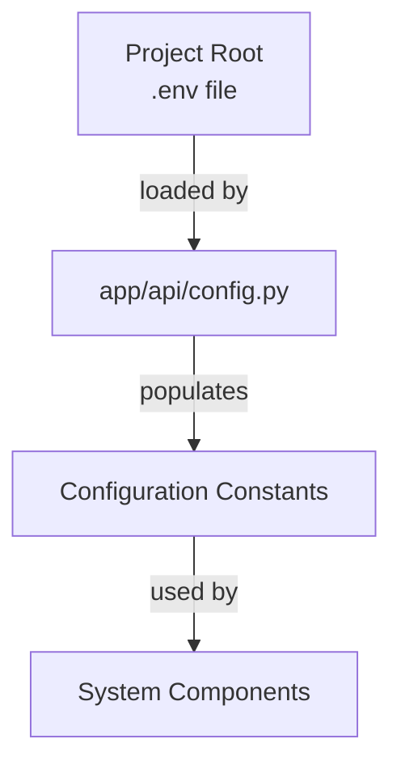
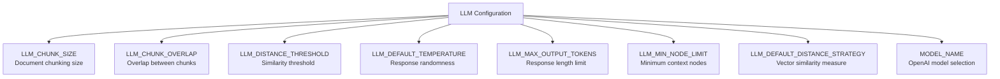
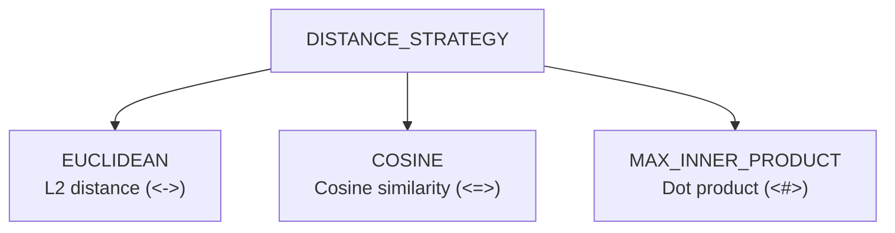
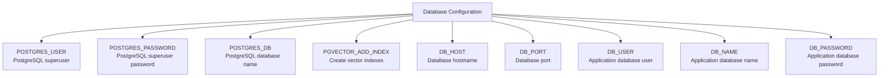
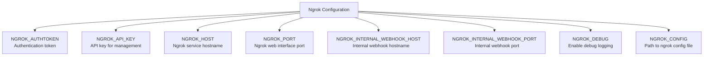
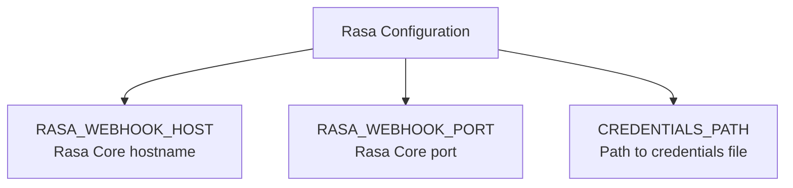
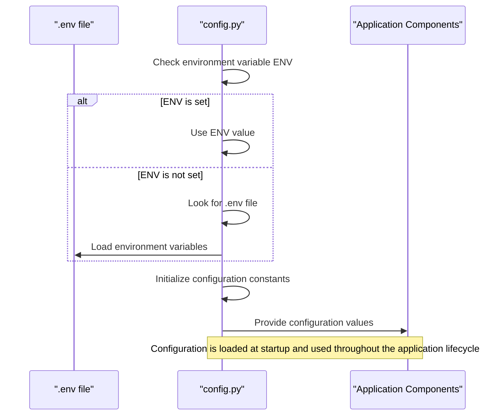
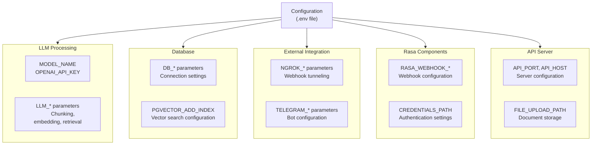

<!-- source: DeepWiki mcp.deepwiki.com · repo paulpierre/RasaGPT · page 2.1 Configuration Options · fetched 2026-10-26 -->

# Configuration Options

<details>
<summary>Relevant source files</summary>

The following files were used as context for generating this wiki page:

- [.env-example](.env-example)
- [app/api/config.py](app/api/config.py)

</details>


This page documents all the configuration options and environment variables used in RasaGPT. Understanding these options is essential for properly setting up and customizing your RasaGPT instance. For information about the Docker deployment architecture, see [Docker Environment](#2.2).

## Overview

RasaGPT uses environment variables to configure all aspects of the system. These settings control the behavior of various components including:

- API server
- LLM (Large Language Model) integration
- Vector database
- Document processing
- Rasa integration
- Telegram bot
- Development tools

Configuration values are loaded from a `.env` file at the root of the project and are accessible throughout the application.

## Environment File Setup

The system uses a `.env` file for configuration. A template is provided as `.env-example`:



Sources: [.env-example](), [app/api/config.py:15-28]()

## Configuration Categories

The configuration options are organized into the following categories:

| Category | Purpose | Example Variables |
|----------|---------|-------------------|
| General | Basic system settings | `ENV` |
| File Upload | Document processing settings | `FILE_UPLOAD_PATH` |
| LLM | Language model parameters | `LLM_CHUNK_SIZE`, `MODEL_NAME` |
| Database | PostgreSQL and pgvector configuration | `DB_HOST`, `PGVECTOR_ADD_INDEX` |
| Ngrok | Tunneling for webhook access | `NGROK_AUTHTOKEN` |
| Rasa | Rasa core and webhook configuration | `RASA_WEBHOOK_HOST` |
| Telegram | Bot settings | `TELEGRAM_ACCESS_TOKEN` |
| API | API server configuration | `API_PORT` |
| Admin Tools | PgAdmin settings | `PGADMIN_DEFAULT_EMAIL` |

Sources: [.env-example]()

## General Settings

| Variable | Description | Default |
|----------|-------------|---------|
| `ENV` | Deployment environment (local, staging, production) | `local` |

Sources: [.env-example:1]()

## File Upload Settings

| Variable | Description | Default |
|----------|-------------|---------|
| `FILE_UPLOAD_PATH` | Directory path for uploaded files | `data` |

Sources: [.env-example:3](), [app/api/config.py:65]()

## LLM Configuration

These settings control how the Large Language Model processes text and generates responses.



| Variable | Description | Default | Code Reference |
|----------|-------------|---------|---------------|
| `LLM_DEFAULT_TEMPERATURE` | Controls randomness in responses (0-1) | `0` | [app/api/config.py:86]() |
| `LLM_CHUNK_SIZE` | Size of text chunks for document processing | `1000` | [app/api/config.py:87]() |
| `LLM_CHUNK_OVERLAP` | Overlap between consecutive chunks | `200` | [app/api/config.py:88]() |
| `LLM_DISTANCE_THRESHOLD` | Threshold for similarity matching | `0.2` | [app/api/config.py:89]() |
| `LLM_MAX_OUTPUT_TOKENS` | Maximum tokens in generated responses | `256` | [app/api/config.py:90]() |
| `LLM_MIN_NODE_LIMIT` | Minimum number of context nodes to retrieve | `3` | [app/api/config.py:91]() |
| `LLM_DEFAULT_DISTANCE_STRATEGY` | Vector similarity strategy (EUCLIDEAN, COSINE, MAX_INNER_PRODUCT) | `EUCLIDEAN` | [app/api/config.py:129-131]() |
| `MODEL_NAME` | OpenAI model to use (e.g., gpt-3.5-turbo) | `gpt-3.5-turbo` | [app/api/config.py:85]() |

Sources: [.env-example:4-10](), [app/api/config.py:85-91](), [app/api/config.py:94-131]()

### Distance Strategies

RasaGPT supports multiple distance strategies for vector similarity search:



Each strategy is implemented with a corresponding PostgreSQL vector index:

| Strategy | Description | SQL Operator | PgVector Index |
|----------|-------------|--------------|----------------|
| `EUCLIDEAN` | Euclidean distance (L2 norm) | `<->` | `vector_l2_ops` |
| `COSINE` | Cosine similarity | `<=>` | `vector_cosine_ops` |
| `MAX_INNER_PRODUCT` | Maximum inner product (dot product) | `<#>` | `vector_ip_ops` |

Sources: [app/api/config.py:94-128]()

## Database Configuration

Configuration for PostgreSQL database and pgvector extension:



| Variable | Description | Default | Code Reference |
|----------|-------------|---------|---------------|
| `POSTGRES_USER` | PostgreSQL superuser username | `postgres` | [app/api/config.py:68]() |
| `POSTGRES_PASSWORD` | PostgreSQL superuser password | `postgres` | [app/api/config.py:69]() |
| `POSTGRES_DB` | PostgreSQL database name | `postgres` | `.env-example` |
| `PGVECTOR_ADD_INDEX` | Whether to add vector indices | `true` | [app/api/config.py:133]() |
| `DB_HOST` | Database hostname | `db` | [app/api/config.py:70]() |
| `DB_PORT` | Database port | `5432` | [app/api/config.py:71]() |
| `DB_USER` | Application database user | `api` | [app/api/config.py:72]() |
| `DB_NAME` | Application database name | `api` | [app/api/config.py:73]() |
| `DB_PASSWORD` | Application database password | `<YOUR DATABASE PASSWORD>` | [app/api/config.py:74]() |

The system uses two database connection strings:
- `DSN`: Used by the application (`DB_USER`)
- `SU_DSN`: Used for administrative tasks (`POSTGRES_USER`)

Sources: [.env-example:12-21](), [app/api/config.py:68-78]()

## Ngrok Configuration

Ngrok is used to expose the local Rasa webhook to the internet:



| Variable | Description | Default | 
|----------|-------------|---------|
| `NGROK_HOST` | Ngrok service hostname | `ngrok` |
| `NGROK_PORT` | Ngrok web interface port | `4040` |
| `NGROK_AUTHTOKEN` | Authentication token for Ngrok account | `<YOUR NGROK AUTH TOKEN>` |
| `NGROK_API_KEY` | API key for Ngrok management | `<YOUR NGROK API KEY>` |
| `NGROK_INTERNAL_WEBHOOK_HOST` | Internal hostname for webhook forwarding | `api` |
| `NGROK_INTERNAL_WEBHOOK_PORT` | Internal port for webhook forwarding | `8888` |
| `NGROK_DEBUG` | Enable debug logging | `true` |
| `NGROK_CONFIG` | Path to Ngrok configuration file | `/etc/ngrok.yml` |

Sources: [.env-example:23-30]()

## Rasa Integration Settings

Configuration for Rasa Core integration:



| Variable | Description | Default | Code Reference |
|----------|-------------|---------|---------------|
| `RASA_WEBHOOK_HOST` | Hostname for Rasa Core | `rasa-core` | [app/api/config.py:80]() |
| `RASA_WEBHOOK_PORT` | Port for Rasa Core | `5005` | [app/api/config.py:81]() |
| `CREDENTIALS_PATH` | Path to Rasa credentials file | `/app/rasa/credentials.yml` | `.env-example` |

The system constructs a Rasa webhook URL using these settings:
```
RASA_WEBHOOK_URL = http://{RASA_WEBHOOK_HOST}:{RASA_WEBHOOK_PORT}
```

Sources: [.env-example:32-35](), [app/api/config.py:80-82]()

## Telegram Bot Configuration

Settings for the Telegram bot interface:

| Variable | Description | Default |
|----------|-------------|---------|
| `TELEGRAM_ACCESS_TOKEN` | Telegram bot API token | `<YOUR TELEGRAM ACCESS TOKEN>` |
| `TELEGRAM_BOTNAME` | Telegram bot username | `rasagpt` |

Sources: [.env-example:37-38]()

## API Server Settings

Configuration for the FastAPI server:

| Variable | Description | Default |
|----------|-------------|---------|
| `API_PORT` | Port for the API server | `8888` |
| `API_HOST` | Hostname for the API server | `api` |

Sources: [.env-example:40-41]()

## Admin Tools Configuration

Settings for PgAdmin (PostgreSQL administration tool):

| Variable | Description | Default |
|----------|-------------|---------|
| `PGADMIN_PORT` | Port for PgAdmin web interface | `5050` |
| `PGADMIN_DEFAULT_PASSWORD` | Default password for PgAdmin | `pgadmin` |
| `PGADMIN_DEFAULT_EMAIL` | Default email for PgAdmin login | `your@emailaddress.com` |

Sources: [.env-example:43-45]()

## OpenAI Configuration

Settings for OpenAI API integration:

| Variable | Description | Default | Code Reference |
|----------|-------------|---------|---------------|
| `MODEL_NAME` | Name of the OpenAI model to use | `gpt-3.5-turbo` | [app/api/config.py:85]() |
| `OPENAI_API_KEY` | API key for OpenAI services | `<YOUR OPEN AI KEY>` | `.env-example` |

The system supports various OpenAI models with different token limits:

| Model | Token Limit | Description |
|-------|-------------|-------------|
| `text-davinci-003` | 4097 | OpenAI GPT-3 model |
| `gpt-3.5-turbo` | 4096 | OpenAI ChatGPT model |
| `text-davinci-002` | 4097 | OpenAI GPT-3 model |
| `code-davinci-002` | 8001 | Code-specialized model |
| `gpt-4` | 8192 | OpenAI GPT-4 model |
| `gpt-4-32k` | 32768 | OpenAI GPT-4 with extended context |

Sources: [.env-example:47-48](), [app/api/config.py:158-176]()

## Configuration Loading Process

The following diagram illustrates how configuration is loaded and processed in the system:



Sources: [app/api/config.py:15-28]()

## Configuration Dependencies and System Impact

This diagram shows how configuration settings affect different system components:



Sources: [.env-example](), [app/api/config.py]()

---

