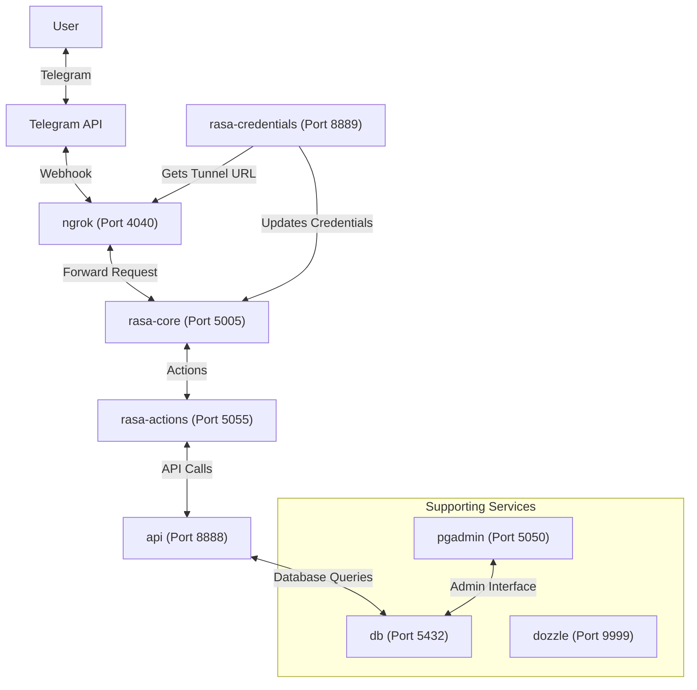
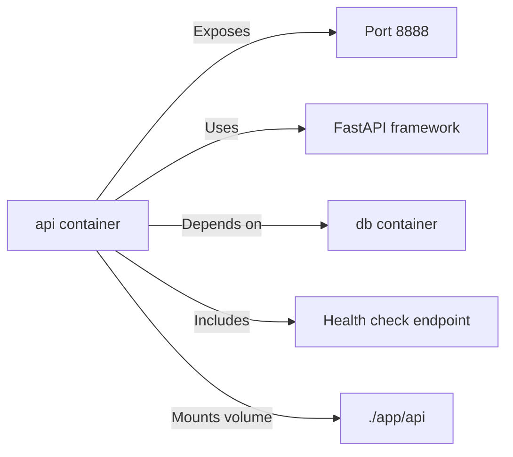
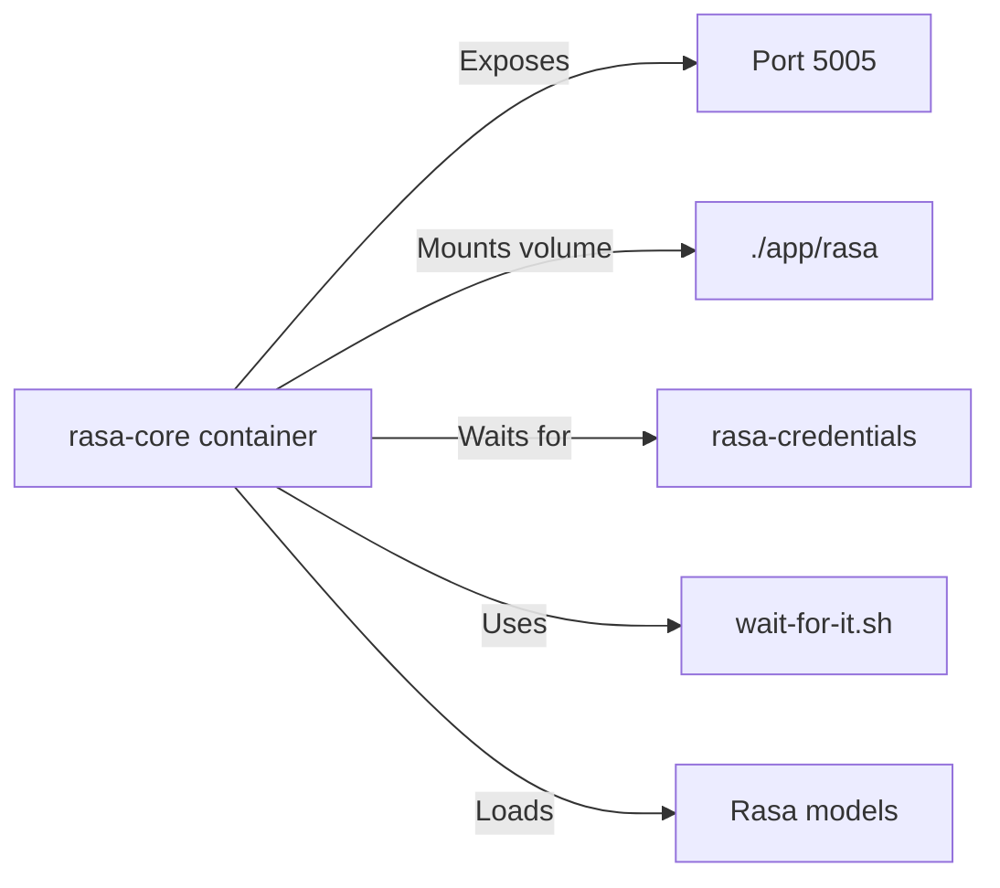
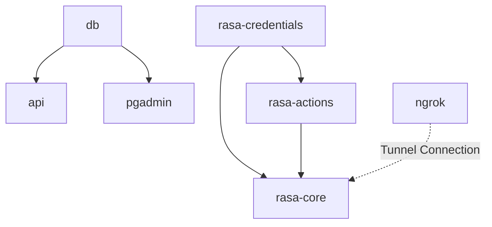
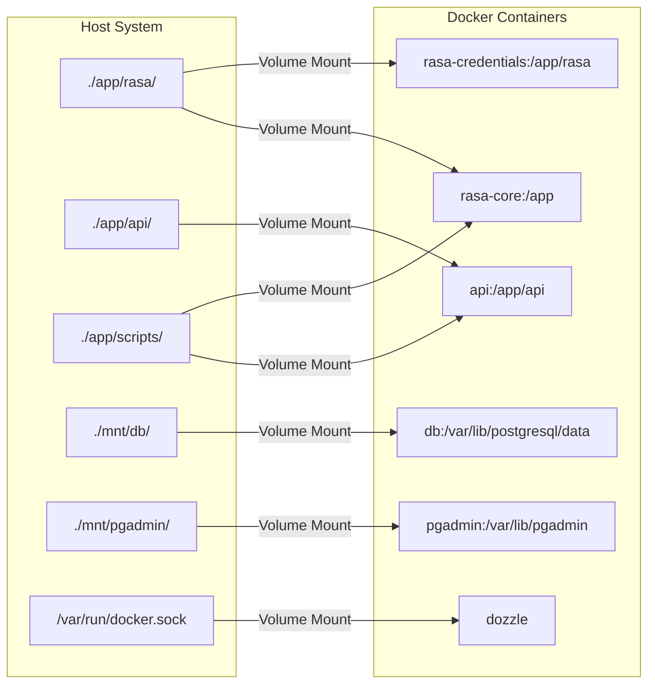
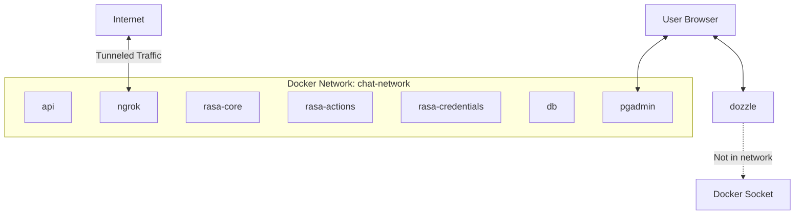

<!-- source: DeepWiki mcp.deepwiki.com · repo paulpierre/RasaGPT · page 2.2 Docker Environment · fetched 2026-10-26 -->

# Docker Environment

Relevant source files

The following files were used as context for generating this wiki page:

- [app/api/Dockerfile](app/api/Dockerfile)
- [app/rasa-credentials/Dockerfile](app/rasa-credentials/Dockerfile)
- [app/scripts/wait-for-it.sh](app/scripts/wait-for-it.sh)
- [docker-compose.yml](docker-compose.yml)

This document provides a detailed explanation of the Docker-based deployment architecture in RasaGPT. It covers the containerized services, their configurations, communication patterns, and how they work together to create a functioning system.

For information about specific configuration options and environment variables used by these containers, see [Configuration Options](#2.1).

## Docker Architecture Overview

RasaGPT uses Docker Compose to orchestrate a multi-container environment consisting of seven key services defined in the docker-compose.yml file:

1. **api**: FastAPI server for LLM integration
2. **ngrok**: Tunnel service for exposing webhooks to the internet
3. **rasa-core**: Main Rasa NLU and dialogue management engine
4. **rasa-actions**: Custom action server for Rasa
5. **rasa-credentials**: Helper service for webhook registration
6. **db**: PostgreSQL database with pgvector extension for embeddings
7. **Support services**: PgAdmin for database management and Dozzle for log viewing

All services operate within a Docker bridge network called `chat-network`, which enables inter-container communication.

Sources: [docker-compose.yml:9-184]()

## Docker Service Architecture

The following diagram illustrates the containerized services and their relationships:

Sources: [docker-compose.yml:11-180]()

## Service Definitions

### Core Services

| Service | Purpose | Port | Base Image/Build | Dependencies |
|---------|---------|------|-----------------|--------------|
| api | LLM integration via FastAPI | 8888 | Custom Python 3.9 build | db |
| ngrok | Tunnel for webhook exposure | 4040 | ngrok/ngrok:latest | - |
| rasa-core | NLU and dialogue management | 5005 | khalosa/rasa-aarch64:3.5.2 | rasa-actions, rasa-credentials |
| rasa-actions | Custom action server | 5055 | Custom build | rasa-credentials |
| rasa-credentials | Webhook URL management | 8889 | Custom Python 3.8 build | - |
| db | Vector database | 5432 | Custom PostgreSQL build | - |

### Support Services

| Service | Purpose | Port | Base Image |
|---------|---------|------|------------|
| pgadmin | Database admin interface | 5050 | dpage/pgadmin4 |
| dozzle | Container log viewer | 9999 | amir20/dozzle:latest |

Sources: [docker-compose.yml:16-179]()

## Detailed Service Configurations

### API Service

The `api` service provides the LLM integration layer for RasaGPT:
- Built from a custom Dockerfile at [app/api/Dockerfile:1-15]()
- Exposes port 8888 for HTTP access
- Mounts the API codebase as a volume for hot reloading
- Includes health check to ensure service availability
- Uses uvicorn to serve the FastAPI application

Sources: [docker-compose.yml:16-35](), [app/api/Dockerfile:1-15]()

### Ngrok Service

The `ngrok` service creates a secure tunnel to expose the Rasa webhook to the internet:
- Uses the official ngrok/ngrok image
- Exposes management UI on port 4040
- Configures tunnel settings from `./app/rasa/ngrok.yml`
- Authenticates using the NGROK_AUTH_TOKEN environment variable

Sources: [docker-compose.yml:41-57]()

### Rasa Core Service

The `rasa-core` service runs the main Rasa NLU and dialogue management engine:
- Uses the ARM64-compatible khalosa/rasa-aarch64:3.5.2 image
- Exposes the Rasa API on port 5005
- Mounts Rasa project files from ./app/rasa
- Uses the wait-for-it script to ensure dependencies are available before starting
- Loads credentials and endpoints from configuration files

Sources: [docker-compose.yml:63-79](), [app/scripts/wait-for-it.sh:1-205]()

### Rasa Actions Service

The `rasa-actions` service runs custom action code that Rasa Core can trigger:
- Built from a custom Dockerfile in `./app/rasa/actions`
- Exposes the action server on port 5055
- Depends on the rasa-credentials service
- Provides custom functionality beyond standard Rasa abilities

Sources: [docker-compose.yml:85-97]()

### Rasa Credentials Service

The `rasa-credentials` service manages webhook registration and credentials:
- Built from [app/rasa-credentials/Dockerfile:1-16]()
- Runs on port 8889
- Mounts Rasa project files and credential service code
- Updates the webhook URL in the Rasa credentials file
- Includes health check to verify service availability

Sources: [docker-compose.yml:103-120](), [app/rasa-credentials/Dockerfile:1-16]()

### Database Service

The `db` service runs PostgreSQL with the pgvector extension for vector embeddings:
- Built from a custom Dockerfile in `./app/db`
- Exposes PostgreSQL on port 5432
- Persists database files to `./mnt/db`
- Includes health check using pg_isready
- Provides storage for conversation history and document embeddings

Sources: [docker-compose.yml:126-144]()

### PgAdmin Service

The `pgadmin` service provides a web interface for database management:
- Uses the official dpage/pgadmin4 image
- Exposes the web interface on port 5050 (configurable via PGADMIN_PORT)
- Persists configuration to `./mnt/pgadmin`
- Configured with default credentials via environment variables

Sources: [docker-compose.yml:150-165]()

### Dozzle Service

The `dozzle` service provides a web interface for viewing container logs:
- Uses the amir20/dozzle:latest image
- Exposes the web interface on port 9999
- Mounts the Docker socket to access container logs
- Provides real-time log viewing for all containers

Sources: [docker-compose.yml:171-179]()

## Service Dependencies and Startup Order

The startup order is carefully managed through:

1. Docker Compose `depends_on` directives
2. The `wait-for-it.sh` script that ensures services are fully available

The script [app/scripts/wait-for-it.sh:1-205]() is used by several services:
- `api` waits for `db` to be ready
- `rasa-core` waits for `rasa-credentials` to be ready

This ensures that dependent services don't start until their prerequisites are fully operational.

Sources: [docker-compose.yml:29-30](), [docker-compose.yml:74-79](), [app/scripts/wait-for-it.sh:1-205]()

## Volume Mounts and Data Persistence

RasaGPT uses Docker volumes to:
- Persist database data across container restarts
- Enable real-time code changes without rebuilding containers
- Share configuration files between services

Key volume mounts include:
- `./app/api` → `/app/api` in the API container
- `./app/rasa` → `/app` in the Rasa Core container
- `./mnt/db` → `/var/lib/postgresql/data` in the database container
- `/var/run/docker.sock` → `/var/run/docker.sock` in the Dozzle container

Sources: [docker-compose.yml:34-35](), [docker-compose.yml:69-70](), [docker-compose.yml:109-110](), [docker-compose.yml:136](), [docker-compose.yml:158](), [docker-compose.yml:175]()

## Network Configuration

All services (except Dozzle) are connected via a bridge network named `chat-network`:
- Each service can reach others using service names as hostnames
- For example, the API reaches the database at `db:5432`
- The Rasa Actions server reaches the API at `api:8888`
- External users access the system through exposed ports or Ngrok tunnel

Sources: [docker-compose.yml:31-32](), [docker-compose.yml:53-54](), [docker-compose.yml:75-76](), [docker-compose.yml:96-97](), [docker-compose.yml:115-116](), [docker-compose.yml:143-144](), [docker-compose.yml:164-165](), [docker-compose.yml:181-183]()

## Health Checks

RasaGPT implements health checks for critical services:

| Service | Health Check | Interval | Retries |
|---------|--------------|----------|---------|
| api | curl -f http://api:8888/health | 15s | 5 |
| rasa-credentials | curl -f http://rasa-credentials:8889 | 15s | 5 |
| db | pg_isready -U postgres | 5s | 5 |

These checks ensure system stability by:
1. Verifying services are responsive
2. Allowing Docker to restart containers if needed
3. Enabling dependent services to wait for prerequisites

Sources: [docker-compose.yml:25-28](), [docker-compose.yml:117-120](), [docker-compose.yml:139-142]()

## Development vs. Production Considerations

The Docker environment is configured primarily for development with:

- Volume mounts for hot-reloading code changes
- Exposed ports for direct service access
- Development tools like PgAdmin and Dozzle

For production deployments, consider:

1. Removing development services (pgadmin, dozzle)
2. Using production-ready Docker images without development dependencies
3. Configuring proper SSL termination for secure communication
4. Implementing container orchestration for high availability
5. Setting more restrictive network policies

## Troubleshooting

Common issues and their solutions:

1. **Service won't start**: Check logs with `docker-compose logs <service-name>`
2. **Cannot connect to service**: Ensure the service is healthy with `docker-compose ps`
3. **Database connection issues**: Verify database credentials in the `.env` file
4. **Webhook not receiving messages**: Check Ngrok tunnel status at `http://localhost:4040`
5. **Rasa model loading failures**: Ensure models are built correctly before starting services

The Dozzle log viewer at `http://localhost:9999` provides real-time logs for all containers.

---

