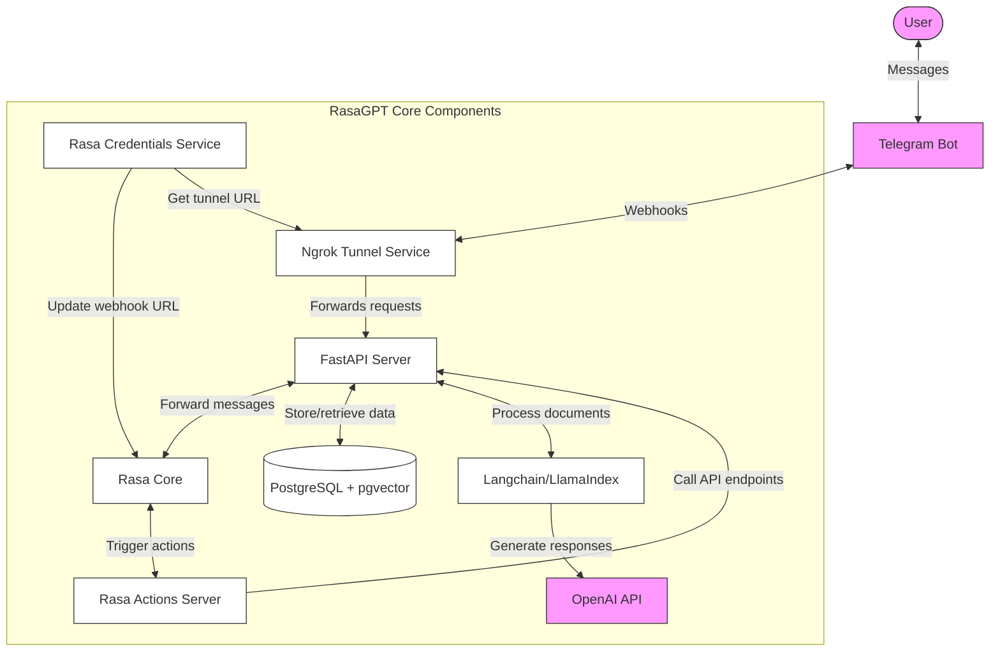
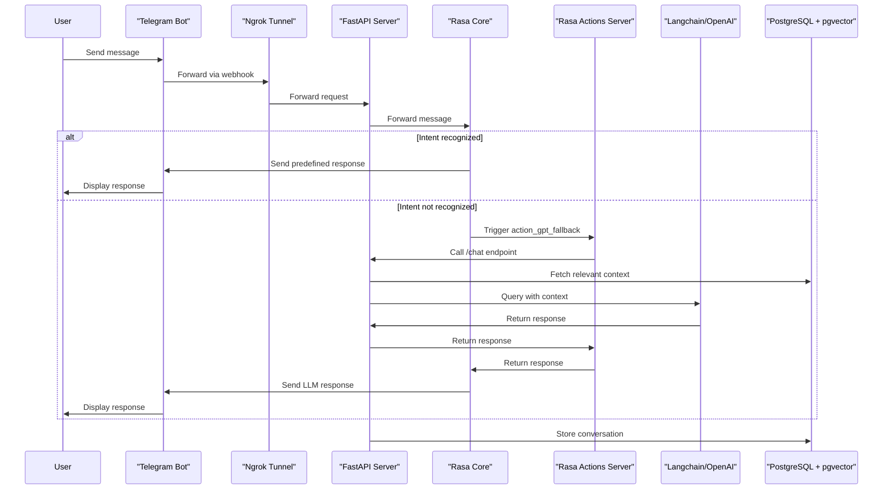
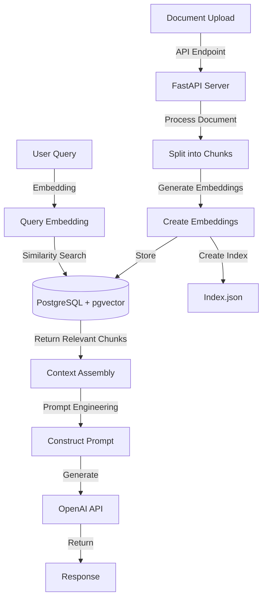
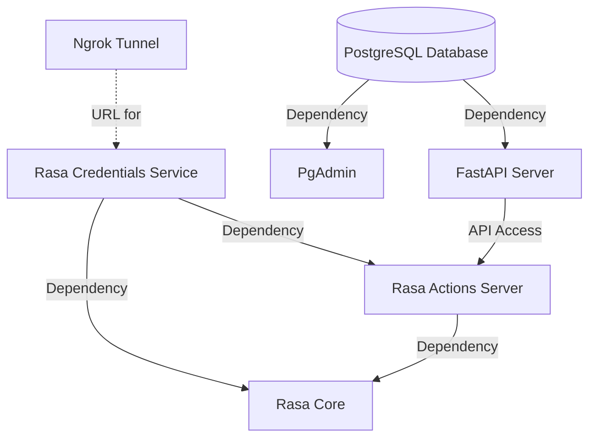
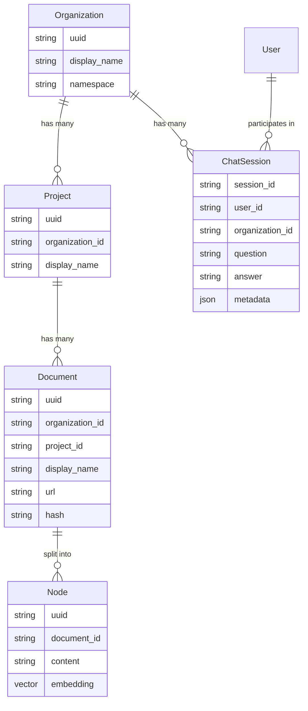

<!-- source: DeepWiki mcp.deepwiki.com · repo paulpierre/RasaGPT · page 3 Core Components · fetched 2026-10-26 -->

# Core Components

Relevant source files

The following files were used as context for generating this wiki page:

- [README.md](README.md)
- [app/scripts/wait-for-it.sh](app/scripts/wait-for-it.sh)
- [docker-compose.yml](docker-compose.yml)
- [github/rasagpt-video-title-screen.png](github/rasagpt-video-title-screen.png)

This page provides an overview of the main components that constitute the RasaGPT system. It explains the purpose and function of each component, as well as how they interact with each other to form the complete system. For installation instructions, see [Installation and Setup](#2), and for detailed API documentation, see [FastAPI Server](#3.1).

## System Component Overview

RasaGPT is built as a collection of specialized services that work together to create a conversational AI platform with LLM capabilities. The system follows a microservices architecture, with each component running in its own Docker container.

Sources: [docker-compose.yml:11-180](), [README.md:565-585]()

## Main Components and Their Functions

### FastAPI Server

The FastAPI server acts as the central hub of the RasaGPT system. It handles all API requests, manages document processing, coordinates with the Rasa components, and serves as the main integration point for the LLM capabilities.

**Key responsibilities:**
- Processing incoming messages from Rasa
- Managing document uploads and indexing
- Querying vector embeddings for relevant context
- Communicating with OpenAI API for response generation
- Maintaining conversation history
- Supporting multi-tenancy with organizations and projects

The FastAPI server is configured to run on port 8888 and provides a Swagger documentation interface for testing the API endpoints.

Sources: [docker-compose.yml:16-36](), [README.md:260-262]()

### Rasa Components

RasaGPT utilizes Rasa's conversational AI framework through three main components:

#### 1. Rasa Core

The main Rasa service that handles:
- Processing of user messages
- Intent classification
- Dialog management
- Integration with messaging platforms (Telegram)

Rasa Core runs on port 5005 and uses trained NLU models to process user messages.

#### 2. Rasa Actions Server

The Rasa Actions server implements custom actions that are triggered when specific intents are detected by Rasa Core. Most importantly, it contains the `action_gpt_fallback` action that is triggered when Rasa cannot confidently classify an intent, allowing the system to use LLM capabilities to respond.

The Actions server runs on port 5055.

#### 3. Rasa Credentials Service

A helper service that:
- Obtains the Ngrok tunnel URL
- Updates the Rasa credentials configuration
- Ensures proper webhook registration with Telegram
- Manages restart of Rasa when configuration changes

This service runs on port 8889 and is essential for making Rasa work with Telegram through an Ngrok tunnel.

Sources: [docker-compose.yml:60-120](), [README.md:570-584]()

### Database Components

#### PostgreSQL with pgvector

RasaGPT uses PostgreSQL as its primary database, enhanced with the pgvector extension for vector similarity search. This enables:

- Storage of document embeddings
- Similarity search for retrieving relevant context
- Multi-tenant data model support
- Storage of conversation history

The PostgreSQL database runs on port 5432 and is complemented by PgAdmin (port 5050) for database management through a web interface.

Sources: [docker-compose.yml:126-165](), [README.md:600-607]()

### Networking and External Access

#### Ngrok Tunnel

The Ngrok service creates a secure tunnel to expose the local Rasa service to the internet, enabling Telegram to send webhooks to the local development environment. Features include:

- Creating a public HTTPS URL for the local Rasa webhook
- Automatically updating webhook URL in Telegram
- Exposing admin interface on port 4040 for monitoring connections

This component is essential for development and testing with messaging platforms.

Sources: [docker-compose.yml:41-57](), [README.md:588-596]()

### Logging and Monitoring

#### Dozzle (Log Viewer)

Dozzle provides a web interface to view logs from all Docker containers in the system. It runs on port 9999 and helps with debugging and monitoring the system.

Sources: [docker-compose.yml:171-179]()

## Data Flow and Component Interaction

### Conversation Flow

This diagram depicts how a user message flows through the RasaGPT system components:

Sources: [README.md:565-629]()

### Document Processing Pipeline

The following diagram illustrates how documents are processed, indexed, and utilized for context retrieval:

Sources: [README.md:608-616]()

## Component Dependencies and Startup Sequence

The components of RasaGPT have dependencies on each other which dictate their startup sequence. The system uses a wait-for-it script to ensure services wait for their dependencies before starting.

Sources: [docker-compose.yml:25-31](), [docker-compose.yml:73-79](), [app/scripts/wait-for-it.sh:1-205]()

## Data Model Relationships

The data in RasaGPT is organized in a multi-tenant model with the following entity relationships:

Sources: [README.md:268-547]()

## Service Port Mappings

The following table shows the ports exposed by each service in the RasaGPT system:

| Service | Port | Purpose |
|---------|------|---------|
| FastAPI Server | 8888 | API endpoints, document processing, and chat functionality |
| Ngrok | 4040 | Tunnel administration and monitoring |
| Rasa Core | 5005 | Rasa API and webhook endpoints |
| Rasa Actions | 5055 | Custom action execution |
| Rasa Credentials | 8889 | Webhook URL management |
| PostgreSQL | 5432 | Database connection |
| PgAdmin | 5050 | Database administration interface |
| Dozzle | 9999 | Log viewing interface |

Sources: [docker-compose.yml:24-178]()

## Component Configuration

Each component in the RasaGPT system is configured through environment variables loaded from a `.env` file. These environment variables control aspects such as:

- API credentials (OpenAI, Telegram, Ngrok)
- Database connection details
- Service URLs and ports
- Feature flags and operational modes

For a detailed list of available configuration options, see [Configuration Options](#2.1).

Sources: [docker-compose.yml:21-22](), [docker-compose.yml:46-52](), [docker-compose.yml:65-67](), [docker-compose.yml:90-91](), [docker-compose.yml:113-114](), [docker-compose.yml:130-134](), [docker-compose.yml:153-156]()

---

