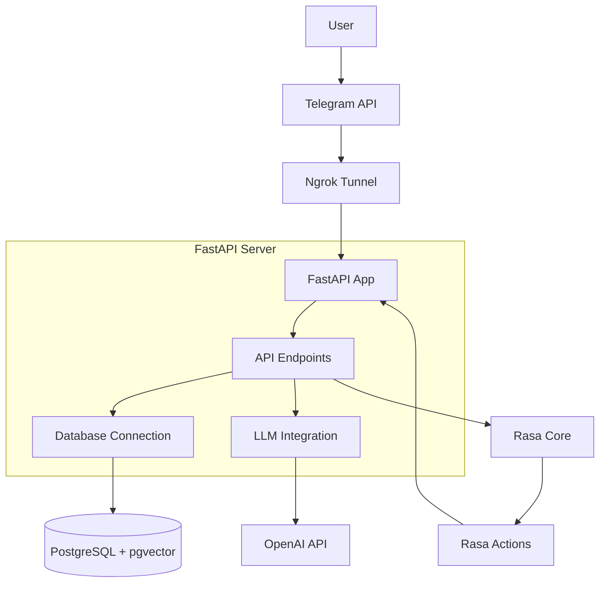
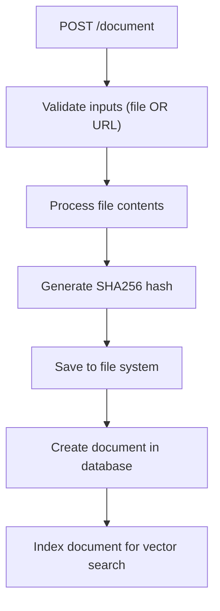
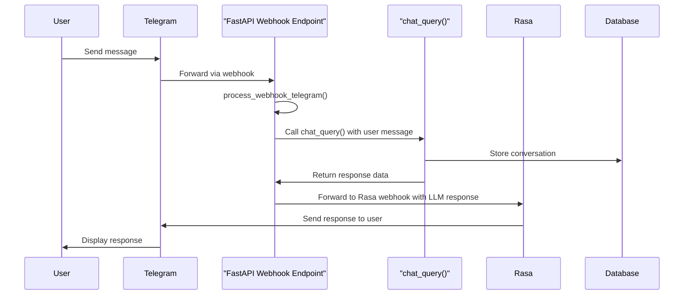
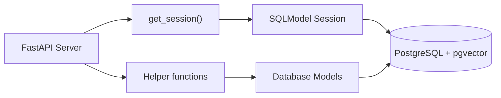
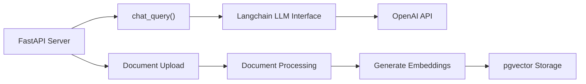
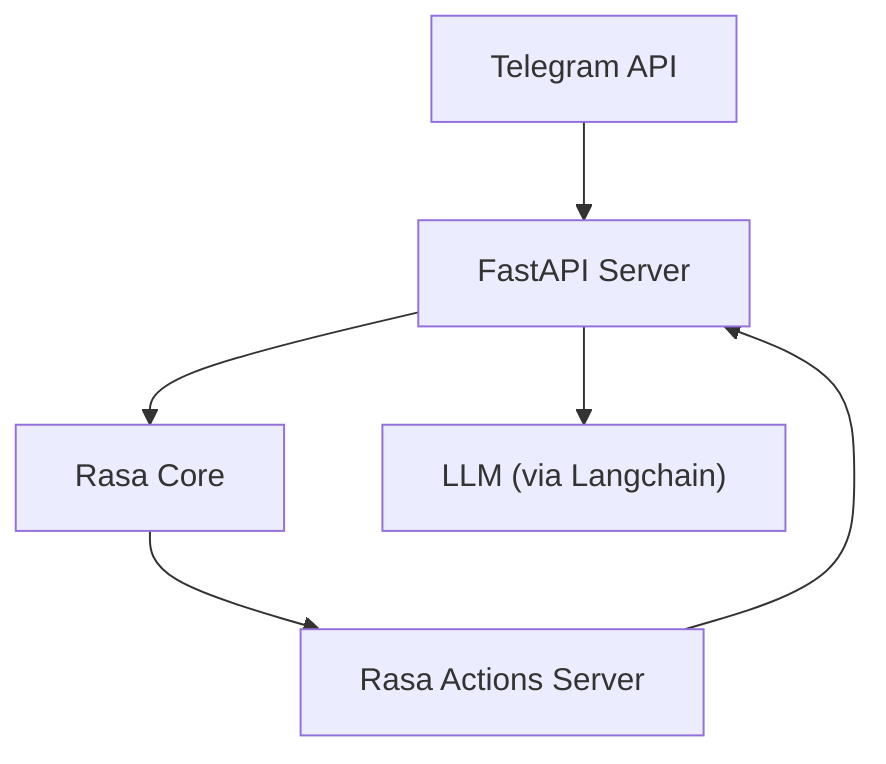

<!-- source: DeepWiki mcp.deepwiki.com · repo paulpierre/RasaGPT · page 3.1 FastAPI Server · fetched 2026-10-26 -->

# FastAPI Server

<details>
<summary>Relevant source files</summary>

The following files were used as context for generating this wiki page:

- [app/api/API.md](app/api/API.md)
- [app/api/main.py](app/api/main.py)
- [app/api/requirements.txt](app/api/requirements.txt)

</details>


## Purpose and Scope

The FastAPI Server is the central API component of the RasaGPT system, serving as a bridge between various components like Telegram, Rasa, PostgreSQL database, and LLM services. This document covers the server's configuration, endpoints, request handling, and integration with other system components.

For more information about Rasa integration, see [Rasa Integration](#3.2). For database schema and vector storage details, see [Database and Vector Store](#3.3).

## Overview

The FastAPI Server provides a RESTful API that supports multi-tenancy and document management for the RasaGPT chatbot platform. It handles webhook requests from Telegram, processes them through Rasa, and facilitates LLM-powered responses when Rasa can't handle an intent natively.



Sources:
- [app/api/main.py:1-106]()
- [app/api/requirements.txt:1-13]()

## Server Configuration

The server is built using FastAPI, a modern, fast web framework for building APIs with Python. It relies on a number of dependencies that enable its core functionality.

### Dependencies

The FastAPI server has the following key dependencies:

| Dependency | Purpose |
|------------|---------|
| fastapi | Core web framework |
| uvicorn | ASGI server to run the application |
| sqlmodel | SQL database interaction with type annotations |
| pgvector | Vector embedding storage and similarity search |
| langchain | LLM integration and document processing |
| python-multipart | For handling file uploads |
| openai | OpenAI API client |

Sources:
- [app/api/requirements.txt:1-13]()

### API Initialization and Static Files

The FastAPI application is initialized and configured to serve static files:


Sources:
- [app/api/main.py:105-115]()
- [app/api/main.py:556-565]()

## API Endpoints

The FastAPI server provides several groups of endpoints to manage different aspects of the system.

```mermaid
classDiagram
    class "FastAPI Server" {
        /health
        /org/*
        /project/*
        /document/*
        /user/*
        /webhooks/{channel}/webhook
    }
    
    class "Organization Endpoints" {
        GET /org
        POST /org
        GET /org/{organization_id}
        PUT /org/{organization_id}
    }
    
    class "Project Endpoints" {
        GET /project
        POST /project
        GET /project/{project_id}
    }
    
    class "Document Endpoints" {
        POST /document
        GET /document
        GET /document/{document_id}
    }
    
    class "User Endpoints" {
        GET /user
        POST /user
        GET /user/{user_uuid}
        PUT /user/{user_uuid}
    }
    
    class "Webhook Endpoint" {
        POST /webhooks/{channel}/webhook
    }
    
    "FastAPI Server" --> "Organization Endpoints"
    "FastAPI Server" --> "Project Endpoints"
    "FastAPI Server" --> "Document Endpoints"
    "FastAPI Server" --> "User Endpoints"
    "FastAPI Server" --> "Webhook Endpoint"
```

Sources:
- [app/api/main.py:113-550]()

### Health Check Endpoint

A simple endpoint that returns a status to confirm the API is running:

```
GET /health
Response: {"status": "ok"}
```

Sources:
- [app/api/main.py:113-115]()

### Organization Endpoints

Endpoints for managing organizations in the multi-tenant architecture:

| Method | Endpoint | Description |
|--------|----------|-------------|
| GET | /org | Get all organizations |
| POST | /org | Create a new organization |
| GET | /org/{organization_id} | Get an organization by UUID or namespace |
| PUT | /org/{organization_id} | Update an organization |

Sources:
- [app/api/main.py:125-212]()

### Project Endpoints

Endpoints for managing projects within organizations:

| Method | Endpoint | Description |
|--------|----------|-------------|
| GET | /project | Get all projects for an organization |
| POST | /project | Create a new project for an organization |
| GET | /project/{project_id} | Get a specific project |

Sources:
- [app/api/main.py:222-266]()

### Document Endpoints

Endpoints for uploading and retrieving documents that are used as knowledge sources:

| Method | Endpoint | Description |
|--------|----------|-------------|
| POST | /document | Upload a document file or URL |
| GET | /document | List all documents for a project |
| GET | /document/{document_id} | Get a specific document |

The document upload endpoint is particularly important as it processes documents that will be used for LLM context:



Sources:
- [app/api/main.py:276-376]()

### User Endpoints

Endpoints for user management:

| Method | Endpoint | Description |
|--------|----------|-------------|
| GET | /user | Get all users |
| POST | /user | Create a new user |
| GET | /user/{user_uuid} | Get a user by UUID |
| PUT | /user/{user_uuid} | Update a user |

Sources:
- [app/api/main.py:387-440]()

### Webhook Endpoint

The webhook endpoint is a critical part of the system that handles incoming messages from messaging platforms like Telegram:

```
POST /webhooks/{channel}/webhook
```

This endpoint:
1. Processes incoming webhook data
2. Extracts user and message metadata
3. Calls the `chat_query` function to get a response
4. Forwards the webhook to Rasa with additional metadata

Sources:
- [app/api/main.py:488-550]()

## Webhook Processing Flow

The webhook processing is a central part of the FastAPI server's functionality, handling communication between users and the chatbot system.



For Telegram specifically, the server processes webhook data to extract:
- User identifier
- Username
- First name
- Language preference
- Message content
- Timestamp
- Message type

Sources:
- [app/api/main.py:447-485]()
- [app/api/main.py:488-550]()

## Integration with Other Components

The FastAPI server integrates with several other components of the RasaGPT system:

### Database Integration

The server uses SQLModel (built on SQLAlchemy) to interact with the PostgreSQL database:



Database models include:
- Organization
- Project
- Document
- User
- ChatSession

Sources:
- [app/api/main.py:35-62]()

### LLM Integration

The server integrates with Large Language Models through the Langchain library:



The LLM integration is used for:
- Generating responses when Rasa can't handle a user query
- Processing and indexing documents for knowledge retrieval
- Creating vector embeddings for similarity search

Sources:
- [app/api/main.py:28-30]()
- [app/api/main.py:84-97]()

### Rasa Integration

The FastAPI server interacts with Rasa by:
1. Forwarding webhook requests from messaging platforms to Rasa
2. Receiving requests from Rasa's actions server when it needs LLM responses
3. Providing webhook endpoints for Rasa to call



The webhook endpoint integrates with Rasa by forwarding processed messages to Rasa's webhook endpoint, enriched with metadata from the LLM:

```
POST /webhooks/{channel}/webhook -> RASA_WEBHOOK_URL/webhooks/{channel}/webhook
```

Sources:
- [app/api/main.py:97]()
- [app/api/main.py:488-550]()

## Summary

The FastAPI server is a central component in the RasaGPT architecture, providing:

1. RESTful API endpoints for managing organizations, projects, documents, and users
2. Webhook handling for messaging platforms
3. Integration with Rasa for conversational AI
4. Document processing and indexing for knowledge retrieval
5. LLM integration for generating responses
6. Database interactions for storing and retrieving data

The server is designed with multi-tenancy in mind, allowing multiple organizations to use the system with their own isolated data and configurations.

Sources:
- [app/api/main.py:1-565]()
- [app/api/requirements.txt:1-13]()

---

