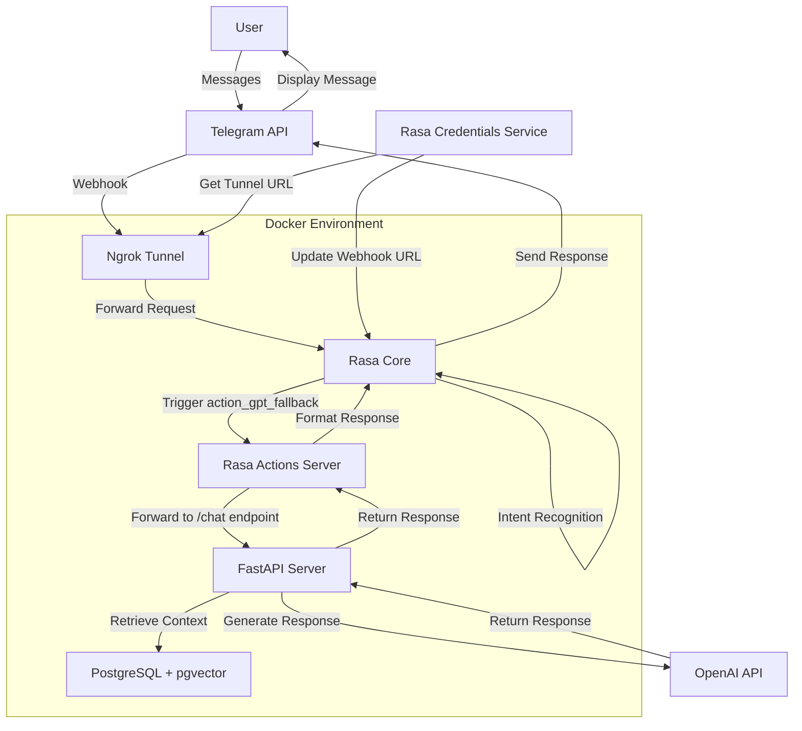
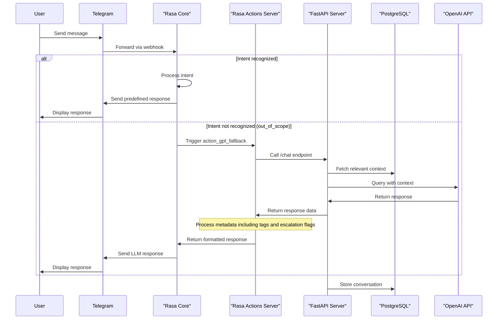
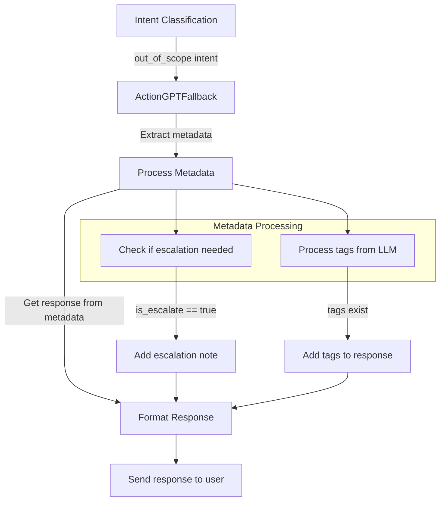
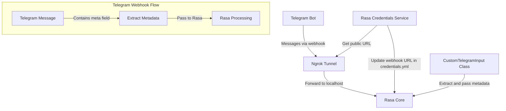

<!-- source: DeepWiki mcp.deepwiki.com · repo paulpierre/RasaGPT · page 3.2 Rasa Integration · fetched 2026-10-26 -->

# Rasa Integration

<details>
<summary>Relevant source files</summary>

The following files were used as context for generating this wiki page:

- [README.md](README.md)
- [app/rasa/actions/actions.py](app/rasa/actions/actions.py)
- [app/rasa/custom_telegram.py](app/rasa/custom_telegram.py)
- [github/rasagpt-video-title-screen.png](github/rasagpt-video-title-screen.png)

</details>


This page explains how Rasa is integrated into the RasaGPT system, covering its configuration, custom actions, and interaction with other components. For details about the FastAPI server that communicates with Rasa, see [FastAPI Server](#3.1).

## Overview of Rasa in RasaGPT

RasaGPT uses Rasa as its conversational AI foundation, extending it with LLM capabilities. Rasa handles the messaging platform integration (primarily Telegram), intent recognition, and conversation flow, while deferring to GPT-powered responses when it doesn't have a predefined answer.

The key components of Rasa integration include:

- **Rasa Core**: Manages conversation flow and intent recognition
- **Rasa Actions Server**: Executes custom actions when specific intents are triggered
- **Custom Actions**: Integrates with external APIs, specifically the `action_gpt_fallback` to use LLMs
- **Credentials Service**: Manages webhook URLs for Telegram
- **Ngrok Tunnel**: Provides public URL access to the locally running Rasa instance

Sources: [README.md:108-112](), [README.md:573-584]()

## Rasa Integration Architecture

The diagram below illustrates how Rasa is integrated within the RasaGPT system:



Sources: [README.md:569-585]()

## Rasa Configuration Files

Rasa requires several configuration files to define its behavior. The key configuration files in RasaGPT include:

| Configuration File | Purpose |
|-------------------|---------|
| `config.yml` | Defines NLU pipeline and policy configuration, including the FallbackClassifier threshold |
| `credentials.yml` | Contains webhook paths and Telegram credentials (updated by rasa-credentials service) |
| `domain.yml` | Defines intents, actions, and responses (includes `action_gpt_fallback`) |
| `endpoints.yml` | Defines the custom action endpoint for Rasa to trigger fallback actions |
| `nlu.yml` | Defines intents including `out_of_scope` for triggering LLM fallback |
| `rules.yml` | Sets rules for intents, including routing `out_of_scope` to `action_gpt_fallback` |

Sources: [README.md:574-581]()

## Conversation Flow with Rasa Integration

The sequence diagram below illustrates how a conversation flows through the RasaGPT system:



Sources: [README.md:70-81](), [README.md:621-629]()

## Custom Action for LLM Integration

The key to integrating LLMs with Rasa is the `action_gpt_fallback` custom action. This action is triggered when Rasa cannot confidently match an intent, routing the query to the LLM via the FastAPI server.

The `ActionGPTFallback` class in `actions.py` handles:

1. Extracting metadata from the user message
2. Processing the LLM response
3. Adding tags and escalation information to the response
4. Sending the formatted response back to the user

Sources: [app/rasa/actions/actions.py:24-81]()



## Telegram Integration with Rasa

RasaGPT integrates with Telegram as the primary messaging channel. This integration relies on three key components:

1. **Telegram Bot API**: External service that receives and sends messages
2. **Ngrok**: Creates a public URL tunnel to the local Rasa server
3. **Rasa Credentials Service**: Updates webhook URLs automatically

The system also includes a custom Telegram input class that extends Rasa's default implementation to allow for metadata passing. This is defined in `custom_telegram.py`:

Sources: [app/rasa/custom_telegram.py:1-20]()



## Handling Webhook URLs and Ngrok

One of the challenges in developing Telegram bots locally is the need for a public URL. RasaGPT solves this with Ngrok and a dedicated credentials service that coordinates between Ngrok and Rasa.

The process works as follows:

1. Ngrok creates a public tunnel to the local Rasa server
2. The rasa-credentials service gets the tunnel URL from Ngrok
3. It updates the `credentials.yml` file with the new webhook URL
4. It restarts Rasa to apply the changes
5. Telegram is configured to send messages to this URL

This setup allows for seamless local development and testing of the Telegram bot integration.

Sources: [README.md:588-604]()

## Troubleshooting Rasa Integration

When troubleshooting Rasa integration issues, consider the following:

1. **Check Ngrok tunnel**: Verify that the Ngrok tunnel is running and accessible
2. **Verify webhook URLs**: Ensure the webhook URL in Telegram matches the one in `credentials.yml`
3. **Check Rasa logs**: Look for errors in the Rasa logs using Dozzle at http://localhost:9999/
4. **Restart services**: Use `make restart` to restart all services if URLs are not matching
5. **Check action server**: Ensure the Rasa Actions server is running and properly configured

To verify webhook configuration, use:

```bash
curl -sS "https://api.telegram.org/bot<your-bot-secret-token>/getWebhookInfo" | json_pp
```

The output should match the Ngrok URL in your `credentials.yml` file.

Sources: [README.md:658-693]()

## Training and Deploying Rasa Models

RasaGPT automates the training of Rasa models during the installation process. The `make install` command handles:

1. Building the Docker environment
2. Training the Rasa model
3. Setting up webhook URLs
4. Starting all services

After installation, you can retrain the model using the Makefile commands or by accessing the Rasa container directly. The system is designed to require minimal manual intervention for setting up and maintaining Rasa models.

Sources: [README.md:207-214]()

---

