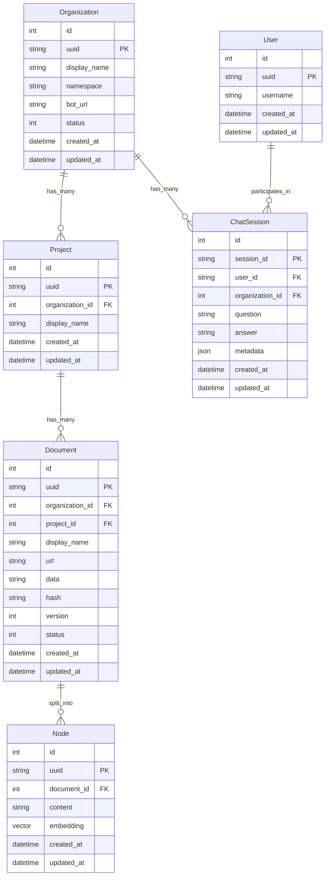
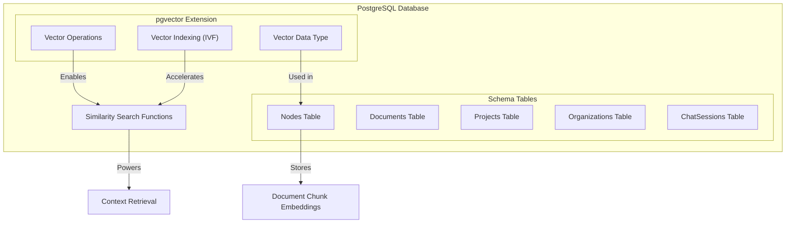
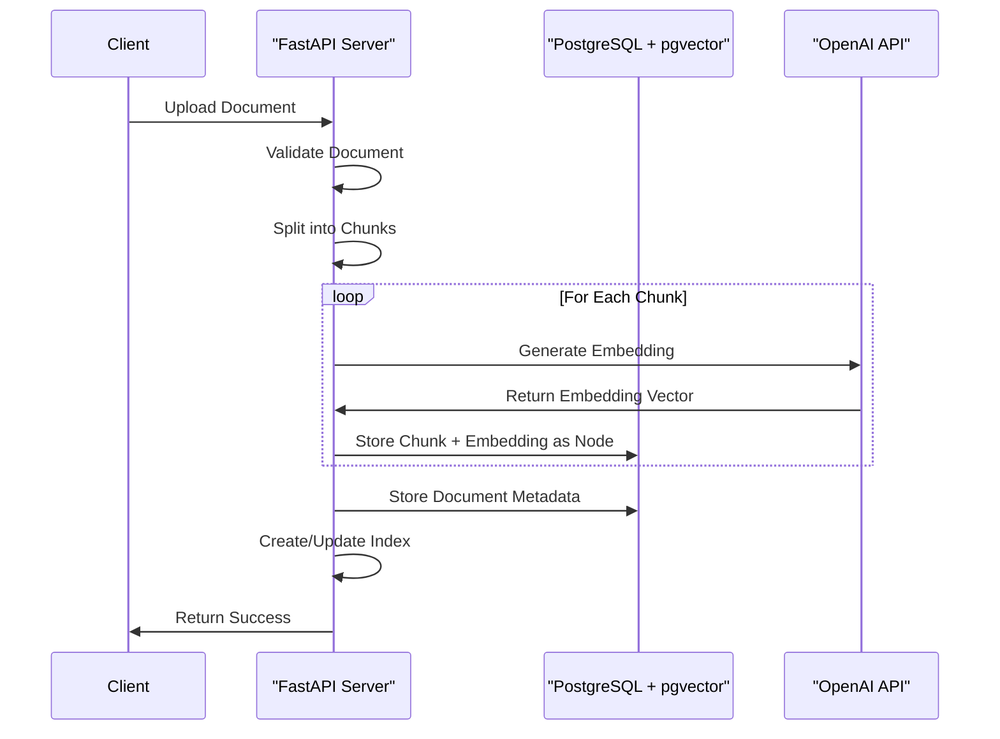
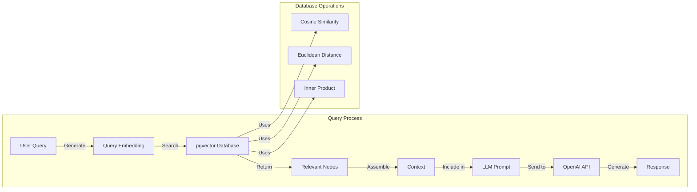

<!-- source: DeepWiki mcp.deepwiki.com · repo paulpierre/RasaGPT · page 3.3 Database and Vector Store · fetched 2026-10-26 -->

# Database and Vector Store

Relevant source files

The following files were used as context for generating this wiki page:

- [README.md](README.md)
- [app/api/seed.py](app/api/seed.py)
- [github/rasagpt-video-title-screen.png](github/rasagpt-video-title-screen.png)

This document explains the database architecture and vector storage functionality in RasaGPT, which provides the foundation for storing, indexing, and retrieving conversation data and document embeddings. For information about LLM integration with the vector store, see [LLM Integration](#3.4).

## Overview

RasaGPT uses PostgreSQL with the pgvector extension as its primary database system. This combination enables:

1. Structured storage of organizational data, projects, documents, and conversations
2. Vector embedding storage and similarity search capabilities
3. Multi-tenant data isolation
4. Efficient document indexing and retrieval for context-augmented conversation

The database system is a core component that supports all other aspects of RasaGPT, providing persistent storage while the vector functionality enables semantic search across uploaded documents.

Sources: [README.md:45-49]()

## Database Schema

The schema implements a multi-tenant architecture to support multiple organizations, each with their own projects, documents, and conversations.

### Entity Relationship Diagram

Sources: [README.md:268-322](), [app/api/seed.py:26-122]()

## PostgreSQL with pgvector Extension

RasaGPT uses the pgvector extension to enable vector operations directly in PostgreSQL. This allows for efficient storage and similarity search of vector embeddings.

### Vector Store Implementation

Sources: [README.md:46-48](), [README.md:600-606]()

### pgvector Setup

The pgvector extension is enabled through a combination of:

1. Docker setup to install the extension in PostgreSQL
2. Database initialization through `create_db.sh`
3. Explicit enabling of the extension through the `enable_vector` method

The database container initializes the extension during first startup, and the API ensures the extension is enabled before operation.

Sources: [README.md:600-606]()

## Document Processing Pipeline

Documents are processed through a pipeline that splits them into chunks, generates embeddings, and stores them in the database for later retrieval.

Sources: [README.md:612-615]()

## Data Model Entities

### Organization

The top-level entity in the multi-tenant structure. Each organization represents a client or tenant in the system with isolated data.

Key fields:
- `uuid`: Unique identifier
- `display_name`: Human-readable name
- `namespace`: URL-friendly identifier
- `bot_url`: Telegram bot URL (optional)

### Project

Projects belong to organizations and group related documents together.

Key fields:
- `uuid`: Unique identifier
- `organization_id`: Foreign key to parent organization
- `display_name`: Human-readable name

### Document

Documents contain the actual content to be processed and made available for semantic search.

Key fields:
- `uuid`: Unique identifier
- `organization_id` and `project_id`: Foreign keys to organization and project
- `display_name`: Filename or title
- `data`: The document content
- `hash`: Content hash for change detection
- `version`: Document version number

### Node

Nodes represent chunks of document content with associated vector embeddings.

Key fields:
- `uuid`: Unique identifier
- `document_id`: Foreign key to source document
- `content`: Text chunk
- `embedding`: Vector embedding of the content

### ChatSession

Represents a conversation between a user and the bot.

Key fields:
- `session_id`: Unique conversation identifier
- `user_id`: Reference to the user
- `organization_id`: Foreign key to organization
- `question`: User's query
- `answer`: System response
- `metadata`: Additional conversation data (JSON)

Sources: [README.md:268-322](), [app/api/seed.py:26-122]()

## Vector Search Implementation

When a user sends a message, the system uses vector similarity search to find relevant document chunks to provide context for the LLM response.

Sources: [README.md:612-615](), [README.md:249-251]()

## Multi-tenancy Implementation

The database schema enforces data isolation between different organizations. Each entity in the system (except for User) is associated with an organization, ensuring that queries only return data relevant to the current context.

```mermaid
flowchart TD
    subgraph "API Request Flow"
        Request["API Request"] -->|"Include"| OrgID["Organization ID/UUID"]
        OrgID -->|"Filter"| DbQuery["Database Query"]
        DbQuery -->|"Return only"| OrgData["Organization's Data"]
    end
    
    subgraph "Document Search Flow"
        UserQuery["User Query"] -->|"In context of"| OrgContext["Organization Context"]
        OrgContext -->|"Limit search to"| OrgNodes["Organization's Nodes"]
        OrgNodes -->|"Return"| RelevantContext["Relevant Context"]
    end
```

The multi-tenant architecture enables:
1. Data isolation between clients
2. Organization-specific document repositories
3. Customization per organization
4. Security through enforced data boundaries

Sources: [README.md:324-380](), [app/api/seed.py:26-122]()

## Database Operations

### Document Versioning

The system tracks document versions and automatically updates embeddings when documents change:

1. When a document is uploaded, a hash of its content is computed
2. If a document with the same name exists, the hash is compared
3. If different, a new version is created and nodes are regenerated
4. This ensures embeddings stay in sync with document content

### Embedding Generation and Storage

1. Documents are split into manageable chunks (default 1000 characters)
2. Each chunk is processed to generate a vector embedding using OpenAI's models
3. Embeddings are stored as vector types in the `nodes` table
4. The association between nodes and documents is maintained for traceability

Sources: [README.md:93-94](), [README.md:612-615]()

## Vector Store Performance Considerations

The default implementation uses basic vector search techniques that can be optimized:

- Current implementation uses 1000 character chunking
- Uses euclidean distance for similarity search
- More advanced chunking strategies could improve retrieval quality
- Index optimization could improve search performance by up to 70%

Sources: [README.md:249-251]()

## Database Administration

The system includes PgAdmin for database management:
- Available at http://localhost:5050
- Allows for direct inspection and management of the database
- Useful for debugging and maintenance operations

Sources: [README.md:100]()

## Conclusion

The database and vector store in RasaGPT form the foundation for document storage, semantic search, and context retrieval. The multi-tenant architecture allows for secure isolation of data between different organizations, while the pgvector extension enables efficient similarity search directly within PostgreSQL. This system powers the bot's ability to retrieve relevant information when responding to user queries.

---

