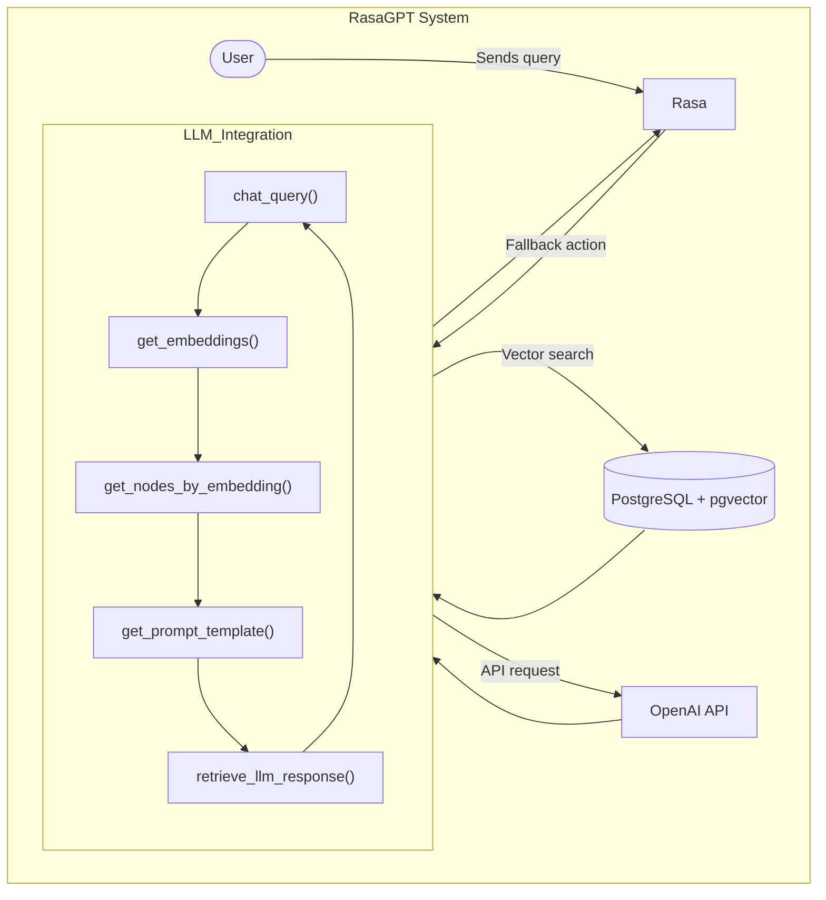
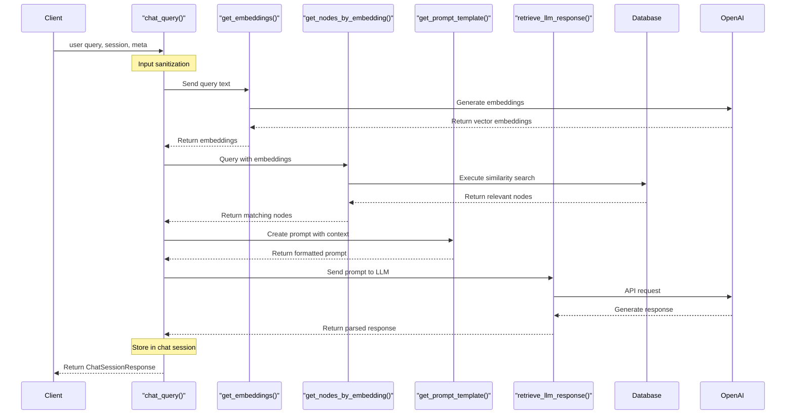
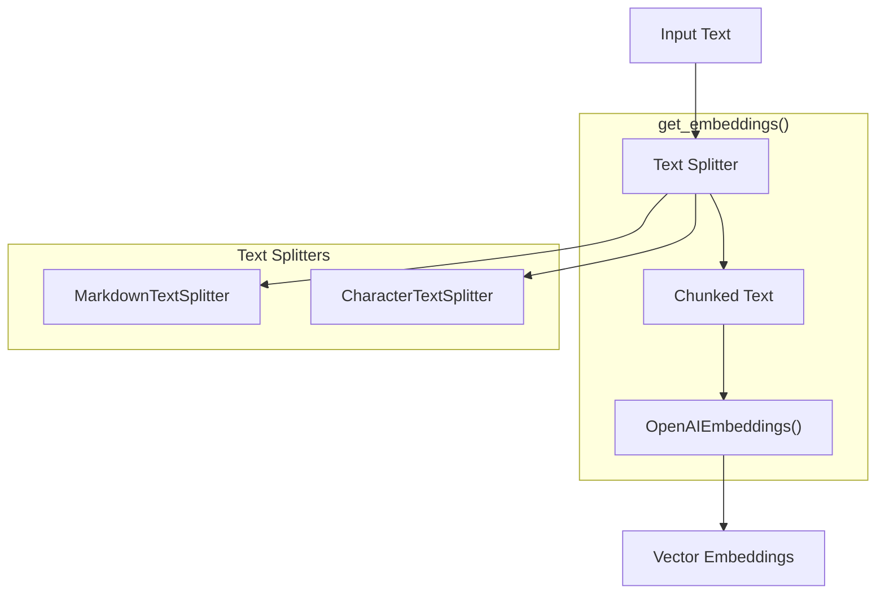
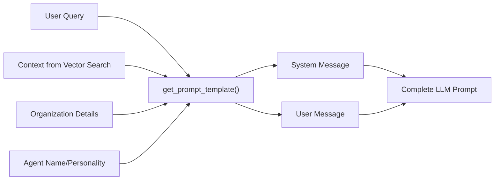
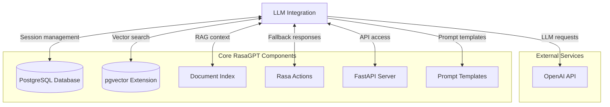

<!-- source: DeepWiki mcp.deepwiki.com · repo paulpierre/RasaGPT · page 3.4 LLM Integration · fetched 2026-10-26 -->

# LLM Integration

Relevant source files

The following files were used as context for generating this wiki page:

- [app/api/llm.py](app/api/llm.py)
- [app/api/util.py](app/api/util.py)

This document details how Large Language Models (LLMs) are integrated into the RasaGPT system. It covers the processes of generating embeddings, performing semantic search, creating context-rich prompts, and retrieving responses from LLMs. For information about how these capabilities are exposed through the API, see [FastAPI Server](#3.1), and for details on how the vector embeddings are stored, see [Database and Vector Store](#3.3).

## Overview

RasaGPT integrates with LLMs (primarily OpenAI models) to provide context-aware responses based on document knowledge. The system uses vector embeddings to find relevant document chunks, combines them with user queries, and formats structured prompts for the LLM to generate responses.

**Diagram: LLM Integration System Overview**

Sources: [app/api/llm.py:64-281](), [app/api/llm.py:398-419]()

## Key Components

### 1. Chat Query Engine

The `chat_query()` function serves as the central component of the LLM integration, orchestrating the entire process from receiving a query to returning a response.

**Diagram: Chat Query Process Flow**

Sources: [app/api/llm.py:64-281]()

### 2. Embedding Generation

The system uses OpenAI's embedding models to convert text into vector representations for semantic search.

**Diagram: Embedding Generation Process**

Sources: [app/api/llm.py:425-454]()

### 3. Vector Search

The system performs semantic search by comparing query embeddings with stored document embeddings using different distance strategies.

| Distance Strategy | Function | Description |
|-------------------|----------|-------------|
| EUCLIDEAN | match_node_euclidean | Euclidean distance between vectors |
| COSINE | match_node_cosine | Cosine similarity between vectors |
| MAX_INNER_PRODUCT | match_node_max_inner_product | Maximum inner product search |

Sources: [app/api/llm.py:356-392]()

### 4. Prompt Engineering

The system uses carefully designed prompt templates to format input for the LLM, combining:
- User query
- Context from relevant documents
- Organization information
- Agent personality

**Diagram: Prompt Template Construction**

Sources: [app/api/llm.py:294-339]()

## Query Processing Workflow

The complete workflow for processing a user query through the LLM integration:

1. **Query Preparation**
   - Sanitize user input to remove problematic characters
   - Calculate token counts to manage model limits
   - Generate embeddings for the query using OpenAI's embedding model

2. **Context Retrieval**
   - Perform vector similarity search to find relevant document nodes
   - Concatenate node content to create context string
   - Ensure combined token count stays within model limits

3. **Prompt Construction**
   - Build system prompt with instructions and context
   - Format user query as part of the prompt
   - Structure expected response format (JSON with message, tags, is_escalate)

4. **LLM Interaction**
   - Send formatted prompt to OpenAI API
   - Process and validate the response
   - Extract structured data (response message, tags, escalation flag)

5. **Response Storage**
   - Create or update a ChatSession record
   - Store query embeddings, response, and metadata
   - Return formatted response to the caller

Sources: [app/api/llm.py:64-281](), [app/api/llm.py:398-419](), [app/api/util.py:61-94]()

## Configuration Options

The LLM integration is configurable through several parameters defined in the config module:

| Parameter | Description | Default |
|-----------|-------------|---------|
| LLM_MODELS | Available language models | GPT_35_TURBO |
| LLM_DISTANCE_THRESHOLD | Maximum similarity threshold | Varies |
| LLM_DEFAULT_TEMPERATURE | Creativity setting (0-1) | Varies |
| LLM_MAX_OUTPUT_TOKENS | Maximum tokens in response | Varies |
| LLM_CHUNK_SIZE | Size of text chunks for embedding | Varies |
| LLM_CHUNK_OVERLAP | Overlap between chunks | Varies |
| LLM_MIN_NODE_LIMIT | Minimum nodes to retrieve | Varies |
| VECTOR_EMBEDDINGS_COUNT | Dimensions in embedding vector | 1536 |

Sources: [app/api/llm.py:44-57]()

## Input and Output Processing

The system includes sanitization functions to ensure proper handling of input and output:

### Input Sanitization
- Removes problematic characters (e.g., single quotes)
- Prevents prompt injection attacks
- Ensures clean input for embedding generation

### Output Validation
- Validates JSON structure of LLM responses
- Ensures required fields are present (message, tags, is_escalate)
- Removes special characters and newlines
- Handles edge cases (e.g., unexpected leading characters)

Sources: [app/api/util.py:61-94]()

## Code Implementation

The LLM integration is primarily implemented in the following files:

1. **app/api/llm.py**: Contains the core functions for LLM interaction
   - `chat_query()`: Main entry point for LLM queries
   - `get_embeddings()`: Creates vector embeddings
   - `get_nodes_by_embedding()`: Performs vector similarity search
   - `get_prompt_template()`: Creates structured prompts
   - `retrieve_llm_response()`: Interacts with OpenAI API

2. **app/api/util.py**: Contains utility functions for processing
   - `sanitize_input()`: Cleans user inputs
   - `sanitize_output()`: Validates and cleans LLM responses

Sources: [app/api/llm.py](), [app/api/util.py]()

## Integration with Other Components

The LLM integration connects with several other RasaGPT components:

**Diagram: LLM Integration Component Relationships**

Sources: [app/api/llm.py:64-281]()

## Error Handling

The LLM integration includes error handling for common issues:

1. **Token Limit Exceeded**
   - Detects when combined tokens exceed model limits
   - Truncates context to fit within limits
   - Preserves user query and essential prompt elements

2. **Invalid LLM Responses**
   - Validates response format
   - Checks for required fields
   - Raises appropriate exceptions with details

3. **OpenAI API Errors**
   - Catches and logs API errors
   - Returns appropriate HTTP exceptions
   - Provides detailed error messages for debugging

Sources: [app/api/llm.py:183-189](), [app/api/llm.py:398-419](), [app/api/util.py:61-81]()

---

