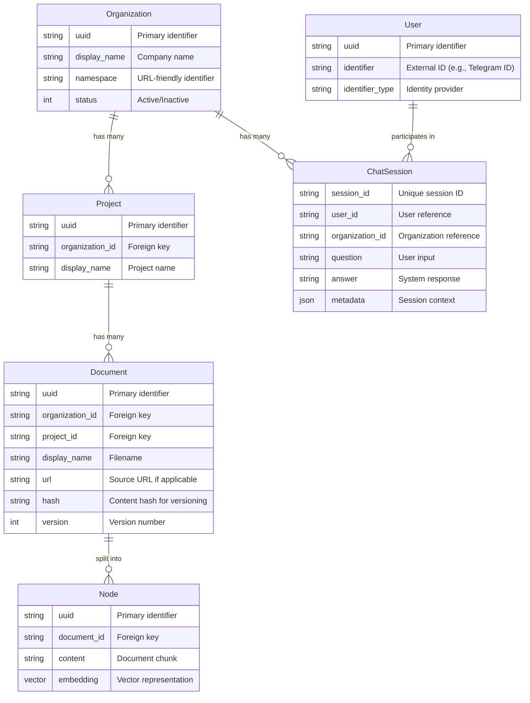
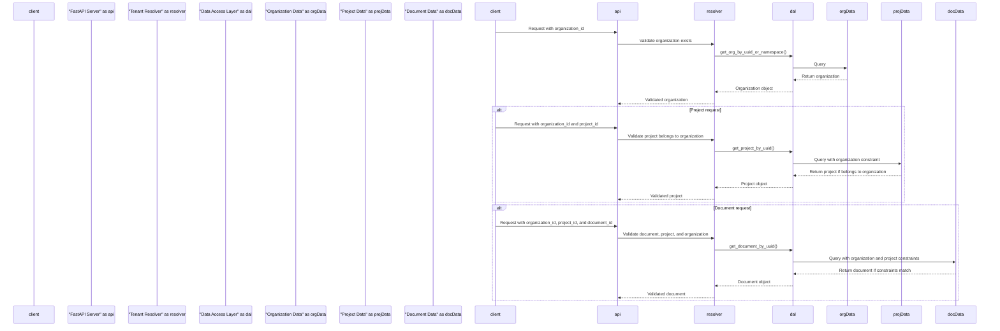
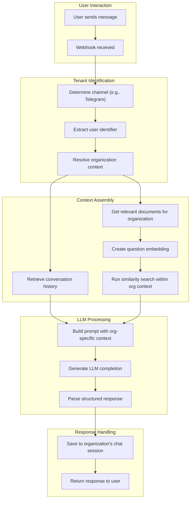

<!-- source: DeepWiki mcp.deepwiki.com · repo paulpierre/RasaGPT · page 4 Multi-tenancy · fetched 2026-10-26 -->

# Multi-tenancy

<details>
<summary>Relevant source files</summary>

The following files were used as context for generating this wiki page:

- [README.md](README.md)
- [app/api/main.py](app/api/main.py)
- [github/rasagpt-video-title-screen.png](github/rasagpt-video-title-screen.png)

</details>


This document explains the multi-tenant architecture of RasaGPT, which allows the system to serve multiple organizations, each with their own isolated data, projects, documents, and conversations. For information about document management within this multi-tenant system, see [Document Management](#4.1).

## Overview

RasaGPT implements a true multi-tenant architecture, enabling the platform to support multiple organizations (tenants) while maintaining data isolation. Each organization can have multiple projects, and each project can contain multiple documents. This hierarchical structure ensures that data from one organization remains separate from others, while the system maintains efficient resource utilization.

Sources: [README.md:268-322]()

## Multi-tenant Data Model

The multi-tenant data model in RasaGPT is built around a hierarchy of entities that establish clear ownership boundaries and relationships.

### Entity Hierarchy Diagram



Sources: [README.md:268-322](), [README.md:544-562]()

## Key Multi-tenant Components

### Organizations

Organizations represent individual clients or companies in a SaaS context. Each organization has:

- A unique UUID for secure identification
- A display name (company name)
- A namespace (URL-friendly identifier)
- Associated projects, documents, and chat sessions

Organizations serve as the primary isolation boundary in the multi-tenant architecture.

Sources: [README.md:268-322]()

### Projects

Projects belong to an organization and represent distinct products, services, or divisions within a company. Each project has:

- A unique UUID
- A reference to its parent organization
- A display name
- Associated documents

Projects help organize content within an organization's data space.

Sources: [README.md:323-498]()

### Documents and Nodes

Documents belong to a specific project within an organization. When uploaded, documents are:

1. Validated for uniqueness using content hashing
2. Versioned to track changes
3. Split into nodes (chunks) for embedding generation
4. Indexed for semantic search

This approach enables efficient retrieval while maintaining tenant isolation.

Sources: [README.md:502-543]()

## Multi-tenant API Architecture

The API is designed to enforce tenant isolation through consistent organization-based access patterns.

### API Request Flow



Sources: [app/api/main.py:118-498]()

### Multi-tenant API Endpoints

The API enforces multi-tenancy by requiring organization context for most operations:

| Endpoint Pattern | Purpose | Multi-tenant Enforcement |
|-----------------|---------|--------------------------|
| `/org` | Manage organizations | Organization UUID/namespace as primary identifier |
| `/project` | Manage projects | Requires `organization_id` parameter |
| `/document` | Manage documents | Requires both `organization_id` and `project_id` parameters |
| `/chat` | Process conversations | Associates sessions with organizations |

This structure ensures that all data access is properly scoped to the appropriate tenant.

Sources: [app/api/main.py:118-249](), [app/api/main.py:250-376]()

## Chat and LLM Integration with Multi-tenancy

When users interact with the chatbot, the system maintains tenant isolation while leveraging shared LLM resources.

### Multi-tenant Conversation Flow



Sources: [app/api/main.py:487-550]()

## Implementation Details

### Organization Resolution

The system resolves organizations by either UUID or namespace for flexibility:

```
get_org_by_uuid_or_namespace(organization_id, session=session)
```

This allows API clients to reference organizations by their human-readable namespace or secure UUID.

### Tenant Data Isolation

Every document uploaded is stored in an organization and project-specific directory structure:

```
file_root_path = os.path.join(FILE_UPLOAD_PATH, str(organization.uuid), str(project.uuid))
```

This ensures physical separation of tenant data on disk.

### Multi-tenant Security Considerations

1. **Namespace uniqueness**: Organization namespaces must be unique to prevent namespace squatting
2. **Parameter validation**: All API endpoints validate that requested resources belong to the specified organization
3. **Scoped embeddings**: Vector searches are scoped to organization context
4. **Session isolation**: Chat sessions are linked to specific organizations

## Multi-tenant Use Cases

The multi-tenant architecture enables several business scenarios:

1. **SaaS service provider**: Run a single RasaGPT instance serving multiple client organizations
2. **Enterprise deployment**: Support multiple departments or business units with isolated data
3. **Agency model**: Allow agencies to manage multiple client organizations
4. **White-label deployments**: Create customized chatbot experiences for different brands

## Summary

RasaGPT's multi-tenant architecture provides a secure, scalable foundation for serving multiple organizations with isolated data while sharing infrastructure resources. The hierarchical organization → project → document model offers a natural way to structure content while maintaining clear ownership boundaries.

The system's API is designed for multi-tenancy from the ground up, with organization context required for most operations and validation at each level to ensure proper data isolation.

---

