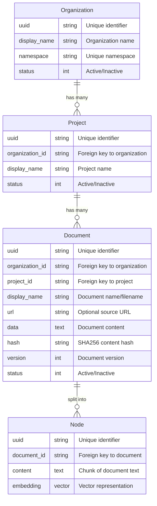
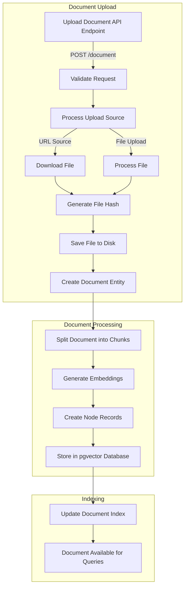

<!-- source: DeepWiki mcp.deepwiki.com · repo paulpierre/RasaGPT · page 4.1 Document Management · fetched 2026-10-26 -->

# Document Management

<details>
<summary>Relevant source files</summary>

The following files were used as context for generating this wiki page:

- [app/api/API.md](app/api/API.md)
- [app/api/main.py](app/api/main.py)

</details>


## Purpose and Scope

This document outlines how RasaGPT handles document management within its multi-tenant architecture. Document management encompasses uploading, indexing, retrieving, and versioning documents that serve as the knowledge base for the conversational AI system. This knowledge base enables RasaGPT to provide context-aware responses by leveraging document content through vector embeddings and semantic search.

This page focuses specifically on the document management aspects of the system. For related information about the overall multi-tenancy architecture, see [Multi-tenancy](#4), and for details about how documents are used in LLM queries, see [LLM Integration](#3.4).

Sources: [app/api/main.py:275-376](), [app/api/API.md:53-64]()

## Document Model and Architecture

RasaGPT implements a hierarchical document management system that supports multi-tenancy through a structured organization of entities.



This entity-relationship diagram illustrates how documents are managed within the multi-tenant architecture:

1. **Organizations** are the top-level entities representing clients or companies
2. **Projects** belong to organizations and represent distinct products or knowledge domains
3. **Documents** belong to projects and contain actual content to be used for knowledge retrieval
4. **Nodes** are chunks of documents that have been processed and embedded for semantic search

Sources: [app/api/main.py:128-196](), [app/api/main.py:218-266](), [app/api/main.py:275-376]()

## Document Processing Flow

The document management system follows a defined workflow from upload to availability for retrieval:



This diagram shows the end-to-end process for document management in RasaGPT:

1. Documents are uploaded through the API endpoint (`/document`)
2. Files can be uploaded directly or retrieved from a URL
3. The system generates a hash of the file contents to track changes
4. The document is saved to disk and registered in the database
5. The document is then processed into chunks (nodes)
6. Embeddings are generated for each chunk using LLM technology
7. Nodes with embeddings are stored in the database with pgvector extension
8. The system updates its document index to make the content available for queries

Sources: [app/api/main.py:275-350](), [app/api/API.md:565-568]()

## Document Upload API

The system provides API endpoints for document management, with the primary upload endpoint supporting both file uploads and URL sources.

### Upload Endpoint

```
POST /document
```

This endpoint accepts the following parameters:

| Parameter | Type | Description |
|-----------|------|-------------|
| organization_id | string | Organization UUID or namespace |
| project_id | string | Project UUID |
| file | file | Document file to upload (mutually exclusive with URL) |
| url | string | URL to download document from (mutually exclusive with file) |
| overwrite | boolean | Whether to overwrite existing document (default: true) |

The upload process handles several scenarios:

1. **File vs. URL**: The API enforces an XOR relationship between file and URL parameters
2. **File versioning**: If a file with the same name exists, the system creates a versioned filename
3. **Hash generation**: A SHA-256 hash is generated for document content to track changes
4. **File storage**: Files are saved to disk in organization/project-specific directories
5. **Database entry**: A document record is created in the database with metadata

Sources: [app/api/main.py:275-350]()

## Document Retrieval and Listing

The system provides endpoints to retrieve document information and listings:

### List Documents Endpoint

```
GET /document
```

This endpoint accepts the following parameters:

| Parameter | Type | Description |
|-----------|------|-------------|
| organization_id | string | Organization UUID or namespace |
| project_id | string | Project UUID |

Returns a list of documents associated with the specified project, including metadata like document UUID, name, and node count.

### Get Document Endpoint

```
GET /document/{document_id}
```

This endpoint accepts the following parameters:

| Parameter | Type | Description |
|-----------|------|-------------|
| organization_id | string | Organization UUID or namespace |
| project_id | string | Project UUID |
| document_id | string | Document UUID |

Returns detailed information about a specific document, including content and metadata.

Sources: [app/api/main.py:356-376]()

## Document Indexing and Retrieval Process

When documents are uploaded, they're processed for retrieval during conversational interactions:

```mermaid
sequenceDiagram
    participant "User" as User
    participant "API" as FastAPI
    participant "pgvector_db" as PostgreSQL+pgvector
    participant "index_file" as IndexJSON
    participant "LLM" as LlamaIndex/OpenAI

    User->>FastAPI: Upload Document
    FastAPI->>FastAPI: Split into Chunks
    FastAPI->>FastAPI: Generate Embeddings
    FastAPI->>PostgreSQL+pgvector: Store Chunks & Embeddings
    FastAPI->>IndexJSON: Update Document Index
    
    User->>FastAPI: Send Query via Chat
    FastAPI->>PostgreSQL+pgvector: Vector Similarity Search
    PostgreSQL+pgvector->>FastAPI: Return Relevant Chunks
    FastAPI->>FastAPI: Assemble Context
    FastAPI->>LlamaIndex/OpenAI: Query with Context
    LlamaIndex/OpenAI->>FastAPI: Generate Response
    FastAPI->>User: Return Response
```

The document indexing and retrieval process involves:

1. **Document chunking**: Documents are split into manageable chunks (nodes)
2. **Embedding generation**: Vector embeddings are created for each chunk
3. **Vector storage**: Embeddings are stored in PostgreSQL using pgvector extension
4. **Index updating**: The document index is updated in `index.json`
5. **Retrieval**: During user queries, relevant chunks are found via vector similarity search
6. **Context assembly**: Retrieved chunks are assembled into context for the LLM
7. **Response generation**: The LLM generates responses using the document context

Sources: [app/api/API.md:565-568](), [app/api/main.py:275-350]()

## Document Storage and File Structure

Documents are stored both in the database (for metadata and searching) and on disk (for content access):

### File Storage Structure

```
FILE_UPLOAD_PATH/
├── {organization_uuid}/
│   ├── {project_uuid}/
│   │   ├── document1.pdf
│   │   ├── document2.md
│   │   └── ...
│   └── {project2_uuid}/
│       ├── document3.docx
│       └── ...
└── {organization2_uuid}/
    └── ...
```

This structure ensures:

1. **Isolation**: Documents from different organizations and projects are separated
2. **Organization**: Logical grouping of files by their business relationship
3. **Access control**: Easier implementation of permissions and access control
4. **Versioning**: Support for multiple versions through filename suffixes

Sources: [app/api/main.py:287](), [app/api/main.py:302-339]()

## Document Versioning

RasaGPT provides basic document versioning capabilities:

1. **Duplicate detection**: File hashes are used to detect identical content
2. **Version numbering**: Files can have version numbers to track changes
3. **Timestamp versioning**: When files with the same name are uploaded, a timestamp suffix is added to the filename
4. **Overwrite control**: The API supports an `overwrite` parameter to control whether existing files should be replaced

This versioning system allows for:

- Tracking document changes over time
- Maintaining a history of document versions
- Avoiding duplicate content in the knowledge base
- Managing document updates efficiently

Sources: [app/api/main.py:291](), [app/api/main.py:306-307](), [app/api/main.py:332-334]()

## Integration with LLM and Search

The document management system integrates with the LLM components via:

1. **Vector embeddings**: Documents are converted to vector embeddings for semantic similarity search
2. **pgvector integration**: PostgreSQL with pgvector extension stores and searches vector data
3. **LlamaIndex**: Provides the indexing and retrieval capability using `GPTSimpleVectorIndex`
4. **Context injection**: Retrieved document chunks are injected into LLM prompts
5. **Distance strategies**: Configurable similarity search with distance threshold settings

Configuration parameters affecting document retrieval include:

| Parameter | Description | Default |
|-----------|-------------|---------|
| LLM_DISTANCE_THRESHOLD | Threshold for vector similarity matching | (Configured in config.py) |
| LLM_DEFAULT_DISTANCE_STRATEGY | Strategy for distance calculation | (Configured in config.py) |
| LLM_MIN_NODE_LIMIT | Minimum number of nodes to retrieve | (Configured in config.py) |

Sources: [app/api/main.py:85-97](), [app/api/API.md:565-568]()

## Security and Multi-tenancy Considerations

The document management system incorporates security measures to support multi-tenancy:

1. **Organization isolation**: Documents are associated with specific organizations and projects
2. **Access control**: API endpoints require organization and project IDs
3. **Namespace separation**: Organizations have unique namespaces
4. **Storage isolation**: Files are stored in organization and project-specific directories
5. **Request validation**: API ensures users can only access documents they're authorized for

This design ensures that documents from one organization are not accessible to users from other organizations, maintaining data isolation in a multi-tenant environment.

Sources: [app/api/main.py:275-376](), [app/api/main.py:128-196]()

---

