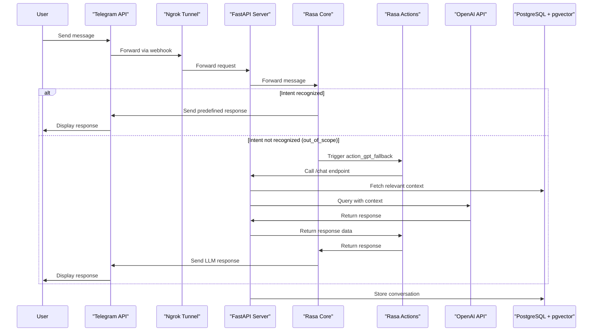
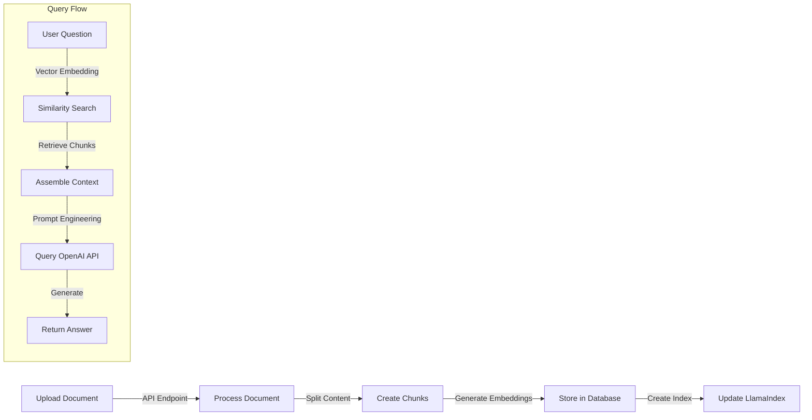
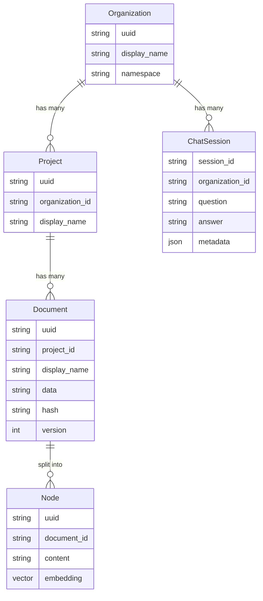
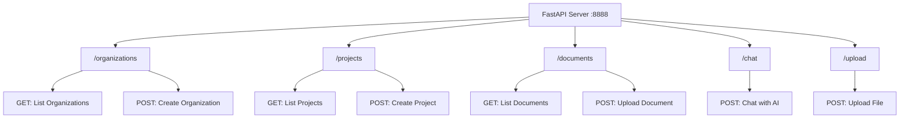

<!-- source: DeepWiki mcp.deepwiki.com · repo paulpierre/RasaGPT · page 5 Using RasaGPT · fetched 2026-10-26 -->

# Using RasaGPT

<details>
<summary>Relevant source files</summary>

The following files were used as context for generating this wiki page:

- [README.md](README.md)
- [app/api/API.md](app/api/API.md)
- [github/rasagpt-video-title-screen.png](github/rasagpt-video-title-screen.png)

</details>


This page provides a comprehensive guide on how to use the RasaGPT system after it has been successfully installed and configured. It covers interacting with the chatbot, managing documents, working with organizations and projects, and utilizing the API functionality.

For installation instructions, please refer to [Installation and Setup](#2).

## Getting Started with RasaGPT

After completing the installation process outlined in the Installation and Setup guide, you can start using RasaGPT immediately. This section covers the basic ways to interact with the system.

### Accessing the Telegram Bot

The primary way to interact with RasaGPT is through the Telegram bot interface:

1. Open Telegram and search for your bot name
2. Or directly visit: https://t.me/yourbotname
3. Start a conversation by sending a message

The bot should respond promptly to your queries based on the knowledge it has from indexed documents.

Sources: [README.md:178-183]()

### Viewing System Interfaces

RasaGPT provides several additional interfaces:

| Interface | URL | Purpose |
|-----------|-----|---------|
| API Documentation | http://localhost:8888/docs | View and test API endpoints |
| Log Viewer | http://localhost:9999/ | View real-time logs of all containers |
| Ngrok Admin UI | http://localhost:4040/status | View the Ngrok tunnel status |
| PgAdmin | http://localhost:5050 | Database management interface |

Sources: [README.md:187-199]()

## Conversation Flow

When you interact with RasaGPT through Telegram, the following process takes place:



1. Your message is sent to the Telegram API
2. Telegram forwards it to your RasaGPT instance via Ngrok
3. The FastAPI server receives and forwards it to Rasa Core
4. Rasa tries to classify your intent:
   - If recognized, it sends a predefined response
   - If not recognized (most common case), it triggers the `action_gpt_fallback` action
5. The action server calls the FastAPI `/chat` endpoint
6. FastAPI retrieves relevant context from the database using vector embeddings
7. This context is sent to the OpenAI API with your query
8. The response is returned through the chain to you
9. The conversation is stored in the database

Sources: [README.md:573-583](), [app/rasa/actions/actions.py](), [app/api/main.py]()

## Document Management

RasaGPT's intelligence comes from documents that you upload and index. These provide the context for answering user questions.

### Document Processing Pipeline



When a document is uploaded:
1. It's split into manageable chunks (nodes)
2. Each chunk has vector embeddings generated
3. Chunks are stored in the database with their embeddings
4. The document is indexed for similarity search

When a user asks a question:
1. The system finds the most relevant document chunks
2. These chunks are assembled into context
3. The context is sent with the question to the LLM
4. The LLM generates a response based on the provided context

Sources: [README.md:564-571](), [app/api/main.py]()

### Uploading Documents

You can upload documents through the API:

1. Access the API documentation at http://localhost:8888/docs
2. Navigate to the `/documents` endpoint
3. Use the POST method to upload a document
4. Provide:
   - Organization ID
   - Project ID
   - Display name
   - Document content/data

Documents are automatically versioned. If you upload a modified version of an existing document, it creates a new version and maintains the previous versions.

Sources: [README.md:191-199]()

## Working with Organizations and Projects

RasaGPT uses a multi-tenant architecture. Understanding the relationship between entities is important for effective use.

### Data Model



- **Organization**: Represents a company or client in a multi-tenant setup
- **Project**: Belongs to an organization and can represent products, departments, or other logical groups
- **Document**: Contains information related to a specific project
- **Node**: A chunk of a document with vector embeddings
- **ChatSession**: Records conversations with users

Sources: [README.md:221-514](), [app/api/models.py]()

### Managing Through the API

You can manage organizations, projects, and documents through the API:

1. **List Organizations**: `GET /organizations`
2. **Get Organization Projects**: `GET /organizations/{id}/projects`
3. **Get Project Documents**: `GET /projects/{id}/documents`
4. **Create New Organization**: `POST /organizations`
5. **Create New Project**: `POST /projects`

These operations are best performed through the API documentation interface at http://localhost:8888/docs.

Sources: [README.md:214-217]()

## API Usage

The RasaGPT API provides comprehensive functionality for system management and integration.

### Key Endpoints



Main endpoints:

1. `/organizations` - Manage organizations
2. `/projects` - Manage projects
3. `/documents` - Upload and manage documents
4. `/chat` - Direct interaction with the AI

The `/chat` endpoint is particularly important as it allows direct integration with the LLM capabilities. It returns both the response text and metadata including:
- Tags related to the query
- Whether escalation to a human is recommended
- Raw context used for the response

Sources: [README.md:214-217](), [app/api/main.py]()

### Example Chat Response

When using the `/chat` endpoint, responses include metadata that can be useful for applications:

```json
{
  "response": "Pepetamine is a cognitive enhancement product available as rare Pepe-coated tablets. The recommended dosage is one tablet per day with water, preferably while browsing meme forums. Take it 30 minutes before mentally demanding tasks for optimal results.",
  "metadata": {
    "tags": ["medication", "dosage", "instructions"],
    "requires_human": false,
    "context_used": true
  }
}
```

Sources: [README.md:502-516]()

## Troubleshooting

If you encounter issues while using RasaGPT, try these troubleshooting steps:

### Viewing Logs

Check the logs for all containers by visiting http://localhost:9999/

This provides real-time visibility into all system components and can help identify issues.

Sources: [README.md:187-192]()

### Checking Webhook Configuration

For Telegram connection issues, verify that your Ngrok webhook is properly configured:

```bash
curl -sS "https://api.telegram.org/bot<your-bot-secret-token>/getWebhookInfo" | json_pp
```

The URL in the response should match the one in your `credentials.yml` file and the one shown in the Ngrok admin UI (http://localhost:4040/status).

Sources: [README.md:606-643]()

### Restarting the System

If issues persist, try restarting the entire system:

```bash
make restart
```

This will stop all containers and start them again with fresh configurations.

Sources: [README.md:643-647]()

## Additional Resources

- View examples of the bot's performance in the [RESULTS.md](https://github.com/paulpierre/RasaGPT/blob/main/RESULTS.md) file
- Explore the API documentation at http://localhost:8888/docs
- For development purposes, shell access to containers is available through various `make` commands

Sources: [README.md:250-255]()

---

