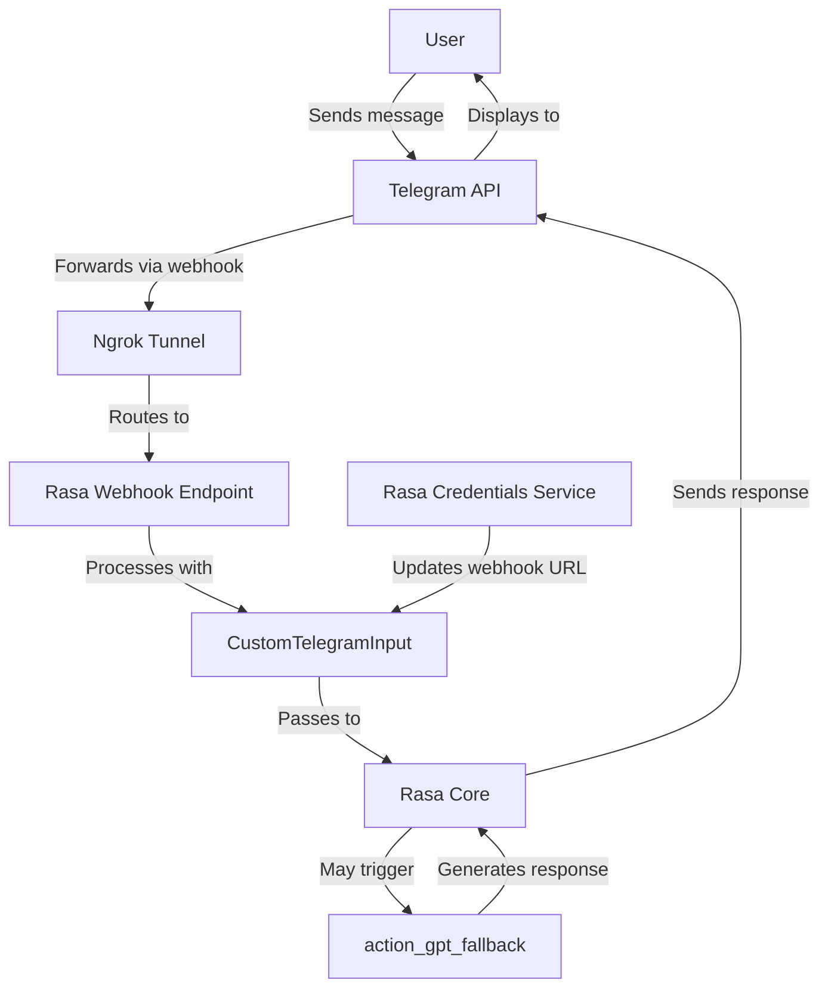
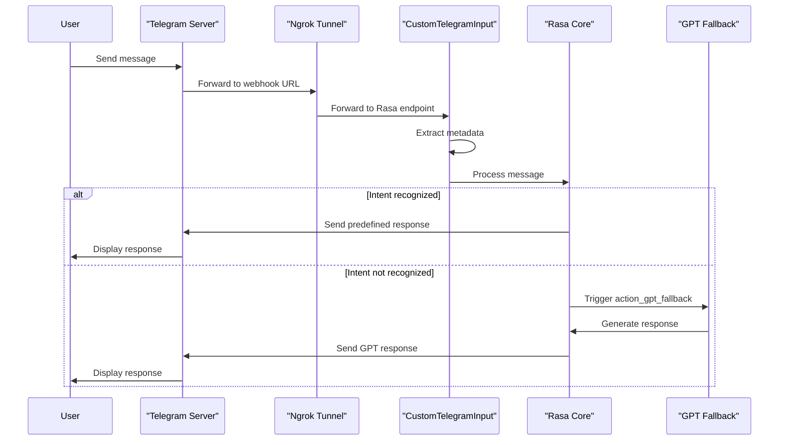
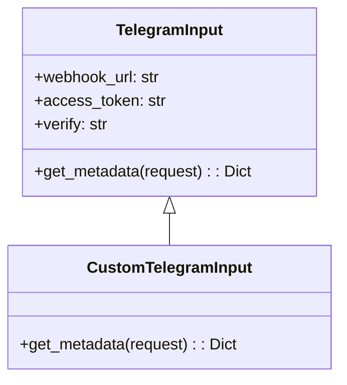
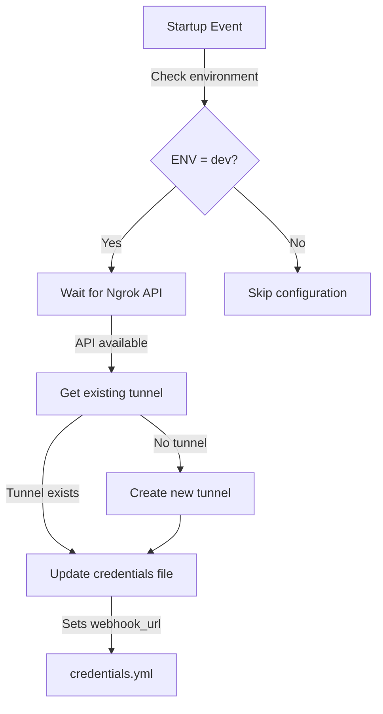

<!-- source: DeepWiki mcp.deepwiki.com · repo paulpierre/RasaGPT · page 5.1 Telegram Bot Integration · fetched 2026-10-26 -->

# Telegram Bot Integration

<details>
<summary>Relevant source files</summary>

The following files were used as context for generating this wiki page:

- [app/rasa-credentials/main.py](app/rasa-credentials/main.py)
- [app/rasa/custom_telegram.py](app/rasa/custom_telegram.py)

</details>


This document details how to set up and use the Telegram bot interface for RasaGPT. It covers the technical implementation of the Telegram integration, including the webhook configuration, custom input channel, and how messages flow through the system.

## Purpose and Scope

This integration allows users to interact with the RasaGPT system through Telegram, a popular messaging platform. The document focuses on the technical components that enable communication between Telegram and RasaGPT, webhook management, and custom handling of metadata in messages.

## Architecture Overview

The Telegram integration in RasaGPT consists of several components working together to provide a seamless messaging experience.



Sources:
- [app/rasa-credentials/main.py]()
- [app/rasa/custom_telegram.py]()

## Message Flow

The following sequence diagram illustrates how messages flow between the user, Telegram, and RasaGPT:



Sources:
- [app/rasa/custom_telegram.py:11-19]()

## Setup Requirements

### Prerequisites

To use the Telegram integration, you need:

1. A Telegram bot token (obtained from BotFather)
2. Your Telegram bot username
3. RasaGPT running with webhook access (via Ngrok in development or a public URL in production)

### Environment Configuration

Configure the following environment variables:

| Variable | Description | Example |
|----------|-------------|---------|
| `TELEGRAM_ACCESS_TOKEN` | Bot token from BotFather | `123456789:ABCDEFGHIJKLMNOPQRSTUVWXYZ` |
| `TELEGRAM_BOTNAME` | Your bot's username | `my_rasagpt_bot` |
| `ENV` | Environment setting | `dev` for development with Ngrok |

Sources:
- [app/rasa-credentials/main.py:28-30]()

## Custom Telegram Input Channel

RasaGPT extends Rasa's standard `TelegramInput` class with a custom implementation to support metadata in messages:



The `CustomTelegramInput` class overrides the `get_metadata` method to extract metadata from the `meta` field in incoming messages. This allows additional information to be passed along with user messages.

Sources:
- [app/rasa/custom_telegram.py:11-19]()

## Webhook Management

### Automatic Webhook Configuration

The Rasa Credentials Service automatically configures the webhook URL in development environments:



Sources:
- [app/rasa-credentials/main.py:170-182]()
- [app/rasa-credentials/main.py:137-157]()

### Development vs Production

- **Development**: Ngrok creates a temporary public URL that forwards to your local Rasa instance
- **Production**: You should use a stable domain with SSL and manually configure the webhook URL

## Credentials File Update Process

The system automatically updates the `credentials.yml` file with the proper Telegram configuration:

1. Retrieves the public Ngrok URL
2. Updates the webhook URL in the credentials file
3. Sets the access token and verification

```yaml
# Example of the updated section in credentials.yml
custom_telegram.CustomTelegramInput:
  webhook_url: "https://abc123.ngrok.io/webhooks/telegram/webhook"
  access_token: "YOUR_TELEGRAM_TOKEN"
  verify: "YOUR_BOT_USERNAME"
```

Sources:
- [app/rasa-credentials/main.py:137-157]()

## Troubleshooting

### Common Issues

| Issue | Possible Cause | Solution |
|-------|---------------|----------|
| Bot not responding | Webhook URL not set correctly | Check Ngrok tunnel status and credentials file |
| Missing metadata | Incorrect message format | Ensure metadata is sent in the `meta` field |
| Webhook errors | Ngrok tunnel expired | Restart the service to create a new tunnel |
| Authentication failures | Invalid Telegram token | Verify your `TELEGRAM_ACCESS_TOKEN` is correct |

### Checking Webhook Status

You can verify that your webhook is properly configured by:

1. Accessing the Ngrok dashboard at http://localhost:4040
2. Checking the logs for webhook registration success
3. Sending a test message to your bot

Sources:
- [app/rasa-credentials/main.py:36-40]()
- [app/rasa-credentials/main.py:89-92]()

## Integration with Rasa Core

The Telegram integration connects with Rasa Core through the webhook endpoint. When a message is received:

1. The `CustomTelegramInput` processes the incoming webhook request
2. Metadata is extracted from the message
3. The message is passed to Rasa Core for intent recognition
4. If no intent is recognized, the `action_gpt_fallback` is triggered
5. Responses are sent back to the user via Telegram

Sources:
- [app/rasa/custom_telegram.py:11-19]()

## Summary

The Telegram bot integration in RasaGPT provides an accessible interface for users to interact with your AI assistant. The system handles the complexities of webhook management and extends Rasa's capabilities with custom metadata handling, making it easier to build context-aware conversations.

For general information about using RasaGPT, see [Using RasaGPT](#5).

---

