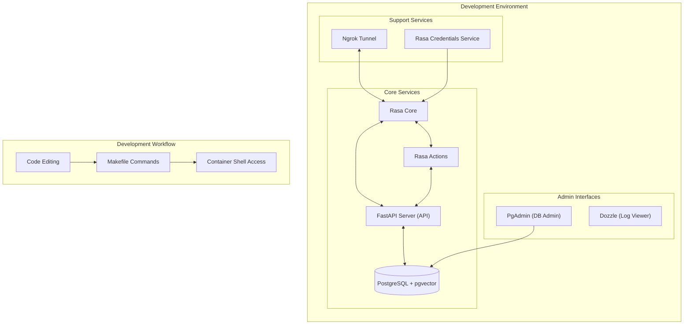
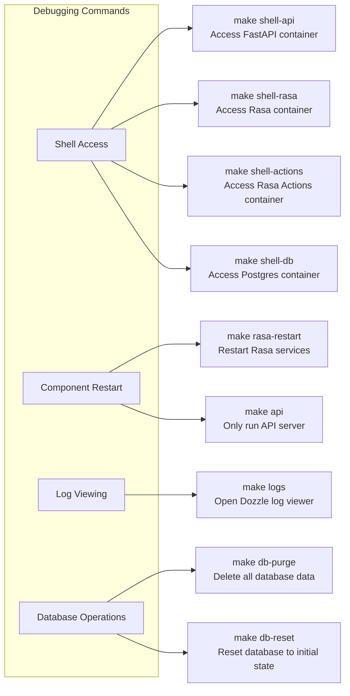
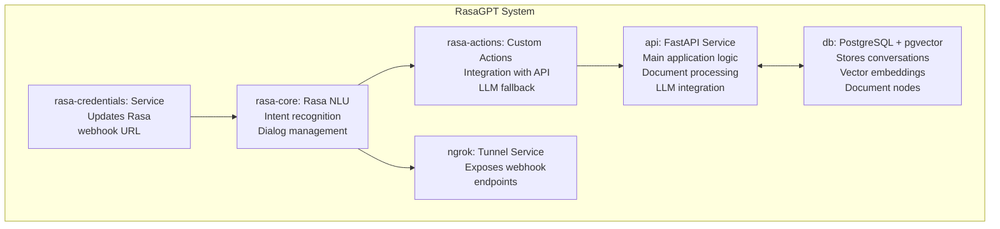

<!-- source: DeepWiki mcp.deepwiki.com · repo paulpierre/RasaGPT · page 6 Development Guide · fetched 2026-10-26 -->

# Development Guide

<details>
<summary>Relevant source files</summary>

The following files were used as context for generating this wiki page:

- [Makefile](Makefile)
- [app/api/Makefile](app/api/Makefile)

</details>


This guide provides comprehensive information for developers who want to extend, modify, or contribute to the RasaGPT codebase. It covers development environment setup, workflows, extension points, and best practices. For basic usage information, see [Using RasaGPT](#5), and for deployment information, see [Installation and Setup](#2).

## Development Environment Overview

RasaGPT uses a Docker-based development environment with multiple interconnected services. This architecture enables isolated development of individual components while maintaining the ability to test the entire system.



Sources: [Makefile:1-294]()

## Setting Up Your Development Environment

### Prerequisites

Before starting development:

1. Install Docker and Docker Compose
2. Clone the RasaGPT repository
3. Ensure Python 3.9+ is installed (for local development)

### Local Development Setup

RasaGPT provides two primary development modes:

1. **Full Docker Environment**: All services run in containers
2. **Hybrid Development**: API service runs locally, other services in Docker

For local API development:

```bash
# Navigate to API directory
cd app/api

# Create virtual environment and install dependencies
make env-create

# Start the database container
make db

# Initialize database schema
make models

# Run the API server locally
make api
```

Sources: [app/api/Makefile:96-152]()

### Full Docker Setup

For full Docker-based development:

```bash
# In the root directory
make build     # Build all Docker images
make run       # Start all containers
```

Sources: [Makefile:68-83]()

## Development Workflow

### Core Development Commands

The project uses Makefiles extensively to simplify development workflows. Here are the key commands:

| Command | Description |
|---------|-------------|
| `make install` | Complete setup of RasaGPT environment |
| `make build` | Build Docker images |
| `make run` | Start all services |
| `make stop` | Stop all services |
| `make restart` | Restart all services |
| `make models` | Initialize database schema |
| `make seed` | Seed database with initial data |

Sources: [Makefile:50-126]()

### Debugging Commands



Sources: [Makefile:154-267]()

### Administration Interfaces

RasaGPT provides several web interfaces for development:

| Interface | Command | Description |
|-----------|---------|-------------|
| Logs | `make logs` | View container logs via Dozzle on http://localhost:9999/ |
| Ngrok | `make ngrok` | View ngrok tunnel dashboard on http://localhost:4040 |
| PgAdmin | `make pgadmin` | Manage database via http://localhost:5050 |

Sources: [Makefile:135-152]()

## RasaGPT Architecture for Developers

Understanding the codebase structure is essential for effective development. RasaGPT consists of these main components:



Sources: [Makefile:1-294]()

## Extending RasaGPT

### Adding New API Endpoints

When adding new API endpoints, consider:

1. Integration with the multi-tenant model
2. Authentication and authorization
3. Error handling and response formatting
4. Database interaction through SQLAlchemy models

### Modifying Rasa Components

To extend Rasa's capabilities:

1. Add new intents in `app/rasa/data/nlu.yml`
2. Create new stories in `app/rasa/data/stories.yml`
3. Add custom actions in `app/rasa/actions/actions.py`
4. After changes, retrain the Rasa model:

```bash
make rasa-train
make rasa-restart
```

Sources: [Makefile:288-293]()

### Database Schema Changes

When modifying the database schema:

1. Update SQLAlchemy models in the API service
2. Run `make models` to propagate changes to the database
3. Consider creating migrations for production deployments

## Development Tools Deep Dive

### API Development Helpers

The API component has its own Makefile with specific commands for local development:

| Command | Description |
|---------|-------------|
| `make install` | Set up environment and build models |
| `make install-seed` | Setup environment with sample data |
| `make run` | Run database and API server |
| `make stop` | Stop all services |
| `make env-create` | Create Python virtual environment |

Sources: [app/api/Makefile:30-152]()

### Debugging Techniques

1. **Shell Access**: Use shell commands to access running containers
   ```bash
   make shell-api     # Access FastAPI container
   make shell-rasa    # Access Rasa container
   make shell-actions # Access Rasa Actions container
   make shell-db      # Access database container
   ```

2. **Log Viewing**: Access centralized logs via Dozzle interface
   ```bash
   make logs          # Open logs in browser
   ```

3. **Database Inspection**: Use PgAdmin for database exploration
   ```bash
   make pgadmin       # Open PgAdmin in browser
   ```

Sources: [Makefile:229-267]()

## Development Best Practices

### Code Organization

Maintain the existing separation of concerns:
- FastAPI handles API endpoints, document processing, and LLM integration
- Rasa handles conversation flow and intent recognition
- PostgreSQL with pgvector for data storage and vector search

### Docker Workflow Tips

1. When adding new dependencies:
   - Update `requirements.txt` files
   - Rebuild the affected Docker images with `make build`

2. For speedy development:
   - Use volume mounts in docker-compose.yml to reflect code changes
   - Run specific components locally when needed

### Testing Changes

1. For API changes:
   - Test endpoints with tools like Postman or curl
   - Validate against database schema

2. For Rasa changes:
   - Test conversation flows using Rasa shell:
     ```bash
     make shell-rasa
     rasa shell
     ```

## Troubleshooting Common Issues

### Container Startup Problems

If containers fail to start properly:
1. Check logs with `make logs` or `docker-compose logs <service>`
2. Ensure environment variables are properly set in `.env`
3. Try rebuilding with `make build` followed by `make run`

### Database Connection Issues

If database connection fails:
1. Ensure PostgreSQL container is running
2. Check database credentials in environment variables
3. Reset database if needed: `make db-reset`

### Rasa Training Issues

If Rasa training fails:
1. Check for syntax errors in Rasa files
2. Ensure consistent indentation in YAML files
3. Verify that all referenced entities and slots exist

Sources: [Makefile:276-293]()

## Conclusion

RasaGPT's modular architecture allows for flexible extension and modification. By using the provided development tools and following the established patterns, you can efficiently enhance the system's capabilities while maintaining its robust foundation.

---

