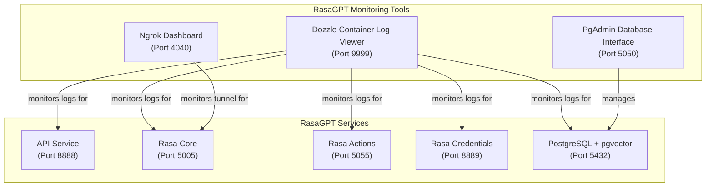
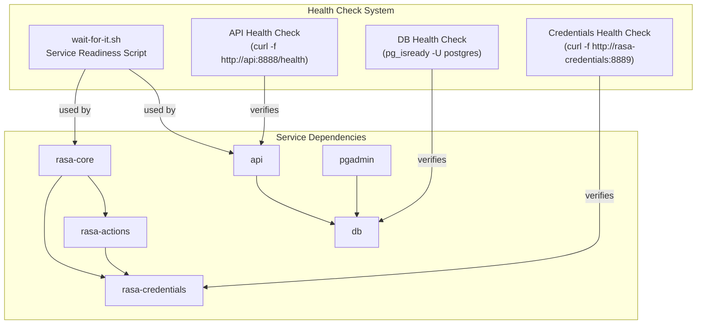
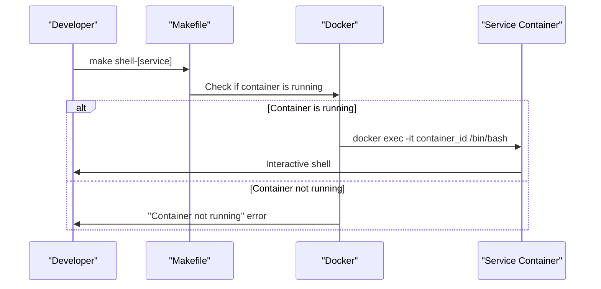

<!-- source: DeepWiki mcp.deepwiki.com · repo paulpierre/RasaGPT · page 6.1 Debugging and Monitoring · fetched 2026-10-26 -->

# Debugging and Monitoring

<details>
<summary>Relevant source files</summary>

The following files were used as context for generating this wiki page:

- [Makefile](Makefile)
- [app/scripts/wait-for-it.sh](app/scripts/wait-for-it.sh)
- [docker-compose.yml](docker-compose.yml)

</details>


This document provides a comprehensive guide to debugging and monitoring the RasaGPT system. It covers the built-in monitoring tools, debugging techniques, log inspection strategies, and troubleshooting methods for diagnosing issues in the RasaGPT environment.

## Monitoring Architecture Overview

RasaGPT includes several integrated monitoring and debugging tools that work within its containerized architecture.



Sources: [docker-compose.yml:166-180]()

## Built-in Monitoring Tools

RasaGPT provides three main monitoring interfaces that help you observe and diagnose the system:

### 1. Dozzle - Container Log Viewer

Dozzle provides a web interface to view logs from all Docker containers in real-time, simplifying log inspection without having to access each container individually.

- **Access URL**: http://localhost:9999
- **Command**: `make logs`
- **Purpose**: Monitor container logs, see error messages, and track application behavior

### 2. PgAdmin - Database Management

PgAdmin provides a comprehensive interface for PostgreSQL database management, allowing you to inspect tables, run queries, and monitor database health.

- **Access URL**: http://localhost:5050
- **Command**: `make pgadmin`
- **Default Credentials**: 
  - Email: `pgadmin4@pgadmin.org` (configurable via `PGADMIN_DEFAULT_EMAIL`)
  - Password: `admin` (configurable via `PGADMIN_DEFAULT_PASSWORD`)
- **Purpose**: Inspect data, run SQL queries, and monitor database performance

### 3. Ngrok Dashboard

The Ngrok dashboard allows you to monitor the tunneling service that exposes your Rasa webhook to the internet.

- **Access URL**: http://localhost:4040
- **Command**: `make ngrok`
- **Purpose**: View tunnel status, webhook URLs, and request/response logs

Sources: [Makefile:136-152](), [docker-compose.yml:41-57](), [docker-compose.yml:148-165](), [docker-compose.yml:171-179]()

## Health Checks and Service Dependencies

RasaGPT implements health checks to ensure services are available before dependent services start, improving system stability and simplifying debugging.



The `wait-for-it.sh` script is a crucial utility that ensures services wait for their dependencies to be ready before starting. This prevents startup race conditions and makes debugging easier.

Sources: [docker-compose.yml:25-28](), [docker-compose.yml:74](), [docker-compose.yml:117-120](), [docker-compose.yml:139-142](), [app/scripts/wait-for-it.sh:1-205]()

## Debugging Techniques

### Container Shell Access

The Makefile provides commands to access shells inside each container for direct debugging:

| Command | Purpose | Container |
|---------|---------|-----------|
| `make shell-api` | Access the API service shell | chat_api |
| `make shell-rasa` | Access the Rasa Core shell | chat_rasa_core |
| `make shell-actions` | Access the Rasa Actions shell | chat_rasa_actions |
| `make shell-db` | Access the PostgreSQL shell | chat_db |

Inside these shells, you can run commands specific to each service, check configurations, and diagnose issues directly.



Sources: [Makefile:228-267]()

### Service Management Commands

RasaGPT provides specific commands for managing services:

| Command | Purpose |
|---------|---------|
| `make run` | Start all services |
| `make stop` | Stop all services |
| `make restart` | Restart all services |
| `make rasa-restart` | Restart only the Rasa service |
| `make api` | Run only the API server |
| `make db` | Run only the database |
| `make models` | Build the database schema |
| `make seed` | Seed the database with initial data |

These commands are valuable for isolating components during debugging and testing specific parts of the system.

Sources: [Makefile:81-126]()

### Advanced Debugging Workflow

```mermaid
flowchart TD
    start["Start Debugging"] --> identify["Identify Issue Category"]
    
    identify --> api_issue["API Issue"]
    identify --> rasa_issue["Rasa Issue"]
    identify --> db_issue["Database Issue"]
    identify --> conn_issue["Connection Issue"]
    
    api_issue --> check_api_logs["Check API logs\n(Dozzle)"]
    api_issue --> api_shell["Access API shell\n(make shell-api)"]
    
    rasa_issue --> check_rasa_logs["Check Rasa logs\n(Dozzle)"]
    rasa_issue --> rasa_shell["Access Rasa shell\n(make shell-rasa)"]
    rasa_issue --> actions_shell["Access Actions shell\n(make shell-actions)"]
    
    db_issue --> check_db_logs["Check DB logs\n(Dozzle)"]
    db_issue --> db_shell["Access DB shell\n(make shell-db)"]
    db_issue --> pgadmin["Inspect with PgAdmin\n(make pgadmin)"]
    
    conn_issue --> check_ngrok["Check Ngrok dashboard\n(make ngrok)"]
    conn_issue --> health_checks["Verify Health Checks"]
    
    check_api_logs --> analyze["Analyze and Fix"]
    api_shell --> analyze
    check_rasa_logs --> analyze
    rasa_shell --> analyze
    actions_shell --> analyze
    check_db_logs --> analyze
    db_shell --> analyze
    pgadmin --> analyze
    check_ngrok --> analyze
    health_checks --> analyze
    
    analyze --> test["Test Fix"]
    test --> solved{Issue Solved?}
    solved -->|Yes| end["End Debugging"]
    solved -->|No| identify
```

Sources: [Makefile:22-32](), [Makefile:228-267]()

## System Health Verification

To verify if the system is healthy, you can use these approaches:

1. **Check container status**:
   ```bash
   docker-compose ps
   ```

2. **Verify service health endpoints**:
   - API health: `curl http://localhost:8888/health`
   - Rasa webhook status: Check in Ngrok dashboard

3. **Monitor container logs** with Dozzle for real-time error detection

4. **Check database connectivity** using PgAdmin

Sources: [docker-compose.yml:25-28](), [docker-compose.yml:117-120](), [docker-compose.yml:139-142]()

## Troubleshooting Common Issues

### Service Dependency Problems

If services fail to start because their dependencies aren't ready, try:

1. Using the `wait-for-it.sh` script with appropriate timeouts
2. Restarting services in the correct order
3. Checking container logs for connection errors

Example of proper dependency handling in the Rasa Core container:
```
/app/wait-for-it.sh rasa-credentials:8889 -t 120 -o && rasa run --enable-api...
```

Sources: [docker-compose.yml:74]()

### Database Connection Issues

If experiencing database issues:

1. Verify PostgreSQL is running: `docker-compose ps db`
2. Check database logs: `make logs` and filter for DB container
3. Try accessing the database directly: `make shell-db`
4. Use PgAdmin to verify database structure: `make pgadmin`

If necessary, reset the database (warning: destroys all data):
```bash
make db-purge
make api
make models
```

Sources: [Makefile:197-223]()

### Rasa Service Problems

For issues with Rasa:

1. Restart Rasa services: `make rasa-restart`
2. Check Rasa logs in Dozzle
3. Access Rasa shell: `make shell-rasa`
4. Verify Webhook URL in Ngrok dashboard matches what's in the Rasa credentials
5. Rebuild Rasa models: `make rasa-train`

Sources: [Makefile:104-120](), [Makefile:288-293]()

## Cleanup and Reset Options

For persistent issues, RasaGPT provides options to clean and reset the system:

| Command | Purpose | Warning |
|---------|---------|---------|
| `make purge` | Delete all containers and images | Removes all Docker data |
| `make db-purge` | Delete database volume | Deletes all stored data |
| `make db-reset` | Reinitialize database | Deletes all stored data |

Sources: [Makefile:204-223]()

## Summary

RasaGPT provides a comprehensive set of debugging and monitoring tools designed to help diagnose and fix issues across the containerized architecture. By using the built-in web interfaces (Dozzle, PgAdmin, Ngrok), command-line utilities, and Makefile commands, developers can effectively monitor, debug, and maintain the system.