# Page: Overview

# Overview

<details>
<summary>Relevant source files</summary>

The following files were used as context for generating this wiki page:

- [README.md](README.md)
- [github/rasagpt-banner.png](github/rasagpt-banner.png)
- [github/rasagpt-video-title-screen.png](github/rasagpt-video-title-screen.png)

</details>


This document provides an introduction to RasaGPT, a headless LLM chatbot platform built on top of Rasa and Langchain. It explains the system's purpose, high-level architecture, and core functionality. For detailed installation instructions, see [Installation and Setup](#2).

RasaGPT is a boilerplate and reference implementation that combines the Rasa conversational AI framework with large language model (LLM) capabilities through Langchain and LlamaIndex. It provides an API-first approach to building intelligent chatbots with document retrieval capabilities and multi-tenant support.

Sources: [README.md:6-8]()

## System Purpose and Scope

RasaGPT addresses several key implementation challenges in building LLM-powered chatbots:

1. Creating a proprietary bot endpoint with document upload and training pipeline
2. Integrating Langchain/LlamaIndex with Rasa
3. Resolving library conflicts with LLM libraries
4. Running Rasa in Docker with cross-platform support
5. Implementing reverse proxy capabilities for chatbots
6. Creating a custom pgvector implementation instead of using Langchain's default
7. Adding multi-tenancy support, session management, and metadata handling

The system is designed as a reference implementation with practical usage scenarios including help desk, customer support, quiz systems, e-learning, and more.

Sources: [README.md:39-51]()

## System Architecture

### High-Level Architecture Overview

The diagram below shows the main components of RasaGPT and how they interact with each other.

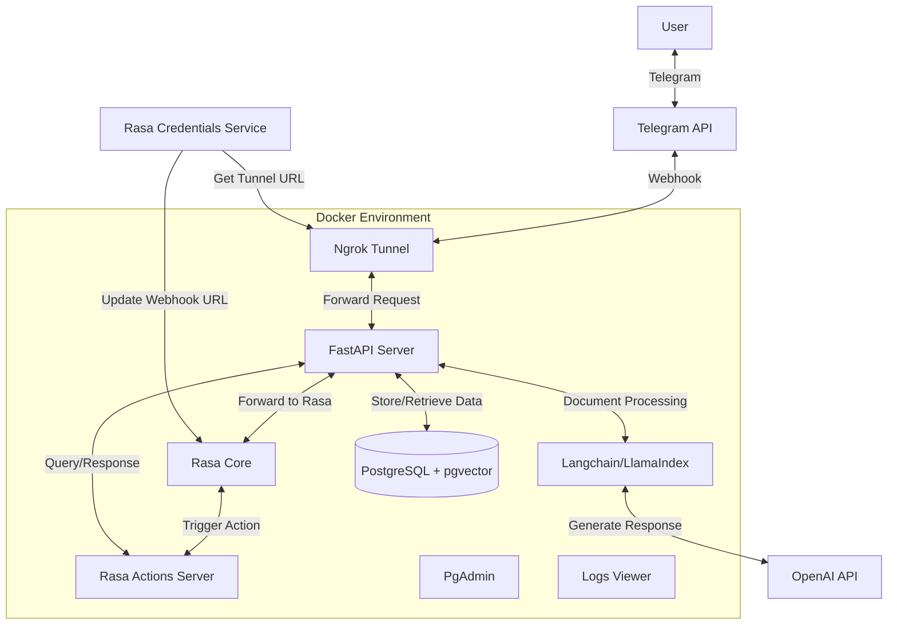

Users interact with the bot through Telegram, which forwards messages to the FastAPI server via an Ngrok tunnel. The FastAPI server processes these messages and sends them to Rasa Core for intent recognition. When Rasa cannot handle a query, it triggers custom actions that leverage the LLM capabilities through the FastAPI server, which uses Langchain/LlamaIndex for document retrieval and response generation.

Sources: [README.md:560-616]()

### Docker Service Architecture

The following diagram shows the Docker services that make up the RasaGPT system and their port mappings.

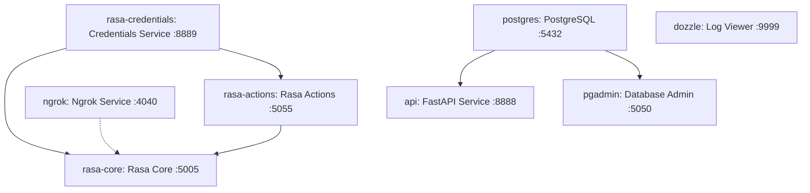

The system consists of eight Docker services, each with a specific role. The PostgreSQL database serves as the foundation, storing data for the API server. The FastAPI server, Rasa Core, and Rasa Actions work together to handle chat interactions, while supporting services like Ngrok, PgAdmin, and Dozzle provide infrastructure capabilities.

Sources: [README.md:159-171](), [README.md:182-196]()

## Conversation Flow

The following diagram illustrates how a user conversation flows through the RasaGPT system:

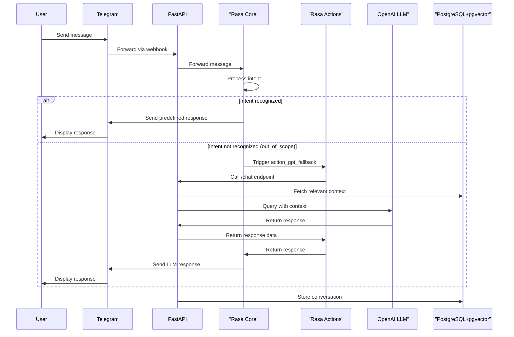

When a user sends a message through Telegram, it's forwarded to the FastAPI server and then to Rasa Core. If Rasa can recognize the intent, it responds directly. If not, it triggers the `action_gpt_fallback` action which leverages the LLM capabilities through the FastAPI server. The server retrieves relevant context from the database, queries the LLM, and returns a response to the user.

Sources: [README.md:616-629](), [README.md:575-582]()

## Document Processing and Indexing

RasaGPT includes a document processing pipeline that enables the chatbot to answer questions based on uploaded documents:

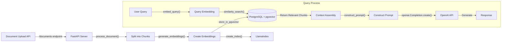

Documents are uploaded through the API, processed into chunks, and embedded using vector representations. These embeddings are stored in the PostgreSQL database using the pgvector extension. When a user queries the system, their question is also embedded, and a similarity search identifies the most relevant document chunks. These chunks are then used to provide context to the LLM when generating a response.

Sources: [README.md:607-615](), [README.md:95-104]()

## Multi-tenant Data Model

RasaGPT supports multi-tenancy through a hierarchical data model:

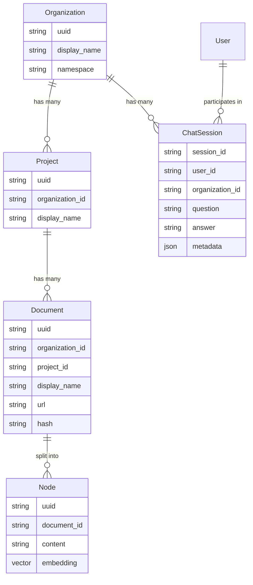

The data model shows the relationships between different entities in the system. Organizations have projects, which have documents. Documents are split into nodes, each with vector embeddings for similarity search. Chat sessions track conversations between users and bots, associated with specific organizations.

Sources: [README.md:267-543]()

## Key Features

RasaGPT includes the following key features:

| Feature Category | Capabilities |
|------------------|--------------|
| **Application & API** | - Document upload and "training" via FastAPI<br>- Document versioning and automatic retraining<br>- Custom async endpoints with FastAPI and SQLModel<br>- Human handoff determination<br>- Automatic tag generation<br>- API documentation via Swagger and Redoc<br>- PGAdmin for database management<br>- Automatic Ngrok endpoint generation |
| **Rasa Integration** | - Built on top of Rasa, the open-source chatbot framework<br>- Support for MacOS M1/M2 via Docker<br>- Telegram integration with easy extension to other platforms<br>- Complex dialog pipelines with fallback to OpenAI GPT |
| **Flexibility** | - Extensible with Langchain capabilities<br>- Multi-tenant schema design<br>- Customizable agent personalities<br>- Chat history storage with embeddings<br>- Automatic knowledge base embedding generation |

Sources: [README.md:89-120]()

## Technical Implementation

### Rasa Integration

The Rasa integration is configured through several key files:

1. **config.yml** - Contains the NLU pipeline and policy configuration, with `FallbackClassifier` threshold settings
2. **credentials.yml** - Contains webhook paths and Telegram credentials, updated by the `rasa-credentials` service
3. **domain.yml** - Defines chat entrypoint logic, intents, and actions including `action_gpt_fallback`
4. **endpoints.yml** - Configures custom action endpoints
5. **nlu.yml** - Defines intents, including the `out_of_scope` intent
6. **rules.yml** - Sets up rules for handling intents, triggering appropriate actions
7. **actions.py** - Implements custom actions like `ActionGPTFallback`

When a message cannot be handled by Rasa's standard intent recognition, it triggers the `action_gpt_fallback` which interacts with the FastAPI server to get a response from the LLM.

Sources: [README.md:569-585]()

### Database & Vector Store

The system uses PostgreSQL with the pgvector extension for storing and querying vector embeddings:

1. The database is initialized during setup with the pgvector extension enabled
2. The database schema is created using SQLModel through the `models.py` file
3. The `enable_vector` method in `models.py` activates the pgvector extension
4. Document chunks (nodes) are stored with their vector embeddings for similarity search

Sources: [README.md:600-607]()

### LLM Integration

The LLM integration is handled through Langchain and LlamaIndex:

1. Training data is loaded into the database
2. If the index doesn't exist, it's created and stored in `index.json`
3. LlamaIndex uses `GPTSimpleVectorIndex` to find relevant data and inject it into prompts
4. Prompt guardrails ensure the conversation stays focused
5. LLM responses include JSON formatting, categorical tagging, and human escalation recommendations

Sources: [README.md:607-629]()

## Common Use Cases

RasaGPT is designed to support a variety of use cases:

1. **Customer Support** - Answering product or service-related questions
2. **Help Desk** - Providing IT or technical support
3. **E-Learning** - Creating interactive educational experiences
4. **Knowledge Base** - Making organizational knowledge accessible
5. **Quiz Systems** - Building interactive quiz or testing experiences

The architecture allows for customization and extension to support specific business needs while maintaining a consistent user experience.

Sources: [README.md:104-105]()

---

# Page: System Architecture

# System Architecture

<details>
<summary>Relevant source files</summary>

The following files were used as context for generating this wiki page:

- [README.md](README.md)
- [app/scripts/wait-for-it.sh](app/scripts/wait-for-it.sh)
- [docker-compose.yml](docker-compose.yml)
- [github/rasagpt-video-title-screen.png](github/rasagpt-video-title-screen.png)

</details>


This document outlines the high-level architecture of RasaGPT, detailing the core components and their interactions within the system. It covers the Docker-based deployment architecture, API services, integration with Rasa, database design, and the conversational flow throughout the system. For information about specific features and capabilities, see [Features and Capabilities](#1.2).

## Overview

RasaGPT is a headless LLM chatbot platform that combines traditional conversational AI (Rasa) with modern large language model capabilities through an API-first design. The system enables multi-tenancy, document indexing, semantic search, and conversational AI in a modular, containerized architecture.

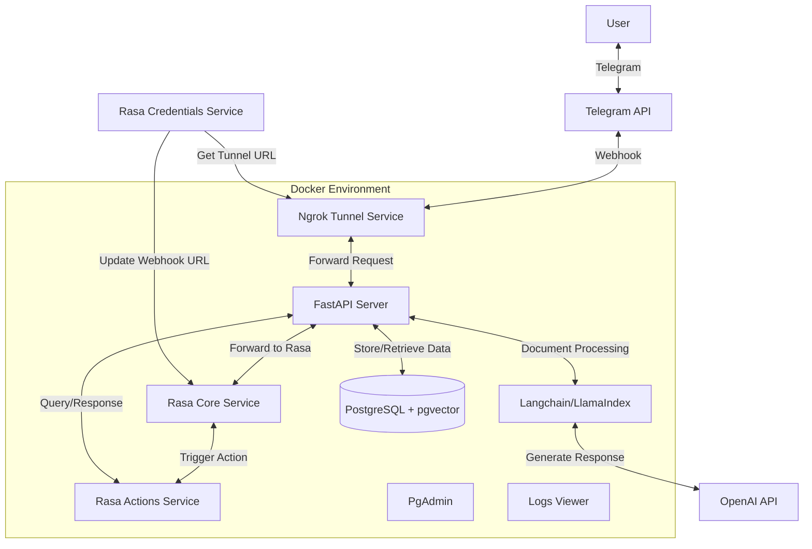

Sources: [docker-compose.yml:1-184](), [README.md:6-53]()

## Docker-based Deployment Architecture

RasaGPT uses Docker and Docker Compose to orchestrate multiple services that work together. This containerized approach ensures consistency across environments and simplifies deployment.

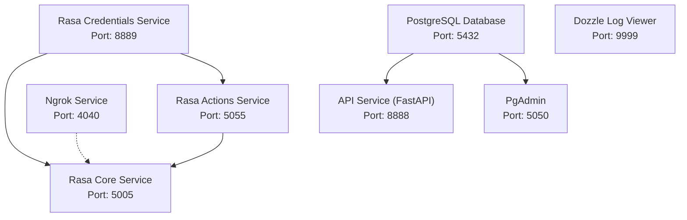

The system consists of the following Docker services:

| Service | Container Name | Description | Port |
|---------|---------------|-------------|------|
| API | chat_api | FastAPI server that provides LLM capabilities and document processing | 8888 |
| Ngrok | chat_ngrok | Creates secure tunnels for webhook communication | 4040 |
| Rasa Core | chat_rasa_core | Main Rasa service for NLU and conversation handling | 5005 |
| Rasa Actions | chat_rasa_actions | Custom actions server for Rasa | 5055 |
| Rasa Credentials | chat_rasa_credentials | Helper service for webhook configuration | 8889 |
| Database | chat_db | PostgreSQL with pgvector extension | 5432 |
| PgAdmin | chat_pgadmin | Database management interface | 5050 |
| Dozzle | chat_dozzle | Log viewer for all containers | 9999 |

Each service runs in its own container and communicates with others through a dedicated Docker network called `chat-network`.

Sources: [docker-compose.yml:10-184]()

## Service Dependencies and Startup Process

RasaGPT services have specific dependencies and must start in a particular order to function correctly. The system uses a waiting mechanism to ensure services are available before dependent services start.

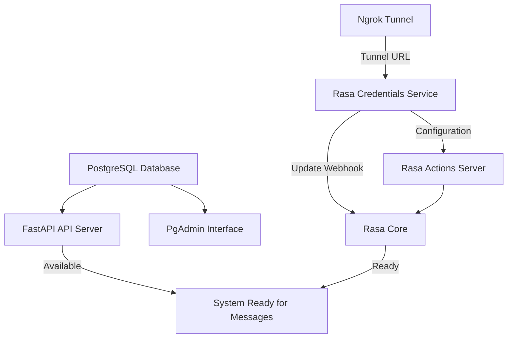

The startup process:

1. Database initializes first with pgvector extension
2. FastAPI server starts and connects to the database
3. Ngrok service starts and creates a tunnel
4. Rasa Credentials service gets the Ngrok URL and configures Rasa
5. Rasa Actions server starts
6. Rasa Core starts and connects to Rasa Actions
7. The system is ready to process messages

The waiting mechanism is implemented using `wait-for-it.sh` script which checks service availability before allowing dependent services to start.

Sources: [docker-compose.yml:65-74](), [app/scripts/wait-for-it.sh:1-205]()

## Conversation Flow

This diagram shows how a user message flows through the RasaGPT system:

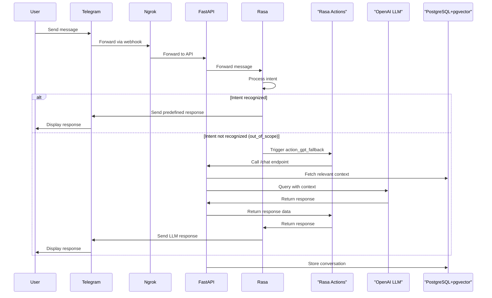

Key points about conversation flow:

1. Users interact through Telegram, which sends messages to RasaGPT via webhook
2. Rasa attempts to classify the user message into a predefined intent
3. If an intent is recognized, Rasa sends a predefined response
4. If no intent is recognized ("out_of_scope"), the `action_gpt_fallback` is triggered
5. The fallback action calls the FastAPI server to generate a response using the LLM
6. The LLM response is processed and sent back to the user
7. All conversations are stored in the database for future reference

Sources: [README.md:576-629]()

## Document Processing and Vector Search

RasaGPT processes documents to create vector embeddings for semantic search capabilities. This enables the system to find relevant content when responding to user queries.

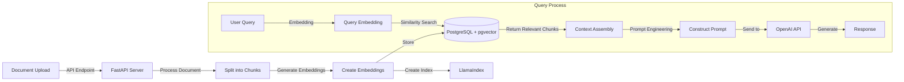

The document processing pipeline:

1. Documents are uploaded via the FastAPI server
2. Documents are split into smaller chunks for better semantic indexing
3. Embeddings are generated for each chunk using OpenAI's embedding models
4. Embeddings are stored in PostgreSQL using the pgvector extension
5. When a user query comes in:
   - The query is converted to an embedding
   - A similarity search finds the most relevant document chunks
   - Relevant chunks are assembled as context
   - A prompt is constructed with this context
   - The prompt is sent to OpenAI for response generation

Sources: [README.md:611-615]()

## Multi-tenant Data Model

RasaGPT implements a multi-tenant architecture with organizations, projects, and documents. This structure enables the system to serve multiple clients with isolated data.

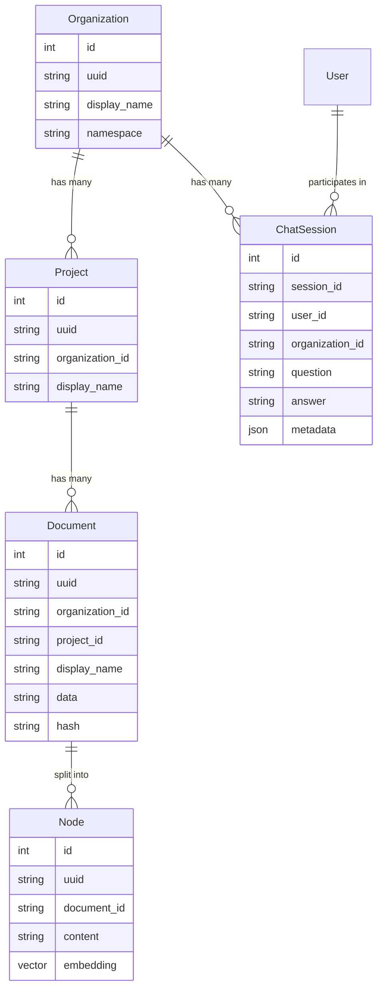

Key entities in the data model:

1. **Organization**: Represents a client in a multi-tenant environment
2. **Project**: Belongs to an Organization and groups related documents
3. **Document**: Contains text data that is processed and indexed
4. **Node**: A chunk of a document with associated vector embeddings
5. **User**: Represents an end-user of the chatbot
6. **ChatSession**: Records interactions between users and the chatbot

This model allows:
- Isolating data between different clients
- Organizing and managing documents in a hierarchical structure
- Storing chat history with metadata for future analysis
- Maintaining embeddings for semantic search

Sources: [README.md:267-496]()

## Key Components and Integrations

### FastAPI Server

The FastAPI server serves as the central hub of the system, providing:

- REST API for document management and chatbot interactions
- Document processing and indexing using Langchain/LlamaIndex
- Storage and retrieval of vector embeddings
- Integration with OpenAI API for LLM capabilities
- Multi-tenant organization management

### Rasa Integration

Rasa provides the conversational framework with:

- Intent recognition using an NLU pipeline
- Webhook configuration for Telegram integration
- Custom actions that connect to the FastAPI server
- Fallback mechanisms when intents aren't recognized

### Telegram Integration via Ngrok

RasaGPT integrates with Telegram through:

- Automatic webhook configuration using Ngrok tunnels
- The Rasa Credentials service updates Telegram webhooks
- Ngrok provides secure, publicly accessible URLs for local development

### Database with Vector Search

PostgreSQL with pgvector extension provides:

- Storage for documents, organizations, projects, and chat history
- Vector embeddings for semantic similarity search
- Efficient retrieval of relevant document chunks during conversations

Sources: [README.md:566-585]()

## Conclusion

The RasaGPT architecture combines traditional conversational AI with modern LLM capabilities, providing a flexible, multi-tenant chatbot platform. The modular Docker-based design allows for easy deployment and scalability, while the integration with existing communication channels like Telegram enables immediate practical applications.

By leveraging vector embeddings and semantic search, RasaGPT enhances the capabilities of Rasa with the power of large language models, creating a hybrid system that can handle complex conversational scenarios and knowledge retrieval tasks.

---

# Page: Features and Capabilities

# Features and Capabilities

<details>
<summary>Relevant source files</summary>

The following files were used as context for generating this wiki page:

- [README.md](README.md)
- [RESULTS.md](RESULTS.md)
- [github/rasagpt-video-title-screen.png](github/rasagpt-video-title-screen.png)

</details>


This document outlines the key features and capabilities of RasaGPT, a headless LLM chatbot platform built on top of Rasa and Langchain. For information about installing and setting up the system, see [Installation and Setup](#2).

## Core Platform Features

RasaGPT provides a comprehensive set of features that enable sophisticated chatbot functionality with large language model integration:

### Full Application and API

| Feature | Description |
|---------|-------------|
| LLM Knowledge Base | System "learns" on arbitrary corpus of data using Langchain |
| Document Management | Upload documents and "train" via FastAPI with versioning and automatic re-training |
| Customizable Backend | Extend with async endpoints and database models via FastAPI and SQLModel |
| Smart Conversation Handling | Bot determines when human handoff is necessary and generates tags automatically |
| API Documentation | Full documentation via Swagger and Redoc |
| Database Management | PGAdmin included for database browsing |
| Webhook Management | Ngrok endpoints automatically generated for Telegram access |
| Vector Search | Embedding similarity search built into Postgres via pgvector |
| Test Data | Dummy data included for experimentation |

Sources: [README.md:91-105]()

### Rasa Integration

RasaGPT leverages Rasa's powerful framework with enhancements:

- Built on top of Rasa, the open source gold-standard for chat platforms
- MacOS M1/M2 support via Docker (canonical Rasa image lacks this support)
- Telegram integration with easy extension to other platforms
- Complex dialog pipelines using NLU models from Huggingface with OpenAI GPT as fallback

Sources: [README.md:106-112]()

### Flexibility Features

The system is designed for maximum flexibility:

- Extensible with Langchain's agentic and memory capabilities
- Multi-tenant schema supporting organizations, sessions, and data storage
- Customizable agent personalities
- Chat history storage with embedding creation for future retrieval optimization
- Automatic embedding generation from knowledge base corpus and client feedback

Sources: [README.md:113-120]()

## System Architecture

### Component Interaction

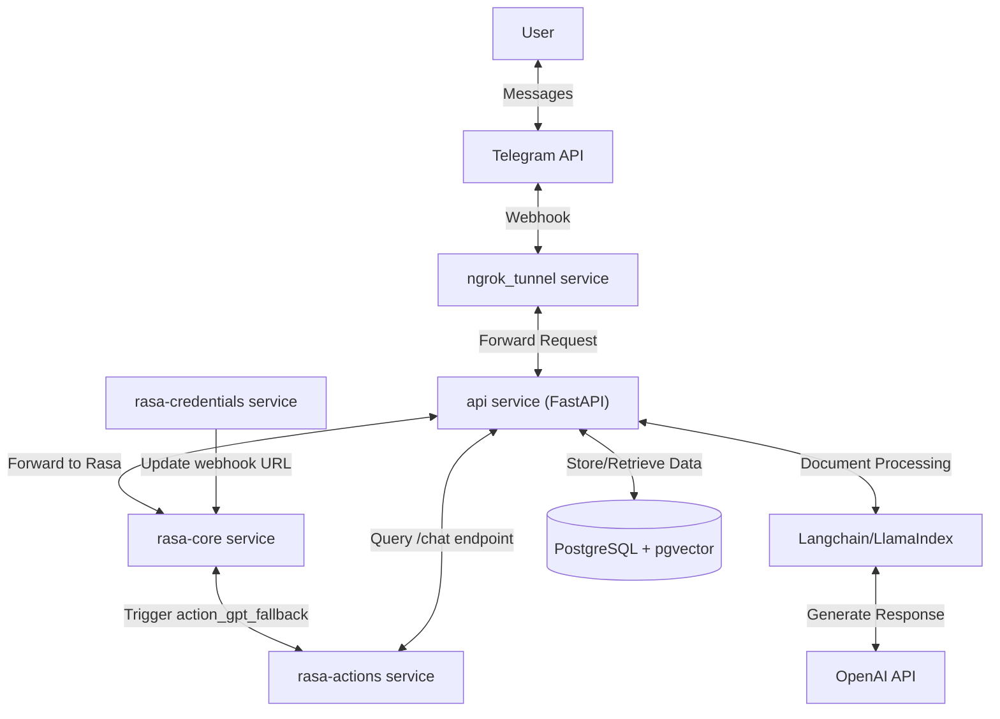

**High-Level System Architecture**

Sources: [README.md:570-585](), [docker-compose.yml]()

### Conversation Flow

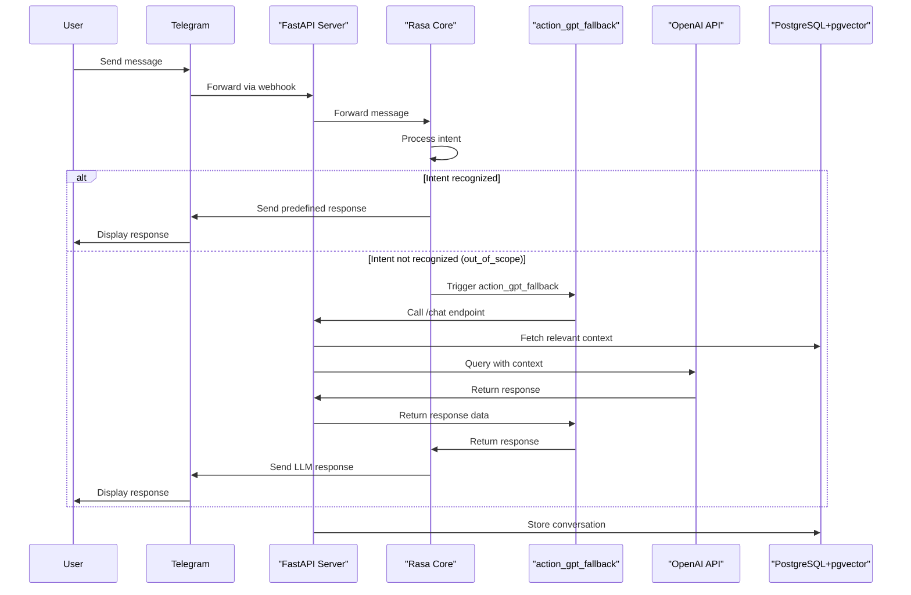

**Conversation Flow Through System Components**

Sources: [README.md:590-629](), [app/rasa/actions/actions.py](), [app/rasa/data/rules.yml]()

## Document Processing and Indexing

### Document Pipeline

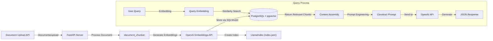

**Document Processing and Indexing Pipeline**

Sources: [README.md:610-616](), [app/api/main.py:49-66]()

## Multi-tenant Data Model

RasaGPT uses a sophisticated data model to support multi-tenancy and document management:

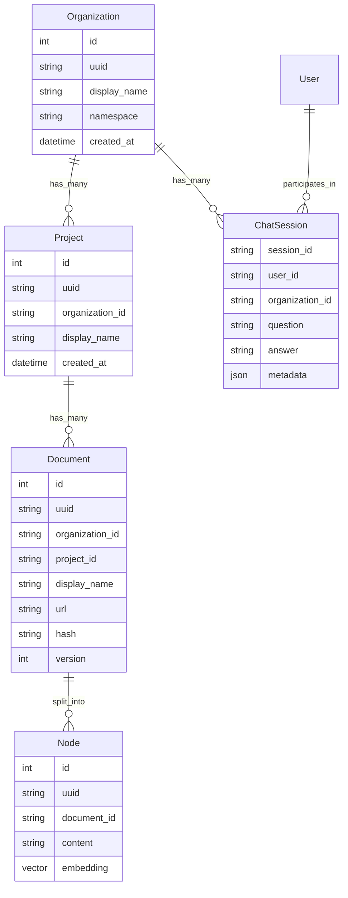

**Multi-tenant Data Model**

Sources: [app/api/models.py](), [README.md:267-321](), [README.md:325-498]()

## API and Integration

### Core API Endpoints

| Endpoint | Method | Description |
|----------|--------|-------------|
| `/organizations` | GET | List all organizations |
| `/organizations/{org_id}` | GET | Get organization details |
| `/organizations/{org_id}/projects` | GET | List projects for an organization |
| `/projects/{project_id}` | GET | Get project details |
| `/projects/{project_id}/documents` | GET | List documents in a project |
| `/documents/{document_id}` | GET | Get document details |
| `/documents/upload` | POST | Upload a new document |
| `/chat` | POST | Send a message to the chatbot |

Sources: [app/api/main.py](), [README.md:261-262]()

### LLM Response Features

The LLM integration provides enhanced response capabilities:

- Context-aware responses based on document corpus
- Automatic tagging of user questions (categorization)
- Human handoff detection when the bot can't confidently answer
- JSON-formatted responses with structured metadata
- Document similarity search via vector embeddings

Sources: [README.md:623-629](), [RESULTS.md:7-50]()

## Performance and Response Quality

RasaGPT's retrieval and response quality varies based on the indexing strategy currently used:

- Uses 1000 character length chunking for document indexing
- Employs Euclidean distance for similarity search
- Quality is described as "hit or miss" but can be improved with optimization
- Retrieval accuracy could be increased by more than 70% with improvements to indexing

The system captures successful responses like:
- Company information retrieval
- Product details and usage instructions
- Financial information
- Historical data

Sources: [RESULTS.md:12-113](), [README.md:248-253]()

## Future Enhancements

Future planned enhancements to the system include:

- Improved LlamaIndex optimizations
- Chat history implementation
- Query routing abstractions
- Exploration of diverse indexing methods (Tree, Keyword)
- Implementation of dual agent pattern for answer verification
- Hypothetical Document Embeddings (HyDE) pattern for improved retrieval

Sources: [README.md:633-646](), [RESULTS.md:152-166]()

## Technical Implementation Details

The RasaGPT implementation includes:

- Docker-containerized microservices architecture
- Automatic webhook configuration between Ngrok and Telegram
- Vector database implemented with PostgreSQL and pgvector
- Training and inference pipeline for document embeddings
- Makefile-managed initialization and operations
- Headless API-first design

Sources: [README.md:42-50](), [README.md:206-215](), [README.md:602-607]()

---

# Page: Installation and Setup

# Installation and Setup

<details>
<summary>Relevant source files</summary>

The following files were used as context for generating this wiki page:

- [.env-example](.env-example)
- [Makefile](Makefile)
- [README.md](README.md)
- [github/rasagpt-video-title-screen.png](github/rasagpt-video-title-screen.png)

</details>


This page provides comprehensive instructions for installing and setting up RasaGPT on your system. It covers all prerequisites, configuration steps, and verification procedures to ensure a successful deployment. For information about specific configuration options and environment variables, see [Configuration Options](#2.1).

## Overview of Installation Process

The installation process for RasaGPT involves setting up several interconnected components through Docker containers. The system uses a Makefile to automate most of the installation steps, making the process straightforward.

**Installation Flow Diagram**

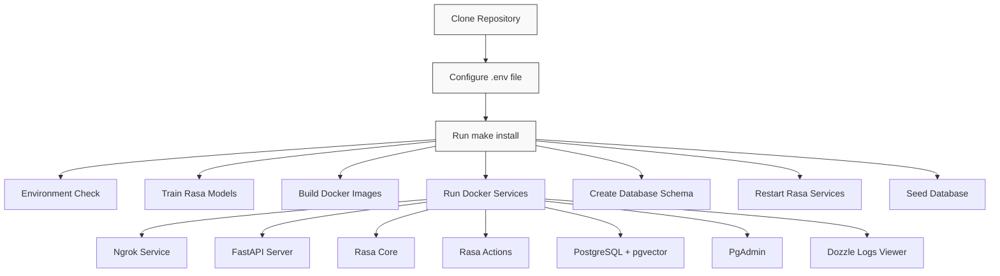

Sources: [Makefile:53-64](), [README.md:123-146]()

## Prerequisites

Before installing RasaGPT, ensure you have the following requirements met:

| Requirement | Description |
|-------------|-------------|
| Python 3.9 | Base programming language required |
| Docker & Docker Compose | For containerized deployment (Docker Desktop for MacOS) |
| OpenAI API Key | Required for LLM functionality |
| Telegram Bot Credentials | For bot communication channel |
| Ngrok Auth Token | For exposing local server to the internet |
| Make | Build automation tool (brew install make for MacOS) |
| SQLModel | Python library for database models |

### System-Specific Requirements

> ⚠️ **For Non-MacOS Users**: If you're using Linux or Windows, you need to change the image name from `khalosa/rasa-aarch64:3.5.2` to `rasa/rasa:latest` in:
> - docker-compose.yml on line #64
> - app/rasa/actions/Dockerfile on line #1

Sources: [README.md:127-133](), [README.md:67-68]()

## Installation Steps

### 1. Clone the Repository

```bash
git clone https://github.com/paulpierre/RasaGPT.git
cd RasaGPT
```

### 2. Configure Environment Variables

Copy the example environment file and edit it with your credentials:

```bash
cp .env-example .env
```

Edit the `.env` file and fill in all required credentials:

| Required Variables | Description |
|-------------------|-------------|
| OPENAI_API_KEY | Your OpenAI API key |
| TELEGRAM_ACCESS_TOKEN | Your Telegram bot token |
| TELEGRAM_BOTNAME | Your Telegram bot's name |
| NGROK_AUTHTOKEN | Your Ngrok authentication token |
| DB_PASSWORD | Password for the API database user |

Sources: [.env-example:1-48](), [README.md:139-146]()

### 3. Run the Installation Process

Execute the make install command to start the automated installation:

```bash
make install
```

This command will:
1. Check for the presence of the `.env` file
2. Train the Rasa NLU model
3. Build all Docker images
4. Start all required services
5. Initialize the database schema with pgvector support
6. Restart Rasa to properly connect with other services
7. Seed the database with sample data

Sources: [Makefile:53-64](), [README.md:206-215]()

## Installation Architecture

The following diagram shows the containers and services created during installation and how they interact:

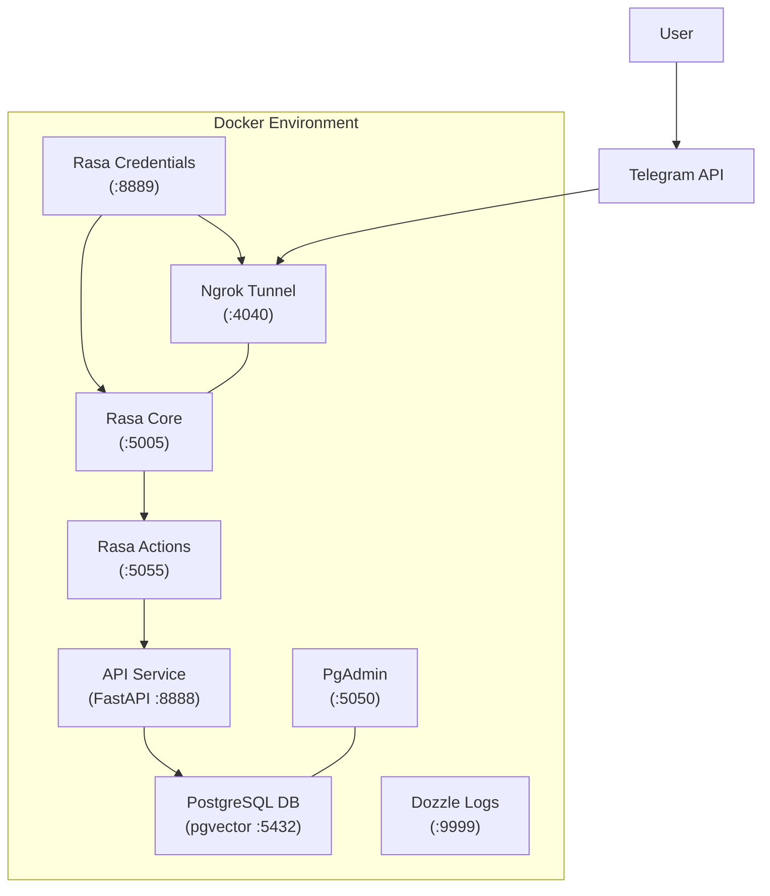

Sources: [docker-compose.yml](), [README.md:201-207]()

## Verification Steps

After installation completes, verify that the system is working properly:

### 1. Check Service Status

You can view all running services and their logs through the Dozzle interface:

```bash
make logs
# Or visit http://localhost:9999/
```

### 2. Verify API Access

Access the API documentation to ensure the FastAPI server is running:

```bash
# Visit http://localhost:8888/docs
```

### 3. Test Telegram Integration

Start chatting with your bot by visiting:
```
https://t.me/yourbotname
```
(Where 'yourbotname' is the name specified in your .env file)

Sources: [README.md:222-226](), [README.md:230-234](), [README.md:238-244]()

## System Component Relationships

This diagram illustrates how the installed components work together to process user messages:

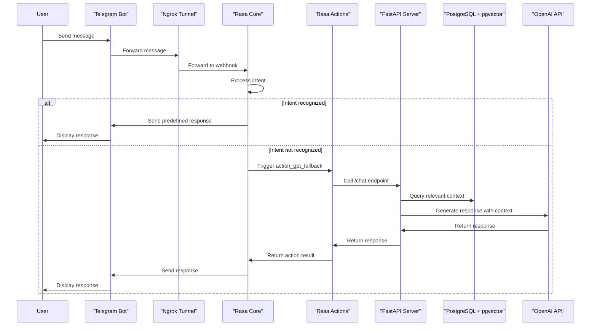

Sources: [README.md:565-625]()

## Common Makefile Commands

The Makefile provides various commands to manage the RasaGPT system:

| Command | Description |
|---------|-------------|
| `make install` | Install and run RasaGPT |
| `make run` | Run RasaGPT (after installation) |
| `make stop` | Stop all RasaGPT services |
| `make restart` | Restart all services |
| `make logs` | Open logs viewer in browser |
| `make ngrok` | Open Ngrok admin interface |
| `make pgadmin` | Open PostgreSQL admin interface |
| `make shell-api` | Open shell in API container |
| `make shell-rasa` | Open shell in Rasa container |
| `make shell-actions` | Open shell in Rasa Actions container |
| `make shell-db` | Open shell in database container |

Sources: [Makefile:5-32](), [README.md:154-156]()

## Installation Folder Structure

After installation, the main components of the system are organized as follows:

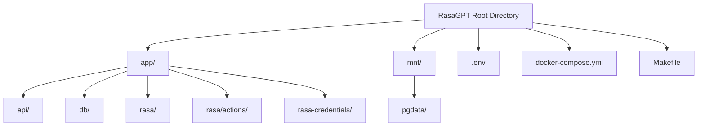

## Troubleshooting

### Ngrok Issues

If the bot isn't responding, check that your webhooks with Ngrok and Telegram match:

```bash
curl -sS "https://api.telegram.org/bot<your-bot-secret-token>/getWebhookInfo" | json_pp
```

This should return a URL matching the one in your `credentials.yml` file and visible in the Ngrok admin UI at http://localhost:4040/status.

If there's a mismatch, restart the system:

```bash
make restart
```

### Database Issues

If experiencing database problems, you can reset the database:

```bash
make db-purge
make api
make models
```

### Container Errors

For issues with specific containers, you can:

1. Check the logs with `make logs`
2. Open a shell in the problematic container (e.g., `make shell-api`)
3. Rebuild and restart all services with `make restart`

Sources: [README.md:650-693](), [Makefile:213-223]()

## Next Steps

After successful installation, you can:

1. Start chatting with your bot via Telegram
2. Explore the API documentation to understand available endpoints
3. Upload documents to the knowledge base
4. Explore different configuration options (see [Configuration Options](#2.1))

Sources: [README.md:222-255]()

---

# Page: Configuration Options

# Configuration Options

<details>
<summary>Relevant source files</summary>

The following files were used as context for generating this wiki page:

- [.env-example](.env-example)
- [app/api/config.py](app/api/config.py)

</details>


This page documents all the configuration options and environment variables used in RasaGPT. Understanding these options is essential for properly setting up and customizing your RasaGPT instance. For information about the Docker deployment architecture, see [Docker Environment](#2.2).

## Overview

RasaGPT uses environment variables to configure all aspects of the system. These settings control the behavior of various components including:

- API server
- LLM (Large Language Model) integration
- Vector database
- Document processing
- Rasa integration
- Telegram bot
- Development tools

Configuration values are loaded from a `.env` file at the root of the project and are accessible throughout the application.

## Environment File Setup

The system uses a `.env` file for configuration. A template is provided as `.env-example`:

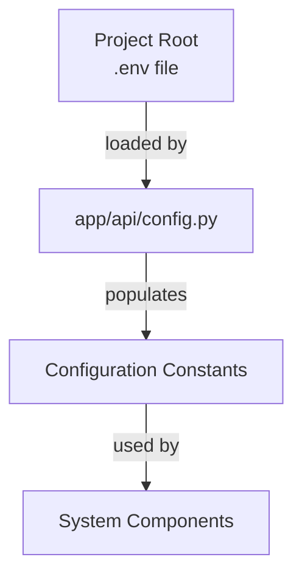

Sources: [.env-example](), [app/api/config.py:15-28]()

## Configuration Categories

The configuration options are organized into the following categories:

| Category | Purpose | Example Variables |
|----------|---------|-------------------|
| General | Basic system settings | `ENV` |
| File Upload | Document processing settings | `FILE_UPLOAD_PATH` |
| LLM | Language model parameters | `LLM_CHUNK_SIZE`, `MODEL_NAME` |
| Database | PostgreSQL and pgvector configuration | `DB_HOST`, `PGVECTOR_ADD_INDEX` |
| Ngrok | Tunneling for webhook access | `NGROK_AUTHTOKEN` |
| Rasa | Rasa core and webhook configuration | `RASA_WEBHOOK_HOST` |
| Telegram | Bot settings | `TELEGRAM_ACCESS_TOKEN` |
| API | API server configuration | `API_PORT` |
| Admin Tools | PgAdmin settings | `PGADMIN_DEFAULT_EMAIL` |

Sources: [.env-example]()

## General Settings

| Variable | Description | Default |
|----------|-------------|---------|
| `ENV` | Deployment environment (local, staging, production) | `local` |

Sources: [.env-example:1]()

## File Upload Settings

| Variable | Description | Default |
|----------|-------------|---------|
| `FILE_UPLOAD_PATH` | Directory path for uploaded files | `data` |

Sources: [.env-example:3](), [app/api/config.py:65]()

## LLM Configuration

These settings control how the Large Language Model processes text and generates responses.

```mermaid
flowchart TD
    llmConfig["LLM Configuration"] --> chunkSize["LLM_CHUNK_SIZE
    Document chunking size"]
    llmConfig --> chunkOverlap["LLM_CHUNK_OVERLAP
    Overlap between chunks"]
    llmConfig --> distThreshold["LLM_DISTANCE_THRESHOLD
    Similarity threshold"]
    llmConfig --> temp["LLM_DEFAULT_TEMPERATURE
    Response randomness"]
    llmConfig --> maxTokens["LLM_MAX_OUTPUT_TOKENS
    Response length limit"]
    llmConfig --> minNodes["LLM_MIN_NODE_LIMIT
    Minimum context nodes"]
    llmConfig --> distStrategy["LLM_DEFAULT_DISTANCE_STRATEGY
    Vector similarity measure"]
    llmConfig --> modelName["MODEL_NAME
    OpenAI model selection"]
```

| Variable | Description | Default | Code Reference |
|----------|-------------|---------|---------------|
| `LLM_DEFAULT_TEMPERATURE` | Controls randomness in responses (0-1) | `0` | [app/api/config.py:86]() |
| `LLM_CHUNK_SIZE` | Size of text chunks for document processing | `1000` | [app/api/config.py:87]() |
| `LLM_CHUNK_OVERLAP` | Overlap between consecutive chunks | `200` | [app/api/config.py:88]() |
| `LLM_DISTANCE_THRESHOLD` | Threshold for similarity matching | `0.2` | [app/api/config.py:89]() |
| `LLM_MAX_OUTPUT_TOKENS` | Maximum tokens in generated responses | `256` | [app/api/config.py:90]() |
| `LLM_MIN_NODE_LIMIT` | Minimum number of context nodes to retrieve | `3` | [app/api/config.py:91]() |
| `LLM_DEFAULT_DISTANCE_STRATEGY` | Vector similarity strategy (EUCLIDEAN, COSINE, MAX_INNER_PRODUCT) | `EUCLIDEAN` | [app/api/config.py:129-131]() |
| `MODEL_NAME` | OpenAI model to use (e.g., gpt-3.5-turbo) | `gpt-3.5-turbo` | [app/api/config.py:85]() |

Sources: [.env-example:4-10](), [app/api/config.py:85-91](), [app/api/config.py:94-131]()

### Distance Strategies

RasaGPT supports multiple distance strategies for vector similarity search:

```mermaid
flowchart TD
    distStrategy["DISTANCE_STRATEGY"] --> euclidean["EUCLIDEAN
    L2 distance (<->)"]
    distStrategy --> cosine["COSINE
    Cosine similarity (<=>)"]
    distStrategy --> maxInnerProduct["MAX_INNER_PRODUCT
    Dot product (<#>)"]
```

Each strategy is implemented with a corresponding PostgreSQL vector index:

| Strategy | Description | SQL Operator | PgVector Index |
|----------|-------------|--------------|----------------|
| `EUCLIDEAN` | Euclidean distance (L2 norm) | `<->` | `vector_l2_ops` |
| `COSINE` | Cosine similarity | `<=>` | `vector_cosine_ops` |
| `MAX_INNER_PRODUCT` | Maximum inner product (dot product) | `<#>` | `vector_ip_ops` |

Sources: [app/api/config.py:94-128]()

## Database Configuration

Configuration for PostgreSQL database and pgvector extension:

```mermaid
flowchart TD
    dbConfig["Database Configuration"] --> pgUser["POSTGRES_USER
    PostgreSQL superuser"]
    dbConfig --> pgPassword["POSTGRES_PASSWORD
    PostgreSQL superuser password"]
    dbConfig --> pgDb["POSTGRES_DB
    PostgreSQL database name"]
    dbConfig --> pgVector["PGVECTOR_ADD_INDEX
    Create vector indexes"]
    dbConfig --> dbHost["DB_HOST
    Database hostname"]
    dbConfig --> dbPort["DB_PORT
    Database port"]
    dbConfig --> dbUser["DB_USER
    Application database user"]
    dbConfig --> dbName["DB_NAME
    Application database name"]
    dbConfig --> dbPassword["DB_PASSWORD
    Application database password"]
```

| Variable | Description | Default | Code Reference |
|----------|-------------|---------|---------------|
| `POSTGRES_USER` | PostgreSQL superuser username | `postgres` | [app/api/config.py:68]() |
| `POSTGRES_PASSWORD` | PostgreSQL superuser password | `postgres` | [app/api/config.py:69]() |
| `POSTGRES_DB` | PostgreSQL database name | `postgres` | `.env-example` |
| `PGVECTOR_ADD_INDEX` | Whether to add vector indices | `true` | [app/api/config.py:133]() |
| `DB_HOST` | Database hostname | `db` | [app/api/config.py:70]() |
| `DB_PORT` | Database port | `5432` | [app/api/config.py:71]() |
| `DB_USER` | Application database user | `api` | [app/api/config.py:72]() |
| `DB_NAME` | Application database name | `api` | [app/api/config.py:73]() |
| `DB_PASSWORD` | Application database password | `<YOUR DATABASE PASSWORD>` | [app/api/config.py:74]() |

The system uses two database connection strings:
- `DSN`: Used by the application (`DB_USER`)
- `SU_DSN`: Used for administrative tasks (`POSTGRES_USER`)

Sources: [.env-example:12-21](), [app/api/config.py:68-78]()

## Ngrok Configuration

Ngrok is used to expose the local Rasa webhook to the internet:

```mermaid
flowchart TD
    ngrokConfig["Ngrok Configuration"] --> authToken["NGROK_AUTHTOKEN
    Authentication token"]
    ngrokConfig --> apiKey["NGROK_API_KEY
    API key for management"]
    ngrokConfig --> host["NGROK_HOST
    Ngrok service hostname"]
    ngrokConfig --> port["NGROK_PORT
    Ngrok web interface port"]
    ngrokConfig --> webhookHost["NGROK_INTERNAL_WEBHOOK_HOST
    Internal webhook hostname"]
    ngrokConfig --> webhookPort["NGROK_INTERNAL_WEBHOOK_PORT
    Internal webhook port"]
    ngrokConfig --> debug["NGROK_DEBUG
    Enable debug logging"]
    ngrokConfig --> config["NGROK_CONFIG
    Path to ngrok config file"]
```

| Variable | Description | Default | 
|----------|-------------|---------|
| `NGROK_HOST` | Ngrok service hostname | `ngrok` |
| `NGROK_PORT` | Ngrok web interface port | `4040` |
| `NGROK_AUTHTOKEN` | Authentication token for Ngrok account | `<YOUR NGROK AUTH TOKEN>` |
| `NGROK_API_KEY` | API key for Ngrok management | `<YOUR NGROK API KEY>` |
| `NGROK_INTERNAL_WEBHOOK_HOST` | Internal hostname for webhook forwarding | `api` |
| `NGROK_INTERNAL_WEBHOOK_PORT` | Internal port for webhook forwarding | `8888` |
| `NGROK_DEBUG` | Enable debug logging | `true` |
| `NGROK_CONFIG` | Path to Ngrok configuration file | `/etc/ngrok.yml` |

Sources: [.env-example:23-30]()

## Rasa Integration Settings

Configuration for Rasa Core integration:

```mermaid
flowchart TD
    rasaConfig["Rasa Configuration"] --> webhookHost["RASA_WEBHOOK_HOST
    Rasa Core hostname"]
    rasaConfig --> webhookPort["RASA_WEBHOOK_PORT
    Rasa Core port"]
    rasaConfig --> credentialsPath["CREDENTIALS_PATH
    Path to credentials file"]
```

| Variable | Description | Default | Code Reference |
|----------|-------------|---------|---------------|
| `RASA_WEBHOOK_HOST` | Hostname for Rasa Core | `rasa-core` | [app/api/config.py:80]() |
| `RASA_WEBHOOK_PORT` | Port for Rasa Core | `5005` | [app/api/config.py:81]() |
| `CREDENTIALS_PATH` | Path to Rasa credentials file | `/app/rasa/credentials.yml` | `.env-example` |

The system constructs a Rasa webhook URL using these settings:
```
RASA_WEBHOOK_URL = http://{RASA_WEBHOOK_HOST}:{RASA_WEBHOOK_PORT}
```

Sources: [.env-example:32-35](), [app/api/config.py:80-82]()

## Telegram Bot Configuration

Settings for the Telegram bot interface:

| Variable | Description | Default |
|----------|-------------|---------|
| `TELEGRAM_ACCESS_TOKEN` | Telegram bot API token | `<YOUR TELEGRAM ACCESS TOKEN>` |
| `TELEGRAM_BOTNAME` | Telegram bot username | `rasagpt` |

Sources: [.env-example:37-38]()

## API Server Settings

Configuration for the FastAPI server:

| Variable | Description | Default |
|----------|-------------|---------|
| `API_PORT` | Port for the API server | `8888` |
| `API_HOST` | Hostname for the API server | `api` |

Sources: [.env-example:40-41]()

## Admin Tools Configuration

Settings for PgAdmin (PostgreSQL administration tool):

| Variable | Description | Default |
|----------|-------------|---------|
| `PGADMIN_PORT` | Port for PgAdmin web interface | `5050` |
| `PGADMIN_DEFAULT_PASSWORD` | Default password for PgAdmin | `pgadmin` |
| `PGADMIN_DEFAULT_EMAIL` | Default email for PgAdmin login | `your@emailaddress.com` |

Sources: [.env-example:43-45]()

## OpenAI Configuration

Settings for OpenAI API integration:

| Variable | Description | Default | Code Reference |
|----------|-------------|---------|---------------|
| `MODEL_NAME` | Name of the OpenAI model to use | `gpt-3.5-turbo` | [app/api/config.py:85]() |
| `OPENAI_API_KEY` | API key for OpenAI services | `<YOUR OPEN AI KEY>` | `.env-example` |

The system supports various OpenAI models with different token limits:

| Model | Token Limit | Description |
|-------|-------------|-------------|
| `text-davinci-003` | 4097 | OpenAI GPT-3 model |
| `gpt-3.5-turbo` | 4096 | OpenAI ChatGPT model |
| `text-davinci-002` | 4097 | OpenAI GPT-3 model |
| `code-davinci-002` | 8001 | Code-specialized model |
| `gpt-4` | 8192 | OpenAI GPT-4 model |
| `gpt-4-32k` | 32768 | OpenAI GPT-4 with extended context |

Sources: [.env-example:47-48](), [app/api/config.py:158-176]()

## Configuration Loading Process

The following diagram illustrates how configuration is loaded and processed in the system:

```mermaid
sequenceDiagram
    participant EnvFile as ".env file"
    participant Config as "config.py"
    participant AppComponents as "Application Components"
    
    Config->>Config: Check environment variable ENV
    alt ENV is set
        Config->>Config: Use ENV value
    else ENV is not set
        Config->>Config: Look for .env file
        Config->>EnvFile: Load environment variables
    end
    
    Config->>Config: Initialize configuration constants
    Config->>AppComponents: Provide configuration values
    
    Note over Config,AppComponents: Configuration is loaded at startup and used throughout the application lifecycle
```

Sources: [app/api/config.py:15-28]()

## Configuration Dependencies and System Impact

This diagram shows how configuration settings affect different system components:

```mermaid
flowchart TD
    config["Configuration
    (.env file)"]
    
    subgraph llm["LLM Processing"]
        modelName["MODEL_NAME
        OPENAI_API_KEY"]
        llmParams["LLM_* parameters
        Chunking, embedding, retrieval"]
    end
    
    subgraph data["Database"]
        dbConn["DB_* parameters
        Connection settings"]
        vectorConfig["PGVECTOR_ADD_INDEX
        Vector search configuration"]
    end
    
    subgraph integration["External Integration"]
        ngrokSettings["NGROK_* parameters
        Webhook tunneling"]
        telegramSettings["TELEGRAM_* parameters
        Bot configuration"]
    end
    
    subgraph rasa["Rasa Components"]
        rasaWebhook["RASA_WEBHOOK_*
        Webhook configuration"]
        credentialsFile["CREDENTIALS_PATH
        Authentication settings"]
    end
    
    subgraph api["API Server"]
        apiSettings["API_PORT, API_HOST
        Server configuration"]
        fileUpload["FILE_UPLOAD_PATH
        Document storage"]
    end
    
    config --> llm
    config --> data
    config --> integration
    config --> rasa
    config --> api
```

Sources: [.env-example](), [app/api/config.py]()

---

# Page: Docker Environment

# Docker Environment

<details>
<summary>Relevant source files</summary>

The following files were used as context for generating this wiki page:

- [app/api/Dockerfile](app/api/Dockerfile)
- [app/rasa-credentials/Dockerfile](app/rasa-credentials/Dockerfile)
- [app/scripts/wait-for-it.sh](app/scripts/wait-for-it.sh)
- [docker-compose.yml](docker-compose.yml)

</details>


This document provides a detailed explanation of the Docker-based deployment architecture in RasaGPT. It covers the containerized services, their configurations, communication patterns, and how they work together to create a functioning system.

For information about specific configuration options and environment variables used by these containers, see [Configuration Options](#2.1).

## Docker Architecture Overview

RasaGPT uses Docker Compose to orchestrate a multi-container environment consisting of seven key services defined in the docker-compose.yml file:

1. **api**: FastAPI server for LLM integration
2. **ngrok**: Tunnel service for exposing webhooks to the internet
3. **rasa-core**: Main Rasa NLU and dialogue management engine
4. **rasa-actions**: Custom action server for Rasa
5. **rasa-credentials**: Helper service for webhook registration
6. **db**: PostgreSQL database with pgvector extension for embeddings
7. **Support services**: PgAdmin for database management and Dozzle for log viewing

All services operate within a Docker bridge network called `chat-network`, which enables inter-container communication.

Sources: [docker-compose.yml:9-184]()

## Docker Service Architecture

The following diagram illustrates the containerized services and their relationships:

```mermaid
graph TD
    User["User"] <-->|"Telegram"| TelegramAPI["Telegram API"]
    TelegramAPI <-->|"Webhook"| Ngrok["ngrok (Port 4040)"]
    Ngrok <-->|"Forward Request"| RasaCore["rasa-core (Port 5005)"]
    RasaCore <-->|"Actions"| RasaActions["rasa-actions (Port 5055)"]
    RasaActions <-->|"API Calls"| API["api (Port 8888)"]
    RasaCredentials["rasa-credentials (Port 8889)"] -->|"Updates Credentials"| RasaCore
    RasaCredentials -->|"Gets Tunnel URL"| Ngrok
    API <-->|"Database Queries"| DB["db (Port 5432)"]
    subgraph "Supporting Services"
        PgAdmin["pgadmin (Port 5050)"] <-->|"Admin Interface"| DB
        Dozzle["dozzle (Port 9999)"]
    end
```

Sources: [docker-compose.yml:11-180]()

## Service Definitions

### Core Services

| Service | Purpose | Port | Base Image/Build | Dependencies |
|---------|---------|------|-----------------|--------------|
| api | LLM integration via FastAPI | 8888 | Custom Python 3.9 build | db |
| ngrok | Tunnel for webhook exposure | 4040 | ngrok/ngrok:latest | - |
| rasa-core | NLU and dialogue management | 5005 | khalosa/rasa-aarch64:3.5.2 | rasa-actions, rasa-credentials |
| rasa-actions | Custom action server | 5055 | Custom build | rasa-credentials |
| rasa-credentials | Webhook URL management | 8889 | Custom Python 3.8 build | - |
| db | Vector database | 5432 | Custom PostgreSQL build | - |

### Support Services

| Service | Purpose | Port | Base Image |
|---------|---------|------|------------|
| pgadmin | Database admin interface | 5050 | dpage/pgadmin4 |
| dozzle | Container log viewer | 9999 | amir20/dozzle:latest |

Sources: [docker-compose.yml:16-179]()

## Detailed Service Configurations

### API Service

```mermaid
graph LR
    API["api container"] -->|"Exposes"| Port["Port 8888"]
    API -->|"Uses"| FastAPI["FastAPI framework"]
    API -->|"Depends on"| DB["db container"]
    API -->|"Includes"| Health["Health check endpoint"]
    API -->|"Mounts volume"| AppAPI["./app/api"]
```

The `api` service provides the LLM integration layer for RasaGPT:
- Built from a custom Dockerfile at [app/api/Dockerfile:1-15]()
- Exposes port 8888 for HTTP access
- Mounts the API codebase as a volume for hot reloading
- Includes health check to ensure service availability
- Uses uvicorn to serve the FastAPI application

Sources: [docker-compose.yml:16-35](), [app/api/Dockerfile:1-15]()

### Ngrok Service

The `ngrok` service creates a secure tunnel to expose the Rasa webhook to the internet:
- Uses the official ngrok/ngrok image
- Exposes management UI on port 4040
- Configures tunnel settings from `./app/rasa/ngrok.yml`
- Authenticates using the NGROK_AUTH_TOKEN environment variable

Sources: [docker-compose.yml:41-57]()

### Rasa Core Service

```mermaid
graph LR
    RasaCore["rasa-core container"] -->|"Exposes"| Port["Port 5005"]
    RasaCore -->|"Mounts volume"| AppRasa["./app/rasa"]
    RasaCore -->|"Waits for"| RasaCredentials["rasa-credentials"]
    RasaCore -->|"Uses"| WaitScript["wait-for-it.sh"]
    RasaCore -->|"Loads"| Models["Rasa models"]
```

The `rasa-core` service runs the main Rasa NLU and dialogue management engine:
- Uses the ARM64-compatible khalosa/rasa-aarch64:3.5.2 image
- Exposes the Rasa API on port 5005
- Mounts Rasa project files from ./app/rasa
- Uses the wait-for-it script to ensure dependencies are available before starting
- Loads credentials and endpoints from configuration files

Sources: [docker-compose.yml:63-79](), [app/scripts/wait-for-it.sh:1-205]()

### Rasa Actions Service

The `rasa-actions` service runs custom action code that Rasa Core can trigger:
- Built from a custom Dockerfile in `./app/rasa/actions`
- Exposes the action server on port 5055
- Depends on the rasa-credentials service
- Provides custom functionality beyond standard Rasa abilities

Sources: [docker-compose.yml:85-97]()

### Rasa Credentials Service

The `rasa-credentials` service manages webhook registration and credentials:
- Built from [app/rasa-credentials/Dockerfile:1-16]()
- Runs on port 8889
- Mounts Rasa project files and credential service code
- Updates the webhook URL in the Rasa credentials file
- Includes health check to verify service availability

Sources: [docker-compose.yml:103-120](), [app/rasa-credentials/Dockerfile:1-16]()

### Database Service

The `db` service runs PostgreSQL with the pgvector extension for vector embeddings:
- Built from a custom Dockerfile in `./app/db`
- Exposes PostgreSQL on port 5432
- Persists database files to `./mnt/db`
- Includes health check using pg_isready
- Provides storage for conversation history and document embeddings

Sources: [docker-compose.yml:126-144]()

### PgAdmin Service

The `pgadmin` service provides a web interface for database management:
- Uses the official dpage/pgadmin4 image
- Exposes the web interface on port 5050 (configurable via PGADMIN_PORT)
- Persists configuration to `./mnt/pgadmin`
- Configured with default credentials via environment variables

Sources: [docker-compose.yml:150-165]()

### Dozzle Service

The `dozzle` service provides a web interface for viewing container logs:
- Uses the amir20/dozzle:latest image
- Exposes the web interface on port 9999
- Mounts the Docker socket to access container logs
- Provides real-time log viewing for all containers

Sources: [docker-compose.yml:171-179]()

## Service Dependencies and Startup Order

```mermaid
flowchart TD
    DB["db"] --> API["api"]
    DB --> PgAdmin["pgadmin"]
    RasaCredentials["rasa-credentials"] --> RasaCore["rasa-core"]
    RasaCredentials --> RasaActions["rasa-actions"]
    RasaActions --> RasaCore
    Ngrok["ngrok"] -.->|"Tunnel Connection"| RasaCore
```

The startup order is carefully managed through:

1. Docker Compose `depends_on` directives
2. The `wait-for-it.sh` script that ensures services are fully available

The script [app/scripts/wait-for-it.sh:1-205]() is used by several services:
- `api` waits for `db` to be ready
- `rasa-core` waits for `rasa-credentials` to be ready

This ensures that dependent services don't start until their prerequisites are fully operational.

Sources: [docker-compose.yml:29-30](), [docker-compose.yml:74-79](), [app/scripts/wait-for-it.sh:1-205]()

## Volume Mounts and Data Persistence

```mermaid
graph LR
    subgraph "Host System"
        AppRasa["./app/rasa/"]
        AppAPI["./app/api/"]
        AppScripts["./app/scripts/"]
        MntDB["./mnt/db/"]
        MntPgAdmin["./mnt/pgadmin/"]
        DockerSock["/var/run/docker.sock"]
    end
    
    subgraph "Docker Containers"
        RasaCore["rasa-core:/app"]
        RasaCredentials["rasa-credentials:/app/rasa"]
        API["api:/app/api"]
        DB["db:/var/lib/postgresql/data"]
        PgAdmin["pgadmin:/var/lib/pgadmin"]
        Dozzle["dozzle"]
    end
    
    AppRasa -->|"Volume Mount"| RasaCore
    AppRasa -->|"Volume Mount"| RasaCredentials
    AppAPI -->|"Volume Mount"| API
    AppScripts -->|"Volume Mount"| API
    AppScripts -->|"Volume Mount"| RasaCore
    MntDB -->|"Volume Mount"| DB
    MntPgAdmin -->|"Volume Mount"| PgAdmin
    DockerSock -->|"Volume Mount"| Dozzle
```

RasaGPT uses Docker volumes to:
- Persist database data across container restarts
- Enable real-time code changes without rebuilding containers
- Share configuration files between services

Key volume mounts include:
- `./app/api` → `/app/api` in the API container
- `./app/rasa` → `/app` in the Rasa Core container
- `./mnt/db` → `/var/lib/postgresql/data` in the database container
- `/var/run/docker.sock` → `/var/run/docker.sock` in the Dozzle container

Sources: [docker-compose.yml:34-35](), [docker-compose.yml:69-70](), [docker-compose.yml:109-110](), [docker-compose.yml:136](), [docker-compose.yml:158](), [docker-compose.yml:175]()

## Network Configuration

```mermaid
graph TB
    subgraph "Docker Network: chat-network"
        API["api"]
        Ngrok["ngrok"]
        RasaCore["rasa-core"]
        RasaActions["rasa-actions"]
        RasaCredentials["rasa-credentials"]
        DB["db"]
        PgAdmin["pgadmin"]
    end
    
    Internet["Internet"] <-->|"Tunneled Traffic"| Ngrok
    User["User Browser"] <--> PgAdmin
    User <--> Dozzle["dozzle"]
    
    Dozzle -.->|"Not in network"| DockerSocket["Docker Socket"]
```

All services (except Dozzle) are connected via a bridge network named `chat-network`:
- Each service can reach others using service names as hostnames
- For example, the API reaches the database at `db:5432`
- The Rasa Actions server reaches the API at `api:8888`
- External users access the system through exposed ports or Ngrok tunnel

Sources: [docker-compose.yml:31-32](), [docker-compose.yml:53-54](), [docker-compose.yml:75-76](), [docker-compose.yml:96-97](), [docker-compose.yml:115-116](), [docker-compose.yml:143-144](), [docker-compose.yml:164-165](), [docker-compose.yml:181-183]()

## Health Checks

RasaGPT implements health checks for critical services:

| Service | Health Check | Interval | Retries |
|---------|--------------|----------|---------|
| api | curl -f http://api:8888/health | 15s | 5 |
| rasa-credentials | curl -f http://rasa-credentials:8889 | 15s | 5 |
| db | pg_isready -U postgres | 5s | 5 |

These checks ensure system stability by:
1. Verifying services are responsive
2. Allowing Docker to restart containers if needed
3. Enabling dependent services to wait for prerequisites

Sources: [docker-compose.yml:25-28](), [docker-compose.yml:117-120](), [docker-compose.yml:139-142]()

## Development vs. Production Considerations

The Docker environment is configured primarily for development with:

- Volume mounts for hot-reloading code changes
- Exposed ports for direct service access
- Development tools like PgAdmin and Dozzle

For production deployments, consider:

1. Removing development services (pgadmin, dozzle)
2. Using production-ready Docker images without development dependencies
3. Configuring proper SSL termination for secure communication
4. Implementing container orchestration for high availability
5. Setting more restrictive network policies

## Troubleshooting

Common issues and their solutions:

1. **Service won't start**: Check logs with `docker-compose logs <service-name>`
2. **Cannot connect to service**: Ensure the service is healthy with `docker-compose ps`
3. **Database connection issues**: Verify database credentials in the `.env` file
4. **Webhook not receiving messages**: Check Ngrok tunnel status at `http://localhost:4040`
5. **Rasa model loading failures**: Ensure models are built correctly before starting services

The Dozzle log viewer at `http://localhost:9999` provides real-time logs for all containers.

---

# Page: Core Components

# Core Components

<details>
<summary>Relevant source files</summary>

The following files were used as context for generating this wiki page:

- [README.md](README.md)
- [app/scripts/wait-for-it.sh](app/scripts/wait-for-it.sh)
- [docker-compose.yml](docker-compose.yml)
- [github/rasagpt-video-title-screen.png](github/rasagpt-video-title-screen.png)

</details>


This page provides an overview of the main components that constitute the RasaGPT system. It explains the purpose and function of each component, as well as how they interact with each other to form the complete system. For installation instructions, see [Installation and Setup](#2), and for detailed API documentation, see [FastAPI Server](#3.1).

## System Component Overview

RasaGPT is built as a collection of specialized services that work together to create a conversational AI platform with LLM capabilities. The system follows a microservices architecture, with each component running in its own Docker container.

```mermaid
graph TD
    User(["User"]) <-->|"Messages"| Telegram["Telegram Bot"]
    Telegram <-->|"Webhooks"| Ngrok["Ngrok Tunnel Service"]
    
    subgraph "RasaGPT Core Components"
        Ngrok -->|"Forwards requests"| FastAPI["FastAPI Server"]
        FastAPI <-->|"Forward messages"| RasaCore["Rasa Core"]
        RasaCore <-->|"Trigger actions"| RasaActions["Rasa Actions Server"]
        RasaActions -->|"Call API endpoints"| FastAPI
        
        FastAPI <-->|"Store/retrieve data"| Database[("PostgreSQL + pgvector")]
        FastAPI <-->|"Process documents"| LangchainLlama["Langchain/LlamaIndex"]
        LangchainLlama -->|"Generate responses"| OpenAI["OpenAI API"]
        
        RasaCredentials["Rasa Credentials Service"] -->|"Update webhook URL"| RasaCore
        RasaCredentials -->|"Get tunnel URL"| Ngrok
    end
    
    classDef external fill:#f9f,stroke:#333,stroke-width:1px;
    classDef component fill:#fff,stroke:#333,stroke-width:1px;
    
    class User,Telegram,OpenAI external;
    class FastAPI,RasaCore,RasaActions,Database,LangchainLlama,Ngrok,RasaCredentials component;
```

Sources: [docker-compose.yml:11-180](), [README.md:565-585]()

## Main Components and Their Functions

### FastAPI Server

The FastAPI server acts as the central hub of the RasaGPT system. It handles all API requests, manages document processing, coordinates with the Rasa components, and serves as the main integration point for the LLM capabilities.

**Key responsibilities:**
- Processing incoming messages from Rasa
- Managing document uploads and indexing
- Querying vector embeddings for relevant context
- Communicating with OpenAI API for response generation
- Maintaining conversation history
- Supporting multi-tenancy with organizations and projects

The FastAPI server is configured to run on port 8888 and provides a Swagger documentation interface for testing the API endpoints.

Sources: [docker-compose.yml:16-36](), [README.md:260-262]()

### Rasa Components

RasaGPT utilizes Rasa's conversational AI framework through three main components:

#### 1. Rasa Core

The main Rasa service that handles:
- Processing of user messages
- Intent classification
- Dialog management
- Integration with messaging platforms (Telegram)

Rasa Core runs on port 5005 and uses trained NLU models to process user messages.

#### 2. Rasa Actions Server

The Rasa Actions server implements custom actions that are triggered when specific intents are detected by Rasa Core. Most importantly, it contains the `action_gpt_fallback` action that is triggered when Rasa cannot confidently classify an intent, allowing the system to use LLM capabilities to respond.

The Actions server runs on port 5055.

#### 3. Rasa Credentials Service

A helper service that:
- Obtains the Ngrok tunnel URL
- Updates the Rasa credentials configuration
- Ensures proper webhook registration with Telegram
- Manages restart of Rasa when configuration changes

This service runs on port 8889 and is essential for making Rasa work with Telegram through an Ngrok tunnel.

Sources: [docker-compose.yml:60-120](), [README.md:570-584]()

### Database Components

#### PostgreSQL with pgvector

RasaGPT uses PostgreSQL as its primary database, enhanced with the pgvector extension for vector similarity search. This enables:

- Storage of document embeddings
- Similarity search for retrieving relevant context
- Multi-tenant data model support
- Storage of conversation history

The PostgreSQL database runs on port 5432 and is complemented by PgAdmin (port 5050) for database management through a web interface.

Sources: [docker-compose.yml:126-165](), [README.md:600-607]()

### Networking and External Access

#### Ngrok Tunnel

The Ngrok service creates a secure tunnel to expose the local Rasa service to the internet, enabling Telegram to send webhooks to the local development environment. Features include:

- Creating a public HTTPS URL for the local Rasa webhook
- Automatically updating webhook URL in Telegram
- Exposing admin interface on port 4040 for monitoring connections

This component is essential for development and testing with messaging platforms.

Sources: [docker-compose.yml:41-57](), [README.md:588-596]()

### Logging and Monitoring

#### Dozzle (Log Viewer)

Dozzle provides a web interface to view logs from all Docker containers in the system. It runs on port 9999 and helps with debugging and monitoring the system.

Sources: [docker-compose.yml:171-179]()

## Data Flow and Component Interaction

### Conversation Flow

This diagram depicts how a user message flows through the RasaGPT system components:

```mermaid
sequenceDiagram
    participant User
    participant Telegram as "Telegram Bot"
    participant Ngrok as "Ngrok Tunnel"
    participant FastAPI as "FastAPI Server"
    participant RasaCore as "Rasa Core"
    participant RasaActions as "Rasa Actions Server"
    participant LLM as "Langchain/OpenAI"
    participant DB as "PostgreSQL + pgvector"
    
    User->>Telegram: Send message
    Telegram->>Ngrok: Forward via webhook
    Ngrok->>FastAPI: Forward request
    FastAPI->>RasaCore: Forward message
    
    alt Intent recognized
        RasaCore->>Telegram: Send predefined response
        Telegram->>User: Display response
    else Intent not recognized
        RasaCore->>RasaActions: Trigger action_gpt_fallback
        RasaActions->>FastAPI: Call /chat endpoint
        FastAPI->>DB: Fetch relevant context
        FastAPI->>LLM: Query with context
        LLM->>FastAPI: Return response
        FastAPI->>RasaActions: Return response
        RasaActions->>RasaCore: Return response
        RasaCore->>Telegram: Send LLM response
        Telegram->>User: Display response
    end
    
    FastAPI->>DB: Store conversation
```

Sources: [README.md:565-629]()

### Document Processing Pipeline

The following diagram illustrates how documents are processed, indexed, and utilized for context retrieval:

```mermaid
graph TD
    Upload["Document Upload"] -->|"API Endpoint"| FastAPI["FastAPI Server"]
    FastAPI -->|"Process Document"| Split["Split into Chunks"]
    Split -->|"Generate Embeddings"| Embed["Create Embeddings"]
    Embed -->|"Store"| Database[("PostgreSQL + pgvector")]
    Embed -->|"Create Index"| IndexFile["Index.json"]
    
    UserQuery["User Query"] -->|"Embedding"| QueryEmbed["Query Embedding"]
    QueryEmbed -->|"Similarity Search"| Database
    Database -->|"Return Relevant Chunks"| Context["Context Assembly"]
    Context -->|"Prompt Engineering"| Prompt["Construct Prompt"]
    Prompt -->|"Generate"| OpenAI["OpenAI API"]
    OpenAI -->|"Return"| Response["Response"]
```

Sources: [README.md:608-616]()

## Component Dependencies and Startup Sequence

The components of RasaGPT have dependencies on each other which dictate their startup sequence. The system uses a wait-for-it script to ensure services wait for their dependencies before starting.

```mermaid
graph TD
    db[("PostgreSQL Database")] -->|"Dependency"| api["FastAPI Server"]
    db -->|"Dependency"| pgadmin["PgAdmin"]
    
    rasa-credentials["Rasa Credentials Service"] -->|"Dependency"| rasa-core["Rasa Core"]
    rasa-credentials -->|"Dependency"| rasa-actions["Rasa Actions Server"]
    
    rasa-actions -->|"Dependency"| rasa-core
    
    api -->|"API Access"| rasa-actions
    
    ngrok["Ngrok Tunnel"] -.->|"URL for"| rasa-credentials
```

Sources: [docker-compose.yml:25-31](), [docker-compose.yml:73-79](), [app/scripts/wait-for-it.sh:1-205]()

## Data Model Relationships

The data in RasaGPT is organized in a multi-tenant model with the following entity relationships:

```mermaid
erDiagram
    Organization ||--o{ Project : "has many"
    Project ||--o{ Document : "has many"
    Document ||--o{ Node : "split into"
    Organization ||--o{ ChatSession : "has many"
    User ||--o{ ChatSession : "participates in"
    
    Organization {
        string uuid
        string display_name
        string namespace
    }
    
    Project {
        string uuid
        string organization_id
        string display_name
    }
    
    Document {
        string uuid
        string organization_id
        string project_id
        string display_name
        string url
        string hash
    }
    
    Node {
        string uuid
        string document_id
        string content
        vector embedding
    }
    
    ChatSession {
        string session_id
        string user_id
        string organization_id
        string question
        string answer
        json metadata
    }
```

Sources: [README.md:268-547]()

## Service Port Mappings

The following table shows the ports exposed by each service in the RasaGPT system:

| Service | Port | Purpose |
|---------|------|---------|
| FastAPI Server | 8888 | API endpoints, document processing, and chat functionality |
| Ngrok | 4040 | Tunnel administration and monitoring |
| Rasa Core | 5005 | Rasa API and webhook endpoints |
| Rasa Actions | 5055 | Custom action execution |
| Rasa Credentials | 8889 | Webhook URL management |
| PostgreSQL | 5432 | Database connection |
| PgAdmin | 5050 | Database administration interface |
| Dozzle | 9999 | Log viewing interface |

Sources: [docker-compose.yml:24-178]()

## Component Configuration

Each component in the RasaGPT system is configured through environment variables loaded from a `.env` file. These environment variables control aspects such as:

- API credentials (OpenAI, Telegram, Ngrok)
- Database connection details
- Service URLs and ports
- Feature flags and operational modes

For a detailed list of available configuration options, see [Configuration Options](#2.1).

Sources: [docker-compose.yml:21-22](), [docker-compose.yml:46-52](), [docker-compose.yml:65-67](), [docker-compose.yml:90-91](), [docker-compose.yml:113-114](), [docker-compose.yml:130-134](), [docker-compose.yml:153-156]()

---

# Page: FastAPI Server

# FastAPI Server

<details>
<summary>Relevant source files</summary>

The following files were used as context for generating this wiki page:

- [app/api/API.md](app/api/API.md)
- [app/api/main.py](app/api/main.py)
- [app/api/requirements.txt](app/api/requirements.txt)

</details>


## Purpose and Scope

The FastAPI Server is the central API component of the RasaGPT system, serving as a bridge between various components like Telegram, Rasa, PostgreSQL database, and LLM services. This document covers the server's configuration, endpoints, request handling, and integration with other system components.

For more information about Rasa integration, see [Rasa Integration](#3.2). For database schema and vector storage details, see [Database and Vector Store](#3.3).

## Overview

The FastAPI Server provides a RESTful API that supports multi-tenancy and document management for the RasaGPT chatbot platform. It handles webhook requests from Telegram, processes them through Rasa, and facilitates LLM-powered responses when Rasa can't handle an intent natively.

```mermaid
flowchart TD
    subgraph "FastAPI Server"
        api["FastAPI App"]
        endpoints["API Endpoints"]
        llm["LLM Integration"]
        db_conn["Database Connection"]
    end
    
    user["User"] --> telegram["Telegram API"]
    telegram --> ngrok["Ngrok Tunnel"]
    ngrok --> api
    
    api --> endpoints
    endpoints --> db_conn
    endpoints --> llm
    endpoints --> rasa["Rasa Core"]
    
    rasa --> actions["Rasa Actions"]
    actions --> api
    
    db_conn --> postgres[(PostgreSQL + pgvector)]
    llm --> openai["OpenAI API"]
```

Sources:
- [app/api/main.py:1-106]()
- [app/api/requirements.txt:1-13]()

## Server Configuration

The server is built using FastAPI, a modern, fast web framework for building APIs with Python. It relies on a number of dependencies that enable its core functionality.

### Dependencies

The FastAPI server has the following key dependencies:

| Dependency | Purpose |
|------------|---------|
| fastapi | Core web framework |
| uvicorn | ASGI server to run the application |
| sqlmodel | SQL database interaction with type annotations |
| pgvector | Vector embedding storage and similarity search |
| langchain | LLM integration and document processing |
| python-multipart | For handling file uploads |
| openai | OpenAI API client |

Sources:
- [app/api/requirements.txt:1-13]()

### API Initialization and Static Files

The FastAPI application is initialized and configured to serve static files:

```mermaid
flowchart LR
    app_init["FastAPI() initialization"] --> static_mount["Mount /static directory"]
    static_mount --> openapi_config["Configure OpenAPI docs"]
    openapi_config --> health_endpoint["Add health check endpoint"]
```

Sources:
- [app/api/main.py:105-115]()
- [app/api/main.py:556-565]()

## API Endpoints

The FastAPI server provides several groups of endpoints to manage different aspects of the system.

```mermaid
classDiagram
    class "FastAPI Server" {
        /health
        /org/*
        /project/*
        /document/*
        /user/*
        /webhooks/{channel}/webhook
    }
    
    class "Organization Endpoints" {
        GET /org
        POST /org
        GET /org/{organization_id}
        PUT /org/{organization_id}
    }
    
    class "Project Endpoints" {
        GET /project
        POST /project
        GET /project/{project_id}
    }
    
    class "Document Endpoints" {
        POST /document
        GET /document
        GET /document/{document_id}
    }
    
    class "User Endpoints" {
        GET /user
        POST /user
        GET /user/{user_uuid}
        PUT /user/{user_uuid}
    }
    
    class "Webhook Endpoint" {
        POST /webhooks/{channel}/webhook
    }
    
    "FastAPI Server" --> "Organization Endpoints"
    "FastAPI Server" --> "Project Endpoints"
    "FastAPI Server" --> "Document Endpoints"
    "FastAPI Server" --> "User Endpoints"
    "FastAPI Server" --> "Webhook Endpoint"
```

Sources:
- [app/api/main.py:113-550]()

### Health Check Endpoint

A simple endpoint that returns a status to confirm the API is running:

```
GET /health
Response: {"status": "ok"}
```

Sources:
- [app/api/main.py:113-115]()

### Organization Endpoints

Endpoints for managing organizations in the multi-tenant architecture:

| Method | Endpoint | Description |
|--------|----------|-------------|
| GET | /org | Get all organizations |
| POST | /org | Create a new organization |
| GET | /org/{organization_id} | Get an organization by UUID or namespace |
| PUT | /org/{organization_id} | Update an organization |

Sources:
- [app/api/main.py:125-212]()

### Project Endpoints

Endpoints for managing projects within organizations:

| Method | Endpoint | Description |
|--------|----------|-------------|
| GET | /project | Get all projects for an organization |
| POST | /project | Create a new project for an organization |
| GET | /project/{project_id} | Get a specific project |

Sources:
- [app/api/main.py:222-266]()

### Document Endpoints

Endpoints for uploading and retrieving documents that are used as knowledge sources:

| Method | Endpoint | Description |
|--------|----------|-------------|
| POST | /document | Upload a document file or URL |
| GET | /document | List all documents for a project |
| GET | /document/{document_id} | Get a specific document |

The document upload endpoint is particularly important as it processes documents that will be used for LLM context:

```mermaid
flowchart TD
    upload["POST /document"] --> validate["Validate inputs (file OR URL)"]
    validate --> process_file["Process file contents"]
    process_file --> hash["Generate SHA256 hash"]
    hash --> save["Save to file system"]
    save --> create_doc["Create document in database"]
    create_doc --> index_doc["Index document for vector search"]
```

Sources:
- [app/api/main.py:276-376]()

### User Endpoints

Endpoints for user management:

| Method | Endpoint | Description |
|--------|----------|-------------|
| GET | /user | Get all users |
| POST | /user | Create a new user |
| GET | /user/{user_uuid} | Get a user by UUID |
| PUT | /user/{user_uuid} | Update a user |

Sources:
- [app/api/main.py:387-440]()

### Webhook Endpoint

The webhook endpoint is a critical part of the system that handles incoming messages from messaging platforms like Telegram:

```
POST /webhooks/{channel}/webhook
```

This endpoint:
1. Processes incoming webhook data
2. Extracts user and message metadata
3. Calls the `chat_query` function to get a response
4. Forwards the webhook to Rasa with additional metadata

Sources:
- [app/api/main.py:488-550]()

## Webhook Processing Flow

The webhook processing is a central part of the FastAPI server's functionality, handling communication between users and the chatbot system.

```mermaid
sequenceDiagram
    participant User
    participant Telegram
    participant FastAPI as "FastAPI Webhook Endpoint"
    participant Chat as "chat_query()"
    participant Rasa
    participant Database
    
    User->>Telegram: Send message
    Telegram->>FastAPI: Forward via webhook
    FastAPI->>FastAPI: process_webhook_telegram()
    FastAPI->>Chat: Call chat_query() with user message
    Chat->>Database: Store conversation
    Chat->>FastAPI: Return response data
    FastAPI->>Rasa: Forward to Rasa webhook with LLM response
    Rasa->>Telegram: Send response to user
    Telegram->>User: Display response
```

For Telegram specifically, the server processes webhook data to extract:
- User identifier
- Username
- First name
- Language preference
- Message content
- Timestamp
- Message type

Sources:
- [app/api/main.py:447-485]()
- [app/api/main.py:488-550]()

## Integration with Other Components

The FastAPI server integrates with several other components of the RasaGPT system:

### Database Integration

The server uses SQLModel (built on SQLAlchemy) to interact with the PostgreSQL database:

```mermaid
flowchart LR
    api["FastAPI Server"] --> get_session["get_session()"]
    get_session --> session["SQLModel Session"]
    session --> database[(PostgreSQL + pgvector)]
    
    api --> helpers["Helper functions"]
    helpers --> models["Database Models"]
    models --> database
```

Database models include:
- Organization
- Project
- Document
- User
- ChatSession

Sources:
- [app/api/main.py:35-62]()

### LLM Integration

The server integrates with Large Language Models through the Langchain library:

```mermaid
flowchart LR
    api["FastAPI Server"] --> chat_query["chat_query()"]
    chat_query --> llm["Langchain LLM Interface"]
    llm --> openai["OpenAI API"]
    
    api --> document_upload["Document Upload"]
    document_upload --> document_processing["Document Processing"]
    document_processing --> embeddings["Generate Embeddings"]
    embeddings --> vector_store["pgvector Storage"]
```

The LLM integration is used for:
- Generating responses when Rasa can't handle a user query
- Processing and indexing documents for knowledge retrieval
- Creating vector embeddings for similarity search

Sources:
- [app/api/main.py:28-30]()
- [app/api/main.py:84-97]()

### Rasa Integration

The FastAPI server interacts with Rasa by:
1. Forwarding webhook requests from messaging platforms to Rasa
2. Receiving requests from Rasa's actions server when it needs LLM responses
3. Providing webhook endpoints for Rasa to call

```mermaid
flowchart TD
    telegram["Telegram API"] --> fastapi["FastAPI Server"]
    fastapi --> rasa["Rasa Core"]
    rasa --> actions["Rasa Actions Server"]
    actions --> fastapi
    fastapi --> llm["LLM (via Langchain)"]
```

The webhook endpoint integrates with Rasa by forwarding processed messages to Rasa's webhook endpoint, enriched with metadata from the LLM:

```
POST /webhooks/{channel}/webhook -> RASA_WEBHOOK_URL/webhooks/{channel}/webhook
```

Sources:
- [app/api/main.py:97]()
- [app/api/main.py:488-550]()

## Summary

The FastAPI server is a central component in the RasaGPT architecture, providing:

1. RESTful API endpoints for managing organizations, projects, documents, and users
2. Webhook handling for messaging platforms
3. Integration with Rasa for conversational AI
4. Document processing and indexing for knowledge retrieval
5. LLM integration for generating responses
6. Database interactions for storing and retrieving data

The server is designed with multi-tenancy in mind, allowing multiple organizations to use the system with their own isolated data and configurations.

Sources:
- [app/api/main.py:1-565]()
- [app/api/requirements.txt:1-13]()

---

# Page: Rasa Integration

# Rasa Integration

<details>
<summary>Relevant source files</summary>

The following files were used as context for generating this wiki page:

- [README.md](README.md)
- [app/rasa/actions/actions.py](app/rasa/actions/actions.py)
- [app/rasa/custom_telegram.py](app/rasa/custom_telegram.py)
- [github/rasagpt-video-title-screen.png](github/rasagpt-video-title-screen.png)

</details>


This page explains how Rasa is integrated into the RasaGPT system, covering its configuration, custom actions, and interaction with other components. For details about the FastAPI server that communicates with Rasa, see [FastAPI Server](#3.1).

## Overview of Rasa in RasaGPT

RasaGPT uses Rasa as its conversational AI foundation, extending it with LLM capabilities. Rasa handles the messaging platform integration (primarily Telegram), intent recognition, and conversation flow, while deferring to GPT-powered responses when it doesn't have a predefined answer.

The key components of Rasa integration include:

- **Rasa Core**: Manages conversation flow and intent recognition
- **Rasa Actions Server**: Executes custom actions when specific intents are triggered
- **Custom Actions**: Integrates with external APIs, specifically the `action_gpt_fallback` to use LLMs
- **Credentials Service**: Manages webhook URLs for Telegram
- **Ngrok Tunnel**: Provides public URL access to the locally running Rasa instance

Sources: [README.md:108-112](), [README.md:573-584]()

## Rasa Integration Architecture

The diagram below illustrates how Rasa is integrated within the RasaGPT system:

```mermaid
flowchart TD
    User["User"]
    Telegram["Telegram API"]
    Ngrok["Ngrok Tunnel"]
    FastAPI["FastAPI Server"]
    RasaCore["Rasa Core"]
    RasaActions["Rasa Actions Server"]
    LLM["OpenAI API"]
    DB["PostgreSQL + pgvector"]

    User -- "Messages" --> Telegram
    Telegram -- "Webhook" --> Ngrok
    Ngrok -- "Forward Request" --> RasaCore
    RasaCore -- "Intent Recognition" --> RasaCore
    RasaCore -- "Trigger action_gpt_fallback" --> RasaActions
    RasaActions -- "Forward to /chat endpoint" --> FastAPI
    FastAPI -- "Retrieve Context" --> DB
    FastAPI -- "Generate Response" --> LLM
    LLM -- "Return Response" --> FastAPI
    FastAPI -- "Return Response" --> RasaActions
    RasaActions -- "Format Response" --> RasaCore
    RasaCore -- "Send Response" --> Telegram
    Telegram -- "Display Message" --> User

    subgraph "Docker Environment"
        Ngrok
        FastAPI
        RasaCore
        RasaActions
        DB
    end

    RasaCredentials["Rasa Credentials Service"] -- "Update Webhook URL" --> RasaCore
    RasaCredentials -- "Get Tunnel URL" --> Ngrok
```

Sources: [README.md:569-585]()

## Rasa Configuration Files

Rasa requires several configuration files to define its behavior. The key configuration files in RasaGPT include:

| Configuration File | Purpose |
|-------------------|---------|
| `config.yml` | Defines NLU pipeline and policy configuration, including the FallbackClassifier threshold |
| `credentials.yml` | Contains webhook paths and Telegram credentials (updated by rasa-credentials service) |
| `domain.yml` | Defines intents, actions, and responses (includes `action_gpt_fallback`) |
| `endpoints.yml` | Defines the custom action endpoint for Rasa to trigger fallback actions |
| `nlu.yml` | Defines intents including `out_of_scope` for triggering LLM fallback |
| `rules.yml` | Sets rules for intents, including routing `out_of_scope` to `action_gpt_fallback` |

Sources: [README.md:574-581]()

## Conversation Flow with Rasa Integration

The sequence diagram below illustrates how a conversation flows through the RasaGPT system:

```mermaid
sequenceDiagram
    participant User
    participant Telegram
    participant Rasa as "Rasa Core"
    participant Actions as "Rasa Actions Server"
    participant API as "FastAPI Server"
    participant DB as "PostgreSQL"
    participant LLM as "OpenAI API"
    
    User->>Telegram: Send message
    Telegram->>Rasa: Forward via webhook
    
    alt Intent recognized
        Rasa->>Rasa: Process intent
        Rasa->>Telegram: Send predefined response
        Telegram->>User: Display response
    else Intent not recognized (out_of_scope)
        Rasa->>Actions: Trigger action_gpt_fallback
        Actions->>API: Call /chat endpoint
        API->>DB: Fetch relevant context
        API->>LLM: Query with context
        LLM->>API: Return response
        API->>Actions: Return response data
        
        Note over Actions: Process metadata including tags and escalation flags
        
        Actions->>Rasa: Return formatted response
        Rasa->>Telegram: Send LLM response
        Telegram->>User: Display response
    end
    
    API->>DB: Store conversation
```

Sources: [README.md:70-81](), [README.md:621-629]()

## Custom Action for LLM Integration

The key to integrating LLMs with Rasa is the `action_gpt_fallback` custom action. This action is triggered when Rasa cannot confidently match an intent, routing the query to the LLM via the FastAPI server.

The `ActionGPTFallback` class in `actions.py` handles:

1. Extracting metadata from the user message
2. Processing the LLM response
3. Adding tags and escalation information to the response
4. Sending the formatted response back to the user

Sources: [app/rasa/actions/actions.py:24-81]()

```mermaid
flowchart TD
    Intent["Intent Classification"] -- "out_of_scope intent" --> ActionGPTFallback["ActionGPTFallback"]
    ActionGPTFallback -- "Extract metadata" --> ProcessMetadata["Process Metadata"]
    ProcessMetadata -- "Get response from metadata" --> FormatResponse["Format Response"]
    
    subgraph "Metadata Processing"
        CheckEscalation["Check if escalation needed"]
        ProcessTags["Process tags from LLM"]
    end
    
    ProcessMetadata --> CheckEscalation
    ProcessMetadata --> ProcessTags
    CheckEscalation -- "is_escalate == true" --> AddEscalationNote["Add escalation note"]
    ProcessTags -- "tags exist" --> AddTags["Add tags to response"]
    
    AddEscalationNote --> FormatResponse
    AddTags --> FormatResponse
    FormatResponse --> SendResponse["Send response to user"]
```

## Telegram Integration with Rasa

RasaGPT integrates with Telegram as the primary messaging channel. This integration relies on three key components:

1. **Telegram Bot API**: External service that receives and sends messages
2. **Ngrok**: Creates a public URL tunnel to the local Rasa server
3. **Rasa Credentials Service**: Updates webhook URLs automatically

The system also includes a custom Telegram input class that extends Rasa's default implementation to allow for metadata passing. This is defined in `custom_telegram.py`:

Sources: [app/rasa/custom_telegram.py:1-20]()

```mermaid
flowchart TD
    TelegramBot["Telegram Bot"]
    NgrokTunnel["Ngrok Tunnel"]
    RasaCore["Rasa Core"]
    RasaCredentials["Rasa Credentials Service"]
    CustomTelegramInput["CustomTelegramInput Class"]
    
    TelegramBot -- "Messages via webhook" --> NgrokTunnel
    NgrokTunnel -- "Forward to localhost" --> RasaCore
    RasaCredentials -- "Get public URL" --> NgrokTunnel
    RasaCredentials -- "Update webhook URL in credentials.yml" --> RasaCore
    CustomTelegramInput -- "Extract and pass metadata" --> RasaCore
    
    subgraph "Telegram Webhook Flow"
        TelegramMessage["Telegram Message"] -- "Contains meta field" --> MetadataExtraction["Extract Metadata"]
        MetadataExtraction -- "Pass to Rasa" --> RasaProcessing["Rasa Processing"]
    end
```

## Handling Webhook URLs and Ngrok

One of the challenges in developing Telegram bots locally is the need for a public URL. RasaGPT solves this with Ngrok and a dedicated credentials service that coordinates between Ngrok and Rasa.

The process works as follows:

1. Ngrok creates a public tunnel to the local Rasa server
2. The rasa-credentials service gets the tunnel URL from Ngrok
3. It updates the `credentials.yml` file with the new webhook URL
4. It restarts Rasa to apply the changes
5. Telegram is configured to send messages to this URL

This setup allows for seamless local development and testing of the Telegram bot integration.

Sources: [README.md:588-604]()

## Troubleshooting Rasa Integration

When troubleshooting Rasa integration issues, consider the following:

1. **Check Ngrok tunnel**: Verify that the Ngrok tunnel is running and accessible
2. **Verify webhook URLs**: Ensure the webhook URL in Telegram matches the one in `credentials.yml`
3. **Check Rasa logs**: Look for errors in the Rasa logs using Dozzle at http://localhost:9999/
4. **Restart services**: Use `make restart` to restart all services if URLs are not matching
5. **Check action server**: Ensure the Rasa Actions server is running and properly configured

To verify webhook configuration, use:

```bash
curl -sS "https://api.telegram.org/bot<your-bot-secret-token>/getWebhookInfo" | json_pp
```

The output should match the Ngrok URL in your `credentials.yml` file.

Sources: [README.md:658-693]()

## Training and Deploying Rasa Models

RasaGPT automates the training of Rasa models during the installation process. The `make install` command handles:

1. Building the Docker environment
2. Training the Rasa model
3. Setting up webhook URLs
4. Starting all services

After installation, you can retrain the model using the Makefile commands or by accessing the Rasa container directly. The system is designed to require minimal manual intervention for setting up and maintaining Rasa models.

Sources: [README.md:207-214]()

---

# Page: Database and Vector Store

# Database and Vector Store

<details>
<summary>Relevant source files</summary>

The following files were used as context for generating this wiki page:

- [README.md](README.md)
- [app/api/seed.py](app/api/seed.py)
- [github/rasagpt-video-title-screen.png](github/rasagpt-video-title-screen.png)

</details>


This document explains the database architecture and vector storage functionality in RasaGPT, which provides the foundation for storing, indexing, and retrieving conversation data and document embeddings. For information about LLM integration with the vector store, see [LLM Integration](#3.4).

## Overview

RasaGPT uses PostgreSQL with the pgvector extension as its primary database system. This combination enables:

1. Structured storage of organizational data, projects, documents, and conversations
2. Vector embedding storage and similarity search capabilities
3. Multi-tenant data isolation
4. Efficient document indexing and retrieval for context-augmented conversation

The database system is a core component that supports all other aspects of RasaGPT, providing persistent storage while the vector functionality enables semantic search across uploaded documents.

Sources: [README.md:45-49]()

## Database Schema

The schema implements a multi-tenant architecture to support multiple organizations, each with their own projects, documents, and conversations.

### Entity Relationship Diagram

```mermaid
erDiagram
    "Organization" ||--o{ "Project" : "has_many"
    "Project" ||--o{ "Document" : "has_many"
    "Document" ||--o{ "Node" : "split_into"
    "Organization" ||--o{ "ChatSession" : "has_many"
    "User" ||--o{ "ChatSession" : "participates_in"
    
    "Organization" {
        int id
        string uuid PK
        string display_name
        string namespace
        string bot_url
        int status
        datetime created_at
        datetime updated_at
    }
    
    "Project" {
        int id
        string uuid PK
        int organization_id FK
        string display_name
        datetime created_at
        datetime updated_at
    }
    
    "Document" {
        int id
        string uuid PK
        int organization_id FK
        int project_id FK
        string display_name
        string url
        string data
        string hash
        int version
        int status
        datetime created_at
        datetime updated_at
    }
    
    "Node" {
        int id
        string uuid PK
        int document_id FK
        string content
        vector embedding
        datetime created_at
        datetime updated_at
    }
    
    "ChatSession" {
        int id
        string session_id PK
        string user_id FK
        int organization_id FK
        string question
        string answer
        json metadata
        datetime created_at
        datetime updated_at
    }
    
    "User" {
        int id
        string uuid PK
        string username
        datetime created_at
        datetime updated_at
    }
```

Sources: [README.md:268-322](), [app/api/seed.py:26-122]()

## PostgreSQL with pgvector Extension

RasaGPT uses the pgvector extension to enable vector operations directly in PostgreSQL. This allows for efficient storage and similarity search of vector embeddings.

### Vector Store Implementation

```mermaid
flowchart TD
    subgraph "PostgreSQL Database"
        subgraph "pgvector Extension"
            VectorOps["Vector Operations"]
            VectorType["Vector Data Type"]
            VectorIndexing["Vector Indexing (IVF)"]
        end
        
        subgraph "Schema Tables"
            Nodes["Nodes Table"]
            Documents["Documents Table"]
            Projects["Projects Table"]
            Organizations["Organizations Table"]
            ChatSessions["ChatSessions Table"]
        end
        
        VectorType -->|"Used in"| Nodes
        VectorOps -->|"Enables"| SimilaritySearch["Similarity Search Functions"]
        VectorIndexing -->|"Accelerates"| SimilaritySearch
    end
    
    SimilaritySearch -->|"Powers"| ContextRetrieval["Context Retrieval"]
    Nodes -->|"Stores"| Embeddings["Document Chunk Embeddings"]
```

Sources: [README.md:46-48](), [README.md:600-606]()

### pgvector Setup

The pgvector extension is enabled through a combination of:

1. Docker setup to install the extension in PostgreSQL
2. Database initialization through `create_db.sh`
3. Explicit enabling of the extension through the `enable_vector` method

The database container initializes the extension during first startup, and the API ensures the extension is enabled before operation.

Sources: [README.md:600-606]()

## Document Processing Pipeline

Documents are processed through a pipeline that splits them into chunks, generates embeddings, and stores them in the database for later retrieval.

```mermaid
sequenceDiagram
    participant Client
    participant API as "FastAPI Server"
    participant DB as "PostgreSQL + pgvector"
    participant LLM as "OpenAI API"
    
    Client->>API: Upload Document
    API->>API: Validate Document
    API->>API: Split into Chunks
    
    loop For Each Chunk
        API->>LLM: Generate Embedding
        LLM->>API: Return Embedding Vector
        API->>DB: Store Chunk + Embedding as Node
    end
    
    API->>DB: Store Document Metadata
    API->>API: Create/Update Index
    API->>Client: Return Success
```

Sources: [README.md:612-615]()

## Data Model Entities

### Organization

The top-level entity in the multi-tenant structure. Each organization represents a client or tenant in the system with isolated data.

Key fields:
- `uuid`: Unique identifier
- `display_name`: Human-readable name
- `namespace`: URL-friendly identifier
- `bot_url`: Telegram bot URL (optional)

### Project

Projects belong to organizations and group related documents together.

Key fields:
- `uuid`: Unique identifier
- `organization_id`: Foreign key to parent organization
- `display_name`: Human-readable name

### Document

Documents contain the actual content to be processed and made available for semantic search.

Key fields:
- `uuid`: Unique identifier
- `organization_id` and `project_id`: Foreign keys to organization and project
- `display_name`: Filename or title
- `data`: The document content
- `hash`: Content hash for change detection
- `version`: Document version number

### Node

Nodes represent chunks of document content with associated vector embeddings.

Key fields:
- `uuid`: Unique identifier
- `document_id`: Foreign key to source document
- `content`: Text chunk
- `embedding`: Vector embedding of the content

### ChatSession

Represents a conversation between a user and the bot.

Key fields:
- `session_id`: Unique conversation identifier
- `user_id`: Reference to the user
- `organization_id`: Foreign key to organization
- `question`: User's query
- `answer`: System response
- `metadata`: Additional conversation data (JSON)

Sources: [README.md:268-322](), [app/api/seed.py:26-122]()

## Vector Search Implementation

When a user sends a message, the system uses vector similarity search to find relevant document chunks to provide context for the LLM response.

```mermaid
flowchart LR
    subgraph "Query Process"
        UserQuery["User Query"] -->|"Generate"| QueryEmbed["Query Embedding"]
        QueryEmbed -->|"Search"| VectorDB["pgvector Database"]
        VectorDB -->|"Return"| RelevantNodes["Relevant Nodes"]
        RelevantNodes -->|"Assemble"| Context["Context"]
        Context -->|"Include in"| Prompt["LLM Prompt"]
        Prompt -->|"Send to"| LLM["OpenAI API"]
        LLM -->|"Generate"| Response["Response"]
    end
    
    subgraph "Database Operations"
        VectorDB -->|"Uses"| CosineSimilarity["Cosine Similarity"]
        VectorDB -->|"Uses"| EuclideanDistance["Euclidean Distance"]
        VectorDB -->|"Uses"| InnerProduct["Inner Product"]
    end
```

Sources: [README.md:612-615](), [README.md:249-251]()

## Multi-tenancy Implementation

The database schema enforces data isolation between different organizations. Each entity in the system (except for User) is associated with an organization, ensuring that queries only return data relevant to the current context.

```mermaid
flowchart TD
    subgraph "API Request Flow"
        Request["API Request"] -->|"Include"| OrgID["Organization ID/UUID"]
        OrgID -->|"Filter"| DbQuery["Database Query"]
        DbQuery -->|"Return only"| OrgData["Organization's Data"]
    end
    
    subgraph "Document Search Flow"
        UserQuery["User Query"] -->|"In context of"| OrgContext["Organization Context"]
        OrgContext -->|"Limit search to"| OrgNodes["Organization's Nodes"]
        OrgNodes -->|"Return"| RelevantContext["Relevant Context"]
    end
```

The multi-tenant architecture enables:
1. Data isolation between clients
2. Organization-specific document repositories
3. Customization per organization
4. Security through enforced data boundaries

Sources: [README.md:324-380](), [app/api/seed.py:26-122]()

## Database Operations

### Document Versioning

The system tracks document versions and automatically updates embeddings when documents change:

1. When a document is uploaded, a hash of its content is computed
2. If a document with the same name exists, the hash is compared
3. If different, a new version is created and nodes are regenerated
4. This ensures embeddings stay in sync with document content

### Embedding Generation and Storage

1. Documents are split into manageable chunks (default 1000 characters)
2. Each chunk is processed to generate a vector embedding using OpenAI's models
3. Embeddings are stored as vector types in the `nodes` table
4. The association between nodes and documents is maintained for traceability

Sources: [README.md:93-94](), [README.md:612-615]()

## Vector Store Performance Considerations

The default implementation uses basic vector search techniques that can be optimized:

- Current implementation uses 1000 character chunking
- Uses euclidean distance for similarity search
- More advanced chunking strategies could improve retrieval quality
- Index optimization could improve search performance by up to 70%

Sources: [README.md:249-251]()

## Database Administration

The system includes PgAdmin for database management:
- Available at http://localhost:5050
- Allows for direct inspection and management of the database
- Useful for debugging and maintenance operations

Sources: [README.md:100]()

## Conclusion

The database and vector store in RasaGPT form the foundation for document storage, semantic search, and context retrieval. The multi-tenant architecture allows for secure isolation of data between different organizations, while the pgvector extension enables efficient similarity search directly within PostgreSQL. This system powers the bot's ability to retrieve relevant information when responding to user queries.

---

# Page: LLM Integration

# LLM Integration

<details>
<summary>Relevant source files</summary>

The following files were used as context for generating this wiki page:

- [app/api/llm.py](app/api/llm.py)
- [app/api/util.py](app/api/util.py)

</details>


This document details how Large Language Models (LLMs) are integrated into the RasaGPT system. It covers the processes of generating embeddings, performing semantic search, creating context-rich prompts, and retrieving responses from LLMs. For information about how these capabilities are exposed through the API, see [FastAPI Server](#3.1), and for details on how the vector embeddings are stored, see [Database and Vector Store](#3.3).

## Overview

RasaGPT integrates with LLMs (primarily OpenAI models) to provide context-aware responses based on document knowledge. The system uses vector embeddings to find relevant document chunks, combines them with user queries, and formats structured prompts for the LLM to generate responses.

```mermaid
flowchart TB
    subgraph "RasaGPT System"
        User(["User"]) -->|"Sends query"| Rasa
        Rasa -->|"Fallback action"| LLM_Integration

        subgraph "LLM_Integration"
            direction TB
            chat_query["chat_query()"]
            embeddings["get_embeddings()"]
            search["get_nodes_by_embedding()"]
            prompt["get_prompt_template()"]
            llm_call["retrieve_llm_response()"]
            
            chat_query --> embeddings
            embeddings --> search
            search --> prompt
            prompt --> llm_call
            llm_call --> chat_query
        end

        LLM_Integration -->|"Vector search"| Vector_DB[("PostgreSQL + pgvector")]
        LLM_Integration -->|"API request"| OpenAI_API["OpenAI API"]
        Vector_DB --> LLM_Integration
        OpenAI_API --> LLM_Integration
        LLM_Integration --> Rasa
    end
```

**Diagram: LLM Integration System Overview**

Sources: [app/api/llm.py:64-281](), [app/api/llm.py:398-419]()

## Key Components

### 1. Chat Query Engine

The `chat_query()` function serves as the central component of the LLM integration, orchestrating the entire process from receiving a query to returning a response.

```mermaid
sequenceDiagram
    participant Client
    participant chat_query as "chat_query()"
    participant embeddings as "get_embeddings()"
    participant vectorSearch as "get_nodes_by_embedding()"
    participant promptTemplate as "get_prompt_template()"
    participant llmResponse as "retrieve_llm_response()"
    participant Database
    participant OpenAI

    Client->>chat_query: user query, session, meta
    Note over chat_query: Input sanitization
    chat_query->>embeddings: Send query text
    embeddings->>OpenAI: Generate embeddings
    OpenAI-->>embeddings: Return vector embeddings
    embeddings-->>chat_query: Return embeddings
    chat_query->>vectorSearch: Query with embeddings
    vectorSearch->>Database: Execute similarity search
    Database-->>vectorSearch: Return relevant nodes
    vectorSearch-->>chat_query: Return matching nodes
    
    chat_query->>promptTemplate: Create prompt with context
    promptTemplate-->>chat_query: Return formatted prompt
    chat_query->>llmResponse: Send prompt to LLM
    llmResponse->>OpenAI: API request
    OpenAI-->>llmResponse: Generate response
    llmResponse-->>chat_query: Return parsed response
    
    Note over chat_query: Store in chat session
    chat_query-->>Client: Return ChatSessionResponse
```

**Diagram: Chat Query Process Flow**

Sources: [app/api/llm.py:64-281]()

### 2. Embedding Generation

The system uses OpenAI's embedding models to convert text into vector representations for semantic search.

```mermaid
flowchart TB
    Input["Input Text"] --> SplitDocuments["Text Splitter"]
    SplitDocuments --> ChunkedText["Chunked Text"]
    ChunkedText --> OpenAIEmbeddings["OpenAIEmbeddings()"]
    OpenAIEmbeddings --> Vectors["Vector Embeddings"]
    
    subgraph "get_embeddings()"
        SplitDocuments
        ChunkedText
        OpenAIEmbeddings
    end
    
    subgraph "Text Splitters"
        MarkdownSplitter["MarkdownTextSplitter"]
        CharacterSplitter["CharacterTextSplitter"]
    end
    
    SplitDocuments --> MarkdownSplitter
    SplitDocuments --> CharacterSplitter
```

**Diagram: Embedding Generation Process**

Sources: [app/api/llm.py:425-454]()

### 3. Vector Search

The system performs semantic search by comparing query embeddings with stored document embeddings using different distance strategies.

| Distance Strategy | Function | Description |
|-------------------|----------|-------------|
| EUCLIDEAN | match_node_euclidean | Euclidean distance between vectors |
| COSINE | match_node_cosine | Cosine similarity between vectors |
| MAX_INNER_PRODUCT | match_node_max_inner_product | Maximum inner product search |

Sources: [app/api/llm.py:356-392]()

### 4. Prompt Engineering

The system uses carefully designed prompt templates to format input for the LLM, combining:
- User query
- Context from relevant documents
- Organization information
- Agent personality

```mermaid
flowchart LR
    UserQuery["User Query"] --> PromptTemplate["get_prompt_template()"]
    Context["Context from Vector Search"] --> PromptTemplate
    OrganizationInfo["Organization Details"] --> PromptTemplate
    AgentPersonality["Agent Name/Personality"] --> PromptTemplate
    
    PromptTemplate --> SystemPrompt["System Message"]
    PromptTemplate --> UserPrompt["User Message"]
    
    SystemPrompt --> FinalPrompt["Complete LLM Prompt"]
    UserPrompt --> FinalPrompt
```

**Diagram: Prompt Template Construction**

Sources: [app/api/llm.py:294-339]()

## Query Processing Workflow

The complete workflow for processing a user query through the LLM integration:

1. **Query Preparation**
   - Sanitize user input to remove problematic characters
   - Calculate token counts to manage model limits
   - Generate embeddings for the query using OpenAI's embedding model

2. **Context Retrieval**
   - Perform vector similarity search to find relevant document nodes
   - Concatenate node content to create context string
   - Ensure combined token count stays within model limits

3. **Prompt Construction**
   - Build system prompt with instructions and context
   - Format user query as part of the prompt
   - Structure expected response format (JSON with message, tags, is_escalate)

4. **LLM Interaction**
   - Send formatted prompt to OpenAI API
   - Process and validate the response
   - Extract structured data (response message, tags, escalation flag)

5. **Response Storage**
   - Create or update a ChatSession record
   - Store query embeddings, response, and metadata
   - Return formatted response to the caller

Sources: [app/api/llm.py:64-281](), [app/api/llm.py:398-419](), [app/api/util.py:61-94]()

## Configuration Options

The LLM integration is configurable through several parameters defined in the config module:

| Parameter | Description | Default |
|-----------|-------------|---------|
| LLM_MODELS | Available language models | GPT_35_TURBO |
| LLM_DISTANCE_THRESHOLD | Maximum similarity threshold | Varies |
| LLM_DEFAULT_TEMPERATURE | Creativity setting (0-1) | Varies |
| LLM_MAX_OUTPUT_TOKENS | Maximum tokens in response | Varies |
| LLM_CHUNK_SIZE | Size of text chunks for embedding | Varies |
| LLM_CHUNK_OVERLAP | Overlap between chunks | Varies |
| LLM_MIN_NODE_LIMIT | Minimum nodes to retrieve | Varies |
| VECTOR_EMBEDDINGS_COUNT | Dimensions in embedding vector | 1536 |

Sources: [app/api/llm.py:44-57]()

## Input and Output Processing

The system includes sanitization functions to ensure proper handling of input and output:

### Input Sanitization
- Removes problematic characters (e.g., single quotes)
- Prevents prompt injection attacks
- Ensures clean input for embedding generation

### Output Validation
- Validates JSON structure of LLM responses
- Ensures required fields are present (message, tags, is_escalate)
- Removes special characters and newlines
- Handles edge cases (e.g., unexpected leading characters)

Sources: [app/api/util.py:61-94]()

## Code Implementation

The LLM integration is primarily implemented in the following files:

1. **app/api/llm.py**: Contains the core functions for LLM interaction
   - `chat_query()`: Main entry point for LLM queries
   - `get_embeddings()`: Creates vector embeddings
   - `get_nodes_by_embedding()`: Performs vector similarity search
   - `get_prompt_template()`: Creates structured prompts
   - `retrieve_llm_response()`: Interacts with OpenAI API

2. **app/api/util.py**: Contains utility functions for processing
   - `sanitize_input()`: Cleans user inputs
   - `sanitize_output()`: Validates and cleans LLM responses

Sources: [app/api/llm.py](), [app/api/util.py]()

## Integration with Other Components

The LLM integration connects with several other RasaGPT components:

```mermaid
flowchart TD
    LLM_Integration["LLM Integration"] <-->|"Session management"| Database[("PostgreSQL Database")]
    LLM_Integration <-->|"Vector search"| VectorStore[("pgvector Extension")]
    LLM_Integration <-->|"RAG context"| DocumentIndex["Document Index"]
    LLM_Integration <-->|"Fallback responses"| RasaActions["Rasa Actions"]
    LLM_Integration <-->|"API access"| FastAPI["FastAPI Server"]
    LLM_Integration -->|"Prompt templates"| PromptTemplates["Prompt Templates"]
    LLM_Integration -->|"LLM requests"| OpenAI["OpenAI API"]
    
    subgraph "External Services"
        OpenAI
    end
    
    subgraph "Core RasaGPT Components"
        Database
        VectorStore
        DocumentIndex
        RasaActions
        FastAPI
        PromptTemplates
    end
```

**Diagram: LLM Integration Component Relationships**

Sources: [app/api/llm.py:64-281]()

## Error Handling

The LLM integration includes error handling for common issues:

1. **Token Limit Exceeded**
   - Detects when combined tokens exceed model limits
   - Truncates context to fit within limits
   - Preserves user query and essential prompt elements

2. **Invalid LLM Responses**
   - Validates response format
   - Checks for required fields
   - Raises appropriate exceptions with details

3. **OpenAI API Errors**
   - Catches and logs API errors
   - Returns appropriate HTTP exceptions
   - Provides detailed error messages for debugging

Sources: [app/api/llm.py:183-189](), [app/api/llm.py:398-419](), [app/api/util.py:61-81]()

---

# Page: Multi-tenancy

# Multi-tenancy

<details>
<summary>Relevant source files</summary>

The following files were used as context for generating this wiki page:

- [README.md](README.md)
- [app/api/main.py](app/api/main.py)
- [github/rasagpt-video-title-screen.png](github/rasagpt-video-title-screen.png)

</details>


This document explains the multi-tenant architecture of RasaGPT, which allows the system to serve multiple organizations, each with their own isolated data, projects, documents, and conversations. For information about document management within this multi-tenant system, see [Document Management](#4.1).

## Overview

RasaGPT implements a true multi-tenant architecture, enabling the platform to support multiple organizations (tenants) while maintaining data isolation. Each organization can have multiple projects, and each project can contain multiple documents. This hierarchical structure ensures that data from one organization remains separate from others, while the system maintains efficient resource utilization.

Sources: [README.md:268-322]()

## Multi-tenant Data Model

The multi-tenant data model in RasaGPT is built around a hierarchy of entities that establish clear ownership boundaries and relationships.

### Entity Hierarchy Diagram

```mermaid
erDiagram
    "Organization" ||--o{ "Project" : "has many"
    "Project" ||--o{ "Document" : "has many"
    "Document" ||--o{ "Node" : "split into"
    "Organization" ||--o{ "ChatSession" : "has many"
    "User" ||--o{ "ChatSession" : "participates in"
    
    "Organization" {
        string uuid "Primary identifier"
        string display_name "Company name"
        string namespace "URL-friendly identifier"
        int status "Active/Inactive"
    }
    
    "Project" {
        string uuid "Primary identifier"
        string organization_id "Foreign key"
        string display_name "Project name"
    }
    
    "Document" {
        string uuid "Primary identifier"
        string organization_id "Foreign key"
        string project_id "Foreign key"
        string display_name "Filename"
        string url "Source URL if applicable"
        string hash "Content hash for versioning"
        int version "Version number"
    }
    
    "Node" {
        string uuid "Primary identifier"
        string document_id "Foreign key"
        string content "Document chunk"
        vector embedding "Vector representation"
    }
    
    "User" {
        string uuid "Primary identifier"
        string identifier "External ID (e.g., Telegram ID)"
        string identifier_type "Identity provider"
    }
    
    "ChatSession" {
        string session_id "Unique session ID"
        string user_id "User reference"
        string organization_id "Organization reference"
        string question "User input"
        string answer "System response"
        json metadata "Session context"
    }
```

Sources: [README.md:268-322](), [README.md:544-562]()

## Key Multi-tenant Components

### Organizations

Organizations represent individual clients or companies in a SaaS context. Each organization has:

- A unique UUID for secure identification
- A display name (company name)
- A namespace (URL-friendly identifier)
- Associated projects, documents, and chat sessions

Organizations serve as the primary isolation boundary in the multi-tenant architecture.

Sources: [README.md:268-322]()

### Projects

Projects belong to an organization and represent distinct products, services, or divisions within a company. Each project has:

- A unique UUID
- A reference to its parent organization
- A display name
- Associated documents

Projects help organize content within an organization's data space.

Sources: [README.md:323-498]()

### Documents and Nodes

Documents belong to a specific project within an organization. When uploaded, documents are:

1. Validated for uniqueness using content hashing
2. Versioned to track changes
3. Split into nodes (chunks) for embedding generation
4. Indexed for semantic search

This approach enables efficient retrieval while maintaining tenant isolation.

Sources: [README.md:502-543]()

## Multi-tenant API Architecture

The API is designed to enforce tenant isolation through consistent organization-based access patterns.

### API Request Flow

```mermaid
sequenceDiagram
    participant "Client" as client
    participant "FastAPI Server" as api
    participant "Tenant Resolver" as resolver
    participant "Data Access Layer" as dal
    participant "Organization Data" as orgData
    participant "Project Data" as projData
    participant "Document Data" as docData

    client->>api: Request with organization_id
    api->>resolver: Validate organization exists
    resolver->>dal: get_org_by_uuid_or_namespace()
    dal->>orgData: Query
    orgData-->>dal: Return organization
    dal-->>resolver: Organization object
    resolver-->>api: Validated organization
    
    alt Project request
        client->>api: Request with organization_id and project_id
        api->>resolver: Validate project belongs to organization
        resolver->>dal: get_project_by_uuid()
        dal->>projData: Query with organization constraint
        projData-->>dal: Return project if belongs to organization
        dal-->>resolver: Project object
        resolver-->>api: Validated project
    end
    
    alt Document request
        client->>api: Request with organization_id, project_id, and document_id
        api->>resolver: Validate document, project, and organization
        resolver->>dal: get_document_by_uuid()
        dal->>docData: Query with organization and project constraints
        docData-->>dal: Return document if constraints match
        dal-->>resolver: Document object
        resolver-->>api: Validated document
    end
```

Sources: [app/api/main.py:118-498]()

### Multi-tenant API Endpoints

The API enforces multi-tenancy by requiring organization context for most operations:

| Endpoint Pattern | Purpose | Multi-tenant Enforcement |
|-----------------|---------|--------------------------|
| `/org` | Manage organizations | Organization UUID/namespace as primary identifier |
| `/project` | Manage projects | Requires `organization_id` parameter |
| `/document` | Manage documents | Requires both `organization_id` and `project_id` parameters |
| `/chat` | Process conversations | Associates sessions with organizations |

This structure ensures that all data access is properly scoped to the appropriate tenant.

Sources: [app/api/main.py:118-249](), [app/api/main.py:250-376]()

## Chat and LLM Integration with Multi-tenancy

When users interact with the chatbot, the system maintains tenant isolation while leveraging shared LLM resources.

### Multi-tenant Conversation Flow

```mermaid
flowchart TD
    subgraph "User Interaction"
        user["User sends message"]
        webhook["Webhook received"]
    end

    subgraph "Tenant Identification"
        channel["Determine channel (e.g., Telegram)"]
        identifier["Extract user identifier"]
        tenant["Resolve organization context"]
    end

    subgraph "Context Assembly"
        history["Retrieve conversation history"]
        docs["Get relevant documents for organization"]
        embedding["Create question embedding"]
        similarity["Run similarity search within org context"]
    end

    subgraph "LLM Processing"
        prompt["Build prompt with org-specific context"]
        completion["Generate LLM completion"]
        parsing["Parse structured response"]
    end

    subgraph "Response Handling"
        session["Save to organization's chat session"]
        response["Return response to user"]
    end

    user --> webhook
    webhook --> channel
    channel --> identifier
    identifier --> tenant
    
    tenant --> history
    tenant --> docs
    docs --> embedding
    embedding --> similarity
    history --> prompt
    similarity --> prompt
    
    prompt --> completion
    completion --> parsing
    
    parsing --> session
    session --> response
```

Sources: [app/api/main.py:487-550]()

## Implementation Details

### Organization Resolution

The system resolves organizations by either UUID or namespace for flexibility:

```
get_org_by_uuid_or_namespace(organization_id, session=session)
```

This allows API clients to reference organizations by their human-readable namespace or secure UUID.

### Tenant Data Isolation

Every document uploaded is stored in an organization and project-specific directory structure:

```
file_root_path = os.path.join(FILE_UPLOAD_PATH, str(organization.uuid), str(project.uuid))
```

This ensures physical separation of tenant data on disk.

### Multi-tenant Security Considerations

1. **Namespace uniqueness**: Organization namespaces must be unique to prevent namespace squatting
2. **Parameter validation**: All API endpoints validate that requested resources belong to the specified organization
3. **Scoped embeddings**: Vector searches are scoped to organization context
4. **Session isolation**: Chat sessions are linked to specific organizations

## Multi-tenant Use Cases

The multi-tenant architecture enables several business scenarios:

1. **SaaS service provider**: Run a single RasaGPT instance serving multiple client organizations
2. **Enterprise deployment**: Support multiple departments or business units with isolated data
3. **Agency model**: Allow agencies to manage multiple client organizations
4. **White-label deployments**: Create customized chatbot experiences for different brands

## Summary

RasaGPT's multi-tenant architecture provides a secure, scalable foundation for serving multiple organizations with isolated data while sharing infrastructure resources. The hierarchical organization → project → document model offers a natural way to structure content while maintaining clear ownership boundaries.

The system's API is designed for multi-tenancy from the ground up, with organization context required for most operations and validation at each level to ensure proper data isolation.

---

# Page: Document Management

# Document Management

<details>
<summary>Relevant source files</summary>

The following files were used as context for generating this wiki page:

- [app/api/API.md](app/api/API.md)
- [app/api/main.py](app/api/main.py)

</details>


## Purpose and Scope

This document outlines how RasaGPT handles document management within its multi-tenant architecture. Document management encompasses uploading, indexing, retrieving, and versioning documents that serve as the knowledge base for the conversational AI system. This knowledge base enables RasaGPT to provide context-aware responses by leveraging document content through vector embeddings and semantic search.

This page focuses specifically on the document management aspects of the system. For related information about the overall multi-tenancy architecture, see [Multi-tenancy](#4), and for details about how documents are used in LLM queries, see [LLM Integration](#3.4).

Sources: [app/api/main.py:275-376](), [app/api/API.md:53-64]()

## Document Model and Architecture

RasaGPT implements a hierarchical document management system that supports multi-tenancy through a structured organization of entities.

```mermaid
erDiagram
    "Organization" ||--o{ "Project" : "has many"
    "Project" ||--o{ "Document" : "has many"
    "Document" ||--o{ "Node" : "split into"
    
    "Organization" {
        uuid string "Unique identifier"
        display_name string "Organization name"
        namespace string "Unique namespace"
        status int "Active/Inactive"
    }
    
    "Project" {
        uuid string "Unique identifier"
        organization_id string "Foreign key to organization"
        display_name string "Project name"
        status int "Active/Inactive"
    }
    
    "Document" {
        uuid string "Unique identifier"
        organization_id string "Foreign key to organization"
        project_id string "Foreign key to project"
        display_name string "Document name/filename"
        url string "Optional source URL"
        data text "Document content"
        hash string "SHA256 content hash"
        version int "Document version"
        status int "Active/Inactive"
    }
    
    "Node" {
        uuid string "Unique identifier"
        document_id string "Foreign key to document"
        content text "Chunk of document text"
        embedding vector "Vector representation"
    }
```

This entity-relationship diagram illustrates how documents are managed within the multi-tenant architecture:

1. **Organizations** are the top-level entities representing clients or companies
2. **Projects** belong to organizations and represent distinct products or knowledge domains
3. **Documents** belong to projects and contain actual content to be used for knowledge retrieval
4. **Nodes** are chunks of documents that have been processed and embedded for semantic search

Sources: [app/api/main.py:128-196](), [app/api/main.py:218-266](), [app/api/main.py:275-376]()

## Document Processing Flow

The document management system follows a defined workflow from upload to availability for retrieval:

```mermaid
flowchart TD
    subgraph "Document Upload"
        A["Upload Document API Endpoint"] -->|"POST /document"| B["Validate Request"]
        B --> C["Process Upload Source"]
        C -->|"URL Source"| D1["Download File"]
        C -->|"File Upload"| D2["Process File"]
        D1 --> E["Generate File Hash"]
        D2 --> E
        E --> F["Save File to Disk"]
        F --> G["Create Document Entity"]
    end

    subgraph "Document Processing"
        G --> H["Split Document into Chunks"]
        H --> I["Generate Embeddings"]
        I --> J["Create Node Records"]
        J --> K["Store in pgvector Database"]
    end

    subgraph "Indexing"
        K --> L["Update Document Index"]
        L --> M["Document Available for Queries"]
    end
```

This diagram shows the end-to-end process for document management in RasaGPT:

1. Documents are uploaded through the API endpoint (`/document`)
2. Files can be uploaded directly or retrieved from a URL
3. The system generates a hash of the file contents to track changes
4. The document is saved to disk and registered in the database
5. The document is then processed into chunks (nodes)
6. Embeddings are generated for each chunk using LLM technology
7. Nodes with embeddings are stored in the database with pgvector extension
8. The system updates its document index to make the content available for queries

Sources: [app/api/main.py:275-350](), [app/api/API.md:565-568]()

## Document Upload API

The system provides API endpoints for document management, with the primary upload endpoint supporting both file uploads and URL sources.

### Upload Endpoint

```
POST /document
```

This endpoint accepts the following parameters:

| Parameter | Type | Description |
|-----------|------|-------------|
| organization_id | string | Organization UUID or namespace |
| project_id | string | Project UUID |
| file | file | Document file to upload (mutually exclusive with URL) |
| url | string | URL to download document from (mutually exclusive with file) |
| overwrite | boolean | Whether to overwrite existing document (default: true) |

The upload process handles several scenarios:

1. **File vs. URL**: The API enforces an XOR relationship between file and URL parameters
2. **File versioning**: If a file with the same name exists, the system creates a versioned filename
3. **Hash generation**: A SHA-256 hash is generated for document content to track changes
4. **File storage**: Files are saved to disk in organization/project-specific directories
5. **Database entry**: A document record is created in the database with metadata

Sources: [app/api/main.py:275-350]()

## Document Retrieval and Listing

The system provides endpoints to retrieve document information and listings:

### List Documents Endpoint

```
GET /document
```

This endpoint accepts the following parameters:

| Parameter | Type | Description |
|-----------|------|-------------|
| organization_id | string | Organization UUID or namespace |
| project_id | string | Project UUID |

Returns a list of documents associated with the specified project, including metadata like document UUID, name, and node count.

### Get Document Endpoint

```
GET /document/{document_id}
```

This endpoint accepts the following parameters:

| Parameter | Type | Description |
|-----------|------|-------------|
| organization_id | string | Organization UUID or namespace |
| project_id | string | Project UUID |
| document_id | string | Document UUID |

Returns detailed information about a specific document, including content and metadata.

Sources: [app/api/main.py:356-376]()

## Document Indexing and Retrieval Process

When documents are uploaded, they're processed for retrieval during conversational interactions:

```mermaid
sequenceDiagram
    participant "User" as User
    participant "API" as FastAPI
    participant "pgvector_db" as PostgreSQL+pgvector
    participant "index_file" as IndexJSON
    participant "LLM" as LlamaIndex/OpenAI

    User->>FastAPI: Upload Document
    FastAPI->>FastAPI: Split into Chunks
    FastAPI->>FastAPI: Generate Embeddings
    FastAPI->>PostgreSQL+pgvector: Store Chunks & Embeddings
    FastAPI->>IndexJSON: Update Document Index
    
    User->>FastAPI: Send Query via Chat
    FastAPI->>PostgreSQL+pgvector: Vector Similarity Search
    PostgreSQL+pgvector->>FastAPI: Return Relevant Chunks
    FastAPI->>FastAPI: Assemble Context
    FastAPI->>LlamaIndex/OpenAI: Query with Context
    LlamaIndex/OpenAI->>FastAPI: Generate Response
    FastAPI->>User: Return Response
```

The document indexing and retrieval process involves:

1. **Document chunking**: Documents are split into manageable chunks (nodes)
2. **Embedding generation**: Vector embeddings are created for each chunk
3. **Vector storage**: Embeddings are stored in PostgreSQL using pgvector extension
4. **Index updating**: The document index is updated in `index.json`
5. **Retrieval**: During user queries, relevant chunks are found via vector similarity search
6. **Context assembly**: Retrieved chunks are assembled into context for the LLM
7. **Response generation**: The LLM generates responses using the document context

Sources: [app/api/API.md:565-568](), [app/api/main.py:275-350]()

## Document Storage and File Structure

Documents are stored both in the database (for metadata and searching) and on disk (for content access):

### File Storage Structure

```
FILE_UPLOAD_PATH/
├── {organization_uuid}/
│   ├── {project_uuid}/
│   │   ├── document1.pdf
│   │   ├── document2.md
│   │   └── ...
│   └── {project2_uuid}/
│       ├── document3.docx
│       └── ...
└── {organization2_uuid}/
    └── ...
```

This structure ensures:

1. **Isolation**: Documents from different organizations and projects are separated
2. **Organization**: Logical grouping of files by their business relationship
3. **Access control**: Easier implementation of permissions and access control
4. **Versioning**: Support for multiple versions through filename suffixes

Sources: [app/api/main.py:287](), [app/api/main.py:302-339]()

## Document Versioning

RasaGPT provides basic document versioning capabilities:

1. **Duplicate detection**: File hashes are used to detect identical content
2. **Version numbering**: Files can have version numbers to track changes
3. **Timestamp versioning**: When files with the same name are uploaded, a timestamp suffix is added to the filename
4. **Overwrite control**: The API supports an `overwrite` parameter to control whether existing files should be replaced

This versioning system allows for:

- Tracking document changes over time
- Maintaining a history of document versions
- Avoiding duplicate content in the knowledge base
- Managing document updates efficiently

Sources: [app/api/main.py:291](), [app/api/main.py:306-307](), [app/api/main.py:332-334]()

## Integration with LLM and Search

The document management system integrates with the LLM components via:

1. **Vector embeddings**: Documents are converted to vector embeddings for semantic similarity search
2. **pgvector integration**: PostgreSQL with pgvector extension stores and searches vector data
3. **LlamaIndex**: Provides the indexing and retrieval capability using `GPTSimpleVectorIndex`
4. **Context injection**: Retrieved document chunks are injected into LLM prompts
5. **Distance strategies**: Configurable similarity search with distance threshold settings

Configuration parameters affecting document retrieval include:

| Parameter | Description | Default |
|-----------|-------------|---------|
| LLM_DISTANCE_THRESHOLD | Threshold for vector similarity matching | (Configured in config.py) |
| LLM_DEFAULT_DISTANCE_STRATEGY | Strategy for distance calculation | (Configured in config.py) |
| LLM_MIN_NODE_LIMIT | Minimum number of nodes to retrieve | (Configured in config.py) |

Sources: [app/api/main.py:85-97](), [app/api/API.md:565-568]()

## Security and Multi-tenancy Considerations

The document management system incorporates security measures to support multi-tenancy:

1. **Organization isolation**: Documents are associated with specific organizations and projects
2. **Access control**: API endpoints require organization and project IDs
3. **Namespace separation**: Organizations have unique namespaces
4. **Storage isolation**: Files are stored in organization and project-specific directories
5. **Request validation**: API ensures users can only access documents they're authorized for

This design ensures that documents from one organization are not accessible to users from other organizations, maintaining data isolation in a multi-tenant environment.

Sources: [app/api/main.py:275-376](), [app/api/main.py:128-196]()

---

# Page: Using RasaGPT

# Using RasaGPT

<details>
<summary>Relevant source files</summary>

The following files were used as context for generating this wiki page:

- [README.md](README.md)
- [app/api/API.md](app/api/API.md)
- [github/rasagpt-video-title-screen.png](github/rasagpt-video-title-screen.png)

</details>


This page provides a comprehensive guide on how to use the RasaGPT system after it has been successfully installed and configured. It covers interacting with the chatbot, managing documents, working with organizations and projects, and utilizing the API functionality.

For installation instructions, please refer to [Installation and Setup](#2).

## Getting Started with RasaGPT

After completing the installation process outlined in the Installation and Setup guide, you can start using RasaGPT immediately. This section covers the basic ways to interact with the system.

### Accessing the Telegram Bot

The primary way to interact with RasaGPT is through the Telegram bot interface:

1. Open Telegram and search for your bot name
2. Or directly visit: https://t.me/yourbotname
3. Start a conversation by sending a message

The bot should respond promptly to your queries based on the knowledge it has from indexed documents.

Sources: [README.md:178-183]()

### Viewing System Interfaces

RasaGPT provides several additional interfaces:

| Interface | URL | Purpose |
|-----------|-----|---------|
| API Documentation | http://localhost:8888/docs | View and test API endpoints |
| Log Viewer | http://localhost:9999/ | View real-time logs of all containers |
| Ngrok Admin UI | http://localhost:4040/status | View the Ngrok tunnel status |
| PgAdmin | http://localhost:5050 | Database management interface |

Sources: [README.md:187-199]()

## Conversation Flow

When you interact with RasaGPT through Telegram, the following process takes place:

```mermaid
sequenceDiagram
    participant User
    participant Telegram as "Telegram API"
    participant Ngrok as "Ngrok Tunnel"
    participant FastAPI as "FastAPI Server"
    participant Rasa as "Rasa Core"
    participant Actions as "Rasa Actions"
    participant LLM as "OpenAI API"
    participant DB as "PostgreSQL + pgvector"
    
    User->>Telegram: Send message
    Telegram->>Ngrok: Forward via webhook
    Ngrok->>FastAPI: Forward request
    FastAPI->>Rasa: Forward message
    
    alt Intent recognized
        Rasa->>Telegram: Send predefined response
        Telegram->>User: Display response
    else Intent not recognized (out_of_scope)
        Rasa->>Actions: Trigger action_gpt_fallback
        Actions->>FastAPI: Call /chat endpoint
        FastAPI->>DB: Fetch relevant context
        FastAPI->>LLM: Query with context
        LLM->>FastAPI: Return response
        FastAPI->>Actions: Return response data
        Actions->>Rasa: Return response
        Rasa->>Telegram: Send LLM response
        Telegram->>User: Display response
    end
    
    FastAPI->>DB: Store conversation
```

1. Your message is sent to the Telegram API
2. Telegram forwards it to your RasaGPT instance via Ngrok
3. The FastAPI server receives and forwards it to Rasa Core
4. Rasa tries to classify your intent:
   - If recognized, it sends a predefined response
   - If not recognized (most common case), it triggers the `action_gpt_fallback` action
5. The action server calls the FastAPI `/chat` endpoint
6. FastAPI retrieves relevant context from the database using vector embeddings
7. This context is sent to the OpenAI API with your query
8. The response is returned through the chain to you
9. The conversation is stored in the database

Sources: [README.md:573-583](), [app/rasa/actions/actions.py](), [app/api/main.py]()

## Document Management

RasaGPT's intelligence comes from documents that you upload and index. These provide the context for answering user questions.

### Document Processing Pipeline

```mermaid
graph LR
    Upload["Upload Document"] -->|API Endpoint| Process["Process Document"]
    Process -->|Split Content| Chunks["Create Chunks"]
    Chunks -->|Generate Embeddings| Store["Store in Database"]
    Store -->|Create Index| Index["Update LlamaIndex"]
    
    subgraph Query Flow
        Question["User Question"] -->|Vector Embedding| Search["Similarity Search"]
        Search -->|Retrieve Chunks| Context["Assemble Context"]
        Context -->|Prompt Engineering| LLM["Query OpenAI API"]
        LLM -->|Generate| Answer["Return Answer"]
    end
```

When a document is uploaded:
1. It's split into manageable chunks (nodes)
2. Each chunk has vector embeddings generated
3. Chunks are stored in the database with their embeddings
4. The document is indexed for similarity search

When a user asks a question:
1. The system finds the most relevant document chunks
2. These chunks are assembled into context
3. The context is sent with the question to the LLM
4. The LLM generates a response based on the provided context

Sources: [README.md:564-571](), [app/api/main.py]()

### Uploading Documents

You can upload documents through the API:

1. Access the API documentation at http://localhost:8888/docs
2. Navigate to the `/documents` endpoint
3. Use the POST method to upload a document
4. Provide:
   - Organization ID
   - Project ID
   - Display name
   - Document content/data

Documents are automatically versioned. If you upload a modified version of an existing document, it creates a new version and maintains the previous versions.

Sources: [README.md:191-199]()

## Working with Organizations and Projects

RasaGPT uses a multi-tenant architecture. Understanding the relationship between entities is important for effective use.

### Data Model

```mermaid
erDiagram
    Organization ||--o{ Project : "has many"
    Project ||--o{ Document : "has many"
    Document ||--o{ Node : "split into"
    Organization ||--o{ ChatSession : "has many"
    
    Organization {
        string uuid
        string display_name
        string namespace
    }
    
    Project {
        string uuid
        string organization_id
        string display_name
    }
    
    Document {
        string uuid
        string project_id
        string display_name
        string data
        string hash
        int version
    }
    
    Node {
        string uuid
        string document_id
        string content
        vector embedding
    }
    
    ChatSession {
        string session_id
        string organization_id
        string question
        string answer
        json metadata
    }
```

- **Organization**: Represents a company or client in a multi-tenant setup
- **Project**: Belongs to an organization and can represent products, departments, or other logical groups
- **Document**: Contains information related to a specific project
- **Node**: A chunk of a document with vector embeddings
- **ChatSession**: Records conversations with users

Sources: [README.md:221-514](), [app/api/models.py]()

### Managing Through the API

You can manage organizations, projects, and documents through the API:

1. **List Organizations**: `GET /organizations`
2. **Get Organization Projects**: `GET /organizations/{id}/projects`
3. **Get Project Documents**: `GET /projects/{id}/documents`
4. **Create New Organization**: `POST /organizations`
5. **Create New Project**: `POST /projects`

These operations are best performed through the API documentation interface at http://localhost:8888/docs.

Sources: [README.md:214-217]()

## API Usage

The RasaGPT API provides comprehensive functionality for system management and integration.

### Key Endpoints

```mermaid
graph TD
    API["FastAPI Server :8888"] --> Orgs["/organizations"]
    API --> Projects["/projects"]
    API --> Docs["/documents"]
    API --> Chat["/chat"]
    API --> Upload["/upload"]
    
    Orgs --> OrgsGet["GET: List Organizations"]
    Orgs --> OrgsPost["POST: Create Organization"]
    
    Projects --> ProjGet["GET: List Projects"]
    Projects --> ProjPost["POST: Create Project"]
    
    Docs --> DocsGet["GET: List Documents"]
    Docs --> DocsPost["POST: Upload Document"]
    
    Chat --> ChatPost["POST: Chat with AI"]
    Upload --> UploadPost["POST: Upload File"]
```

Main endpoints:

1. `/organizations` - Manage organizations
2. `/projects` - Manage projects
3. `/documents` - Upload and manage documents
4. `/chat` - Direct interaction with the AI

The `/chat` endpoint is particularly important as it allows direct integration with the LLM capabilities. It returns both the response text and metadata including:
- Tags related to the query
- Whether escalation to a human is recommended
- Raw context used for the response

Sources: [README.md:214-217](), [app/api/main.py]()

### Example Chat Response

When using the `/chat` endpoint, responses include metadata that can be useful for applications:

```json
{
  "response": "Pepetamine is a cognitive enhancement product available as rare Pepe-coated tablets. The recommended dosage is one tablet per day with water, preferably while browsing meme forums. Take it 30 minutes before mentally demanding tasks for optimal results.",
  "metadata": {
    "tags": ["medication", "dosage", "instructions"],
    "requires_human": false,
    "context_used": true
  }
}
```

Sources: [README.md:502-516]()

## Troubleshooting

If you encounter issues while using RasaGPT, try these troubleshooting steps:

### Viewing Logs

Check the logs for all containers by visiting http://localhost:9999/

This provides real-time visibility into all system components and can help identify issues.

Sources: [README.md:187-192]()

### Checking Webhook Configuration

For Telegram connection issues, verify that your Ngrok webhook is properly configured:

```bash
curl -sS "https://api.telegram.org/bot<your-bot-secret-token>/getWebhookInfo" | json_pp
```

The URL in the response should match the one in your `credentials.yml` file and the one shown in the Ngrok admin UI (http://localhost:4040/status).

Sources: [README.md:606-643]()

### Restarting the System

If issues persist, try restarting the entire system:

```bash
make restart
```

This will stop all containers and start them again with fresh configurations.

Sources: [README.md:643-647]()

## Additional Resources

- View examples of the bot's performance in the [RESULTS.md](https://github.com/paulpierre/RasaGPT/blob/main/RESULTS.md) file
- Explore the API documentation at http://localhost:8888/docs
- For development purposes, shell access to containers is available through various `make` commands

Sources: [README.md:250-255]()

---

# Page: Telegram Bot Integration

# Telegram Bot Integration

<details>
<summary>Relevant source files</summary>

The following files were used as context for generating this wiki page:

- [app/rasa-credentials/main.py](app/rasa-credentials/main.py)
- [app/rasa/custom_telegram.py](app/rasa/custom_telegram.py)

</details>


This document details how to set up and use the Telegram bot interface for RasaGPT. It covers the technical implementation of the Telegram integration, including the webhook configuration, custom input channel, and how messages flow through the system.

## Purpose and Scope

This integration allows users to interact with the RasaGPT system through Telegram, a popular messaging platform. The document focuses on the technical components that enable communication between Telegram and RasaGPT, webhook management, and custom handling of metadata in messages.

## Architecture Overview

The Telegram integration in RasaGPT consists of several components working together to provide a seamless messaging experience.

```mermaid
flowchart TD
    User["User"] -->|"Sends message"| TelegramAPI["Telegram API"]
    TelegramAPI -->|"Forwards via webhook"| NgrokTunnel["Ngrok Tunnel"]
    NgrokTunnel -->|"Routes to"| RasaWebhook["Rasa Webhook Endpoint"]
    RasaWebhook -->|"Processes with"| CustomTelegram["CustomTelegramInput"]
    CustomTelegram -->|"Passes to"| RasaCore["Rasa Core"]
    RasaCore -->|"May trigger"| ActionGPTFallback["action_gpt_fallback"]
    ActionGPTFallback -->|"Generates response"| RasaCore
    RasaCore -->|"Sends response"| TelegramAPI
    TelegramAPI -->|"Displays to"| User
    
    CredentialsService["Rasa Credentials Service"] -->|"Updates webhook URL"| CustomTelegram
```

Sources:
- [app/rasa-credentials/main.py]()
- [app/rasa/custom_telegram.py]()

## Message Flow

The following sequence diagram illustrates how messages flow between the user, Telegram, and RasaGPT:

```mermaid
sequenceDiagram
    participant User
    participant Telegram as "Telegram Server"
    participant Ngrok as "Ngrok Tunnel"
    participant CustomTelegram as "CustomTelegramInput"
    participant Rasa as "Rasa Core"
    participant GPT as "GPT Fallback"
    
    User->>Telegram: Send message
    Telegram->>Ngrok: Forward to webhook URL
    Ngrok->>CustomTelegram: Forward to Rasa endpoint
    CustomTelegram->>CustomTelegram: Extract metadata
    CustomTelegram->>Rasa: Process message
    
    alt Intent recognized
        Rasa->>Telegram: Send predefined response
        Telegram->>User: Display response
    else Intent not recognized
        Rasa->>GPT: Trigger action_gpt_fallback
        GPT->>Rasa: Generate response
        Rasa->>Telegram: Send GPT response
        Telegram->>User: Display response
    end
```

Sources:
- [app/rasa/custom_telegram.py:11-19]()

## Setup Requirements

### Prerequisites

To use the Telegram integration, you need:

1. A Telegram bot token (obtained from BotFather)
2. Your Telegram bot username
3. RasaGPT running with webhook access (via Ngrok in development or a public URL in production)

### Environment Configuration

Configure the following environment variables:

| Variable | Description | Example |
|----------|-------------|---------|
| `TELEGRAM_ACCESS_TOKEN` | Bot token from BotFather | `123456789:ABCDEFGHIJKLMNOPQRSTUVWXYZ` |
| `TELEGRAM_BOTNAME` | Your bot's username | `my_rasagpt_bot` |
| `ENV` | Environment setting | `dev` for development with Ngrok |

Sources:
- [app/rasa-credentials/main.py:28-30]()

## Custom Telegram Input Channel

RasaGPT extends Rasa's standard `TelegramInput` class with a custom implementation to support metadata in messages:

```mermaid
classDiagram
    class TelegramInput {
        +webhook_url: str
        +access_token: str
        +verify: str
        +get_metadata(request): Dict
    }
    
    class CustomTelegramInput {
        +get_metadata(request): Dict
    }
    
    TelegramInput <|-- CustomTelegramInput
```

The `CustomTelegramInput` class overrides the `get_metadata` method to extract metadata from the `meta` field in incoming messages. This allows additional information to be passed along with user messages.

Sources:
- [app/rasa/custom_telegram.py:11-19]()

## Webhook Management

### Automatic Webhook Configuration

The Rasa Credentials Service automatically configures the webhook URL in development environments:

```mermaid
flowchart TD
    Start["Startup Event"] -->|"Check environment"| EnvCheck{"ENV = dev?"}
    EnvCheck -->|"Yes"| WaitNgrok["Wait for Ngrok API"]
    EnvCheck -->|"No"| Skip["Skip configuration"]
    WaitNgrok -->|"API available"| GetTunnel["Get existing tunnel"]
    GetTunnel -->|"Tunnel exists"| UpdateCreds["Update credentials file"]
    GetTunnel -->|"No tunnel"| CreateTunnel["Create new tunnel"]
    CreateTunnel --> UpdateCreds
    UpdateCreds -->|"Sets webhook_url"| CredentialsFile["credentials.yml"]
```

Sources:
- [app/rasa-credentials/main.py:170-182]()
- [app/rasa-credentials/main.py:137-157]()

### Development vs Production

- **Development**: Ngrok creates a temporary public URL that forwards to your local Rasa instance
- **Production**: You should use a stable domain with SSL and manually configure the webhook URL

## Credentials File Update Process

The system automatically updates the `credentials.yml` file with the proper Telegram configuration:

1. Retrieves the public Ngrok URL
2. Updates the webhook URL in the credentials file
3. Sets the access token and verification

```yaml
# Example of the updated section in credentials.yml
custom_telegram.CustomTelegramInput:
  webhook_url: "https://abc123.ngrok.io/webhooks/telegram/webhook"
  access_token: "YOUR_TELEGRAM_TOKEN"
  verify: "YOUR_BOT_USERNAME"
```

Sources:
- [app/rasa-credentials/main.py:137-157]()

## Troubleshooting

### Common Issues

| Issue | Possible Cause | Solution |
|-------|---------------|----------|
| Bot not responding | Webhook URL not set correctly | Check Ngrok tunnel status and credentials file |
| Missing metadata | Incorrect message format | Ensure metadata is sent in the `meta` field |
| Webhook errors | Ngrok tunnel expired | Restart the service to create a new tunnel |
| Authentication failures | Invalid Telegram token | Verify your `TELEGRAM_ACCESS_TOKEN` is correct |

### Checking Webhook Status

You can verify that your webhook is properly configured by:

1. Accessing the Ngrok dashboard at http://localhost:4040
2. Checking the logs for webhook registration success
3. Sending a test message to your bot

Sources:
- [app/rasa-credentials/main.py:36-40]()
- [app/rasa-credentials/main.py:89-92]()

## Integration with Rasa Core

The Telegram integration connects with Rasa Core through the webhook endpoint. When a message is received:

1. The `CustomTelegramInput` processes the incoming webhook request
2. Metadata is extracted from the message
3. The message is passed to Rasa Core for intent recognition
4. If no intent is recognized, the `action_gpt_fallback` is triggered
5. Responses are sent back to the user via Telegram

Sources:
- [app/rasa/custom_telegram.py:11-19]()

## Summary

The Telegram bot integration in RasaGPT provides an accessible interface for users to interact with your AI assistant. The system handles the complexities of webhook management and extends Rasa's capabilities with custom metadata handling, making it easier to build context-aware conversations.

For general information about using RasaGPT, see [Using RasaGPT](#5).

---

# Page: Development Guide

# Development Guide

<details>
<summary>Relevant source files</summary>

The following files were used as context for generating this wiki page:

- [Makefile](Makefile)
- [app/api/Makefile](app/api/Makefile)

</details>


This guide provides comprehensive information for developers who want to extend, modify, or contribute to the RasaGPT codebase. It covers development environment setup, workflows, extension points, and best practices. For basic usage information, see [Using RasaGPT](#5), and for deployment information, see [Installation and Setup](#2).

## Development Environment Overview

RasaGPT uses a Docker-based development environment with multiple interconnected services. This architecture enables isolated development of individual components while maintaining the ability to test the entire system.

```mermaid
flowchart TB
    subgraph "Development Environment"
        direction TB
        
        subgraph "Core Services"
            api["FastAPI Server (API)"]
            rasa_core["Rasa Core"]
            rasa_actions["Rasa Actions"]
            db[(PostgreSQL + pgvector)]
        end
        
        subgraph "Support Services"
            ngrok["Ngrok Tunnel"]
            rasa_creds["Rasa Credentials Service"]
        end
        
        subgraph "Admin Interfaces"
            pgadmin["PgAdmin (DB Admin)"]
            dozzle["Dozzle (Log Viewer)"]
        end
        
        api <--> db
        rasa_core <--> api
        rasa_actions <--> api
        rasa_core <--> rasa_actions
        ngrok <--> rasa_core
        rasa_creds --> rasa_core
        pgadmin --> db
    end
    
    subgraph "Development Workflow"
        make_commands["Makefile Commands"]
        shell_access["Container Shell Access"]
        code_edit["Code Editing"]
        
        make_commands --> shell_access
        code_edit --> make_commands
    end
```

Sources: [Makefile:1-294]()

## Setting Up Your Development Environment

### Prerequisites

Before starting development:

1. Install Docker and Docker Compose
2. Clone the RasaGPT repository
3. Ensure Python 3.9+ is installed (for local development)

### Local Development Setup

RasaGPT provides two primary development modes:

1. **Full Docker Environment**: All services run in containers
2. **Hybrid Development**: API service runs locally, other services in Docker

For local API development:

```bash
# Navigate to API directory
cd app/api

# Create virtual environment and install dependencies
make env-create

# Start the database container
make db

# Initialize database schema
make models

# Run the API server locally
make api
```

Sources: [app/api/Makefile:96-152]()

### Full Docker Setup

For full Docker-based development:

```bash
# In the root directory
make build     # Build all Docker images
make run       # Start all containers
```

Sources: [Makefile:68-83]()

## Development Workflow

### Core Development Commands

The project uses Makefiles extensively to simplify development workflows. Here are the key commands:

| Command | Description |
|---------|-------------|
| `make install` | Complete setup of RasaGPT environment |
| `make build` | Build Docker images |
| `make run` | Start all services |
| `make stop` | Stop all services |
| `make restart` | Restart all services |
| `make models` | Initialize database schema |
| `make seed` | Seed database with initial data |

Sources: [Makefile:50-126]()

### Debugging Commands

```mermaid
flowchart LR
    subgraph "Debugging Commands"
        direction LR
        shell_access["Shell Access"]
        component_restart["Component Restart"]
        logs_viewing["Log Viewing"]
        database_ops["Database Operations"]
    end
    
    shell_access --> shell_api["make shell-api
    Access FastAPI container"]
    shell_access --> shell_rasa["make shell-rasa
    Access Rasa container"]
    shell_access --> shell_actions["make shell-actions
    Access Rasa Actions container"]
    shell_access --> shell_db["make shell-db
    Access Postgres container"]
    
    component_restart --> rasa_restart["make rasa-restart
    Restart Rasa services"]
    component_restart --> api_restart["make api
    Only run API server"]
    
    logs_viewing --> logs_ui["make logs
    Open Dozzle log viewer"]
    
    database_ops --> db_purge["make db-purge
    Delete all database data"]
    database_ops --> db_reset["make db-reset
    Reset database to initial state"]
```

Sources: [Makefile:154-267]()

### Administration Interfaces

RasaGPT provides several web interfaces for development:

| Interface | Command | Description |
|-----------|---------|-------------|
| Logs | `make logs` | View container logs via Dozzle on http://localhost:9999/ |
| Ngrok | `make ngrok` | View ngrok tunnel dashboard on http://localhost:4040 |
| PgAdmin | `make pgadmin` | Manage database via http://localhost:5050 |

Sources: [Makefile:135-152]()

## RasaGPT Architecture for Developers

Understanding the codebase structure is essential for effective development. RasaGPT consists of these main components:

```mermaid
flowchart TB
    subgraph "RasaGPT System"
        api_service["api: FastAPI Service
        Main application logic
        Document processing
        LLM integration"]
        
        rasa_core["rasa-core: Rasa NLU
        Intent recognition
        Dialog management"]
        
        rasa_actions["rasa-actions: Custom Actions
        Integration with API
        LLM fallback"]
        
        database["db: PostgreSQL + pgvector
        Stores conversations
        Vector embeddings
        Document nodes"]
        
        ngrok["ngrok: Tunnel Service
        Exposes webhook endpoints"]
        
        rasa_creds["rasa-credentials: Service
        Updates Rasa webhook URL"]
    end
    
    api_service <--> database
    rasa_core --> rasa_actions
    rasa_actions --> api_service
    rasa_core --> ngrok
    rasa_creds --> rasa_core
```

Sources: [Makefile:1-294]()

## Extending RasaGPT

### Adding New API Endpoints

When adding new API endpoints, consider:

1. Integration with the multi-tenant model
2. Authentication and authorization
3. Error handling and response formatting
4. Database interaction through SQLAlchemy models

### Modifying Rasa Components

To extend Rasa's capabilities:

1. Add new intents in `app/rasa/data/nlu.yml`
2. Create new stories in `app/rasa/data/stories.yml`
3. Add custom actions in `app/rasa/actions/actions.py`
4. After changes, retrain the Rasa model:

```bash
make rasa-train
make rasa-restart
```

Sources: [Makefile:288-293]()

### Database Schema Changes

When modifying the database schema:

1. Update SQLAlchemy models in the API service
2. Run `make models` to propagate changes to the database
3. Consider creating migrations for production deployments

## Development Tools Deep Dive

### API Development Helpers

The API component has its own Makefile with specific commands for local development:

| Command | Description |
|---------|-------------|
| `make install` | Set up environment and build models |
| `make install-seed` | Setup environment with sample data |
| `make run` | Run database and API server |
| `make stop` | Stop all services |
| `make env-create` | Create Python virtual environment |

Sources: [app/api/Makefile:30-152]()

### Debugging Techniques

1. **Shell Access**: Use shell commands to access running containers
   ```bash
   make shell-api     # Access FastAPI container
   make shell-rasa    # Access Rasa container
   make shell-actions # Access Rasa Actions container
   make shell-db      # Access database container
   ```

2. **Log Viewing**: Access centralized logs via Dozzle interface
   ```bash
   make logs          # Open logs in browser
   ```

3. **Database Inspection**: Use PgAdmin for database exploration
   ```bash
   make pgadmin       # Open PgAdmin in browser
   ```

Sources: [Makefile:229-267]()

## Development Best Practices

### Code Organization

Maintain the existing separation of concerns:
- FastAPI handles API endpoints, document processing, and LLM integration
- Rasa handles conversation flow and intent recognition
- PostgreSQL with pgvector for data storage and vector search

### Docker Workflow Tips

1. When adding new dependencies:
   - Update `requirements.txt` files
   - Rebuild the affected Docker images with `make build`

2. For speedy development:
   - Use volume mounts in docker-compose.yml to reflect code changes
   - Run specific components locally when needed

### Testing Changes

1. For API changes:
   - Test endpoints with tools like Postman or curl
   - Validate against database schema

2. For Rasa changes:
   - Test conversation flows using Rasa shell:
     ```bash
     make shell-rasa
     rasa shell
     ```

## Troubleshooting Common Issues

### Container Startup Problems

If containers fail to start properly:
1. Check logs with `make logs` or `docker-compose logs <service>`
2. Ensure environment variables are properly set in `.env`
3. Try rebuilding with `make build` followed by `make run`

### Database Connection Issues

If database connection fails:
1. Ensure PostgreSQL container is running
2. Check database credentials in environment variables
3. Reset database if needed: `make db-reset`

### Rasa Training Issues

If Rasa training fails:
1. Check for syntax errors in Rasa files
2. Ensure consistent indentation in YAML files
3. Verify that all referenced entities and slots exist

Sources: [Makefile:276-293]()

## Conclusion

RasaGPT's modular architecture allows for flexible extension and modification. By using the provided development tools and following the established patterns, you can efficiently enhance the system's capabilities while maintaining its robust foundation.

---

# Page: Debugging and Monitoring

# Debugging and Monitoring

<details>
<summary>Relevant source files</summary>

The following files were used as context for generating this wiki page:

- [Makefile](Makefile)
- [app/scripts/wait-for-it.sh](app/scripts/wait-for-it.sh)
- [docker-compose.yml](docker-compose.yml)

</details>


This document provides a comprehensive guide to debugging and monitoring the RasaGPT system. It covers the built-in monitoring tools, debugging techniques, log inspection strategies, and troubleshooting methods for diagnosing issues in the RasaGPT environment.

## Monitoring Architecture Overview

RasaGPT includes several integrated monitoring and debugging tools that work within its containerized architecture.

```mermaid
flowchart TB
    subgraph "RasaGPT Monitoring Tools"
        dozzle["Dozzle Container Log Viewer\n(Port 9999)"]
        pgadmin["PgAdmin Database Interface\n(Port 5050)"]
        ngrok_ui["Ngrok Dashboard\n(Port 4040)"]
    end

    subgraph "RasaGPT Services"
        api["API Service\n(Port 8888)"]
        rasa["Rasa Core\n(Port 5005)"]
        rasa_actions["Rasa Actions\n(Port 5055)"]
        rasa_credentials["Rasa Credentials\n(Port 8889)"]
        db["PostgreSQL + pgvector\n(Port 5432)"]
    end

    dozzle -->|"monitors logs for"| api
    dozzle -->|"monitors logs for"| rasa
    dozzle -->|"monitors logs for"| rasa_actions
    dozzle -->|"monitors logs for"| rasa_credentials
    dozzle -->|"monitors logs for"| db
    
    pgadmin -->|"manages"| db
    ngrok_ui -->|"monitors tunnel for"| rasa
```

Sources: [docker-compose.yml:166-180]()

## Built-in Monitoring Tools

RasaGPT provides three main monitoring interfaces that help you observe and diagnose the system:

### 1. Dozzle - Container Log Viewer

Dozzle provides a web interface to view logs from all Docker containers in real-time, simplifying log inspection without having to access each container individually.

- **Access URL**: http://localhost:9999
- **Command**: `make logs`
- **Purpose**: Monitor container logs, see error messages, and track application behavior

### 2. PgAdmin - Database Management

PgAdmin provides a comprehensive interface for PostgreSQL database management, allowing you to inspect tables, run queries, and monitor database health.

- **Access URL**: http://localhost:5050
- **Command**: `make pgadmin`
- **Default Credentials**: 
  - Email: `pgadmin4@pgadmin.org` (configurable via `PGADMIN_DEFAULT_EMAIL`)
  - Password: `admin` (configurable via `PGADMIN_DEFAULT_PASSWORD`)
- **Purpose**: Inspect data, run SQL queries, and monitor database performance

### 3. Ngrok Dashboard

The Ngrok dashboard allows you to monitor the tunneling service that exposes your Rasa webhook to the internet.

- **Access URL**: http://localhost:4040
- **Command**: `make ngrok`
- **Purpose**: View tunnel status, webhook URLs, and request/response logs

Sources: [Makefile:136-152](), [docker-compose.yml:41-57](), [docker-compose.yml:148-165](), [docker-compose.yml:171-179]()

## Health Checks and Service Dependencies

RasaGPT implements health checks to ensure services are available before dependent services start, improving system stability and simplifying debugging.

```mermaid
flowchart TD
    subgraph "Health Check System"
        wfi["wait-for-it.sh\nService Readiness Script"]
        hc_api["API Health Check\n(curl -f http://api:8888/health)"]
        hc_db["DB Health Check\n(pg_isready -U postgres)"]
        hc_cred["Credentials Health Check\n(curl -f http://rasa-credentials:8889)"]
    end

    subgraph "Service Dependencies"
        api["api"] --> db["db"]
        rasa_core["rasa-core"] --> rasa_actions["rasa-actions"]
        rasa_core --> rasa_credentials["rasa-credentials"]
        rasa_actions --> rasa_credentials
        pgadmin["pgadmin"] --> db
    end

    wfi -->|"used by"| api
    wfi -->|"used by"| rasa_core
    
    hc_api -->|"verifies"| api
    hc_db -->|"verifies"| db
    hc_cred -->|"verifies"| rasa_credentials
```

The `wait-for-it.sh` script is a crucial utility that ensures services wait for their dependencies to be ready before starting. This prevents startup race conditions and makes debugging easier.

Sources: [docker-compose.yml:25-28](), [docker-compose.yml:74](), [docker-compose.yml:117-120](), [docker-compose.yml:139-142](), [app/scripts/wait-for-it.sh:1-205]()

## Debugging Techniques

### Container Shell Access

The Makefile provides commands to access shells inside each container for direct debugging:

| Command | Purpose | Container |
|---------|---------|-----------|
| `make shell-api` | Access the API service shell | chat_api |
| `make shell-rasa` | Access the Rasa Core shell | chat_rasa_core |
| `make shell-actions` | Access the Rasa Actions shell | chat_rasa_actions |
| `make shell-db` | Access the PostgreSQL shell | chat_db |

Inside these shells, you can run commands specific to each service, check configurations, and diagnose issues directly.

```mermaid
sequenceDiagram
    participant Dev as "Developer"
    participant Make as "Makefile"
    participant Docker as "Docker"
    participant Container as "Service Container"
    
    Dev->>Make: make shell-[service]
    Make->>Docker: Check if container is running
    alt Container is running
        Docker->>Container: docker exec -it container_id /bin/bash
        Container->>Dev: Interactive shell
    else Container not running
        Docker->>Dev: "Container not running" error
    end
```

Sources: [Makefile:228-267]()

### Service Management Commands

RasaGPT provides specific commands for managing services:

| Command | Purpose |
|---------|---------|
| `make run` | Start all services |
| `make stop` | Stop all services |
| `make restart` | Restart all services |
| `make rasa-restart` | Restart only the Rasa service |
| `make api` | Run only the API server |
| `make db` | Run only the database |
| `make models` | Build the database schema |
| `make seed` | Seed the database with initial data |

These commands are valuable for isolating components during debugging and testing specific parts of the system.

Sources: [Makefile:81-126]()

### Advanced Debugging Workflow

```mermaid
flowchart TD
    start["Start Debugging"] --> identify["Identify Issue Category"]
    
    identify --> api_issue["API Issue"]
    identify --> rasa_issue["Rasa Issue"]
    identify --> db_issue["Database Issue"]
    identify --> conn_issue["Connection Issue"]
    
    api_issue --> check_api_logs["Check API logs\n(Dozzle)"]
    api_issue --> api_shell["Access API shell\n(make shell-api)"]
    
    rasa_issue --> check_rasa_logs["Check Rasa logs\n(Dozzle)"]
    rasa_issue --> rasa_shell["Access Rasa shell\n(make shell-rasa)"]
    rasa_issue --> actions_shell["Access Actions shell\n(make shell-actions)"]
    
    db_issue --> check_db_logs["Check DB logs\n(Dozzle)"]
    db_issue --> db_shell["Access DB shell\n(make shell-db)"]
    db_issue --> pgadmin["Inspect with PgAdmin\n(make pgadmin)"]
    
    conn_issue --> check_ngrok["Check Ngrok dashboard\n(make ngrok)"]
    conn_issue --> health_checks["Verify Health Checks"]
    
    check_api_logs --> analyze["Analyze and Fix"]
    api_shell --> analyze
    check_rasa_logs --> analyze
    rasa_shell --> analyze
    actions_shell --> analyze
    check_db_logs --> analyze
    db_shell --> analyze
    pgadmin --> analyze
    check_ngrok --> analyze
    health_checks --> analyze
    
    analyze --> test["Test Fix"]
    test --> solved{Issue Solved?}
    solved -->|Yes| end["End Debugging"]
    solved -->|No| identify
```

Sources: [Makefile:22-32](), [Makefile:228-267]()

## System Health Verification

To verify if the system is healthy, you can use these approaches:

1. **Check container status**:
   ```bash
   docker-compose ps
   ```

2. **Verify service health endpoints**:
   - API health: `curl http://localhost:8888/health`
   - Rasa webhook status: Check in Ngrok dashboard

3. **Monitor container logs** with Dozzle for real-time error detection

4. **Check database connectivity** using PgAdmin

Sources: [docker-compose.yml:25-28](), [docker-compose.yml:117-120](), [docker-compose.yml:139-142]()

## Troubleshooting Common Issues

### Service Dependency Problems

If services fail to start because their dependencies aren't ready, try:

1. Using the `wait-for-it.sh` script with appropriate timeouts
2. Restarting services in the correct order
3. Checking container logs for connection errors

Example of proper dependency handling in the Rasa Core container:
```
/app/wait-for-it.sh rasa-credentials:8889 -t 120 -o && rasa run --enable-api...
```

Sources: [docker-compose.yml:74]()

### Database Connection Issues

If experiencing database issues:

1. Verify PostgreSQL is running: `docker-compose ps db`
2. Check database logs: `make logs` and filter for DB container
3. Try accessing the database directly: `make shell-db`
4. Use PgAdmin to verify database structure: `make pgadmin`

If necessary, reset the database (warning: destroys all data):
```bash
make db-purge
make api
make models
```

Sources: [Makefile:197-223]()

### Rasa Service Problems

For issues with Rasa:

1. Restart Rasa services: `make rasa-restart`
2. Check Rasa logs in Dozzle
3. Access Rasa shell: `make shell-rasa`
4. Verify Webhook URL in Ngrok dashboard matches what's in the Rasa credentials
5. Rebuild Rasa models: `make rasa-train`

Sources: [Makefile:104-120](), [Makefile:288-293]()

## Cleanup and Reset Options

For persistent issues, RasaGPT provides options to clean and reset the system:

| Command | Purpose | Warning |
|---------|---------|---------|
| `make purge` | Delete all containers and images | Removes all Docker data |
| `make db-purge` | Delete database volume | Deletes all stored data |
| `make db-reset` | Reinitialize database | Deletes all stored data |

Sources: [Makefile:204-223]()

## Summary

RasaGPT provides a comprehensive set of debugging and monitoring tools designed to help diagnose and fix issues across the containerized architecture. By using the built-in web interfaces (Dozzle, PgAdmin, Ngrok), command-line utilities, and Makefile commands, developers can effectively monitor, debug, and maintain the system.