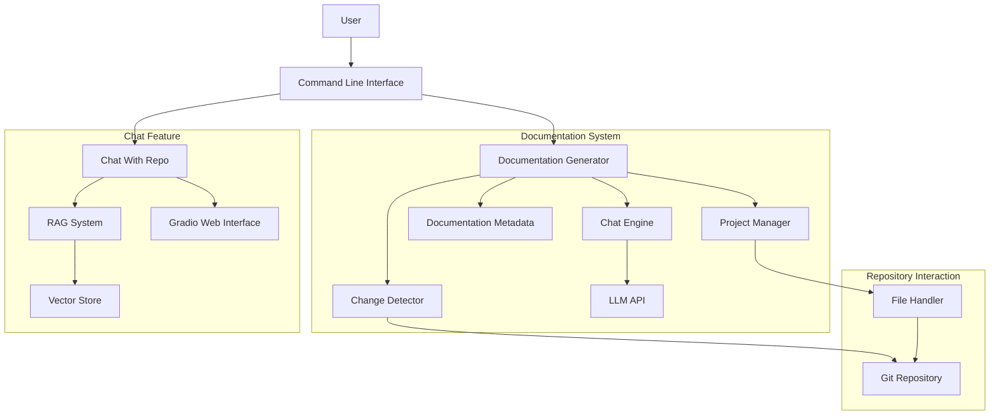
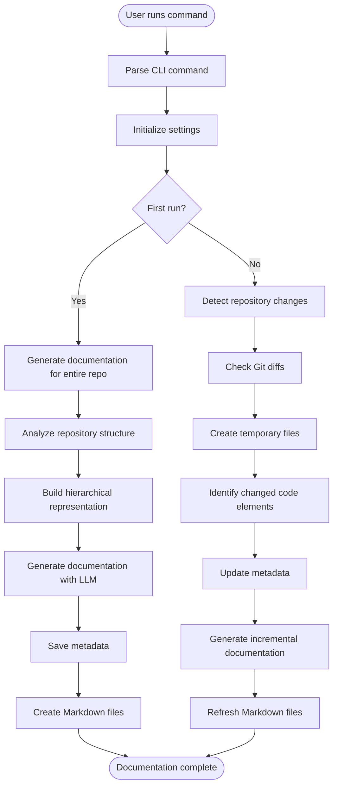
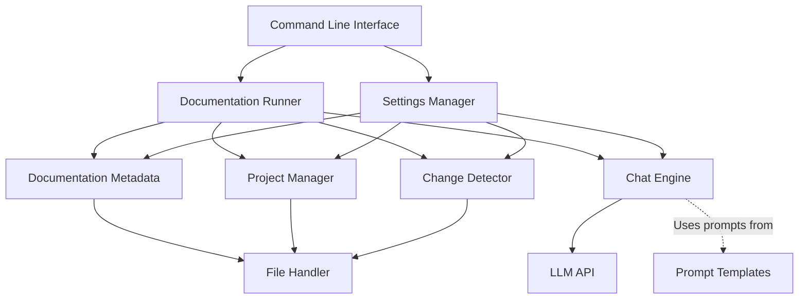
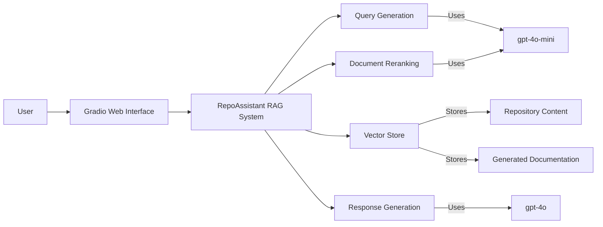

<!-- source: DeepWiki mcp.deepwiki.com · repo OpenBMB/RepoAgent · page 1 Overview · fetched 2026-10-26 -->

# Overview

<details>
<summary>Relevant source files</summary>

The following files were used as context for generating this wiki page:

- [README.md](README.md)
- [README_CN.md](README_CN.md)
- [assets/images/8_documents.png](assets/images/8_documents.png)
- [assets/images/Doc_example.png](assets/images/Doc_example.png)
- [assets/images/ExecutionResult.png](assets/images/ExecutionResult.png)
- [assets/images/RepoAgent.png](assets/images/RepoAgent.png)
- [repo_agent/chat_with_repo/__init__.py](repo_agent/chat_with_repo/__init__.py)

</details>


RepoAgent is an LLM-powered framework designed to automate repository-level code documentation generation. This system analyzes code repositories, understands their structure, generates comprehensive documentation using large language models (LLMs), and maintains that documentation as the codebase evolves. RepoAgent aims to solve the challenge of keeping technical documentation up-to-date with minimal manual effort.

This overview introduces the RepoAgent system architecture, core components, and operational workflows. For installation instructions, see [Installation and Setup](#1.1), and for a step-by-step guide on using the system, see [Quick Start Guide](#1.2).

Sources: [README.md:36-41](), [README.md:44-52]()

## System Architecture

RepoAgent is organized into two main functional systems:

1. **Documentation Generation System** - Analyzes repository structure and creates documentation
2. **Chat with Repository Feature** - Enables interactive querying of repository content

### High-Level Architecture



The system is designed with a clear separation of concerns, with specialized components for repository analysis, metadata management, change detection, and documentation generation.

Sources: [README.md:44-52]()

## Core Components

### Runner (Documentation Generator)

The central orchestrator of the documentation generation process. It coordinates between metadata management, change detection, and document generation.

### MetaInfo (Documentation Metadata)

Maintains the hierarchical structure of the repository and tracks documentation status of each code element. It is critical for both initial documentation and incremental updates.

### ChatEngine

Leverages LLMs to generate documentation for code elements. It constructs prompts containing context about the code and its relationships.

### ChangeDetector

Identifies modified files and code structures by analyzing Git diffs, enabling efficient incremental documentation updates.

### Project Manager

Responsible for analyzing and representing the hierarchical structure of a repository.

### Chat with Repo

A separate feature that allows interactive exploration of the codebase through a conversational interface using Retrieval-Augmented Generation (RAG).

Sources: [README.md:35-52]()

## Documentation Generation Workflow

RepoAgent supports two main workflows: initial documentation generation and incremental updates.



### Initial Documentation Process

1. **Repository Analysis**: The system scans the entire repository and builds a hierarchical representation of its structure.
2. **Documentation Generation**: The ChatEngine generates documentation for each code element using carefully crafted prompts for the LLM.
3. **Metadata Storage**: Information about the repository structure and documentation status is saved for future reference.
4. **Markdown Creation**: The generated documentation is formatted and saved as Markdown files.

### Incremental Update Process

1. **Change Detection**: The ChangeDetector identifies what has changed in the repository since the last documentation update.
2. **Metadata Update**: The metadata is updated to reflect the changes in the repository.
3. **Incremental Documentation**: The system only regenerates documentation for changed code elements.
4. **Markdown Refresh**: Only the affected Markdown files are updated.

Sources: [README.md:114-121](), [README.md:132-136]()

## Component Integration

The integration between components is designed to be loosely coupled, allowing for extensibility and maintainability.



The system uses a configuration-driven approach, with settings that control various aspects of the documentation generation process.

Sources: [README.md:124-134]()

## Chat with Repository Feature

The Chat with Repository feature provides an interactive interface for exploring and understanding the codebase through natural language queries.



This feature leverages different LLM models for various tasks in the RAG pipeline, using a lightweight model for query processing and document reranking, and a more powerful model for generating comprehensive responses.

Sources: [README.md:199-208](), [repo_agent/chat_with_repo/__init__.py:1-3]()

## Usage Patterns

RepoAgent is designed to be integrated into the development workflow, with several common usage patterns:

1. **Manual Documentation Generation**: Running the documentation generation command manually.
   ```
   repoagent run
   ```

2. **Pre-commit Hook Integration**: Automatically detecting and documenting changes during the git commit process.

3. **Repository Exploration**: Using the chat interface to ask questions about the codebase.
   ```
   repoagent chat-with-repo
   ```

### Command Line Options

The `run` command supports various options for customizing the documentation generation process:

| Option | Description | Default |
|--------|-------------|---------|
| `-m`, `--model` | Specifies the model to use for completion | `gpt-3.5-turbo` |
| `-t`, `--temperature` | Sets the generation temperature for the model | `0.2` |
| `-r`, `--request-timeout` | Defines the timeout in seconds for the API request | `60` |
| `-b`, `--base-url` | The base URL for the API calls | `https://api.openai.com/v1` |
| `-tp`, `--target-repo-path` | The file system path to the target repository | Current path |
| `-hp`, `--hierarchy-path` | The name or path for the project hierarchy file | `.project_doc_record` |
| `-mdp`, `--markdown-docs-path` | The folder path for Markdown documentation | `markdown_docs` |
| `-i`, `--ignore-list` | Files or directories to ignore | - |
| `-l`, `--language` | The ISO 639 code or language name for the documentation | `Chinese` |
| `-ll`, `--log-level` | Sets the logging level | `INFO` |

Sources: [README.md:124-134](), [README.md:138-143]()

## Integration with Development Workflow

RepoAgent can be integrated into the development workflow using Git's pre-commit hooks, enabling automatic documentation updates whenever code changes are committed.

### Pre-commit Hook Configuration

```yaml
repos:
  - repo: local
    hooks:
    - id: repo-agent
      name: RepoAgent
      entry: repoagent
      language: system
      pass_filenames: false
      types: [python]
```

This configuration triggers RepoAgent automatically during the commit process, ensuring that documentation remains in sync with code changes.

Sources: [README.md:156-174](), [README.md:178-188]()

## Key Features and Capabilities

RepoAgent offers several key capabilities that make it a powerful tool for code documentation:

1. **Automatic Change Detection**: Tracks additions, deletions, and modifications of files in Git repositories.
2. **Code Structure Analysis**: Uses AST (Abstract Syntax Tree) analysis to understand code structure.
3. **Bidirectional Relationship Identification**: Maps relationships between code objects for richer documentation.
4. **Seamless Markdown Updates**: Maintains documentation consistency with code changes.
5. **Multi-threaded Operation**: Enhances efficiency through concurrent processing.
6. **Team Collaboration Support**: Provides sustainable, automated documentation updates for teams.
7. **Visual Documentation Display**: Presents documentation in an appealing way using Gitbook.

Sources: [README.md:44-52]()

## Summary

RepoAgent represents a significant step forward in automating the creation and maintenance of code documentation. By leveraging LLMs and integrating with existing development workflows, it reduces the burden of documentation on development teams and helps maintain up-to-date, comprehensive documentation with minimal manual effort.

Sources: [README.md:36-41](), [README.md:195-197]()

---

