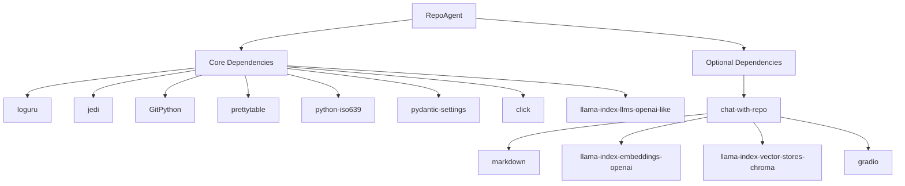
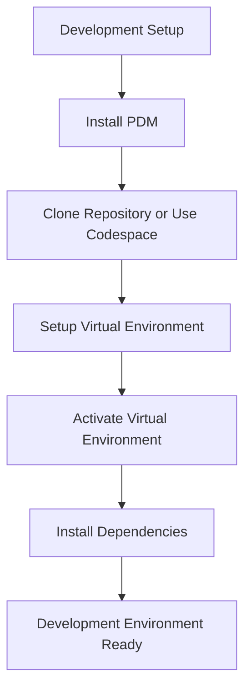
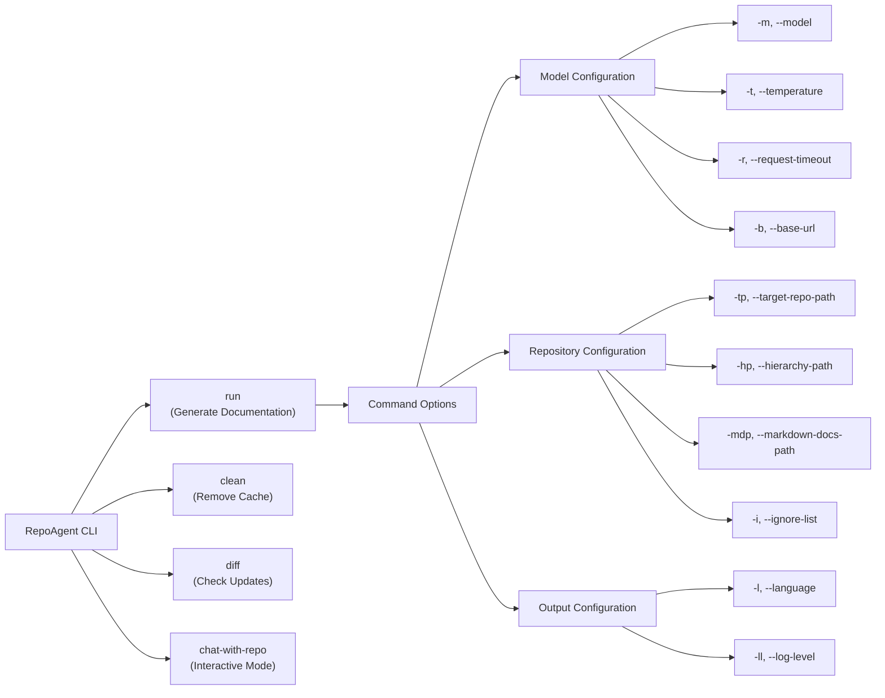
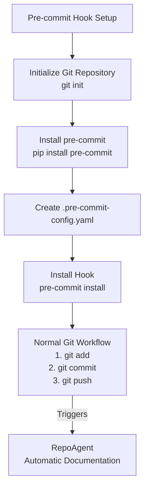

<!-- source: DeepWiki mcp.deepwiki.com · repo OpenBMB/RepoAgent · page 1.1 Installation and Setup · fetched 2026-10-26 -->

# Installation and Setup

<details>
<summary>Relevant source files</summary>

The following files were used as context for generating this wiki page:

- [README.md](README.md)
- [README_CN.md](README_CN.md)
- [pdm.lock](pdm.lock)
- [pyproject.toml](pyproject.toml)
- [repo_agent/chat_with_repo/__init__.py](repo_agent/chat_with_repo/__init__.py)
- [requirements.txt](requirements.txt)

</details>


This document provides detailed instructions for installing RepoAgent and configuring the necessary environment variables and settings. RepoAgent is an LLM-powered framework for automating repository-level code documentation generation. For information about using RepoAgent after installation, see the [Quick Start Guide](#1.2).

## System Requirements

RepoAgent requires:

* **Python**: 3.11 or higher (but less than 4.0)
* **Git**: Required for repository tracking and change detection
* **OpenAI API Key**: Or compatible LLM provider
* **Disk Space**: Sufficient for repository and documentation storage

## Core Dependencies

RepoAgent depends on several Python packages as defined in the project configuration:



Sources: [pyproject.toml:9-21](), [pyproject.toml:40-45]()

## Installation Methods

RepoAgent provides multiple installation methods, each suited for different use cases.

### Using pip (Recommended for Users)

This is the simplest method for most users who want to use RepoAgent without modifying its code.

1. Install the base package:
   ```bash
   pip install repoagent
   ```

2. Optional: Install with chat-with-repo support:
   ```bash
   pip install repoagent[chat-with-repo]
   ```

Sources: [README.md:64-68](), [README.md:205-208]()

### Using GitHub Actions

For automated documentation in CI/CD workflows:

1. Add the RepoAgent GitHub Action to your project.
2. See the GitHub Marketplace: [actions/run-repoagent](https://github.com/marketplace/actions/run-repoagent) for setup instructions.

Sources: [README.md:58-60]()

### Development Setup Using PDM

For contributors or those wanting to modify RepoAgent:



1. Install PDM following the [PDM installation guide](https://pdm-project.org/latest/#installation)
2. Get the code:
   - **Option A**: Use GitHub Codespace (easiest method)
     ```
     https://codespaces.new/OpenBMB/RepoAgent?quickstart=1
     ```
   - **Option B**: Clone the repository
     ```bash
     git clone https://github.com/OpenBMB/RepoAgent.git
     cd RepoAgent
     ```
3. Setup the Python virtual environment:
   ```bash
   pdm venv create --name repoagent
   ```
4. Activate the virtual environment (platform-specific)
5. Install dependencies:
   ```bash
   pdm install
   ```

Sources: [README.md:70-103]()

## Configuration

### Setting up API Key

Before using RepoAgent, you **must** configure the OpenAI API key as an environment variable:

```bash
# On Linux/Mac
export OPENAI_API_KEY=YOUR_API_KEY

# On Windows (Command Prompt)
set OPENAI_API_KEY=YOUR_API_KEY

# On Windows (PowerShell)
$Env:OPENAI_API_KEY = "YOUR_API_KEY"
```

Sources: [README.md:106-113]()

### Command Line Options

RepoAgent provides several command-line options to customize its behavior:



The following options are available:

| Option | Flag | Description | Default Value |
|--------|------|-------------|---------------|
| Model | `-m`, `--model` | LLM model for completion | `gpt-3.5-turbo` |
| Temperature | `-t`, `--temperature` | Generation temperature | `0.2` |
| Request Timeout | `-r`, `--request-timeout` | API request timeout (seconds) | `60` |
| Base URL | `-b`, `--base-url` | API base URL | `https://api.openai.com/v1` |
| Target Repo Path | `-tp`, `--target-repo-path` | Path to target repository | Current directory |
| Hierarchy Path | `-hp`, `--hierarchy-path` | Project hierarchy file path | `.project_doc_record` |
| Markdown Docs Path | `-mdp`, `--markdown-docs-path` | Documentation output folder | `markdown_docs` |
| Ignore List | `-i`, `--ignore-list` | Files/directories to ignore | None |
| Language | `-l`, `--language` | Documentation language | `Chinese` |
| Log Level | `-ll`, `--log-level` | Logging level | `INFO` |

Example usage:
```bash
repoagent run --model gpt-4-turbo --temperature 0.3 --language English
```

Sources: [README.md:115-135]()

## Verification of Installation

Verify your installation with these commands:

```bash
# Generate documentation for current repository
repoagent run

# Show repository structure as parsed by RepoAgent
repoagent run --print-hierarchy

# Check what documentation will be updated based on recent changes
repoagent diff

# Remove RepoAgent-related cache files
repoagent clean
```

If you installed the chat-with-repo feature:
```bash
# Start interactive chat interface
repoagent chat-with-repo
```

Sources: [README.md:118-121](), [README.md:135-141](), [README.md:205-208]()

## Setting Up Pre-commit Hook

For automatic documentation updates with each commit, set up RepoAgent as a pre-commit hook:



1. Initialize your repository (if not already done):
   ```bash
   git init
   ```

2. Install pre-commit:
   ```bash
   pip install pre-commit
   ```

3. Create a `.pre-commit-config.yaml` file in your repository root:
   ```yaml
   repos:
     - repo: local
       hooks:
       - id: repo-agent
         name: RepoAgent
         entry: repoagent
         language: system
         pass_filenames: false
         types: [python]
   ```

4. Install the hook:
   ```bash
   pre-commit install
   ```

Now RepoAgent will automatically run when you commit changes, detecting modifications and generating appropriate documentation.

Sources: [README.md:147-187]()

## Troubleshooting

If you encounter issues:

1. **API Key Issues**: Verify your API key is correctly set as an environment variable
2. **Dependencies Problems**: Ensure all dependencies are installed with the correct versions
3. **Git Setup**: Verify that your repository is a valid Git repository
4. **Pre-commit Hook**: Check the hook is properly installed in `.git/hooks/`

If problems persist, check the GitHub repository for open issues or create a new one.

Sources: [README.md:106-113](), [README.md:146-182]()

---

