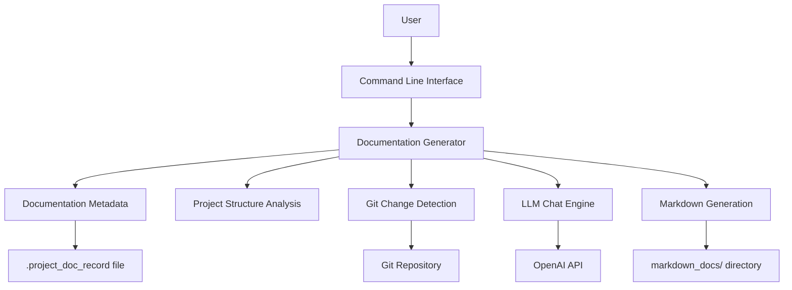
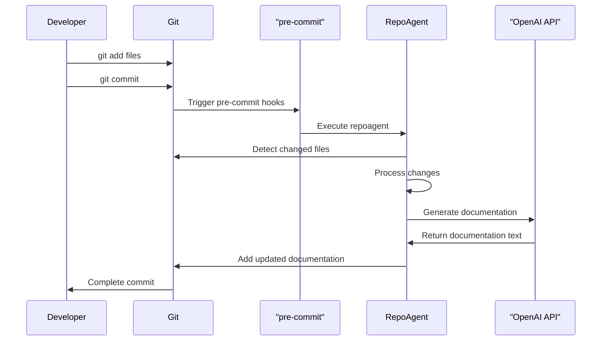

<!-- source: DeepWiki mcp.deepwiki.com · repo OpenBMB/RepoAgent · page 1.2 Quick Start Guide · fetched 2026-10-26 -->

# Quick Start Guide

<details>
<summary>Relevant source files</summary>

The following files were used as context for generating this wiki page:

- [README.md](README.md)
- [README_CN.md](README_CN.md)
- [repo_agent/chat_with_repo/__init__.py](repo_agent/chat_with_repo/__init__.py)
- [repo_agent/main.py](repo_agent/main.py)
- [repo_agent/settings.py](repo_agent/settings.py)

</details>


This guide provides step-by-step instructions for getting started with RepoAgent. You'll learn how to install the tool, configure your environment, generate documentation for a repository, and set up automatic documentation updates using pre-commit hooks. This page focuses on basic usage; for detailed information about the underlying architecture, see [Core Architecture](#2).

## Installation

RepoAgent can be installed using pip, which is the recommended method for most users.

```bash
pip install repoagent
```

If you want to use the Chat with Repository feature, install with:

```bash
pip install repoagent[chat-with-repo]
```

For developers who wish to contribute to RepoAgent, you can set up a development environment using PDM:

```bash
git clone https://github.com/OpenBMB/RepoAgent.git
cd RepoAgent
pdm venv create --name repoagent
# Activate virtual environment (platform specific)
pdm install
```

Sources: [README.md:62-92]()

## Environment Configuration

Before using RepoAgent, you need to configure your OpenAI API key:

```bash
# For Linux/Mac
export OPENAI_API_KEY=YOUR_API_KEY

# For Windows (Command Prompt)
set OPENAI_API_KEY=YOUR_API_KEY

# For Windows (PowerShell)
$Env:OPENAI_API_KEY = "YOUR_API_KEY"
```

Sources: [README.md:106-113]()

## Basic Usage

### Generating Documentation

The primary command for generating documentation is `repoagent run`. By default, this will analyze the current repository and generate comprehensive documentation.

```bash
repoagent run
```

On first run, this command will:
1. Analyze the repository structure
2. Create a JSON file to store metadata (`.project_doc_record` by default)
3. Generate documentation for the entire repository
4. Save the documentation in Markdown format (in `markdown_docs` directory by default)

For subsequent runs, RepoAgent will detect changes and only update the documentation for modified files.

Sources: [README.md:118-134](), [repo_agent/main.py:47-182]()

### Documentation Generation Workflow

```mermaid
flowchart TD
    Start([User runs "repoagent run"]) --> CheckFirstRun{"First run?"}
    
    CheckFirstRun -->|"Yes"| InitialSetup["Create metadata storage"]
    InitialSetup --> FullAnalysis["Analyze entire repository"]
    FullAnalysis --> GenerateAllDocs["Generate documentation for all files"]
    GenerateAllDocs --> SaveOutput["Save to markdown_docs directory"]
    
    CheckFirstRun -->|"No"| DetectChanges["Detect repository changes"]
    DetectChanges --> Changed{"Changes detected?"}
    Changed -->|"Yes"| PartialUpdate["Update documentation for changed files"]
    Changed -->|"No"| NoAction["No action needed"]
    PartialUpdate --> SaveOutput
    NoAction --> End
    
    SaveOutput --> End([Documentation complete])
```

Sources: [README.md:118-134](), [repo_agent/main.py:140-182]()

## Command Options

The `run` command supports several options for customization:

| Option | Flag | Default | Description |
|--------|------|---------|-------------|
| Model | `-m, --model` | `gpt-4o-mini` | Specifies the LLM to use |
| Temperature | `-t, --temperature` | `0.2` | Controls randomness in generation |
| Request timeout | `-r, --request-timeout` | `60` | API request timeout in seconds |
| Base URL | `-b, --base-url` | `https://api.openai.com/v1` | API endpoint URL |
| Target repo path | `-tp, --target-repo-path` | Current directory | Path to repository |
| Hierarchy path | `-hp, --hierarchy-path` | `.project_doc_record` | Path for metadata file |
| Markdown docs path | `-mdp, --markdown-docs-path` | `markdown_docs` | Output directory |
| Ignore list | `-i, --ignore-list` | Empty | Comma-separated files/directories to ignore |
| Language | `-l, --language` | `English` | Documentation language |
| Max thread count | `-mtc, --max-thread-count` | `4` | Parallel execution threads |
| Log level | `-ll, --log-level` | `INFO` | Logging verbosity |
| Print hierarchy | `-pr, --print-hierarchy` | `False` | Print repository structure |

Example with options:

```bash
repoagent run --model gpt-4o --temperature 0.1 --language Chinese --ignore-list "tests,docs"
```

Sources: [repo_agent/main.py:47-153](), [repo_agent/settings.py:26-55](), [README.md:125-135]()

## System Components and Data Flow



Sources: [repo_agent/main.py:174-182]()

## Additional Commands

RepoAgent provides several other useful commands:

### Check Pending Documentation Updates

```bash
repoagent diff
```

This shows which documents will be updated based on your current code changes without actually generating them.

### Clean Temporary Files

```bash
repoagent clean
```

Removes temporary files created during the documentation process.

### Interactive Repository Chat

```bash
repoagent chat-with-repo
```

Starts an interactive chat session for querying and exploring the repository (requires installing with `repoagent[chat-with-repo]`).

Sources: [repo_agent/main.py:184-239](), [README.md:136-139](), [README.md:198-207]()

## Automatic Documentation with Pre-commit Hooks

You can integrate RepoAgent with Git to automatically update documentation when committing changes:

1. Ensure your target repository is a Git repository:
   ```bash
   git init
   ```

2. Install pre-commit:
   ```bash
   pip install pre-commit
   ```

3. Create a `.pre-commit-config.yaml` file in your repository root:
   ```yaml
   repos:
     - repo: local
       hooks:
       - id: repo-agent
         name: RepoAgent
         entry: repoagent
         language: system
         pass_filenames: false
         types: [python]
   ```

4. Install the hook:
   ```bash
   pre-commit install
   ```

Now, each time you commit changes, RepoAgent will automatically generate or update documentation for the modified files.



Sources: [README.md:140-183]()

## Configuration File

Instead of specifying options on the command line, you can configure RepoAgent through environment variables following the pydantic settings format.

Common environment variables you might want to set:

```bash
# OpenAI API settings
export OPENAI_API_KEY=your_api_key
export CHAT_COMPLETION_MODEL=gpt-4o
export CHAT_COMPLETION_TEMPERATURE=0.1

# Project settings
export PROJECT_LANGUAGE=English
export PROJECT_IGNORE_LIST=tests,docs,examples
```

Sources: [repo_agent/settings.py:26-67]()

## Next Steps

After generating documentation for your repository, you can:

1. Explore the documentation in the `markdown_docs` directory
2. Share the documentation with your team
3. Set up pre-commit hooks for automatic updates
4. Customize the documentation generation process with different models or settings
5. Use the chat-with-repo feature to interactively explore the repository

For more information about the core architecture and components of RepoAgent, see [Core Architecture](#2) and [Key Components](#3).

---

