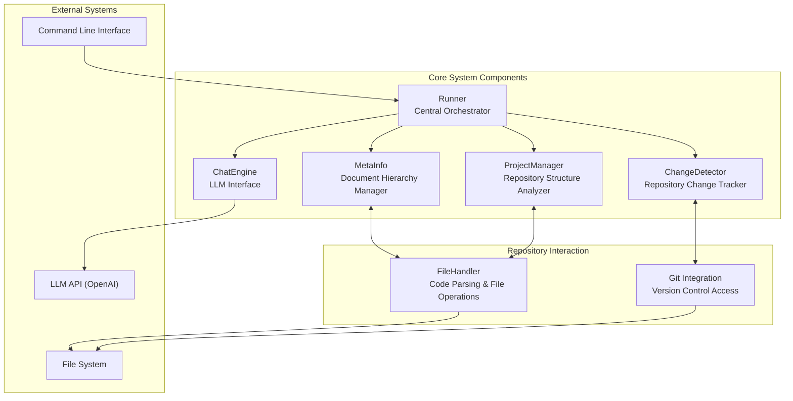
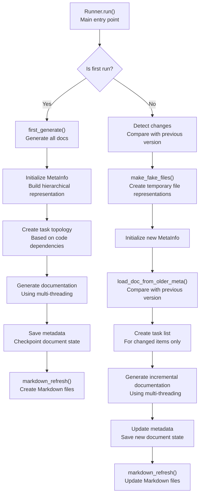
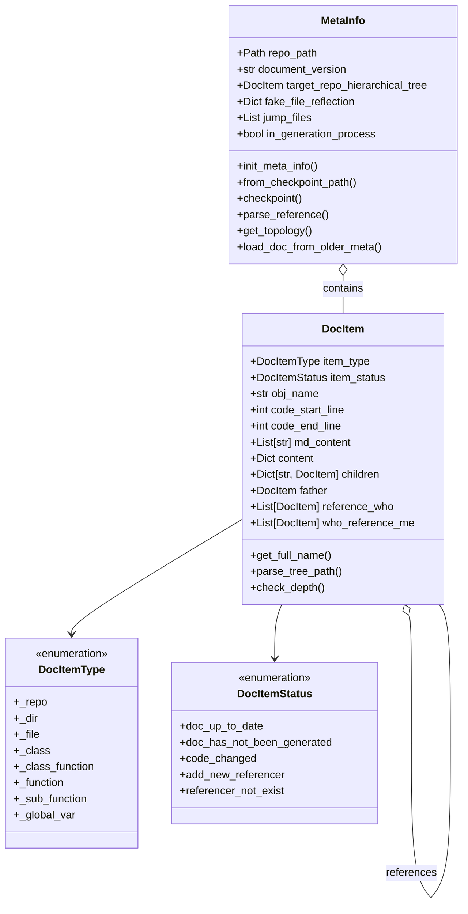
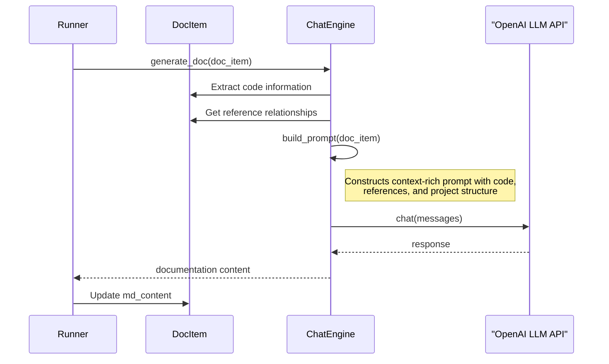
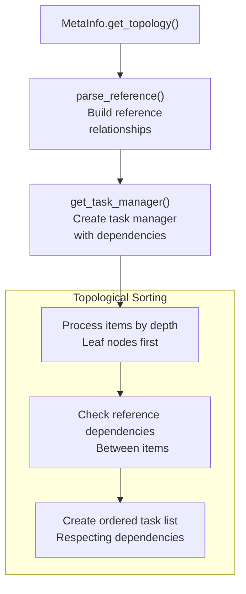
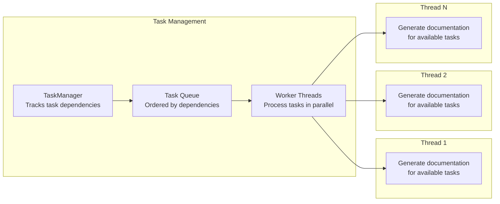
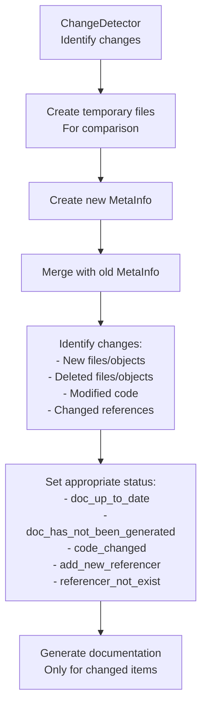
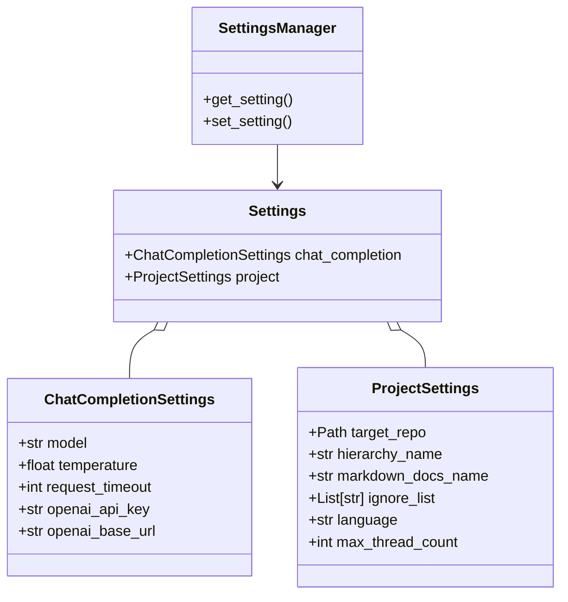
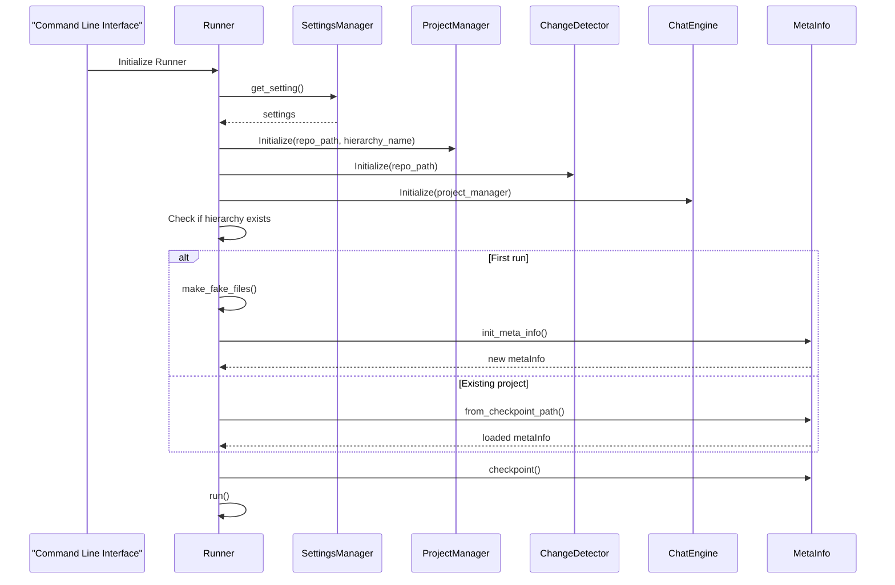

<!-- source: DeepWiki mcp.deepwiki.com · repo OpenBMB/RepoAgent · page 2 Core Architecture · fetched 2026-10-26 -->

# Core Architecture

<details>
<summary>Relevant source files</summary>

The following files were used as context for generating this wiki page:

- [README.md](README.md)
- [README_CN.md](README_CN.md)
- [repo_agent/chat_engine.py](repo_agent/chat_engine.py)
- [repo_agent/chat_with_repo/__init__.py](repo_agent/chat_with_repo/__init__.py)
- [repo_agent/doc_meta_info.py](repo_agent/doc_meta_info.py)
- [repo_agent/runner.py](repo_agent/runner.py)

</details>


This document provides a comprehensive overview of RepoAgent's architectural design and core systems. It describes the high-level components, their responsibilities, and how they interact to generate documentation for code repositories using Large Language Models (LLMs). For specific details about the documentation generation process, see [Documentation Generation System](#2.1). For information about how the system tracks documentation state, see [Metadata Management](#2.2).

## System Overview

RepoAgent is designed around a modular architecture that separates concerns between repository analysis, documentation generation, and change detection. The system is built to efficiently generate documentation for entire repositories and to update documentation incrementally as code changes occur.



Sources: [repo_agent/runner.py:24-39](). [repo_agent/doc_meta_info.py:25-56](). [repo_agent/chat_engine.py:9-25]().

## Component Responsibilities

### Runner - Central Orchestrator

The Runner is the central component that coordinates the entire documentation generation process. It orchestrates the workflow between all other components and manages both initial full-repository documentation and incremental updates.

Key responsibilities:
- Initializing all system components
- Managing the documentation generation workflow
- Coordinating multi-threaded documentation tasks
- Refreshing Markdown output files
- Handling Git integration for detecting and committing changes



Sources: [repo_agent/runner.py:259-343](). [repo_agent/runner.py:101-156]().

### MetaInfo - Documentation Hierarchy Manager

The MetaInfo system maintains the hierarchical representation of the repository and tracks the documentation status of each code element. It's critical for both building the initial structure and managing incremental updates.

Key responsibilities:
- Representing the repository structure as a hierarchical tree
- Tracking documentation status (up-to-date, changed, etc.)
- Managing bidirectional reference relationships between code elements
- Determining the topological order for documentation generation
- Persisting metadata between runs



Sources: [repo_agent/doc_meta_info.py:24-135](). [repo_agent/doc_meta_info.py:327-1019]().

### ChatEngine - LLM Interface

The ChatEngine interfaces with Large Language Models (LLMs) to generate documentation for code elements. It constructs context-rich prompts containing information about the code and its relationships.

Key responsibilities:
- Building prompts with appropriate context about code elements
- Managing API calls to the LLM
- Handling response processing and error handling



Sources: [repo_agent/chat_engine.py:9-25](). [repo_agent/chat_engine.py:116-132]().

### Change Detection System

The Change Detection system identifies changes in the repository by analyzing Git diffs and determines which documentation needs to be updated.

Key responsibilities:
- Accessing Git repository information
- Detecting file additions, modifications, and deletions
- Identifying changed code elements within files
- Determining which documentation needs to be regenerated

```mermaid
flowchart TD
    subgraph "Change Detection Process"
        StartRun["Runner.run()"]
        CheckFirst{"First run?"}
        MakeFake["make_fake_files()
        Create temporary representations"]
        InitNew["MetaInfo.init_meta_info()
        Create new hierarchical structure"]
        LoadOld["load_doc_from_older_meta()
        Merge with previous version"]
        
        StartRun --> CheckFirst
        CheckFirst -->|"No"| MakeFake
        MakeFake --> InitNew
        InitNew --> LoadOld
        
        subgraph "Change Identification"
            CompareCode["Compare code content
            Check if source code modified"]
            CompareRefs["Compare references
            Check if references changed"]
            MarkChanges["Mark items for regeneration
            Set appropriate DocItemStatus"]
        end
        
        LoadOld --> CompareCode
        CompareCode --> CompareRefs
        CompareRefs --> MarkChanges
    end
```



Sources: [repo_agent/runner.py:277-299](). [repo_agent/doc_meta_info.py:716-806]().

## System Architecture Patterns

RepoAgent's architecture follows several important design patterns:

### Hierarchical Tree Representation

The system represents the repository as a hierarchical tree structure, with the repository as the root node, followed by directories, files, classes, and methods/functions. This structure enables efficient navigation and maintenance of parent-child relationships.

```mermaid
graph TD
    Repo["Repository Root"] --> Dir1["Directory"]
    Repo --> Dir2["Directory"]
    Dir1 --> File1["Python File"]
    Dir1 --> File2["Python File"]
    File1 --> Class1["Class"]
    File1 --> Func1["Function"]
    Class1 --> Method1["Method"]
    Class1 --> Method2["Method"]
    
    classDef repo fill:#f9f,stroke:#333;
    classDef dir fill:#afa,stroke:#333;
    classDef file fill:#aaf,stroke:#333;
    classDef class fill:#faa,stroke:#333;
    classDef func fill:#ffa,stroke:#333;
```

Sources: [repo_agent/doc_meta_info.py:110-226](). [repo_agent/doc_meta_info.py:873-1019]().

### Topological Dependency Resolution

RepoAgent uses a topological sorting approach to determine the order in which documentation should be generated, ensuring that dependencies (such as references between code elements) are respected.



Sources: [repo_agent/doc_meta_info.py:698-704](). [repo_agent/doc_meta_info.py:617-696]().

### Concurrent Task Processing

For efficient documentation generation, RepoAgent employs a multi-threaded approach to process documentation tasks concurrently.



Sources: [repo_agent/runner.py:120-135](). [repo_agent/runner.py:321-335]().

### Incremental Generation

Rather than regenerating all documentation when changes occur, RepoAgent implements an incremental approach that only updates documentation for changed code elements and their dependents.



Sources: [repo_agent/runner.py:277-343](). [repo_agent/doc_meta_info.py:716-806]().

## System Configuration

The system is configured through a Settings Manager that maintains configuration for various components, including API keys, model parameters, and repository paths.



Sources: [repo_agent/chat_engine.py:15-25](). [repo_agent/runner.py:26-40]().

## Integration with External Systems

RepoAgent integrates with several external systems:

1. **Git Version Control**: For detecting repository changes and tracking document versions
2. **OpenAI API**: For generating documentation using LLMs
3. **File System**: For reading code files and writing documentation 

This integration enables automatic documentation generation triggered by code changes and ensures documentation remains synchronized with the codebase.

## System Initialization Flow



Sources: [repo_agent/runner.py:25-55](). [repo_agent/runner.py:259-276]().

## Conclusion

RepoAgent's core architecture is designed around modular components with clear separation of concerns. The system efficiently manages the complexity of repository-level code documentation through its hierarchical representation, reference tracking, and incremental update capabilities. The architecture supports both full repository documentation generation and efficient incremental updates as code changes occur.

This design enables RepoAgent to scale to large repositories while maintaining documentation accuracy and freshness with minimal computational overhead. The system's integration with Git allows it to automatically detect changes and update documentation as part of the normal development workflow.

---

