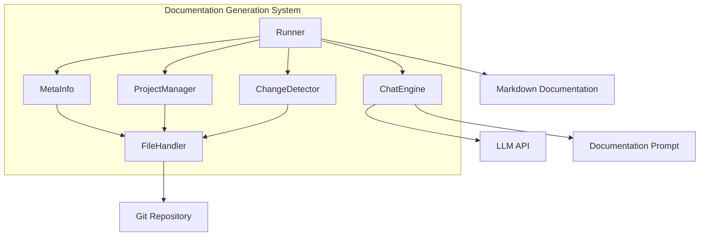
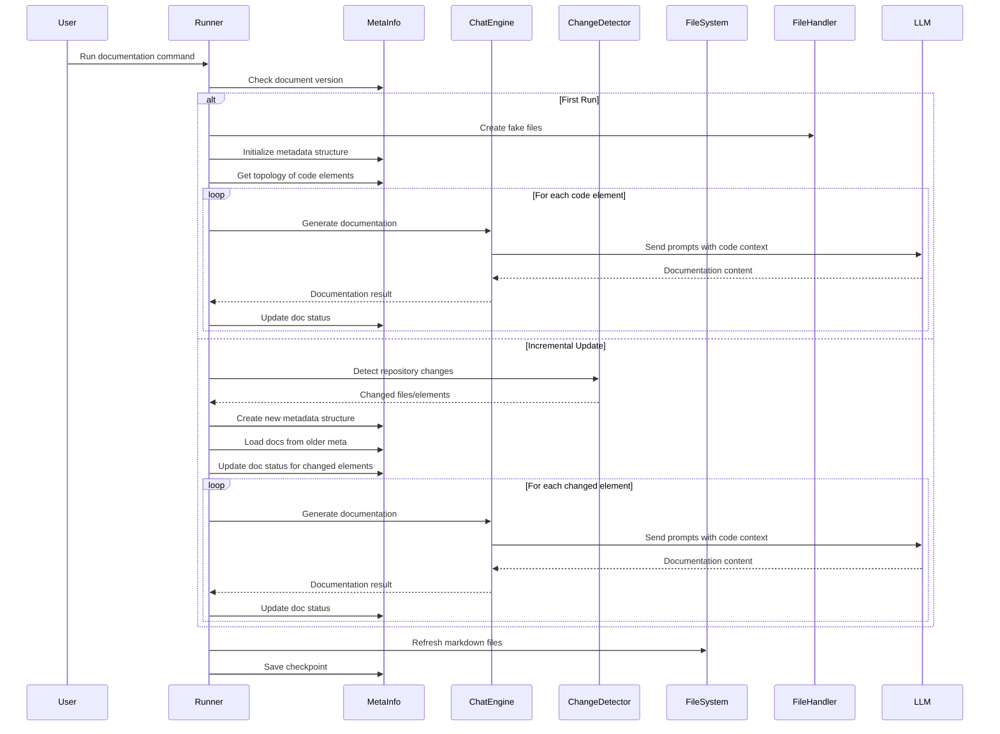
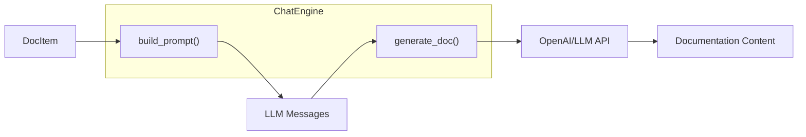
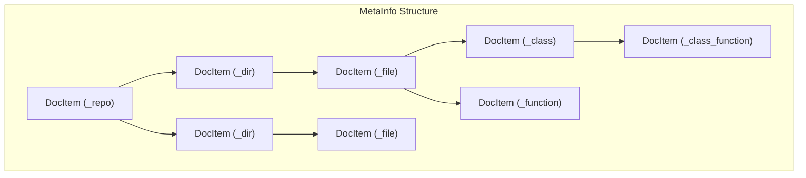

<!-- source: DeepWiki mcp.deepwiki.com · repo OpenBMB/RepoAgent · page 2.1 Documentation Generation System · fetched 2026-10-26 -->

# Documentation Generation System

<details>
<summary>Relevant source files</summary>

The following files were used as context for generating this wiki page:

- [repo_agent/chat_engine.py](repo_agent/chat_engine.py)
- [repo_agent/doc_meta_info.py](repo_agent/doc_meta_info.py)
- [repo_agent/prompt.py](repo_agent/prompt.py)
- [repo_agent/runner.py](repo_agent/runner.py)

</details>


The Documentation Generation System is a core component of RepoAgent that automates the creation of documentation for code repositories using Large Language Models (LLMs). This system processes code files, extracts structural information, identifies relationships between code elements, and generates detailed documentation for each component. It supports both full repository documentation and incremental updates when code changes occur.

For information about how the system manages code changes and updates documentation accordingly, see [Change Detection System](#2.3). For details on metadata management, see [Metadata Management](#2.2).

## System Architecture

The Documentation Generation System consists of several interconnected components that work together to analyze code and generate documentation.



Sources: [repo_agent/runner.py:25-58](), [repo_agent/chat_engine.py:9-26]()

## Documentation Generation Process

The system handles two primary scenarios: initial documentation generation for a repository and incremental updates when code changes occur.



Sources: [repo_agent/runner.py:101-151](), [repo_agent/runner.py:259-344]()

### Initial Documentation Generation

When the system runs for the first time on a repository, it analyzes the entire codebase, builds a hierarchical representation, and generates documentation for all code elements.

1. The system creates a hierarchical representation of the repository
2. It analyzes code elements (files, classes, functions) to detect relationships
3. Documentation is generated using the LLM in a topologically sorted order (from dependencies to dependents)
4. Metadata is saved to track the documentation status of each element
5. Markdown documentation files are created

Sources: [repo_agent/runner.py:101-151]()

### Incremental Documentation Updates

For subsequent runs, the system detects changes in the repository and only generates documentation for modified elements.

1. The system detects repository changes using Git diffs
2. It identifies which code elements have been added, modified, or deleted
3. Documentation is regenerated only for changed elements and elements affected by changes
4. Metadata is updated to reflect the current state of documentation
5. Markdown files are refreshed with the updated content

Sources: [repo_agent/runner.py:259-344]()

## Core Components

### Runner

The Runner is the central orchestrator of the documentation generation process.

**Key Responsibilities:**
- Initializes and coordinates other components
- Manages the documentation generation workflow
- Processes files and code elements
- Handles both initial and incremental documentation generation
- Creates and refreshes markdown documentation files

The Runner manages a task-based system to handle documentation generation in parallel using multiple threads.

Sources: [repo_agent/runner.py:25-58](), [repo_agent/runner.py:101-151](), [repo_agent/runner.py:259-344]()

### ChatEngine

The ChatEngine interfaces with Large Language Models to generate documentation for code elements.



**Key Features:**
- Constructs context-rich prompts for the LLM
- Includes code content, references, and project structure
- Handles LLM API communication
- Formats documentation according to templates

The ChatEngine builds prompts that include:
- The code content of the element being documented
- References to other code elements it calls or is called by
- Project structure context
- Documentation formatting guidelines

Sources: [repo_agent/chat_engine.py:9-133](), [repo_agent/prompt.py:1-50]()

### Documentation Metadata (MetaInfo)

The MetaInfo component manages metadata about documentation and code relationships.



**Key Features:**
- Maintains a hierarchical representation of the repository
- Tracks documentation status of each code element
- Manages reference relationships between code elements
- Handles checkpointing and loading of metadata

The MetaInfo uses DocItem objects to represent code elements, with properties such as:
- Item type (repository, directory, file, class, function)
- Documentation status (up-to-date, needs generation, code changed)
- Code content and references
- Documentation content

Sources: [repo_agent/doc_meta_info.py:25-54](), [repo_agent/doc_meta_info.py:77-83](), [repo_agent/doc_meta_info.py:110-294](), [repo_agent/doc_meta_info.py:326-1026]()

### Change Detection

The ChangeDetector component identifies changes in the repository and determines which code elements need documentation updates.

**Key Operations:**
- Detects file changes using Git diffs
- Identifies modifications to specific code elements
- Determines which documentation needs to be regenerated
- Supports incremental documentation updates

Sources: [repo_agent/runner.py:257-344]()

## Documentation Generation with LLMs

The system uses LLMs to generate documentation by constructing context-rich prompts.

### Prompt Construction

The ChatEngine builds prompts that include:

1. Code context
   - The code content of the element being documented
   - Code location and type information
   
2. Reference information
   - Other code elements that reference this element
   - Elements that this element references
   
3. Documentation guidelines
   - Format specifications
   - Content requirements

```
Table: Prompt Components

| Component              | Description                                   | Source                        |
|------------------------|-----------------------------------------------|-------------------------------|
| Code Content           | Raw code of the element being documented      | DocItem content               |
| Code Type              | Type of code element (class, function)        | DocItem item_type             |
| References             | Elements that reference or are referenced     | DocItem reference_who/who_reference_me |
| Project Structure      | Hierarchical structure of the project         | MetaInfo tree                 |
| Documentation Format   | Format guidelines for consistency             | Prompt template               |
```

Sources: [repo_agent/chat_engine.py:27-115](), [repo_agent/prompt.py:4-39]()

### Documentation Output

The documentation generated by the system is formatted in Markdown and includes:

1. Function/class purpose description
2. Parameter details
3. Code description
4. Usage notes
5. Return value examples (when applicable)
6. Reference relationships

The system generates documentation files that mirror the structure of the repository, with each Python file having a corresponding Markdown documentation file.

Sources: [repo_agent/runner.py:157-248]()

## Integration with Repository Management

The Documentation Generation System integrates with Git to:

1. Detect changes in the repository
2. Track documentation versions
3. Handle incremental updates efficiently
4. Support documentation versioning aligned with code commits

This integration enables the system to maintain documentation that stays in sync with the codebase as it evolves.

Sources: [repo_agent/runner.py:250-256](), [repo_agent/runner.py:259-344]()

## Conclusion

The Documentation Generation System provides a sophisticated approach to automating code documentation using LLMs. By analyzing repository structure, code relationships, and changes over time, it generates comprehensive documentation that remains synchronized with the codebase. The system's modular architecture and incremental update capabilities make it efficient and adaptable for various repository sizes and structures.

---

