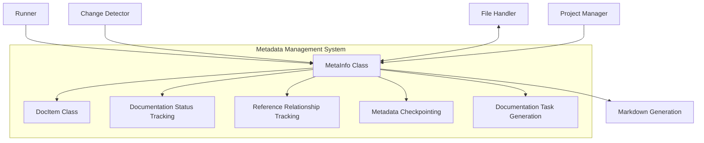
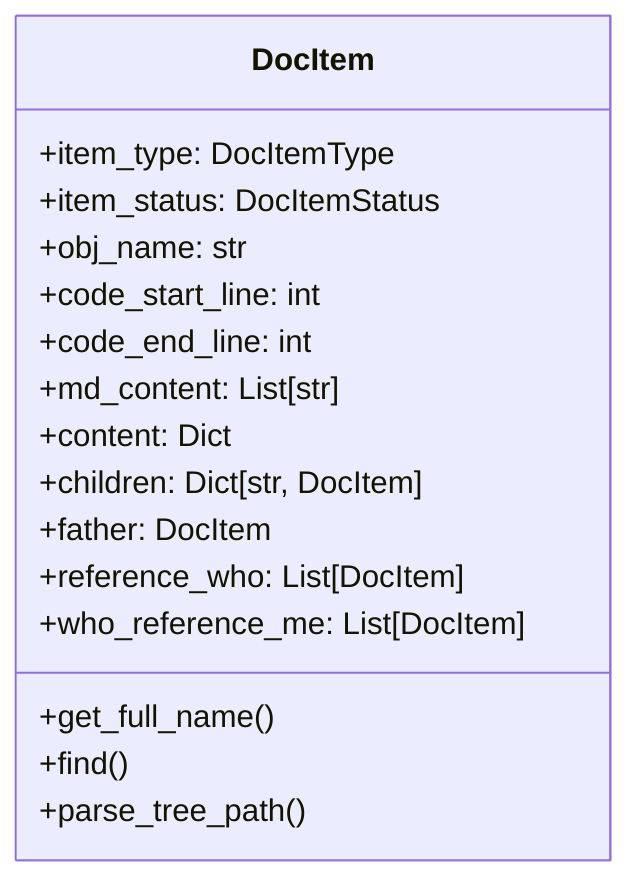
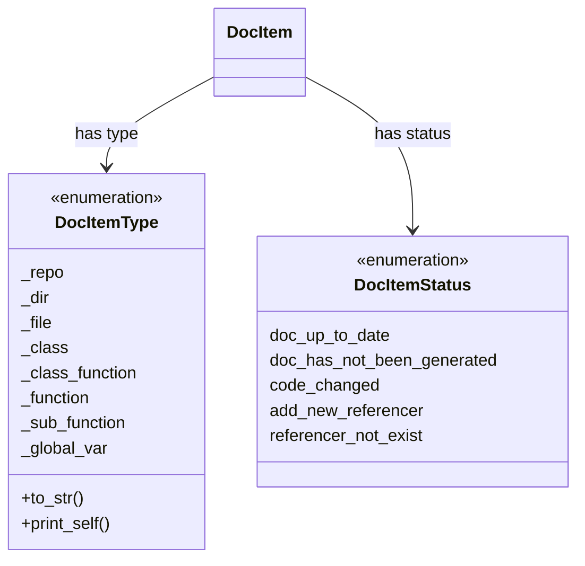
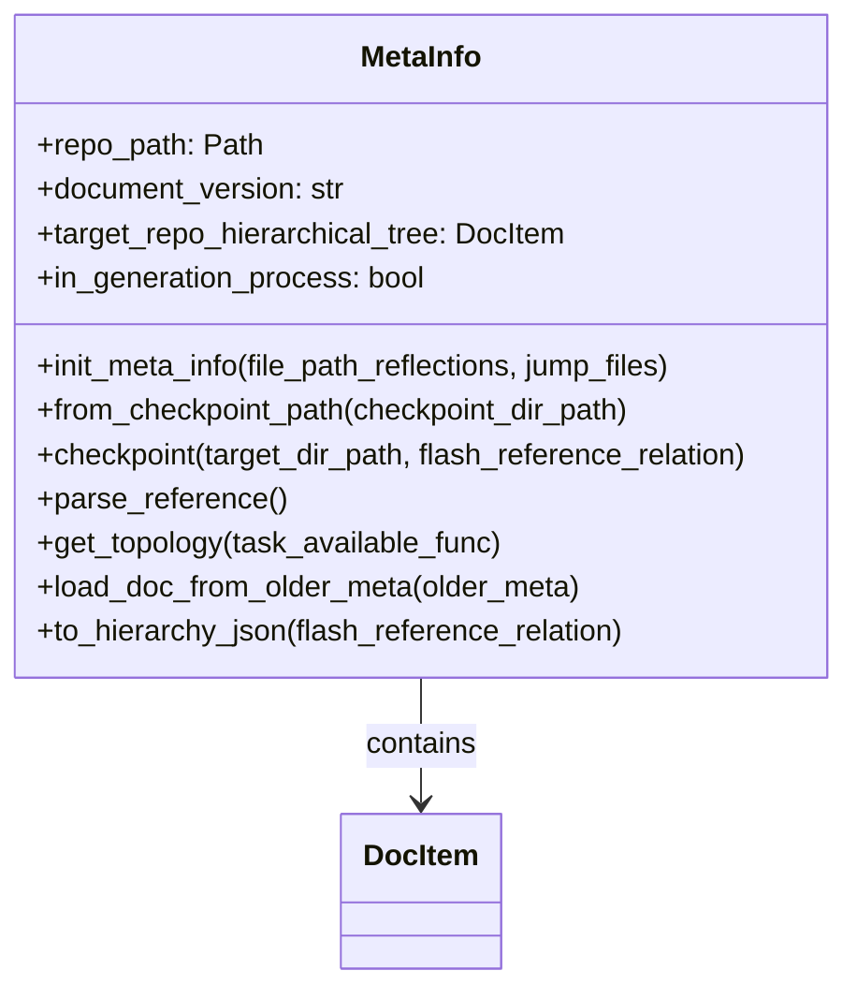
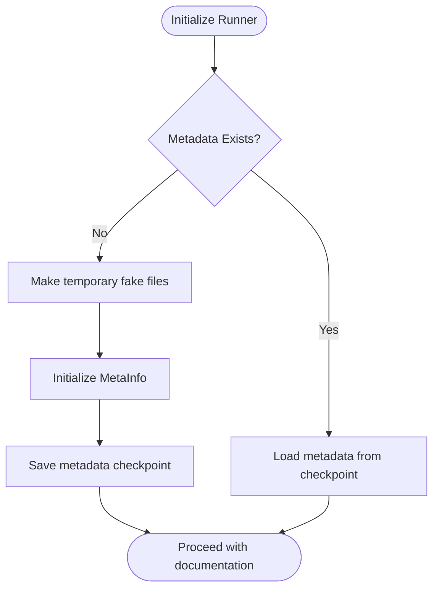
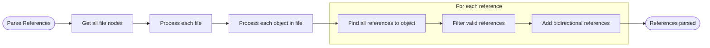
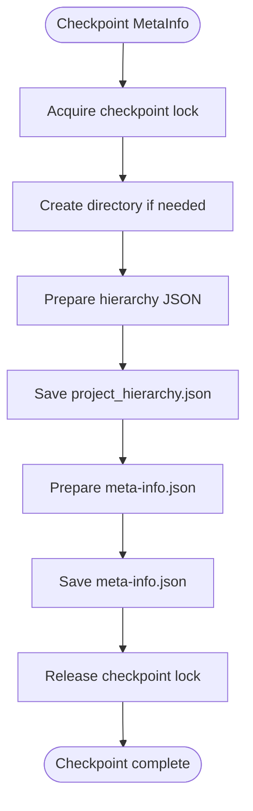
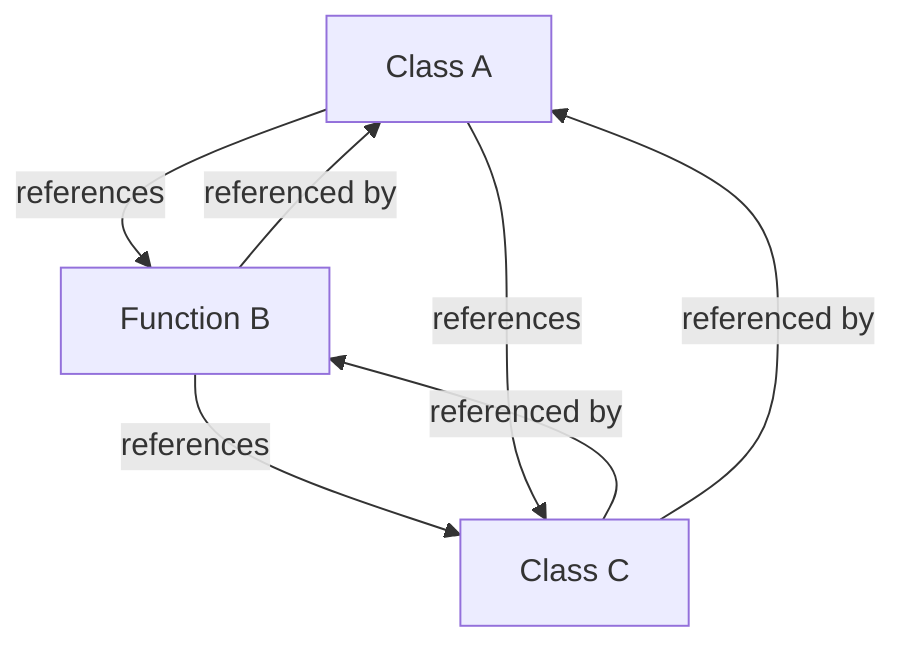
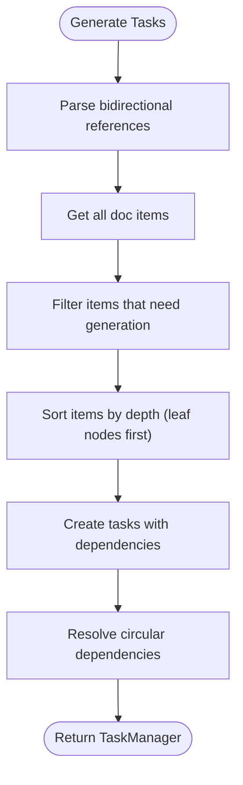
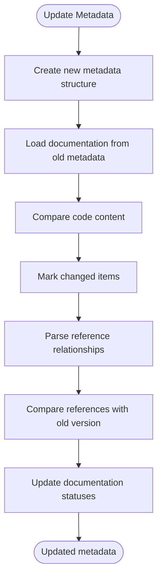

<!-- source: DeepWiki mcp.deepwiki.com · repo OpenBMB/RepoAgent · page 2.2 Metadata Management · fetched 2026-10-26 -->

# Metadata Management

<details>
<summary>Relevant source files</summary>

The following files were used as context for generating this wiki page:

- [repo_agent/doc_meta_info.py](repo_agent/doc_meta_info.py)
- [repo_agent/runner.py](repo_agent/runner.py)

</details>


The Metadata Management system in RepoAgent tracks the hierarchical structure of code repositories, maintains documentation status for code elements, and manages reference relationships between components. This core subsystem allows RepoAgent to efficiently generate and update documentation by tracking what needs to be updated when code changes.

For information about detecting changes in a repository, see [Change Detection System](#2.3). For information about how the repository's structure is analyzed, see [Project Structure Management](#2.4).

## Overview of Metadata Management

The Metadata Management system serves the following key purposes:

1. Represents the repository's hierarchical structure as a tree
2. Tracks documentation status of each code element
3. Manages bidirectional references between code elements
4. Facilitates incremental documentation updates by tracking changes
5. Provides checkpointing for persistent storage of metadata



Sources: [repo_agent/doc_meta_info.py:326-442](). [repo_agent/runner.py:24-56]()

## Core Metadata Classes

The Metadata Management system is built around several key classes and enums that work together to represent and track a repository's structure and documentation status.

### DocItem Class

`DocItem` is the fundamental building block that represents any element in the repository - from the repository itself down to individual functions and variables. It creates a hierarchical tree structure mirroring the repository organization.



Sources: [repo_agent/doc_meta_info.py:110-226]()

### DocItemType and DocItemStatus

The system uses enumerations to track the type and status of each documentation item:



Sources: [repo_agent/doc_meta_info.py:25-83]()

### MetaInfo Class

The `MetaInfo` class is the central component of the Metadata Management system. It orchestrates the entire metadata representation and provides methods for loading, saving, and updating the repository metadata.



Sources: [repo_agent/doc_meta_info.py:326-1020]()

## Metadata Lifecycle

### Initialization

When RepoAgent is run for the first time on a repository, it creates a new metadata representation of the codebase:



Sources: [repo_agent/runner.py:25-54](), [repo_agent/doc_meta_info.py:346-363]()

### Reference Parsing

The metadata system tracks bidirectional references between code elements to understand dependencies and ensure accurate documentation when code changes:



Sources: [repo_agent/doc_meta_info.py:500-616]()

### Metadata Checkpointing

MetaInfo provides checkpointing functionality to save and load metadata state to/from disk:



Sources: [repo_agent/doc_meta_info.py:393-441]()

## Documentation Status Tracking

The metadata system tracks the status of each documentation item to determine which items need documentation updates:

| Status | Description | When Applied |
|--------|-------------|--------------|
| `doc_up_to_date` | Documentation is current | After successful generation |
| `doc_has_not_been_generated` | No documentation exists | For new code elements |
| `code_changed` | Source code was modified | When code content changes detected |
| `add_new_referencer` | New objects reference this item | When reference relationships change |
| `referencer_not_exist` | Former references no longer exist | When referencing objects are removed |

Sources: [repo_agent/doc_meta_info.py:77-83]()

## Reference Relationship Management

The metadata system tracks bidirectional references between code elements, which is crucial for:

1. Determining the correct order for documentation generation
2. Updating documentation when referenced items change
3. Understanding dependencies between code components



The system stores bidirectional references in the `DocItem` class:
- `reference_who`: List of items this item references
- `who_reference_me`: List of items that reference this item

Sources: [repo_agent/doc_meta_info.py:128-137](), [repo_agent/doc_meta_info.py:500-616]()

## Task Generation and Management

The metadata system generates documentation tasks based on the repository structure and reference relationships:



The system uses a topological ordering algorithm that tries to resolve circular dependencies when they occur, ensuring that documentation is generated in the correct order.

Sources: [repo_agent/doc_meta_info.py:617-696]()

## Metadata Update Process

When code changes are detected, the metadata system updates its representation of the repository:



Sources: [repo_agent/runner.py:259-343](), [repo_agent/doc_meta_info.py:716-806]()

## Metadata Storage Format

The metadata is stored on disk in two main files:

1. `project_hierarchy.json`: Contains the hierarchical structure of the repository with documentation content
2. `meta-info.json`: Contains metadata about the documentation process itself

The JSON representation is a flattened version of the hierarchical tree structure, with file paths as keys and lists of contained objects as values.

Sources: [repo_agent/doc_meta_info.py:820-869](), [repo_agent/doc_meta_info.py:393-441]()

## Integration with Other Components

The Metadata Management system integrates with several other components of RepoAgent:

```mermaid
flowchart TD
    subgraph "Metadata Management"
        MetaInfo["MetaInfo"]
    end
    
    subgraph "Runner"
        Runner["Runner"] <--> MetaInfo
        Runner --> FirstGenerate["first_generate()"]
        Runner --> Run["run()"]
    end
    
    subgraph "Change Detection"
        ChangeDetector["ChangeDetector"] --> Runner
    end
    
    subgraph "Documentation Generation"
        ChatEngine["ChatEngine"] --> Runner
    end
    
    subgraph "File Handling"
        FileHandler["FileHandler"] <--> MetaInfo
    end
    
    subgraph "Project Management"
        ProjectManager["ProjectManager"] <--> MetaInfo
    end
    
    MetaInfo --> MarkdownRefresh["markdown_refresh()"]
    MarkdownRefresh --> MarkdownDocs["Markdown Documentation"]
```

Sources: [repo_agent/runner.py:24-56](), [repo_agent/runner.py:157-231]()

## Summary

The Metadata Management system is a critical component of RepoAgent that enables:

1. Efficient tracking of repository structure and documentation status
2. Detection of what documentation needs to be updated when code changes
3. Understanding of reference relationships between code elements
4. Persistence of documentation state across runs
5. Topological ordering of documentation tasks to respect dependencies

This system allows RepoAgent to efficiently generate and maintain documentation for large code repositories with complex interdependencies while minimizing unnecessary document regeneration.

---

