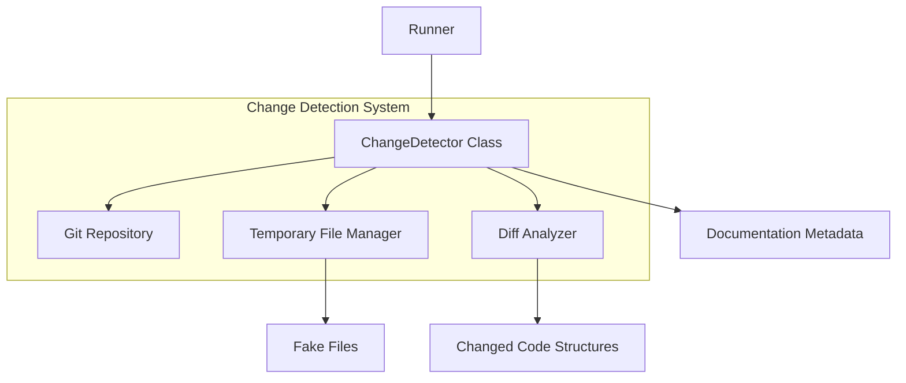
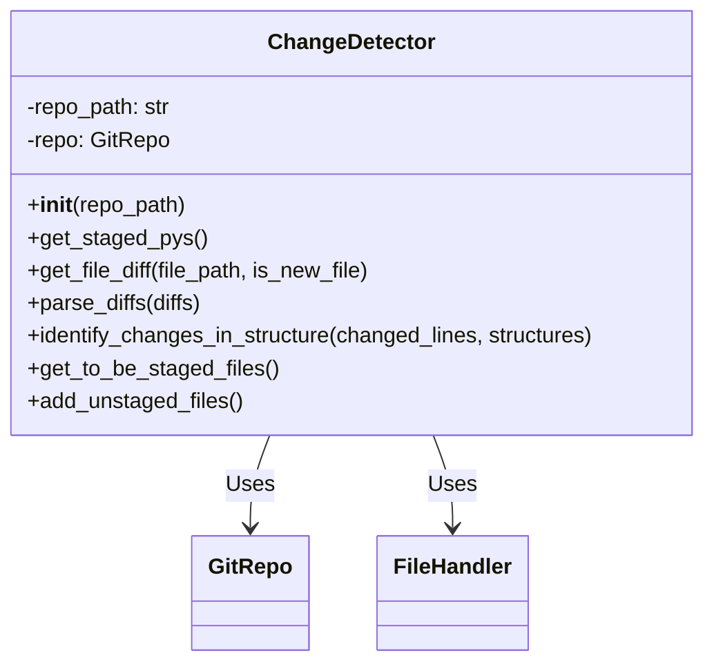
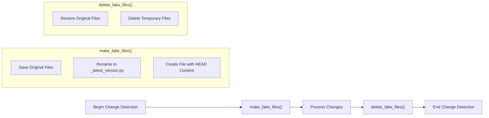
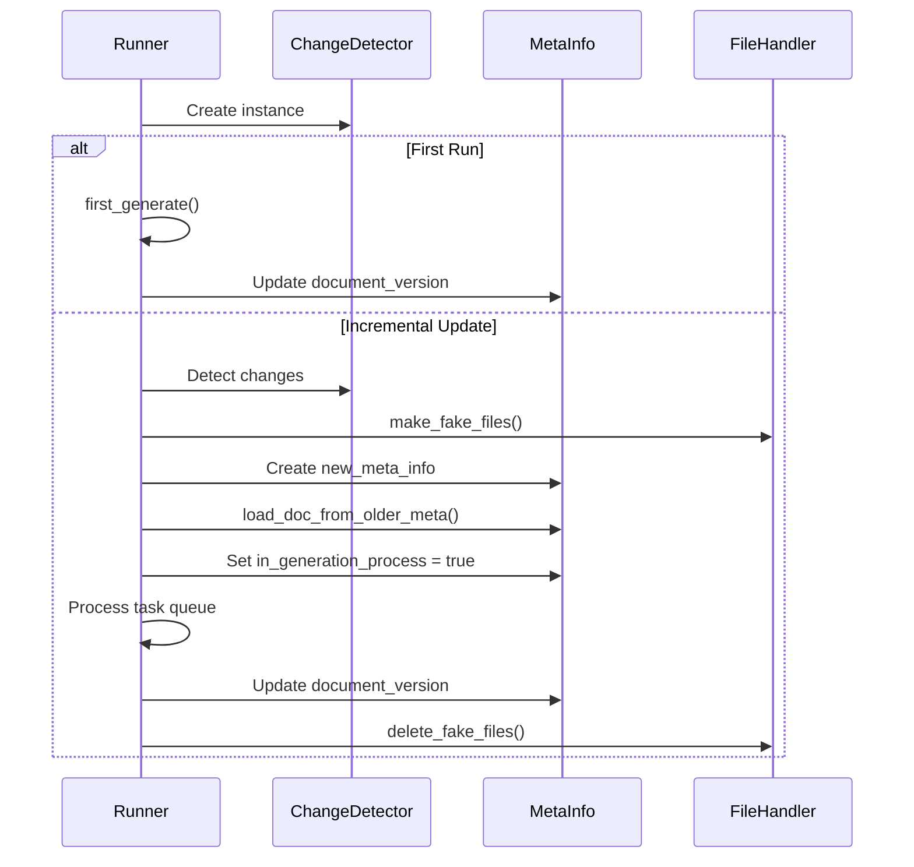
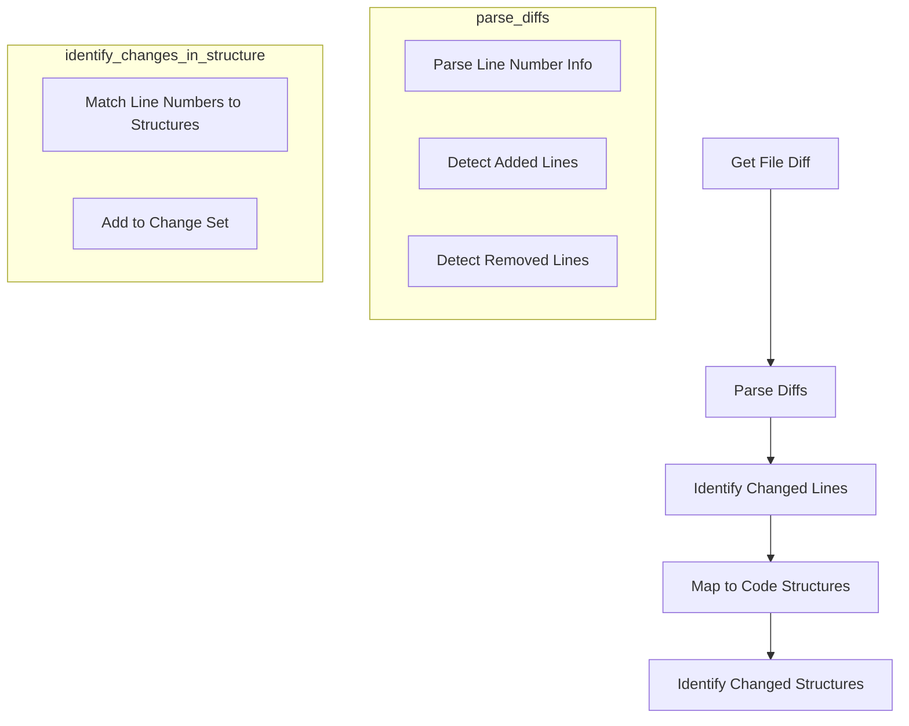

<!-- source: DeepWiki mcp.deepwiki.com · repo OpenBMB/RepoAgent · page 2.3 Change Detection System · fetched 2026-10-26 -->

# Change Detection System

<details>
<summary>Relevant source files</summary>

The following files were used as context for generating this wiki page:

- [.gitignore](.gitignore)
- [repo_agent/__main__.py](repo_agent/__main__.py)
- [repo_agent/change_detector.py](repo_agent/change_detector.py)
- [repo_agent/doc_meta_info.py](repo_agent/doc_meta_info.py)
- [repo_agent/runner.py](repo_agent/runner.py)
- [repo_agent/utils/meta_info_utils.py](repo_agent/utils/meta_info_utils.py)

</details>


The Change Detection System in RepoAgent is responsible for identifying modifications in a Git repository and determining which documentation needs to be updated. This system enables efficient incremental documentation updates by detecting code changes and triggering regeneration only for affected components rather than the entire codebase.

For information about the overall documentation generation process, see [Documentation Generation System](#2.1).

## System Overview

The Change Detection System monitors repository modifications through Git integration and determines what files or code objects have been changed since the last documentation update. It analyzes Git diffs to identify added, modified, and deleted code structures (such as classes, functions, and methods), enabling precise targeting of documentation updates.



Sources: [repo_agent/change_detector.py:1-287](), [repo_agent/runner.py:278-281]()

## Key Components

### ChangeDetector Class

The `ChangeDetector` class is the central component responsible for interfacing with Git repositories and analyzing changes. It provides methods to detect staged files, retrieve file diffs, parse those diffs, and identify which code structures have been affected by changes.



Sources: [repo_agent/change_detector.py:12-286]()

Key methods in the `ChangeDetector` class:

- `get_staged_pys()`: Identifies Python files that have been staged in Git, returning a dictionary of file paths and a boolean indicating whether each file is new
- `get_file_diff(file_path, is_new_file)`: Retrieves the Git diff for a specific file
- `parse_diffs(diffs)`: Parses diff content to extract added and removed line information
- `identify_changes_in_structure(changed_lines, structures)`: Determines which functions or classes have been modified based on changed lines
- `add_unstaged_files()`: Adds unstaged documentation files to the Git staging area

Sources: [repo_agent/change_detector.py:31-268]()

### Temporary File Management

To handle unstaged changes in the repository, the system uses a temporary file mechanism implemented in the utility functions `make_fake_files()` and `delete_fake_files()`. This approach allows the system to preserve the original repository state while processing changes.



Sources: [repo_agent/utils/meta_info_utils.py:13-107]()

The temporary file system works as follows:

1. When changes are detected, the original file is renamed to include a `_latest_version.py` suffix
2. A new file with the original name is created containing the version from Git HEAD
3. This allows the system to compare the staged version with the working directory version
4. After processing, temporary files are deleted and original files are restored

Sources: [repo_agent/utils/meta_info_utils.py:13-79](), [repo_agent/utils/meta_info_utils.py:82-107]()

### Change Processing Workflow

The change detection process is integrated into the documentation generation workflow through the `Runner` class. When running a documentation update, the system follows these steps:



Sources: [repo_agent/runner.py:259-343]()

## Detection of Changed Code Structures

One of the most important features of the Change Detection System is its ability to identify which specific code structures (functions, classes, methods) have been modified. This is done through the following process:

1. Retrieve file diffs from Git
2. Parse diffs to identify added and removed lines
3. Map these lines to code structures using line number information
4. Determine which documentation needs to be regenerated



Sources: [repo_agent/change_detector.py:81-151]()

The output of this process is a dictionary of added and removed code structures, which is used to determine which documentation needs to be updated:

```
{'added': {('ClassName', None), ('FunctionName', 'ParentClass')}, 'removed': set()}
```

Sources: [repo_agent/change_detector.py:124-151]()

## Integration with Metadata System

The Change Detection System works closely with the `MetaInfo` class to track documentation status and manage incremental updates. Each code element in the metadata has a status that indicates whether its documentation is up-to-date or needs regeneration.

The `DocItemStatus` enum defines several states related to change detection:
- `doc_up_to_date`: Documentation is current and doesn't need updates
- `doc_has_not_been_generated`: Documentation hasn't been generated yet
- `code_changed`: Source code has been modified, requiring documentation updates
- `add_new_referencer`: New references to this object have been added
- `referencer_not_exist`: Previously existing references no longer exist

Sources: [repo_agent/doc_meta_info.py:76-82]()

When changes are detected, the system updates the status of affected code elements in the metadata, which then drives the documentation generation process.

## Change Detection in the Runner

The `Runner` class's `run()` method orchestrates the change detection and documentation update process:

1. Check if it's the first run by examining the `document_version` in metadata
2. If not the first run, create temporary files using `make_fake_files()`
3. Build new metadata from the current repository state
4. Load documentation from the older metadata
5. Compare old and new metadata to identify changes
6. Create a task queue for documentation regeneration
7. Process the task queue to update affected documentation
8. Update the document version to the current Git commit hash
9. Clean up temporary files

Sources: [repo_agent/runner.py:259-343]()

## Handling Special Cases

The Change Detection System also handles several special cases:

1. **New Files**: For entirely new files, the system generates documentation for all objects in the file
2. **Deleted Files**: When files are deleted, their documentation is automatically removed
3. **Unstaged Changes**: The system can detect and process changes that haven't been staged in Git yet
4. **Reference Changes**: When the references to a code object change, its documentation is updated even if the code itself hasn't changed

Sources: [repo_agent/runner.py:410-472](), [repo_agent/doc_meta_info.py:716-807]()

## Conclusion

The Change Detection System is a crucial component of RepoAgent that enables efficient incremental documentation updates. By detecting precisely which parts of the codebase have changed, it allows the system to regenerate only the necessary documentation, saving time and computational resources.

---

