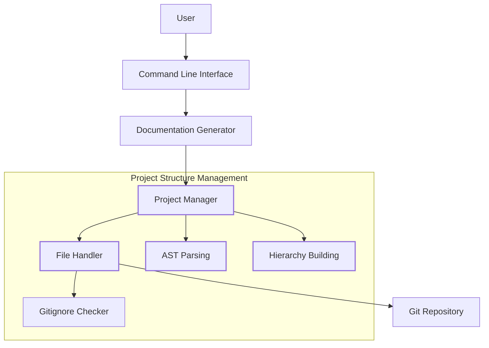
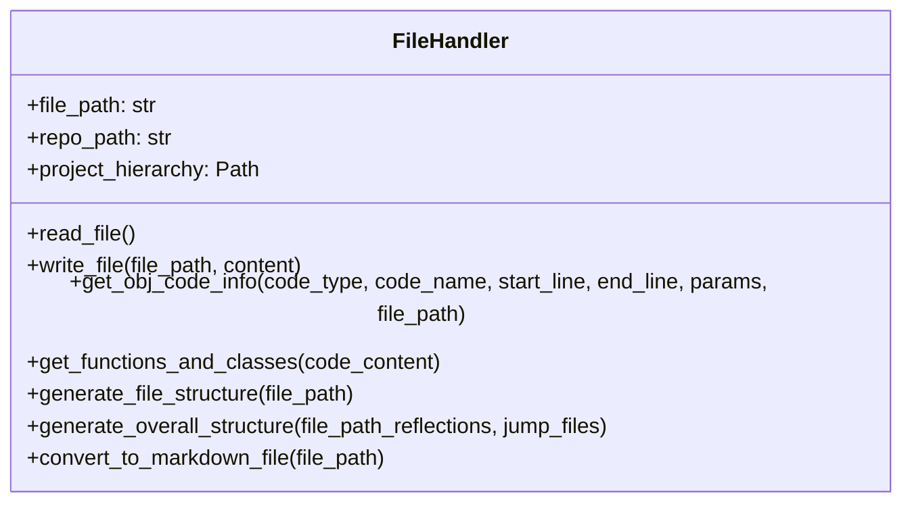
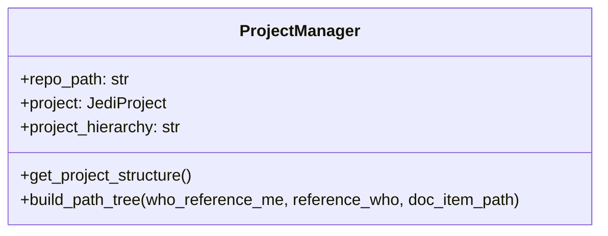
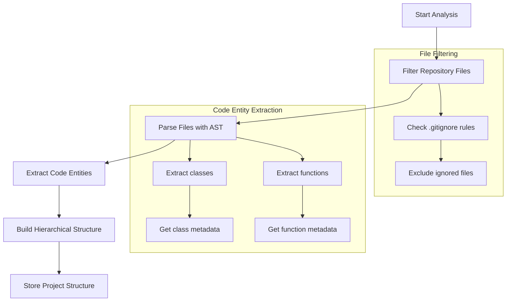
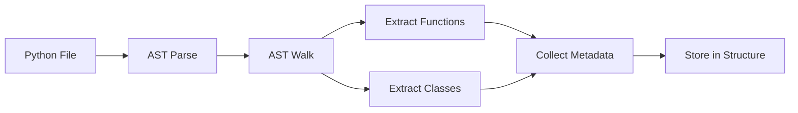
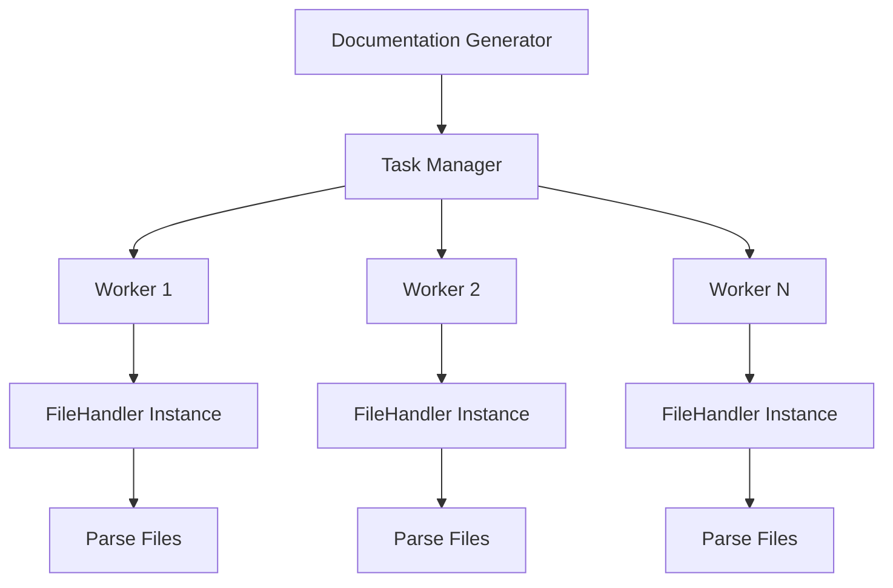

<!-- source: DeepWiki mcp.deepwiki.com · repo OpenBMB/RepoAgent · page 2.4 Project Structure Management · fetched 2026-10-26 -->

# Project Structure Management

<details>
<summary>Relevant source files</summary>

The following files were used as context for generating this wiki page:

- [repo_agent/file_handler.py](repo_agent/file_handler.py)
- [repo_agent/multi_task_dispatch.py](repo_agent/multi_task_dispatch.py)
- [repo_agent/project_manager.py](repo_agent/project_manager.py)

</details>


The Project Structure Management component in RepoAgent is responsible for analyzing and representing the hierarchical structure of a repository. This system extracts code entities (such as classes and functions), their relationships, and organizes them into a structured representation that can be used by other components, particularly the Documentation Generation System. This page explains how RepoAgent analyzes code repositories and builds their structural representation.

For information about how changes to this structure are detected, see [Change Detection System](#2.3). For details on how this structure is stored as metadata, see [Metadata Management](#2.2).

## 1. Overview

Project Structure Management provides a hierarchical view of a code repository by examining files, parsing code, and extracting relevant code entities. It builds a structured representation that serves as the foundation for documentation generation.



Sources: [repo_agent/project_manager.py:6-13](), [repo_agent/file_handler.py:17-31]()

## 2. Core Components

### 2.1 FileHandler

The `FileHandler` class is responsible for reading and writing files, parsing code content, and generating file structure information. It plays a critical role in analyzing individual files to extract their code structure.

Key responsibilities:
- Reading file content from the repository
- Parsing Python files to extract classes, functions, and their metadata
- Generating a structured representation of code entities
- Managing file operations for markdown generation



Sources: [repo_agent/file_handler.py:17-31](), [repo_agent/file_handler.py:32-43](), [repo_agent/file_handler.py:176-215](), [repo_agent/file_handler.py:217-256]()

### 2.2 ProjectManager

The `ProjectManager` class provides high-level repository structure management. It uses the Jedi library for Python code analysis and builds representations of the project's directory structure.

Key responsibilities:
- Walking through directories to build a project structure
- Building path trees to represent relationships between code elements
- Managing the project's overall hierarchical representation



Sources: [repo_agent/project_manager.py:6-13](), [repo_agent/project_manager.py:14-36](), [repo_agent/project_manager.py:38-69]()

## 3. Code Structure Analysis Process

RepoAgent analyzes code repositories through a systematic process to extract the hierarchical structure and metadata of code elements.



Sources: [repo_agent/file_handler.py:258-305](), [repo_agent/file_handler.py:176-215]()

### 3.1 Repository File Analysis

The system walks through the repository, filtering files based on Git rules and file extensions:

1. **File Traversal**: The system recursively walks through the repository directory
2. **Filter Application**: Files are filtered based on `.gitignore` rules and file extensions
3. **File Processing**: Each valid file is processed to extract its code structure

Sources: [repo_agent/file_handler.py:258-305](), [repo_agent/project_manager.py:14-36]()

### 3.2 Code Parsing and Entity Extraction

For each file, the system uses Python's Abstract Syntax Tree (AST) to parse the code and extract relevant entities:



The `get_functions_and_classes` method in `FileHandler` extracts:
- Function and class definitions
- Start and end line numbers
- Function parameters
- Hierarchical relationships between elements

Sources: [repo_agent/file_handler.py:176-215](), [repo_agent/file_handler.py:142-160]()

## 4. Data Structures

### 4.1 Repository Structure Representation

The project structure is represented as a nested dictionary with the following key elements:

| Level | Description | Example |
|-------|-------------|---------|
| File Path | Path to the file relative to repo root | `"repo_agent/file_handler.py"` |
| Code Entities | List of dictionaries representing functions/classes | List of code information dictionaries |
| Entity Metadata | Information about each code entity | Type, name, line numbers, parameters, etc. |

Example structure (simplified):

```
{
  "repo_agent/file_handler.py": [
    {
      "type": "ClassDef",
      "name": "FileHandler",
      "code_start_line": 17,
      "code_end_line": 362,
      "params": [],
      "md_content": [...]
    },
    {
      "type": "FunctionDef",
      "name": "read_file",
      "code_start_line": 32,
      "code_end_line": 43,
      "params": ["self"],
      "md_content": [...]
    }
    // ... other functions
  ],
  // ... other files
}
```

Sources: [repo_agent/file_handler.py:217-256](), [repo_agent/file_handler.py:45-94]()

### 4.2 File Structure Generation

The `generate_file_structure` method creates a detailed representation of a single file's structure:

1. Reads the file content
2. Parses the content to extract functions and classes
3. Collects metadata for each code entity
4. Returns a list of code entity information dictionaries

The resulting structure captures essential information about each code entity, including:
- Entity type (function, class, async function)
- Entity name
- Start and end line numbers
- Parameters (for functions)
- Code content

Sources: [repo_agent/file_handler.py:217-256](), [repo_agent/file_handler.py:45-94]()

## 5. Integration with Task Management

For large repositories, structure analysis can be computationally intensive. RepoAgent uses a task management system to parallelize this work.



The `TaskManager` class:
- Manages dependencies between tasks
- Distributes file processing work across multiple workers
- Coordinates the completion of tasks
- Ensures all files are processed efficiently

Sources: [repo_agent/multi_task_dispatch.py:11-101](), [repo_agent/multi_task_dispatch.py:103-126]()

## 6. Usage in Documentation Generation

The project structure information produced by this system forms the foundation for documentation generation:

1. **Structure Discovery**: The system analyzes the repository to identify all code entities
2. **Metadata Creation**: Detailed information about each entity is collected
3. **Hierarchical Organization**: Entities are organized into a hierarchical structure
4. **Documentation Generation**: The structured information is used to generate documentation with appropriate context

This structured approach ensures that documentation accurately reflects the codebase's organization and captures important relationships between code elements.

Sources: [repo_agent/file_handler.py:258-305](), [repo_agent/file_handler.py:307-362]()

## 7. Summary

Project Structure Management is a critical component of RepoAgent that:
- Analyzes repository content to extract code structure
- Builds a hierarchical representation of the codebase
- Provides detailed metadata about code entities
- Supports the documentation generation process

By creating a comprehensive representation of the repository's structure, this system enables more accurate and contextually relevant documentation generation.

---

