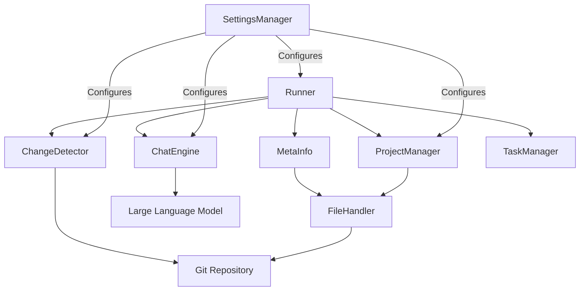
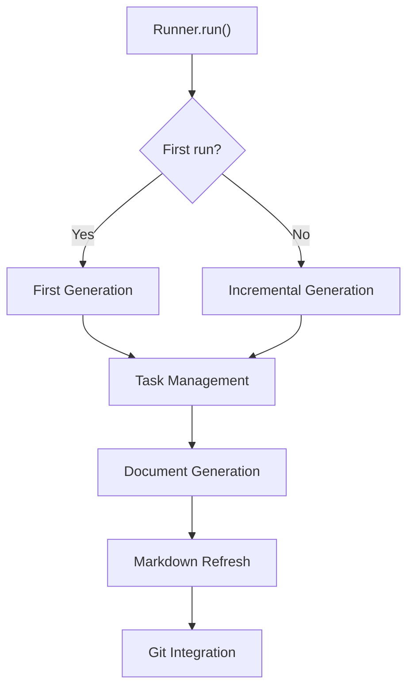
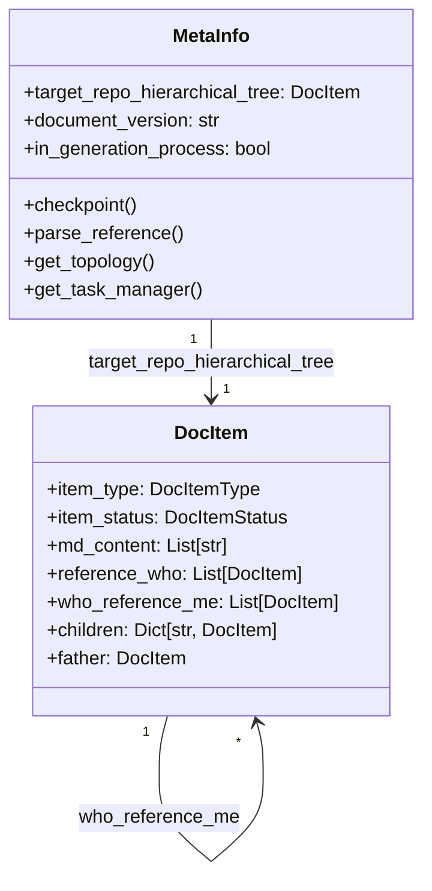
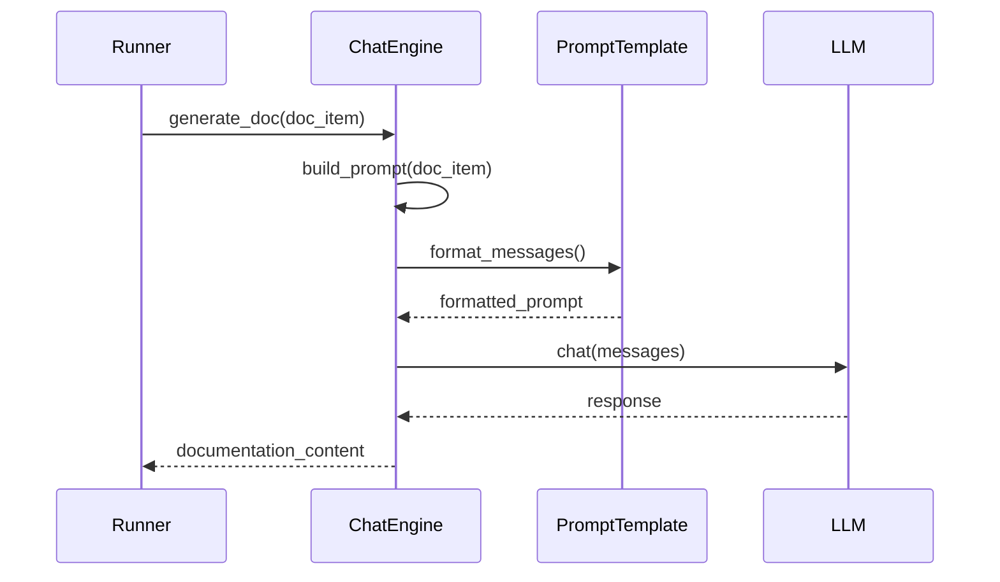
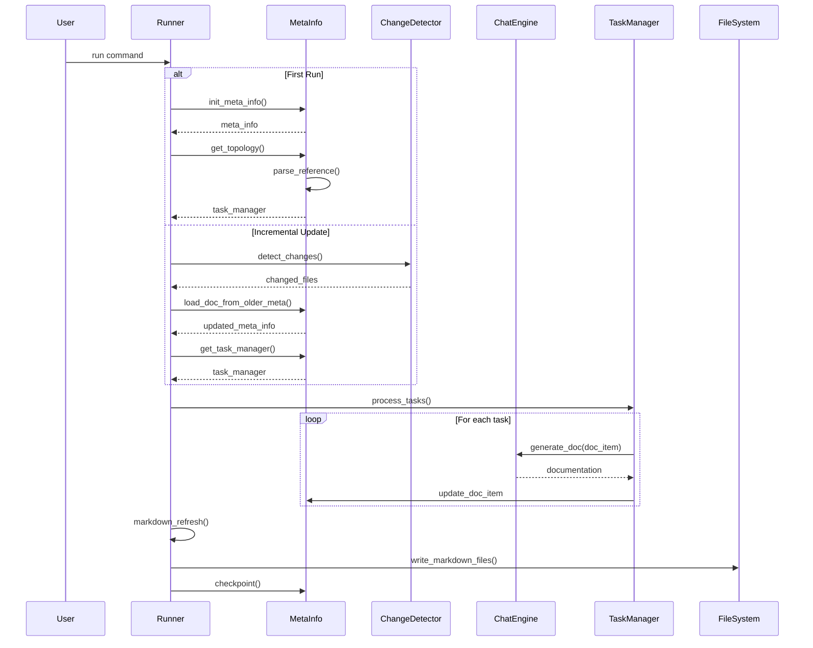
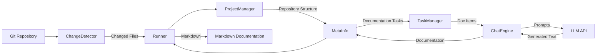

<!-- source: DeepWiki mcp.deepwiki.com · repo OpenBMB/RepoAgent · page 3 Key Components · fetched 2026-10-26 -->

# Key Components

Relevant source files

The following files were used as context for generating this wiki page:

- [README.md](README.md)
- [README_CN.md](README_CN.md)
- [repo_agent/chat_engine.py](repo_agent/chat_engine.py)
- [repo_agent/chat_with_repo/__init__.py](repo_agent/chat_with_repo/__init__.py)
- [repo_agent/doc_meta_info.py](repo_agent/doc_meta_info.py)
- [repo_agent/runner.py](repo_agent/runner.py)

This page provides an overview of the primary components that make up the RepoAgent system and how they interact to enable automated documentation generation for code repositories. For information about the detailed architecture, see [Core Architecture](#2) and for specific processes like document generation, see [Documentation Generation System](#2.1).

## System Component Overview

RepoAgent is structured around several key components that work together to analyze code, generate documentation, and track changes. The following diagram illustrates the main components and their relationships:

Sources:
- [repo_agent/runner.py:25-56](repo_agent/runner.py:25-56)
- [repo_agent/chat_engine.py:9-26](repo_agent/chat_engine.py:9-26)
- [repo_agent/doc_meta_info.py:327-344](repo_agent/doc_meta_info.py:327-344)

## Core Components and Their Functions

### Runner

The Runner serves as the central orchestrator of the documentation generation process. It initializes all other components, manages the workflow, and coordinates between different systems.

Key responsibilities:
- Initializes the project structure and metadata
- Detects repository changes
- Manages documentation generation tasks
- Refreshes markdown output files
- Coordinates with Git for version tracking

Sources:
- [repo_agent/runner.py:25-56](repo_agent/runner.py:25-56)
- [repo_agent/runner.py:259-343](repo_agent/runner.py:259-343)

### MetaInfo

The MetaInfo component maintains the hierarchical structure of the repository and tracks the documentation status of each code element. It's essential for both initial documentation generation and incremental updates.

Key features:
- Represents repository structure as a tree hierarchy (DocItem objects)
- Tracks documentation status for each code element
- Manages bidirectional reference relationships between code objects
- Creates topological ordering for dependency-aware documentation generation
- Persists metadata between runs through checkpointing

Sources:
- [repo_agent/doc_meta_info.py:327-344](repo_agent/doc_meta_info.py:327-344)
- [repo_agent/doc_meta_info.py:346-419](repo_agent/doc_meta_info.py:346-419)
- [repo_agent/doc_meta_info.py:500-615](repo_agent/doc_meta_info.py:500-615)

### ChatEngine

The ChatEngine is responsible for interacting with Large Language Models (LLMs) to generate documentation for code elements. It constructs prompts with relevant context about the code and its relationships.

Key functions:
- Initializes connection to LLM API
- Builds prompts containing code content and context
- Includes reference relationships in prompts to improve documentation quality
- Processes LLM responses into documentation content

Sources:
- [repo_agent/chat_engine.py:9-26](repo_agent/chat_engine.py:9-26)
- [repo_agent/chat_engine.py:27-115](repo_agent/chat_engine.py:27-115)
- [repo_agent/chat_engine.py:116-132](repo_agent/chat_engine.py:116-132)

### ChangeDetector

The ChangeDetector identifies modified files and code structures by analyzing Git diffs. This enables efficient incremental documentation updates by focusing only on changed elements.

Key capabilities:
- Integrates with Git to retrieve repository changes
- Parses Git diffs to identify changed lines
- Maps changed lines to code structures (functions, classes)
- Identifies which documentation needs to be updated

Sources:
- [repo_agent/runner.py:429-436](repo_agent/runner.py:429-436)

### ProjectManager

The ProjectManager analyzes and represents the hierarchical structure of a repository. It's responsible for generating a tree-like representation of the codebase.

Key responsibilities:
- Analyzes repository structure
- Builds hierarchical representation of files and code objects
- Helps identify reference relationships between code elements

Sources:
- [repo_agent/runner.py:32-35](repo_agent/runner.py:32-35)

### FileHandler

The FileHandler component handles file operations, including reading and parsing code files, and writing documentation output.

Key functions:
- Reads and processes code files
- Parses Python code to identify functions and classes
- Extracts code structure information
- Writes generated documentation to markdown files

Sources:
- [repo_agent/runner.py:157-232](repo_agent/runner.py:157-232)

### TaskManager

The TaskManager component handles the coordination of parallel documentation tasks, ensuring that dependencies between code elements are respected during documentation generation.

Key capabilities:
- Manages task dependencies based on code references
- Provides parallel execution of documentation generation
- Ensures documentation is generated in the correct order

Sources:
- [repo_agent/doc_meta_info.py:617-696](repo_agent/doc_meta_info.py:617-696)

## Component Interactions for Documentation Generation

The following diagram illustrates how the key components interact during the documentation generation process:

Sources:
- [repo_agent/runner.py:101-151](repo_agent/runner.py:101-151)
- [repo_agent/runner.py:259-343](repo_agent/runner.py:259-343)

## Path From Repository to Documentation

The following diagram shows the complete path from a code repository to generated documentation:

Sources:
- [repo_agent/runner.py:101-151](repo_agent/runner.py:101-151)
- [repo_agent/runner.py:157-232](repo_agent/runner.py:157-232)
- [repo_agent/runner.py:259-343](repo_agent/runner.py:259-343)

## Document Object Model

The core data structure in RepoAgent is the DocItem class, which represents code elements in a hierarchical tree. The following table shows the key attributes of a DocItem:

| Attribute | Type | Description |
|-----------|------|-------------|
| item_type | DocItemType | Type of the code element (file, class, function, etc.) |
| item_status | DocItemStatus | Current documentation status (up-to-date, changed, etc.) |
| obj_name | str | Name of the code object |
| md_content | List[str] | Generated documentation content |
| children | Dict[str, DocItem] | Child objects within this element |
| father | DocItem | Parent element |
| reference_who | List[DocItem] | Objects this element references |
| who_reference_me | List[DocItem] | Objects that reference this element |

Sources:
- [repo_agent/doc_meta_info.py:110-141](repo_agent/doc_meta_info.py:110-141)

## Task Coordination and Dependencies

RepoAgent uses a topological ordering algorithm to determine the sequence of documentation generation, ensuring that code objects are documented in the correct order based on their dependencies. This approach:

1. Identifies all reference relationships between code elements
2. Creates a directed graph of dependencies
3. Sorts objects topologically to determine generation order
4. Handles cycles in reference relationships with a best-effort approach

This ensures that when documenting a particular code element, documentation for all referenced elements is already available, resulting in more comprehensive and contextually aware documentation.

Sources:
- [repo_agent/doc_meta_info.py:617-696](repo_agent/doc_meta_info.py:617-696)

## Conclusion

RepoAgent's key components form a well-structured system for automated code documentation. The Runner orchestrates the overall process, while the MetaInfo maintains the repository structure and documentation status. The ChatEngine handles interaction with LLMs for document generation, and the ChangeDetector identifies which parts of the code base need documentation updates. Together, these components enable efficient, context-aware documentation generation that stays synchronized with the codebase as it evolves.

---

