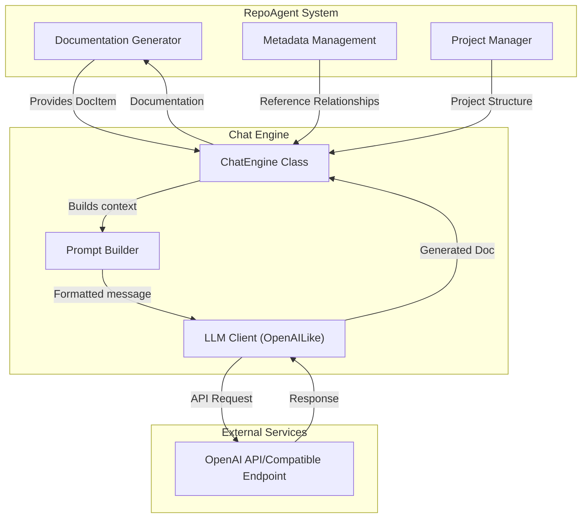
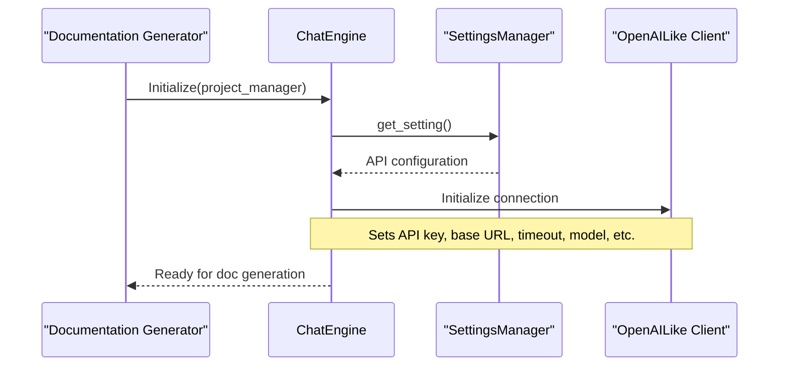
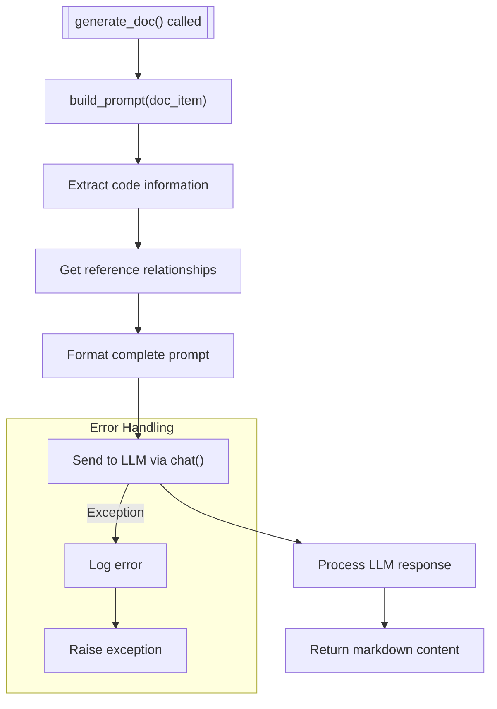
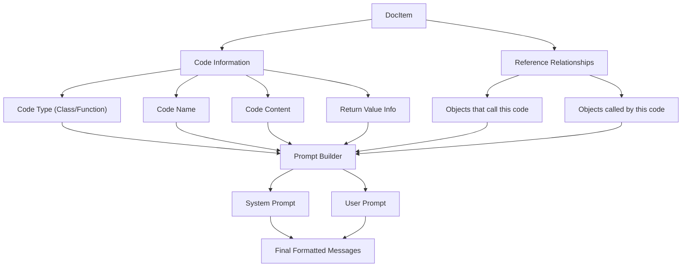
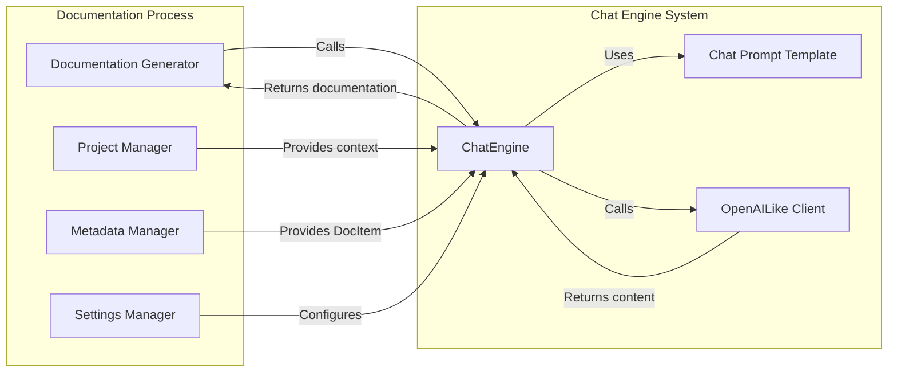

<!-- source: DeepWiki mcp.deepwiki.com · repo OpenBMB/RepoAgent · page 3.1 Chat Engine · fetched 2026-10-26 -->

# Chat Engine

Relevant source files

The following files were used as context for generating this wiki page:

- [repo_agent/chat_engine.py](repo_agent/chat_engine.py)
- [repo_agent/prompt.py](repo_agent/prompt.py)

The Chat Engine is a core component of RepoAgent that interfaces with Large Language Models (LLMs) to generate documentation for code elements such as functions and classes. It is responsible for constructing context-rich prompts and managing interactions with the LLM API to produce high-quality code documentation.

For information about RAG-based chat interactions with repositories, see [Chat with Repository Feature](#4) and [RAG System](#4.1).

## Overview

The Chat Engine serves as the bridge between RepoAgent's code analysis components and external LLM services. It takes structured code information as input and returns natural language documentation that explains the purpose, parameters, and behavior of code elements.

Sources: [repo_agent/chat_engine.py:9-133]()

## Architecture

The Chat Engine is implemented as a Python class that encapsulates LLM communication logic and prompt engineering techniques. It works closely with the Documentation Generator (Runner) and uses predefined prompt templates to create effective LLM instructions.

### Key Components

| Component | Description | Implementation |
|-----------|-------------|----------------|
| ChatEngine | Main class that orchestrates documentation generation | [repo_agent/chat_engine.py:9-133]() |
| OpenAILike | Client for communicating with LLM APIs | Initialized in [repo_agent/chat_engine.py:17-25]() |
| Prompt Templates | Structured templates for LLM interactions | Defined in [repo_agent/prompt.py:4-49]() |

### Initialization Process

The Chat Engine is initialized with a reference to the project manager and establishes a connection to the LLM API using configuration from the Settings Manager:

Sources: [repo_agent/chat_engine.py:14-25]()

## Core Functionality

The Chat Engine provides two primary functions:

1. Building context-rich prompts that incorporate code content and relationships
2. Generating documentation by sending these prompts to the LLM and handling responses

### Documentation Generation Process

Sources: [repo_agent/chat_engine.py:116-132]()

### Code Structure

The `ChatEngine` class contains these key methods:

1. `__init__`: Initializes the LLM client with settings from the configuration.
2. `build_prompt`: Constructs detailed prompts with code context and relationships.
3. `generate_doc`: Sends prompts to the LLM and returns documentation content.

Auxiliary methods within `build_prompt` handle the extraction of reference relationships:
- `get_referenced_prompt`: Builds context about objects that the current code references.
- `get_referencer_prompt`: Builds context about objects that reference the current code.
- `get_relationship_description`: Creates appropriate instructions about relationship documentation.

Sources: [repo_agent/chat_engine.py:9-133]()

## Prompt Construction

The prompt construction process is a critical aspect of the Chat Engine's functionality. It determines the quality and relevance of the generated documentation by providing the LLM with sufficient context about the code and its relationships.

### Prompt Components

Sources: [repo_agent/chat_engine.py:27-114](), [repo_agent/prompt.py:4-49]()

### Prompt Template Structure

The prompt template is divided into two main parts:

1. **System Prompt**: Contains detailed instructions for documentation generation, including:
   - The role and task for the AI
   - Project structure context
   - File path and code element information
   - Formatting requirements for the documentation

2. **User Prompt**: Contains additional guidelines for tone and approach

The template is designed to produce standardized documentation with the following sections:
- Function summary (code name and description)
- Parameters or attributes
- Detailed code description
- Usage notes
- Output examples (when applicable)

Sources: [repo_agent/prompt.py:4-49]()

## Integration with Other Components

The Chat Engine integrates with several other components within the RepoAgent system:

### Integration Points

1. **Documentation Generator (Runner)**:
   - Passes DocItems to the Chat Engine for documentation generation
   - Receives generated documentation for storage and display

2. **Project Manager**:
   - Provides project structure information for context enrichment

3. **Metadata Manager**:
   - Supplies DocItems with reference relationships information
   - Stores generated documentation

4. **Settings Manager**:
   - Provides configuration for LLM connections
   - Controls language and other documentation settings

Sources: [repo_agent/chat_engine.py:14-25](), [repo_agent/chat_engine.py:27-29]()

## Error Handling and Logging

The Chat Engine implements error handling to manage potential issues with LLM API communication:

1. All LLM interactions are wrapped in try-except blocks
2. Errors are logged with detailed information
3. Token usage is logged for debugging and monitoring purposes

This approach helps diagnose issues with prompt construction or API communication.

Sources: [repo_agent/chat_engine.py:120-132]()

## Usage Example

When the Documentation Generator needs documentation for a specific code element:

1. It creates a DocItem containing code content and reference relationships
2. Passes this DocItem to `ChatEngine.generate_doc()`
3. Chat Engine builds a context-rich prompt using `build_prompt()`
4. The prompt is sent to the LLM via the OpenAILike client
5. The response is processed and returned as formatted documentation text
6. The generated documentation is stored in the DocItem's metadata

Sources: [repo_agent/chat_engine.py:116-132]()

---

