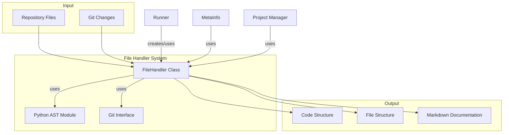
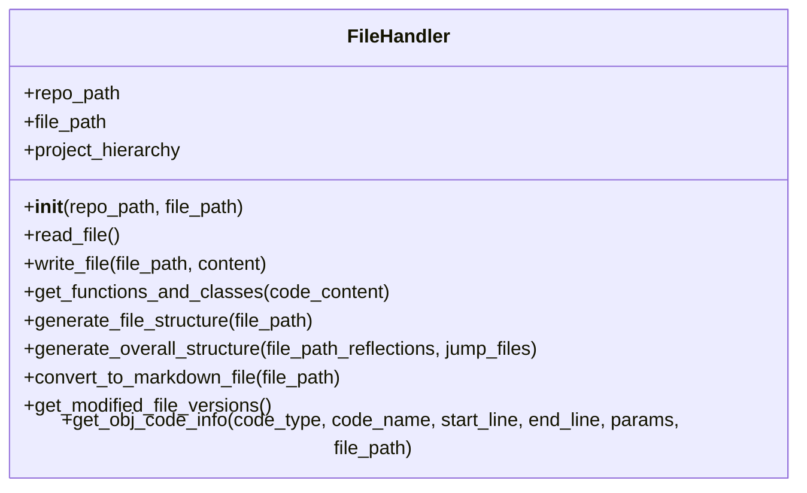
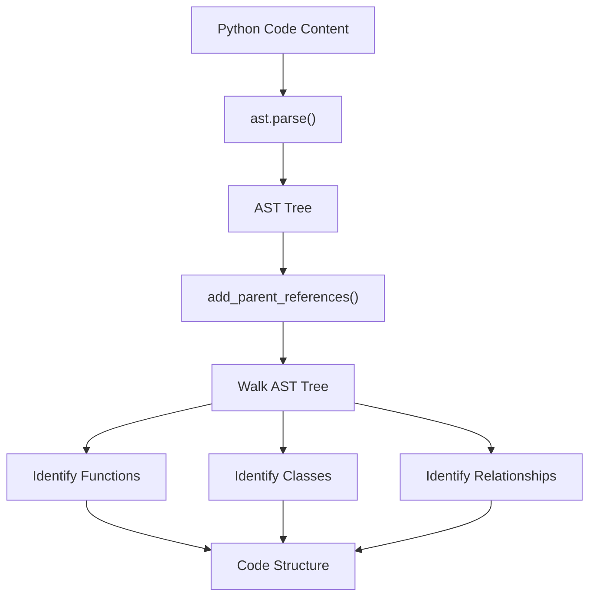
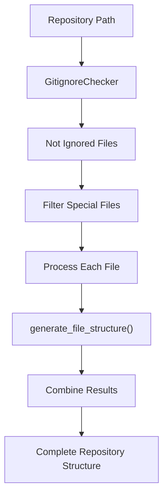
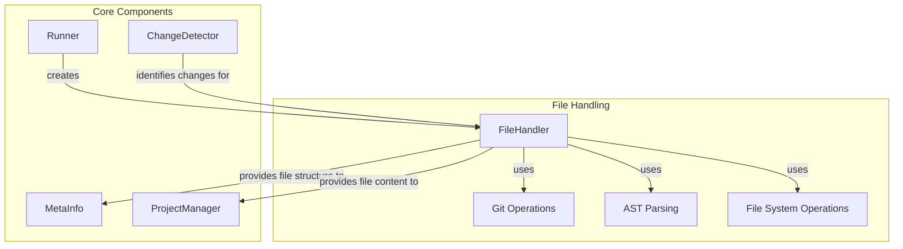

<!-- source: DeepWiki mcp.deepwiki.com · repo OpenBMB/RepoAgent · page 3.2 File Handler and Parsing · fetched 2026-10-26 -->

# File Handler and Parsing

<details>
<summary>Relevant source files</summary>

The following files were used as context for generating this wiki page:

- [repo_agent/doc_meta_info.py](repo_agent/doc_meta_info.py)
- [repo_agent/file_handler.py](repo_agent/file_handler.py)
- [repo_agent/runner.py](repo_agent/runner.py)

</details>


The File Handler component in RepoAgent is responsible for reading, parsing, and processing code files within a repository. It serves as the foundational layer that extracts code structure and content, which is essential for the documentation generation process. This page covers how RepoAgent interacts with repository files, parses code to identify functions, classes, and their relationships, and provides this information to higher-level components.

For information about how the extracted code structures are represented in the documentation metadata system, see [Metadata Management](#2.2).

## 1. Component Overview

The File Handler acts as a bridge between the raw code files in a repository and the structured representation needed for documentation generation. Its primary responsibilities include:

- Reading and writing files in the repository
- Parsing Python code to extract functions, classes, and other structures
- Generating hierarchical representations of file and repository structure
- Supporting Git operations to detect and handle file changes
- Converting code structures to Markdown documentation



Sources: [repo_agent/file_handler.py:17-18](), [repo_agent/runner.py:17](), [repo_agent/doc_meta_info.py:18]()

## 2. Core Implementation

The `FileHandler` class is implemented in `file_handler.py` and serves as the primary interface for interacting with files in the repository.

### 2.1 Class Initialization

The `FileHandler` is initialized with a repository path and a file path. The file path is relative to the repository root.



Sources: [repo_agent/file_handler.py:17-31]()

### 2.2 File Operations

The `FileHandler` provides methods for reading from and writing to files in the repository:

- `read_file()`: Reads the content of the specified file
- `write_file(file_path, content)`: Writes content to a specified file, creating directories if needed
- `get_modified_file_versions()`: Retrieves both current and previous versions of a file using Git

Sources: [repo_agent/file_handler.py:32-44](), [repo_agent/file_handler.py:96-113](), [repo_agent/file_handler.py:114-140]()

## 3. Code Parsing and Structure Extraction

One of the most critical functions of the `FileHandler` is parsing Python code to extract its structure.

### 3.1 AST-Based Parsing

The `FileHandler` uses Python's Abstract Syntax Tree (AST) module to parse code and identify functions, classes, and their hierarchical relationships.



Sources: [repo_agent/file_handler.py:176-215](), [repo_agent/file_handler.py:162-174]()

### 3.2 Function and Class Extraction

The `get_functions_and_classes` method extracts all functions and classes from a Python file, including:
- Function/class name
- Start and end line numbers
- Parameters for functions
- Type of the construct (FunctionDef, ClassDef, AsyncFunctionDef)

This extracted information is crucial for generating accurate documentation about code elements.

Example output format:
```
[
    ('FunctionDef', 'function_name', 10, 20, ['param1', 'param2']),
    ('ClassDef', 'ClassName', 25, 50, [])
]
```

Sources: [repo_agent/file_handler.py:176-215]()

### 3.3 Line Number Determination

The `get_end_lineno` method determines the ending line number for a code construct by recursively examining its child nodes:

Sources: [repo_agent/file_handler.py:142-160]()

## 4. File and Repository Structure Generation

The `FileHandler` builds structured representations of individual files and the entire repository.

### 4.1 File Structure Generation

The `generate_file_structure` method creates a structured representation of a single file, extracting all code objects (functions and classes) with their metadata.

Example output:
```json
{
    "function_name": {
        "type": "function",
        "start_line": 10,
        "end_line": 20,
        "parent": "class_name",
        "params": ["param1", "param2"]
    },
    "class_name": {
        "type": "class",
        "start_line": 5,
        "end_line": 25,
        "parent": null
    }
}
```

Sources: [repo_agent/file_handler.py:217-256]()

### 4.2 Repository-Wide Structure Generation

The `generate_overall_structure` method creates a comprehensive representation of the entire repository by processing all relevant files. It handles special cases like:

- Respecting `.gitignore` rules to skip ignored files
- Handling unstaged changes
- Skipping special files (such as temporary or generated files)



Sources: [repo_agent/file_handler.py:258-305]()

## 5. Code Object Information Extraction

The `get_obj_code_info` method extracts detailed information about a specific code object (function or class):

| Information | Description |
|-------------|-------------|
| type | The type of the code construct (FunctionDef, ClassDef, etc.) |
| name | The name of the function or class |
| code_start_line | The line number where the construct begins |
| code_end_line | The line number where the construct ends |
| params | List of parameters for functions |
| have_return | Boolean indicating if a function has a return statement |
| code_content | The actual code content of the construct |
| name_column | The column position where the name appears |

This detailed information provides the context needed for LLMs to generate meaningful documentation.

Sources: [repo_agent/file_handler.py:45-94]()

## 6. Markdown Conversion

The `convert_to_markdown_file` method transforms the structured representation of a file into Markdown documentation:

1. Reads the file structure from the project hierarchy JSON
2. Determines the hierarchical level of each code construct
3. Formats the documentation with appropriate Markdown headings and content
4. Adds separators between top-level objects

The generated Markdown preserves the hierarchical structure of the code, making the documentation intuitive to navigate.

Sources: [repo_agent/file_handler.py:307-362]()

## 7. Integration with Other Components

The `FileHandler` integrates with multiple core components of RepoAgent:



Sources: [repo_agent/runner.py:424-427](), [repo_agent/doc_meta_info.py:355-356]()

### 7.1 Runner Interaction

The `Runner` component creates `FileHandler` instances to process files that have changed:
- For processing file changes detected by the `ChangeDetector`
- To generate documentation for new files
- To update documentation for modified files

Sources: [repo_agent/runner.py:424-427](), [repo_agent/runner.py:294-305]()

### 7.2 MetaInfo Interaction

The `MetaInfo` component uses `FileHandler` to:
- Initialize the metadata representation of the repository
- Generate the overall repository structure
- Parse code for detecting reference relationships between code elements

Sources: [repo_agent/doc_meta_info.py:355-356]()

## 8. Git Integration

The `FileHandler` leverages Git to:
1. Retrieve previous versions of files for comparison
2. Support the change detection process
3. Work with both committed and uncommitted changes

This Git integration enables RepoAgent to identify precisely what has changed in the code and update documentation accordingly.

Sources: [repo_agent/file_handler.py:114-140]()

## Summary

The File Handler component serves as the foundation for RepoAgent's documentation generation system by:
1. Extracting code structure through AST parsing
2. Building hierarchical representations of files and the repository
3. Providing detailed code information needed for documentation generation
4. Converting code structures to Markdown documentation
5. Integrating with Git to handle code changes

This component bridges the gap between raw code files and the structured information needed by higher-level components to generate meaningful documentation.

---

