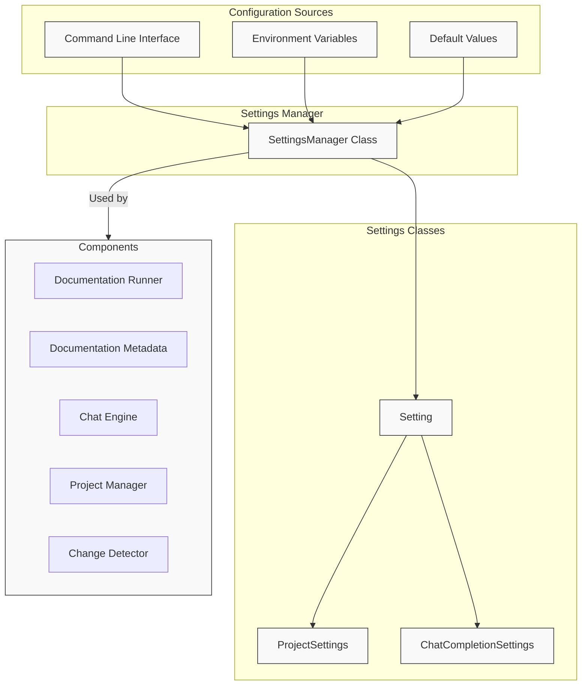
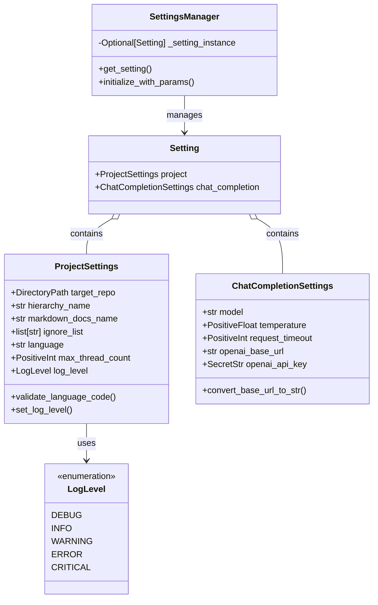
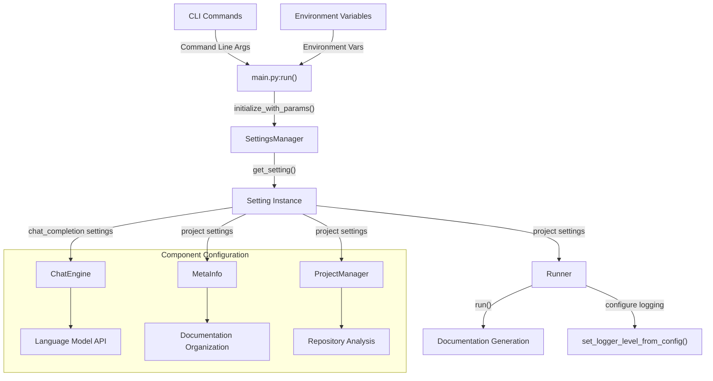

<!-- source: DeepWiki mcp.deepwiki.com · repo OpenBMB/RepoAgent · page 3.3 Settings and Configuration · fetched 2026-10-26 -->

# Settings and Configuration

<details>
<summary>Relevant source files</summary>

The following files were used as context for generating this wiki page:

- [pdm.lock](pdm.lock)
- [pyproject.toml](pyproject.toml)
- [repo_agent/log.py](repo_agent/log.py)
- [repo_agent/main.py](repo_agent/main.py)
- [repo_agent/settings.py](repo_agent/settings.py)
- [requirements.txt](requirements.txt)

</details>


This document describes the configuration framework of RepoAgent, which controls the behavior of documentation generation, language model interactions, and output formats. The configuration system is designed to be flexible and accessible through both command-line arguments and environment variables.

## Overview

RepoAgent uses a Pydantic-based settings system that validates all configuration inputs to ensure they meet required constraints before the application runs. The settings are organized into logical categories that control different aspects of the application.



Sources: [repo_agent/settings.py:1-128](), [repo_agent/main.py:1-244]()

## Settings Structure

RepoAgent's configuration is divided into two primary categories:

1. **Project Settings**: Control repository-specific configurations like target paths, documentation organization, and processing preferences.
2. **Chat Completion Settings**: Configure the behavior of the language model, including model selection, temperature, and API endpoints.

These settings are managed by the `SettingsManager` class, which implements a singleton-like pattern to ensure consistent configuration access throughout the application.



Sources: [repo_agent/settings.py:18-78]()

## Configuration Sources

RepoAgent supports multiple configuration sources with the following precedence order (highest to lowest):

1. Command-line arguments
2. Environment variables
3. Default values

### Command-Line Interface

The CLI provides a comprehensive set of options to configure RepoAgent:

```
repoagent run [OPTIONS]
```

Key options include:

| Option | Default | Description |
|--------|---------|-------------|
| `--model`, `-m` | gpt-4o-mini | LLM model to use for completion |
| `--temperature`, `-t` | 0.2 | Generation temperature |
| `--request-timeout`, `-r` | 60 | API request timeout in seconds |
| `--base-url`, `-b` | https://api.openai.com/v1 | Base URL for API calls |
| `--target-repo-path`, `-tp` | "" | Path to target repository |
| `--hierarchy-path`, `-hp` | .project_doc_record | Path for project hierarchy file |
| `--markdown-docs-path`, `-mdp` | markdown_docs | Path for Markdown documentation |
| `--ignore-list`, `-i` | "" | Comma-separated list of files/dirs to ignore |
| `--language`, `-l` | English | Language for documentation |
| `--max-thread-count`, `-mtc` | 4 | Maximum thread count for parallel processing |
| `--log-level`, `-ll` | INFO | Logging level |
| `--print-hierarchy`, `-pr` | False | Print hierarchy after task completion |

Sources: [repo_agent/main.py:47-182]()

### Environment Variables

All settings can also be configured via environment variables. The naming convention follows Pydantic's pattern:

- For project settings: `PROJECT_*` (e.g., `PROJECT_TARGET_REPO`)
- For chat completion settings: `CHAT_COMPLETION_*` (e.g., `CHAT_COMPLETION_MODEL`)

The OpenAI API key must be provided via the `CHAT_COMPLETION_OPENAI_API_KEY` environment variable.

Sources: [repo_agent/settings.py:26-58]()

## Using the Settings Manager

The `SettingsManager` provides two primary methods to access and initialize settings:

### Getting Existing Settings

```python
from repo_agent.settings import SettingsManager

# Get the current settings instance
settings = SettingsManager.get_setting()

# Access specific setting categories
project_settings = settings.project
chat_settings = settings.chat_completion

# Access individual settings
target_repo = settings.project.target_repo
model_name = settings.chat_completion.model
```

### Initializing Settings with Parameters

```python
SettingsManager.initialize_with_params(
    target_repo="/path/to/repo",
    hierarchy_name=".doc_record",
    markdown_docs_name="docs",
    ignore_list=["venv", "node_modules"],
    language="Japanese",
    max_thread_count=8,
    log_level="DEBUG",
    model="gpt-4o",
    temperature=0.1,
    request_timeout=120,
    openai_base_url="https://api.example.com/v1"
)
```

Sources: [repo_agent/settings.py:76-123](), [repo_agent/main.py:155-173]()

## Project Settings Details

The `ProjectSettings` class contains settings related to the repository and documentation organization:

| Setting | Type | Default | Description |
|---------|------|---------|-------------|
| `target_repo` | DirectoryPath | "" | Path to the target repository |
| `hierarchy_name` | str | ".project_doc_record" | Name of the hierarchy file |
| `markdown_docs_name` | str | "markdown_docs" | Name of the markdown docs folder |
| `ignore_list` | list[str] | [] | List of files/paths to ignore |
| `language` | str | "English" | Documentation language |
| `max_thread_count` | PositiveInt | 4 | Maximum number of threads for parallelization |
| `log_level` | LogLevel | INFO | Logging level |

The `language` setting is validated against ISO 639 codes, allowing both language codes and names (e.g., "en", "English", "ja", "Japanese").

Sources: [repo_agent/settings.py:26-56]()

## Chat Completion Settings Details

The `ChatCompletionSettings` class configures the language model behavior:

| Setting | Type | Default | Description |
|---------|------|---------|-------------|
| `model` | str | "gpt-4o-mini" | Model identifier |
| `temperature` | PositiveFloat | 0.2 | Generation temperature (0.0-1.0) |
| `request_timeout` | PositiveInt | 60 | API request timeout in seconds |
| `openai_base_url` | str | "https://api.openai.com/v1" | Base URL for API calls |
| `openai_api_key` | SecretStr | (required) | API key for OpenAI or compatible service |

Sources: [repo_agent/settings.py:58-68]()

## Configuration Flow in RepoAgent

The following diagram illustrates how settings flow through RepoAgent's components:



Sources: [repo_agent/main.py:140-182](), [repo_agent/settings.py:76-123](), [repo_agent/log.py:64-88]()

## Validation and Error Handling

The configuration system implements robust validation and error handling:

1. Pydantic validation ensures all settings have proper types and meet constraints.
2. Field validators provide custom validation for specific fields:
   - `language` is validated against ISO 639 codes
   - `log_level` is converted to the appropriate enum value
   - URLs are properly formatted

When validation errors occur, the CLI provides user-friendly error messages:

```python
def handle_setting_error(e: ValidationError):
    """Handle configuration errors for settings."""
    for error in e.errors():
        field = error["loc"][-1]
        if error["type"] == "missing":
            message = click.style(
                f"Missing required field `{field}`. Please set the `{field}` environment variable.",
                fg="yellow",
            )
        else:
            message = click.style(error["msg"], fg="yellow")
        click.echo(message, err=True, color=True)

    raise click.ClickException(
        click.style(
            "Program terminated due to configuration errors.", fg="red", bold=True
        )
    )
```

Sources: [repo_agent/main.py:25-45](), [repo_agent/settings.py:35-54]()

## Logging Configuration

RepoAgent uses the Loguru library for logging, which is configured based on the `log_level` setting:

```python
def set_logger_level_from_config(log_level):
    """
    Configures the loguru logger with specified log level and integrates it with the standard logging module.
    """
    logger.remove()
    logger.add(
        sys.stderr, level=log_level, enqueue=True, backtrace=False, diagnose=False
    )

    # Intercept standard logging
    logging.basicConfig(handlers=[InterceptHandler()], level=0, force=True)

    logger.success(f"Log level set to {log_level}!")
```

The logging system supports multiple levels (DEBUG, INFO, WARNING, ERROR, CRITICAL) and includes thread-safe operation with queue-based logging.

Sources: [repo_agent/log.py:64-88]()

## Best Practices

When configuring RepoAgent, consider the following best practices:

1. **API Key Security**: Always use environment variables or secure credential management for the OpenAI API key.
2. **Thread Count Optimization**: Set `max_thread_count` based on your machine's capabilities and available CPU cores.
3. **Temperature Settings**: Lower temperature (0.0-0.3) for more deterministic documentation, higher (0.4-0.8) for more creative outputs.
4. **Model Selection**: Choose larger models (like gpt-4o) for complex codebases and smaller models (like gpt-4o-mini) for simpler projects.
5. **Logging Level**: Use INFO for normal operation, DEBUG for troubleshooting issues, and ERROR for minimal output.

Sources: [repo_agent/settings.py:1-128](), [repo_agent/main.py:47-182]()

## Common Configuration Examples

### Basic Configuration for Local Repository

```bash
# Set required environment variable
export CHAT_COMPLETION_OPENAI_API_KEY=your_api_key_here

# Run RepoAgent with minimal customization
repoagent run --target-repo-path ./my-project --language English
```

### Advanced Configuration with Custom LLM Endpoint

```bash
# Using a different LLM provider or self-hosted endpoint
export CHAT_COMPLETION_OPENAI_API_KEY=your_api_key_here

repoagent run \
  --target-repo-path ./complex-project \
  --model gpt-4o \
  --temperature 0.1 \
  --base-url https://custom-llm-provider.example.com/v1 \
  --max-thread-count 12 \
  --log-level DEBUG \
  --ignore-list node_modules,.git,build,dist \
  --language Japanese
```

Sources: [repo_agent/main.py:47-182](), [repo_agent/settings.py:1-128]()

---

